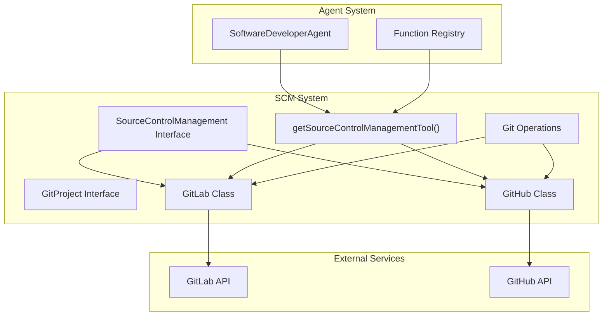
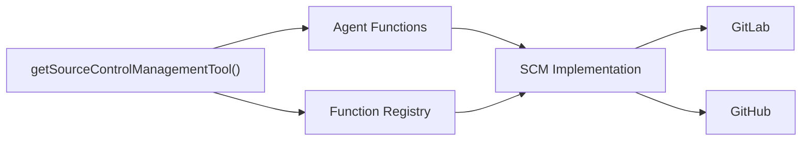
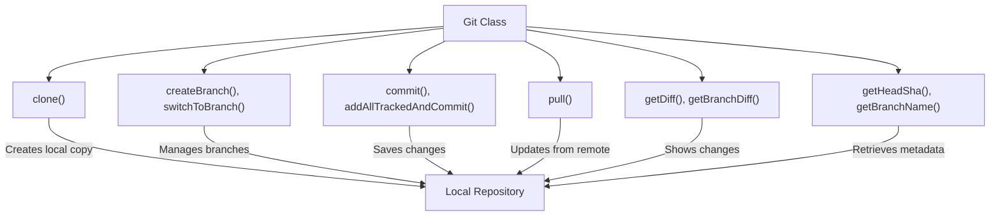
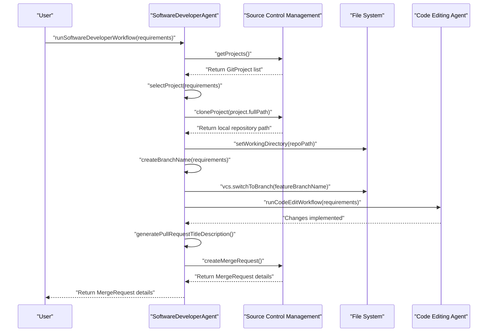
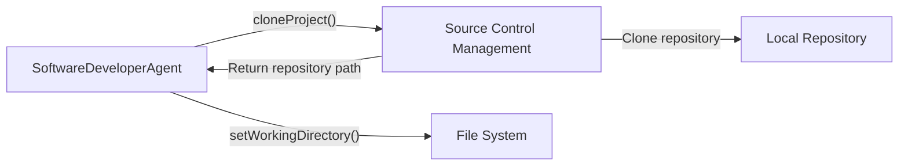
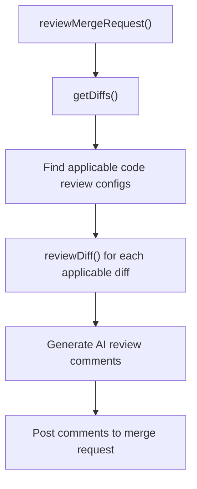
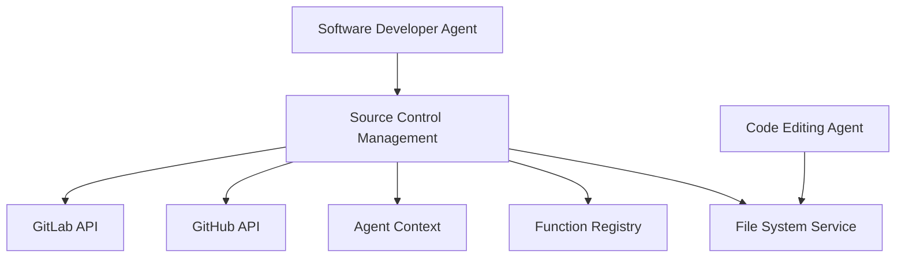

<!-- source: DeepWiki mcp.deepwiki.com · repo TrafficGuard/typedai · page 5.1 Source Control Management · fetched 2026-10-26 -->

# Source Control Management

<details>
<summary>Relevant source files</summary>

The following files were used as context for generating this wiki page:

- [src/functionSchema/functionSchemaParser.ts](src/functionSchema/functionSchemaParser.ts)
- [src/functions/scm/git.ts](src/functions/scm/git.ts)
- [src/functions/scm/gitProject.ts](src/functions/scm/gitProject.ts)
- [src/functions/scm/github.int.ts](src/functions/scm/github.int.ts)
- [src/functions/scm/github.ts](src/functions/scm/github.ts)
- [src/functions/scm/gitlab.ts](src/functions/scm/gitlab.ts)
- [src/functions/scm/sourceControlManagement.ts](src/functions/scm/sourceControlManagement.ts)
- [src/swe/analyzeCompileErrors.ts](src/swe/analyzeCompileErrors.ts)
- [src/swe/documentationBuilder.ts](src/swe/documentationBuilder.ts)
- [src/swe/projectDetection.ts](src/swe/projectDetection.ts)
- [src/swe/pullRequestTitleDescription.ts](src/swe/pullRequestTitleDescription.ts)
- [src/swe/reviewChanges.ts](src/swe/reviewChanges.ts)
- [src/swe/selectProject.ts](src/swe/selectProject.ts)
- [src/swe/softwareDeveloperAgent.ts](src/swe/softwareDeveloperAgent.ts)

</details>


## Purpose and Scope

This document details the Source Control Management (SCM) system within TypedAI, which provides integration with Git services like GitHub and GitLab. The SCM system enables TypedAI agents to interact with repositories, manage branches, create merge/pull requests, and analyze code changes. This system is a key component that allows AI agents to autonomously participate in software development workflows.

For information about file system operations used within repositories, see [File System Operations](#5.3). For details about how the code editing agent works with files, see [Code Editing Agent](#5.2).

## Overview

The SCM system provides a uniform interface for interacting with different Git hosting services while offering provider-specific functionality when needed. It abstracts the complexities of Git operations and API interactions, presenting a consistent set of operations for agent workflows.



Sources: [src/functions/scm/sourceControlManagement.ts:1-43](), [src/functions/scm/gitlab.ts:1-33](), [src/functions/scm/github.ts:1-33]()

## Core Interfaces and Classes

### SourceControlManagement Interface

The `SourceControlManagement` interface defines the contract that all SCM implementations must fulfill. It provides methods for repository management and interactions with Git hosting services.

```typescript
interface SourceControlManagement {
    getProjects(): Promise<GitProject[]>;
    cloneProject(projectPathWithNamespace: string, branchOrCommit?: string): Promise<string>;
    createMergeRequest(projectId: string | number, title: string, description: string, sourceBranch: string, targetBranch: string): Promise<MergeRequest>;
    getJobLogs(projectPath: string, jobId: string): Promise<string>;
}
```

Sources: [src/functions/scm/sourceControlManagement.ts:5-23]()

### GitProject Interface

The `GitProject` interface provides a common representation of Git repositories across different providers.

```typescript
interface GitProject {
    id: number;
    name: string;
    namespace: string;
    fullPath: string;
    description: string | null;
    defaultBranch: string;
    visibility: string;
    archived: boolean;
    extra?: Record<string, any>;
}
```

Sources: [src/functions/scm/gitProject.ts:1-17]()

### SCM Factory Function

The `getSourceControlManagementTool()` function acts as a factory that provides access to the appropriate SCM implementation. It searches for SCM implementations in the agent context or falls back to the function registry.



Sources: [src/functions/scm/sourceControlManagement.ts:25-43]()

## Provider Implementations

### GitLab Implementation

The `GitLab` class implements the `SourceControlManagement` interface for GitLab repositories. It offers functionality for:

1. Project management
2. Repository cloning
3. Merge request creation and analysis
4. Pipeline and job information retrieval
5. Code review functionality

Configuration is handled through user-specific settings or environment variables:

```typescript
export interface GitLabConfig {
    host: string;
    token: string;
    secretName?: string;
    secretProject?: string;
    topLevelGroups: string[];
    groupExcludes?: Set<string>;
}
```

Sources: [src/functions/scm/gitlab.ts:34-42](), [src/functions/scm/gitlab.ts:77-100]()

### GitHub Implementation

The `GitHub` class implements the `SourceControlManagement` interface for GitHub repositories with similar functionality to the GitLab implementation.

Configuration is specific to GitHub:

```typescript
export interface GitHubConfig {
    username: string;
    organisation: string;
    token: string;
}
```

Sources: [src/functions/scm/github.ts:16-20](), [src/functions/scm/github.ts:26-92]()

## Git Operations

The `Git` class provides low-level Git operations for repository management, independent of the hosting service:

1. Clone repositories
2. Create and switch branches
3. Commit changes
4. Pull updates
5. Retrieve diffs and repository information



Sources: [src/functions/scm/git.ts:12-166]()

## SCM in the Software Development Workflow

The SCM system plays a crucial role in the TypedAI Software Developer Agent workflow. The agent uses SCM to:

1. Select appropriate repositories for a task
2. Clone repositories locally
3. Create feature branches
4. Implement changes through the Code Editing Agent
5. Create merge/pull requests with the changes



Sources: [src/swe/softwareDeveloperAgent.ts:29-91]()

### Project Selection

The SCM system helps identify the appropriate repository for implementing requirements. The agent can either use a specified repository or search through available projects.

```typescript
async selectProject(requirements: string): Promise<GitProject> {
    const scm: SourceControlManagement = getSourceControlManagementTool();
    const projects: GitProject[] = await scm.getProjects();
    // ... LLM-based selection of the appropriate project
}
```

Sources: [src/swe/selectProject.ts:1-17]()

### Repository Cloning

Once a project is selected, the SCM system clones it locally:



Sources: [src/functions/scm/gitlab.ts:130-241](), [src/functions/scm/github.ts:73-116]()

### Project Information Detection

After cloning, the system detects project-specific information, including:

1. Programming language/runtime
2. Project structure
3. Development branch configuration
4. Build and test commands

This information guides subsequent operations like branch creation and code editing.

```typescript
export interface ProjectInfo extends ProjectScripts {
    baseDir: string;
    language: LanguageRuntime | '';
    languageTools: LanguageTools | null;
    devBranch: string;
    fileSelection: string;
    indexDocs: string[];
}
```

Sources: [src/swe/projectDetection.ts:33-43]()

### Branch Management

The SCM system creates and manages feature branches for implementing changes:

```typescript
async createBranch(branchName: string): Promise<boolean> {
    this.previousBranch = await this.getBranchName();
    
    const { stdout, stderr, exitCode } = await execCommand(`git branch ${branchName}`);
    if (exitCode === 0) {
        return true;
    }
    if (exitCode > 0 && stderr?.includes('already exists')) {
        logger.info(`Branch ${branchName} already exists. Switching to it`);
        await this.switchToBranch(branchName);
        return false;
    }
    if (exitCode > 0) throw new Error(`${stdout}\n${stderr}`);
}
```

Sources: [src/functions/scm/git.ts:104-119]()

### Merge/Pull Request Creation

After implementing changes, the SCM system creates merge or pull requests for code review:

```typescript
async createMergeRequest(projectId: string | number, title: string, description: string, sourceBranch: string, targetBranch: string): Promise<MergeRequest> {
    // Push changes to remote
    const cmd = `git push --set-upstream origin '${sourceBranch}'`;
    const { exitCode, stdout, stderr } = await execCommand(cmd);
    if (exitCode > 0) throw new Error(`${stdout}\n${stderr}`);
    
    // Create merge request using provider-specific API
    const options: CreateMergeRequestOptions = { 
        description, 
        squash: true, 
        removeSourceBranch: true, 
        assigneeId: user?.id, 
        reviewerId: user?.id 
    };
    const mr: ExpandedMergeRequestSchema = await this.api().MergeRequests.create(
        projectId, 
        sourceBranch, 
        targetBranch, 
        title, 
        options
    );
    
    return {
        id: mr.id,
        iid: mr.iid,
        url: mr.web_url,
        title: mr.title,
    };
}
```

Sources: [src/functions/scm/gitlab.ts:251-277](), [src/functions/scm/github.ts:124-148]()

## Advanced SCM Features

### Code Review

For GitLab, the SCM system includes functionality for automated code review of merge requests:



The code review system:
1. Retrieves diffs from a merge request
2. Applies appropriate code review configurations based on file types and content
3. Generates AI-powered review comments
4. Posts comments to the merge request via the GitLab API

Sources: [src/functions/scm/gitlab.ts:367-431](), [src/functions/scm/gitlab.ts:458-523]()

### Pipeline Analysis

For GitLab projects, the SCM system can analyze CI/CD pipeline results and retrieve logs for failed jobs:

```typescript
async getLatestMergeRequestPipeline(gitlabProjectId: string | number, mergeRequestIId: number): Promise<PipelineWithJobs>
async getFailedJobLogs(gitlabProjectId: string | number, mergeRequestIId: number)
```

Sources: [src/functions/scm/gitlab.ts:279-336]()

## Configuration

SCM implementations are configured through user-specific settings or environment variables:

### GitLab Configuration

```typescript
private config(): GitLabConfig {
    if (!this._config) {
        const config = functionConfig(GitLab);
        this._config = {
            host: config.host || envVar('GITLAB_HOST'),
            token: config.token || envVar('GITLAB_TOKEN'),
            topLevelGroups: (config.topLevelGroups || envVar('GITLAB_GROUPS')).split(',').map((group: string) => group.trim()),
        };
    }
    return this._config;
}
```

Sources: [src/functions/scm/gitlab.ts:89-100]()

### GitHub Configuration

```typescript
config(): GitHubConfig {
    if (!this._config) {
        const userConfig = functionConfig(GitHub) as GitHubConfig;
        this._config = {
            username: userConfig.username || process.env.GITHUB_USER,
            organisation: userConfig.organisation || process.env.GITHUB_ORG,
            token: userConfig.token || envVar('GITHUB_TOKEN'),
        };
    }
    return this._config;
}
```

Sources: [src/functions/scm/github.ts:32-44]()

## Integration Points

The SCM system integrates with several other components of TypedAI:

1. **Software Developer Agent**: Uses SCM to implement software changes
2. **Function Registry**: Provides access to SCM implementations
3. **File System Service**: Used for working with local repositories
4. **Agent Context**: Stores SCM-related state during agent execution



Sources: [src/swe/softwareDeveloperAgent.ts:29-91](), [src/functions/scm/sourceControlManagement.ts:25-43]()

## Summary

The Source Control Management system provides a robust foundation for TypedAI's software development capabilities. By abstracting Git operations and service-specific APIs, it enables AI agents to interact with source code repositories in a natural and efficient manner. The system supports the complete software development workflow from repository selection to merge request creation, facilitating autonomous code contributions by AI agents.

Human Review: To get the most out of the SCM system, ensure that proper credentials are configured for the Git hosting services and that repositories have appropriate permissions for the operations being performed.

---

