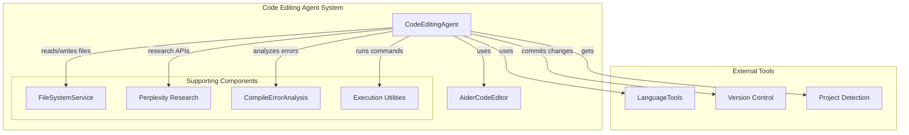
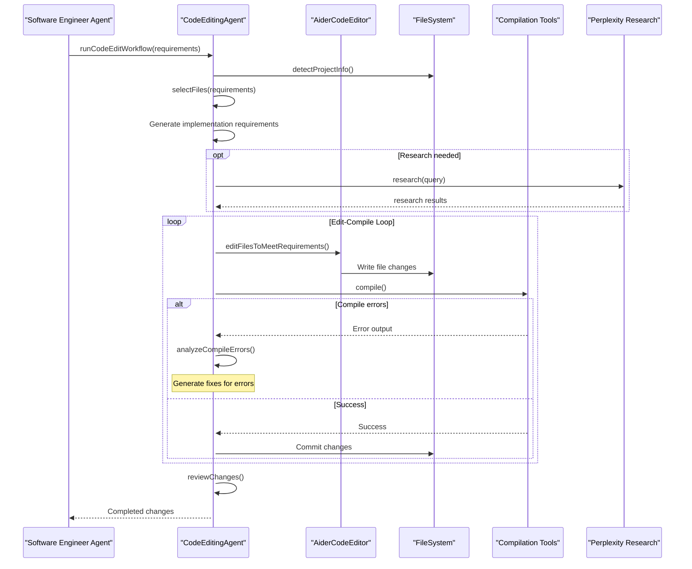
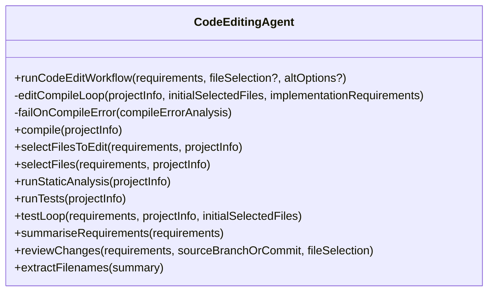
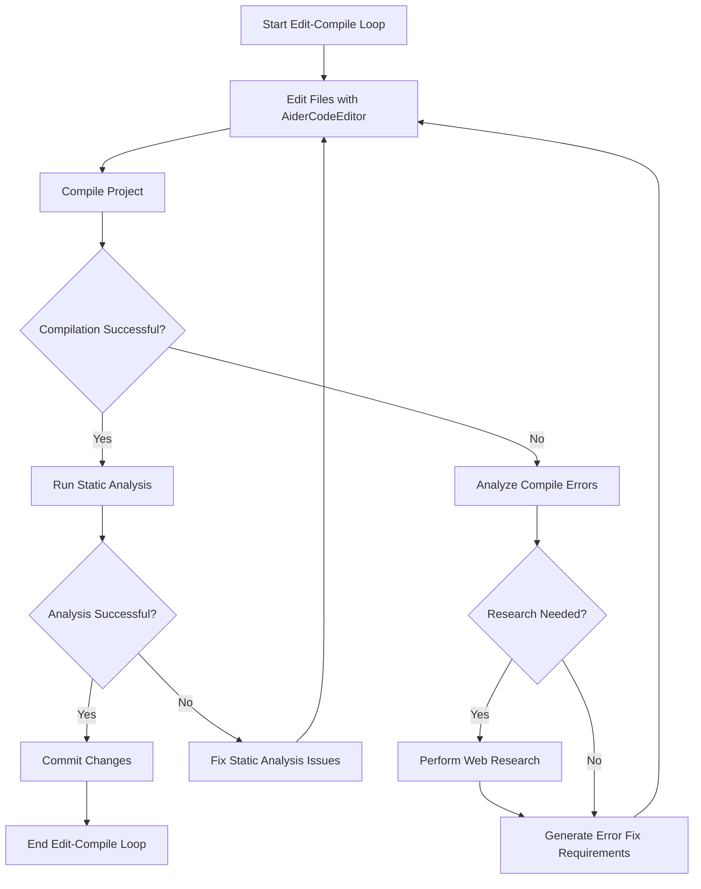
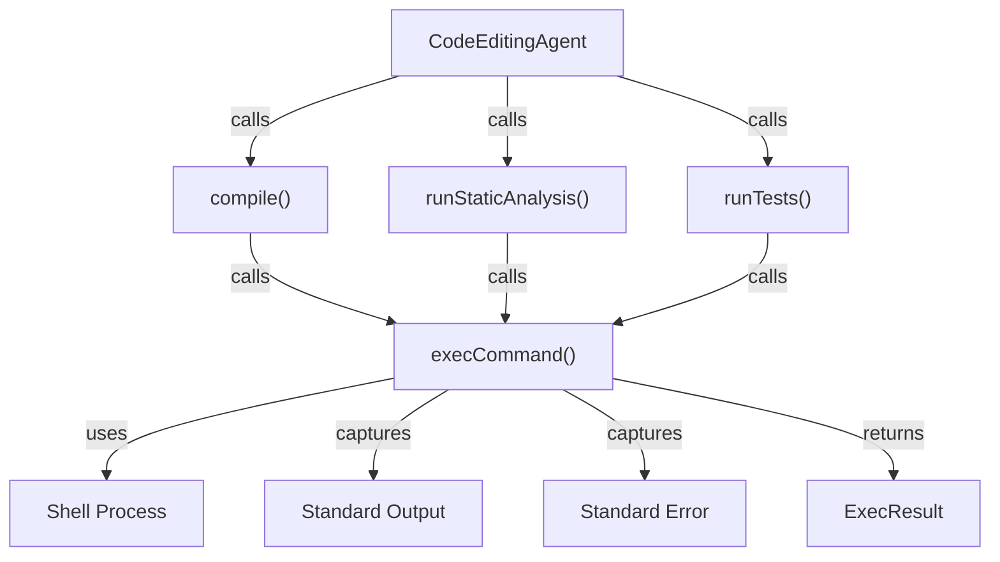

<!-- source: DeepWiki mcp.deepwiki.com · repo TrafficGuard/typedai · page 5.2 Code Editing Agent · fetched 2026-10-26 -->

# Code Editing Agent

Relevant source files

The following files were used as context for generating this wiki page:

- [src/swe/codeEditingAgent.ts](src/swe/codeEditingAgent.ts)
- [src/swe/lang/nodejs/typescriptTools.ts](src/swe/lang/nodejs/typescriptTools.ts)
- [src/utils/exec.ts](src/utils/exec.ts)

## Purpose and Overview

The Code Editing Agent is a specialized component within TypedAI that handles automated code modifications, compilation, and error correction. It serves as the core implementation behind automated software development tasks, working in conjunction with the Software Engineer Agent (see [Software Engineering Tools](#5)) to implement requirements through code changes.

This document details the architecture, workflow, and capabilities of the Code Editing Agent component. For information about source control management, see [Source Control Management](#5.1).

## Architecture Overview

The Code Editing Agent operates as part of an edit-compile feedback loop, making code changes and validating them through compilation to ensure correctness.

Sources: [src/swe/codeEditingAgent.ts:30-424]()

## Workflow Overview

The Code Editing Agent implements an iterative workflow that:
1. Detects project information
2. Selects relevant files for editing
3. Generates implementation requirements with optional web research
4. Executes an edit-compile loop until code is correct
5. Performs code review and addresses any issues

Sources: [src/swe/codeEditingAgent.ts:45-162]()

## Core Implementation

### CodeEditingAgent Class

The `CodeEditingAgent` class is the central implementation of the code editing functionality, providing methods to:
- Run the complete code editing workflow
- Manage the edit-compile loop
- Handle compilation and static analysis
- Process and fix compilation errors
- Review code changes

Sources: [src/swe/codeEditingAgent.ts:30-424]()

### Key Components

| Component | Role |
|-----------|------|
| `AiderCodeEditor` | Makes actual changes to code files |
| `CompileErrorAnalysis` | Analyzes compiler output to determine issues |
| `FileSystemService` | Manages file reading/writing and VCS operations |
| `Perplexity` | Performs web research when needed |
| `LanguageTools` | Provides language-specific functions |

Sources: [src/swe/codeEditingAgent.ts:1-17]()

## Edit-Compile Loop

The edit-compile loop is the core process where code changes are made and validated. The process works as follows:

1. Start with selected files and implementation requirements
2. Edit files using AiderCodeEditor
3. Compile the project
4. If there are compile errors:
   - Analyze errors to determine cause
   - Potentially search online for solutions
   - Generate fix requirements
   - Make changes to fix errors
5. If compilation succeeds:
   - Optionally run static analysis
   - Review changes
   - Commit changes

Sources: [src/swe/codeEditingAgent.ts:172-326]()

## File Selection

Before editing can begin, the agent must determine which files need to be modified. This is handled by two methods:
- `selectFilesToEdit`: Uses an AI-driven approach to identify relevant files
- `selectFiles`: A simplified version that returns a list of selected files

The selected files are then provided to the AiderCodeEditor for making changes.

Sources: [src/swe/codeEditingAgent.ts:348-356]()

## Requirements Processing

The agent transforms high-level requirements into detailed implementation specifications:

1. It first gathers repository and package information
2. Generates comprehensive implementation requirements using an LLM
3. Determines if web research is needed for external APIs or techniques
4. If research is needed, uses Perplexity to gather information
5. Combines research results with implementation requirements

This comprehensive specification is then provided to the AiderCodeEditor to guide code changes.

Sources: [src/swe/codeEditingAgent.ts:91-139]()

## Compile Error Handling

A critical aspect of the Code Editing Agent is its ability to handle and fix compilation errors automatically:

1. When compilation fails, the error output is captured and analyzed
2. The `analyzeCompileErrors` function extracts key information:
   - Summary of compile issues
   - Specific error messages
   - Files involved in errors
   - Potential package dependencies needed
   - Research queries for solving complex errors
3. If the agent has made multiple attempts to fix the same error, it tracks error history
4. Web research may be performed to find solutions for specific errors
5. A specialized set of requirements focused on fixing the errors is generated
6. The AiderCodeEditor is then tasked with fixing the errors before continuing

Sources: [src/swe/codeEditingAgent.ts:229-252]()

## Command Execution

The Code Editing Agent relies heavily on executing shell commands for operations like:
- Compiling code
- Running static analysis
- Installing packages
- Running tests

These operations are performed using the execution utilities from `exec.ts`, which provide:
- Error handling and formatting
- Command output capture
- Environment variable management
- Shell detection and configuration

Sources: [src/swe/codeEditingAgent.ts:328-345](), [src/utils/exec.ts:152-191]()

## Language-Specific Tools Integration

The Code Editing Agent integrates with language-specific tools to handle package management, compilation, and other language-specific operations. For TypeScript/Node.js projects, this includes:

1. Package management:
   - Detecting package manager (npm, yarn, pnpm)
   - Installing dependencies
   - Retrieving installed package information

2. TypeScript-specific operations:
   - Running npm scripts
   - Generating project type definitions
   - Managing TypeScript compilation

3. Environment setup:
   - Setting NODE_ENV appropriately
   - Managing nvm when present
   - Handling language-specific error messages

Sources: [src/swe/lang/nodejs/typescriptTools.ts:13-118]()

## Code Review and Refinement

After successful compilation, the agent performs a review of the changes:

1. It compares the changes against the original requirements
2. Identifies any inconsistencies or improvements
3. If issues are found, it generates a new set of requirements focusing on the review items
4. Runs another edit-compile loop to address review findings

This ensures the final code not only compiles correctly but also meets the intended requirements and maintains code quality.

Sources: [src/swe/codeEditingAgent.ts:145-158]()

## Conclusion

The Code Editing Agent represents a sophisticated approach to automated code editing, leveraging AI to understand requirements, make appropriate code changes, and handle the complexities of compilation and error correction. It forms a core part of TypedAI's software engineering capabilities, enabling automated implementation of code changes while maintaining quality and correctness.

---

