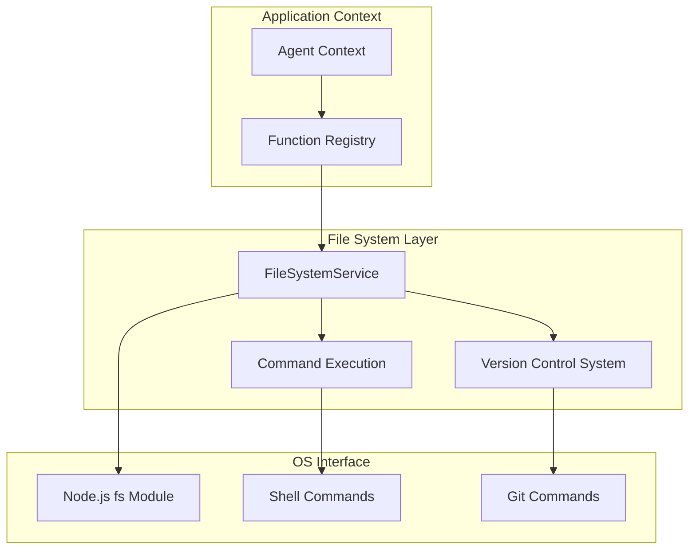
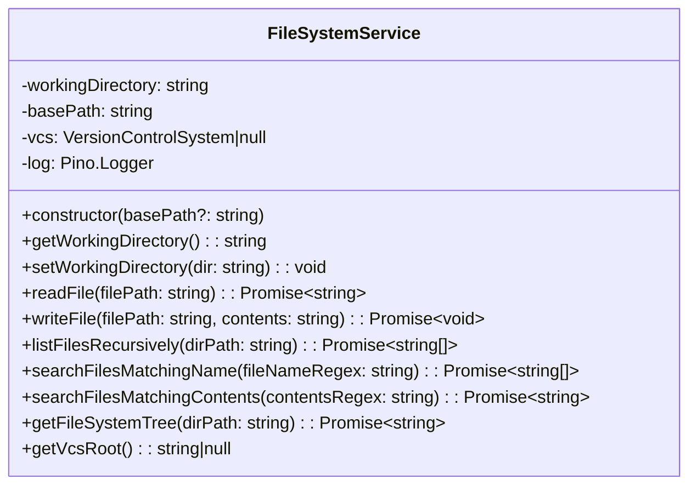
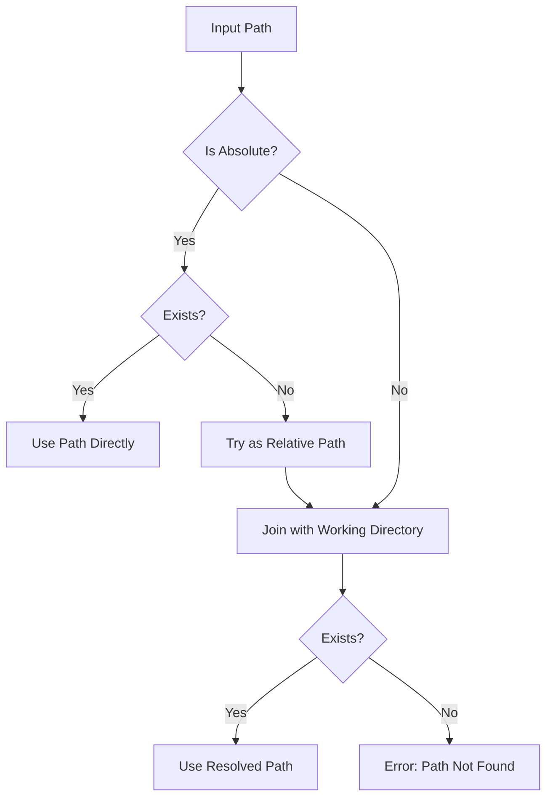
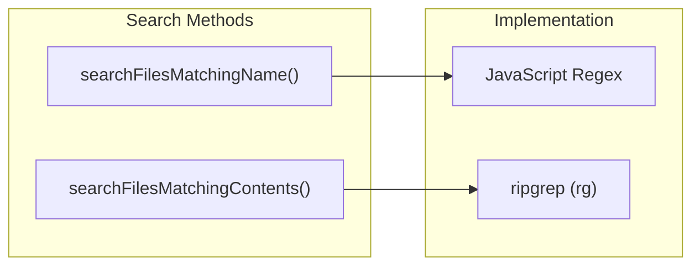
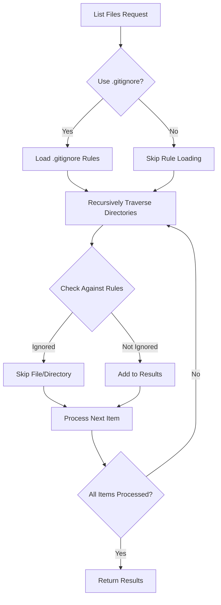
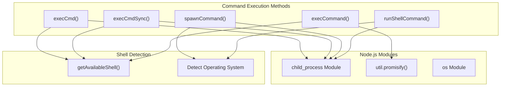
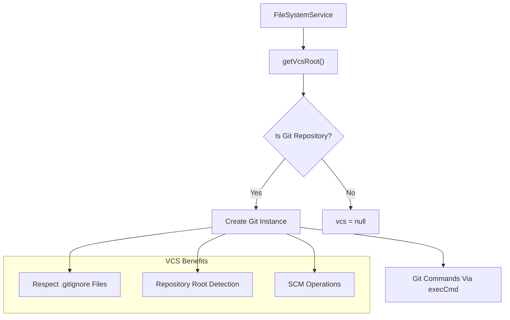
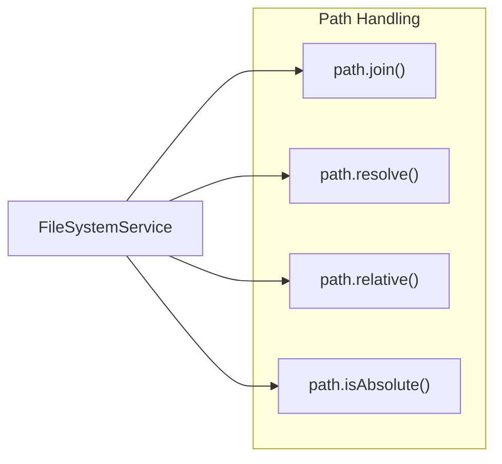
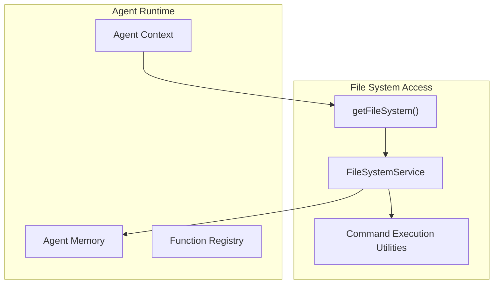

<!-- source: DeepWiki mcp.deepwiki.com · repo TrafficGuard/typedai · page 5.3 File System Operations · fetched 2026-10-26 -->

# File System Operations

<details>
<summary>Relevant source files</summary>

The following files were used as context for generating this wiki page:

- [src/functions/cloud/google/google-cloud.ts](src/functions/cloud/google/google-cloud.ts)
- [src/functions/storage/fileSystemService.ts](src/functions/storage/fileSystemService.ts)
- [src/llm/multi-agent/blackberry.ts](src/llm/multi-agent/blackberry.ts)
- [src/llm/multi-agent/deepSeekR1_Fallbacks.ts](src/llm/multi-agent/deepSeekR1_Fallbacks.ts)
- [src/llm/services/vertexai.ts](src/llm/services/vertexai.ts)
- [src/utils/exec.ts](src/utils/exec.ts)

</details>


The TypedAI platform provides a robust file system abstraction layer that enables agents to interact with the local file system in a controlled, traceable manner. This document details the file system operations available to agents, how they are implemented, and best practices for using them.

For information about code editing capabilities built on top of these file system operations, see [Code Editing Agent](#5.2).

## 1. Overview

The file system operations in TypedAI are primarily implemented through the `FileSystemService` class, which provides a structured interface for agents to access, manipulate, and navigate files and directories. This service maintains working directory state, respects version control systems, and integrates with the platform's tracing and logging systems.



The file system operations are designed with several key principles:

- **Working Directory Awareness**: All operations respect a current working directory context
- **Safety**: Operations prevent access outside allowed directories
- **Integration**: Full integration with Git and other version control systems
- **Observability**: Operations are automatically traced and logged

Sources: [src/functions/storage/fileSystemService.ts:38-51](), [src/utils/exec.ts:8-10]()

## 2. Core Architecture

### 2.1 FileSystemService

The `FileSystemService` class is the central component for file system operations. It provides a virtual file system abstraction on top of the physical file system.



Key configuration parameters:

| Parameter | Description | Default Value |
|-----------|-------------|---------------|
| `basePath` | The root directory that can be accessed by the file system service | Current working directory of process |
| `workingDirectory` | The current working directory within basePath | Same as basePath initially |

Sources: [src/functions/storage/fileSystemService.ts:51-87]()

### 2.2 Path Resolution

The service maintains two important path concepts:

1. **Base Path**: The root directory that can be accessed (the virtual root)
2. **Working Directory**: The current directory context for relative paths

All file operations use path resolution to determine the actual file system path:



Sources: [src/functions/storage/fileSystemService.ts:102-141]()

## 3. File Operations

### 3.1 Reading Files

The service provides several methods for reading files:

| Method | Description | Use Case |
|--------|-------------|----------|
| `readFile(filePath)` | Reads a single file's contents | Reading configuration files |
| `readFileAsXML(filePath)` | Reads a file and formats as XML | Presenting file contents to LLMs |
| `readFiles(filePaths)` | Reads multiple files into a Map | Analyzing related files |
| `readFilesAsXml(filePaths)` | Reads multiple files as XML format | Presenting multiple files to LLMs |
| `getFileContentsRecursively(dirPath)` | Gets all files under a directory | Project analysis |

Example XML format for file contents:

```xml
<file_content file_path="src/index.ts">
// File contents here
</file_content>
```

Sources: [src/functions/storage/fileSystemService.ts:286-376]()

### 3.2 Writing Files

The service provides methods for writing to files:

| Method | Description | Safety Features |
|--------|-------------|----------------|
| `writeFile(filePath, contents)` | Writes/overwrites a file | Creates parent directories automatically |
| `writeNewFile(filePath, contents)` | Writes only if file doesn't exist | Prevents accidental overwrites |
| `editFileContents(filePath, descriptionOfChanges)` | Modifies file using LLM | Simplifies complex edits |

Sources: [src/functions/storage/fileSystemService.ts:406-439]()

### 3.3 Searching Files

The file system provides powerful search capabilities:



Example for searching files by content:
```typescript
// Search for files containing "function calculateTotal"
const matchingFiles = await fs.searchFilesMatchingContents("function calculateTotal");
```

Sources: [src/functions/storage/fileSystemService.ts:166-191]()

## 4. Directory Operations

### 4.1 Listing Files and Directories

The service provides methods for working with directories:

| Method | Description | Notes |
|--------|-------------|-------|
| `listFilesInDirectory(dirPath)` | Lists files/folders in a single directory | Folders end with `/` |
| `listFilesRecursively(dirPath, useGitIgnore)` | Lists all files under a directory | Respects .gitignore by default |
| `listFolders(dirPath)` | Lists only folders in a directory | Returns folder names only |
| `getAllFoldersRecursively(dirPath)` | Gets all folders under a directory | Respects .gitignore |

Directory listing operations respect `.gitignore` rules by default:



Sources: [src/functions/storage/fileSystemService.ts:198-285](), [src/functions/storage/fileSystemService.ts:440-477]()

### 4.2 Directory Visualization

The system provides methods to visualize the file system structure:

| Method | Description | Output |
|--------|-------------|--------|
| `getFileSystemTree(dirPath)` | Textual tree representation | Indented directory structure text |
| `getFileSystemTreeStructure(dirPath)` | Object representation | Record with folders as keys and file arrays as values |

Example tree output:
```
file1.txt
images/
  logo.png
src/utils/
  helper.js
```

Sources: [src/functions/storage/fileSystemService.ts:536-611]()

## 5. Command Execution

For operations that go beyond the capabilities of the Node.js fs module, the system uses command-line utilities through several execution methods:



Command execution functions provide:

- **Consistent environment**: Path and shell settings standardized
- **Error handling**: Structured error returns
- **Tracing**: OpenTelemetry integration for observability
- **Working directory**: All commands execute in the current FileSystemService working directory

Sources: [src/utils/exec.ts:12-266]()

## 6. Version Control Integration

The file system service integrates with version control systems (currently Git) to provide context-aware operations:



The version control integration:

1. Automatically detects Git repositories
2. Caches repository roots for performance
3. Provides .gitignore-aware file operations
4. Enables source control operations via the VCS class

Sources: [src/functions/storage/fileSystemService.ts:612-640]()

## 7. Best Practices

### 7.1 Managing Working Directory

When working with the file system, it's important to maintain proper working directory context:

```typescript
// Bad practice - using absolute paths
fs.readFile('/absolute/path/to/file.txt');

// Good practice - using relative paths
fs.setWorkingDirectory('project/directory');
fs.readFile('file.txt');
```

### 7.2 Error Handling

File operations can fail for various reasons (permissions, file not found, etc.). Always handle these errors appropriately:

```typescript
try {
  const fileContents = await fs.readFile('config.json');
  // Process file contents
} catch (error) {
  // Handle error: file might not exist or be inaccessible
}
```

### 7.3 Working with Large File Sets

When working with large directories:

1. Use `listFilesRecursively` with appropriate filters
2. Process files in batches rather than loading all at once
3. Consider using search functions to target specific files first

## 8. Internal Implementation

The file system service internally uses:

1. **Node.js fs module**: For basic file operations
2. **ripgrep utility**: For efficient content searching
3. **Shell commands**: For operations not directly available through Node.js
4. **Ignore package**: For handling .gitignore parsing and matching

### 8.1 Path Handling

Path manipulation uses Node.js path module for cross-platform compatibility:



### 8.2 Performance Optimizations

The file system service includes several performance optimizations:

1. **Caching Git Roots**: Repository roots are cached to prevent repeated lookup
2. **Caching .gitignore Paths**: Known .gitignore locations are cached
3. **Custom Implementation**: Custom recursion logic for more efficient directory traversal

Sources: [src/functions/storage/fileSystemService.ts:33-36](), [src/functions/storage/fileSystemService.ts:440-477]()

## 9. Integration with Agent System

The file system service is integrated into the agent system through the agent context:



Agents can access the file system through:

1. **Direct function calls**: Using registered file system functions
2. **Tools layer**: Higher-level tools for specific file operations
3. **Memory integration**: Storing file contents in agent memory with the `storeToMemory` option

Sources: [src/utils/exec.ts:8](), [src/functions/storage/fileSystemService.ts:158-164]()

## 10. Summary

The file system operations in TypedAI provide a comprehensive interface for agents to work with files and directories. The `FileSystemService` class offers a secure, traceable, and flexible way to perform file operations while respecting the context of the current working directory and version control settings.

Key capabilities include:
- Reading and writing files
- Searching file contents and names
- Listing and traversing directories
- Generating file system structure visualizations
- Integrating with version control systems

By leveraging these operations, agents can effectively analyze, modify, and manage code repositories and other file-based resources.

---

