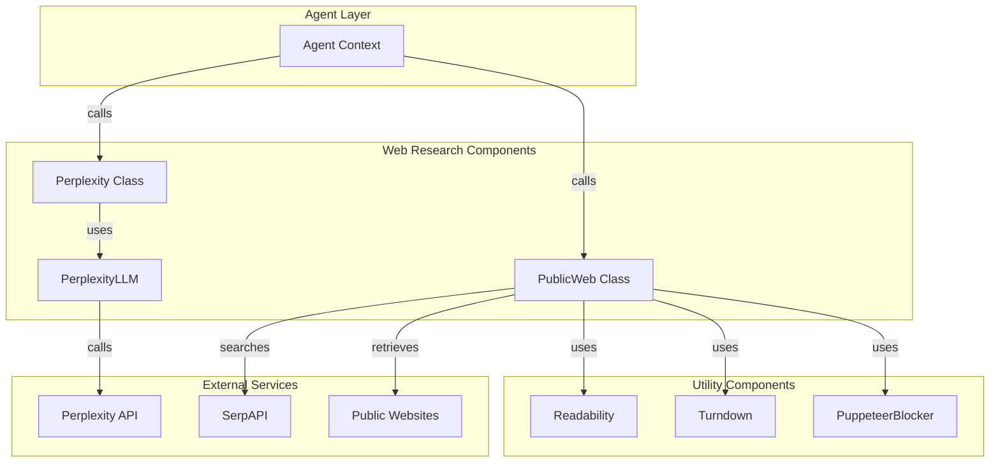
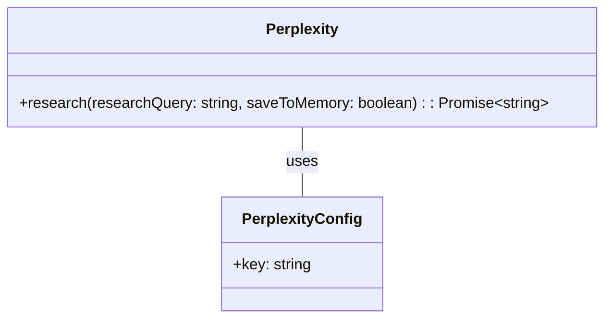
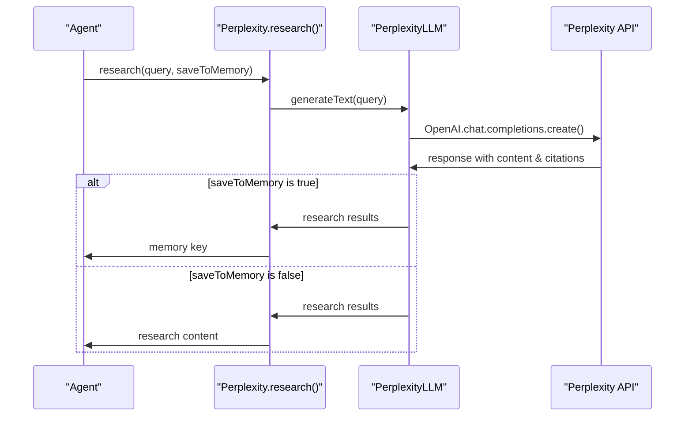
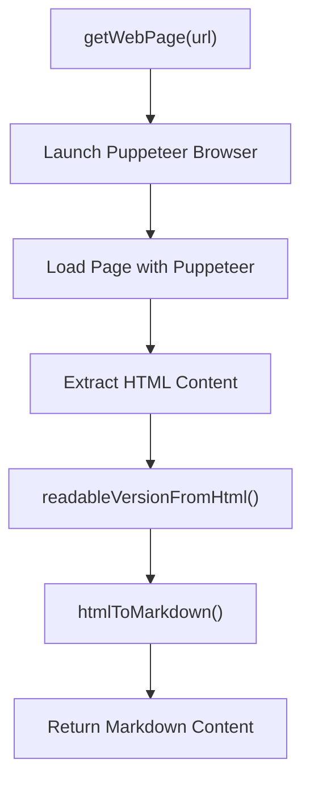
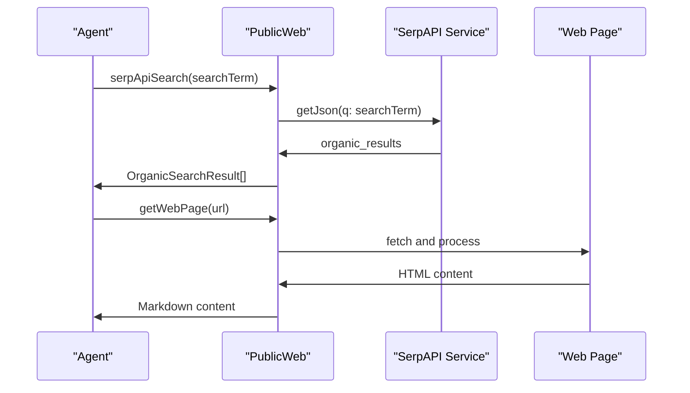
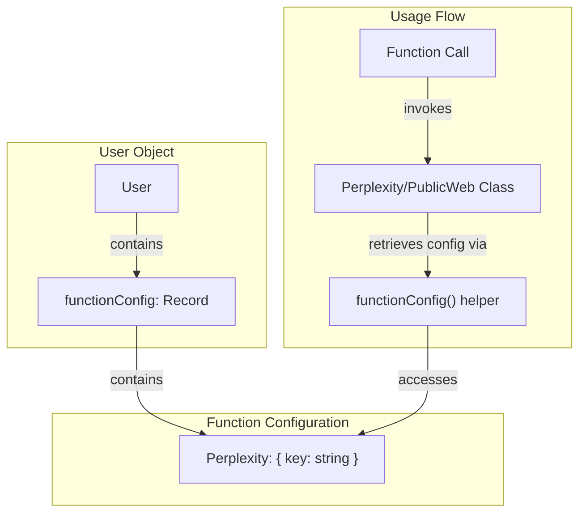
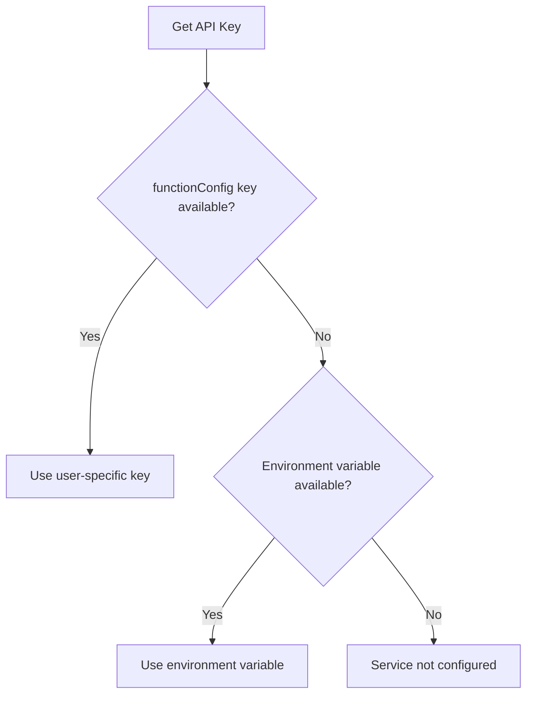
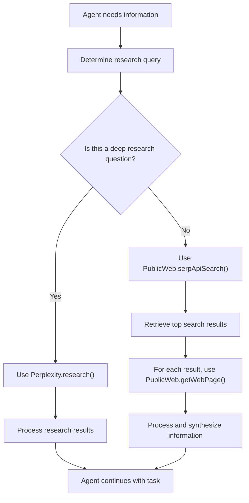
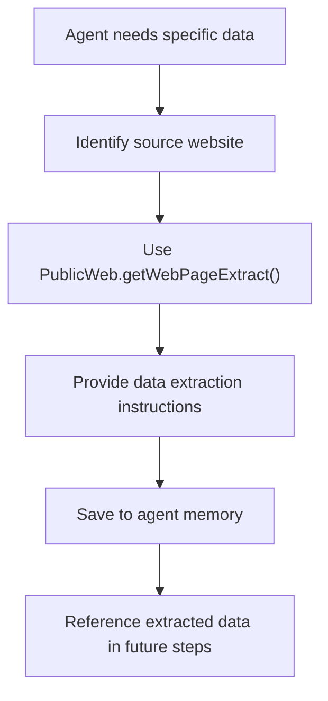

<!-- source: DeepWiki mcp.deepwiki.com · repo TrafficGuard/typedai · page 6 Web & Research Tools · fetched 2026-10-26 -->

# Web & Research Tools

<details>
<summary>Relevant source files</summary>

The following files were used as context for generating this wiki page:

- [src/functions/web/perplexity.ts](src/functions/web/perplexity.ts)
- [src/functions/web/web.ts](src/functions/web/web.ts)
- [src/llm/services/groq.ts](src/llm/services/groq.ts)
- [src/llm/services/perplexity-llm.ts](src/llm/services/perplexity-llm.ts)
- [src/llm/services/together.ts](src/llm/services/together.ts)
- [src/modules/firestore/firestoreUserService.ts](src/modules/firestore/firestoreUserService.ts)
- [src/user/userService/userContext.ts](src/user/userService/userContext.ts)

</details>


## Purpose and Overview

The Web & Research Tools system enables TypedAI agents to interact with online resources, search for information, extract content from websites, and perform deep research using specialized AI services. These capabilities are essential for agents that need to access up-to-date information beyond their training data or gather domain-specific knowledge.

This document covers the components, architecture, and usage of web research capabilities within TypedAI. For information about Source Control Management, see [Source Control Management](#5.1).

## System Architecture

The Web & Research tools consist of several key components that work together to provide comprehensive web interaction capabilities:



Sources: [src/functions/web/web.ts:30-262](), [src/functions/web/perplexity.ts:13-42](), [src/llm/services/perplexity-llm.ts:1-223]()

## Perplexity Research

The Perplexity integration provides agents with deep research capabilities powered by Perplexity's AI models. This integration enables agents to find and synthesize information across the web.

### Perplexity Models

TypedAI supports multiple Perplexity models, each with different capabilities and pricing:

| Model | Description | Use Case | Input Cost/M tokens | Output Cost/M tokens |
|-------|-------------|----------|---------------------|----------------------|
| sonar | Basic model | Simple searches | $1 | $1 |
| sonar-reasoning-pro | Advanced reasoning | Complex research | $2 | $8 |
| sonar-deep-research | Specialized research | In-depth investigation | $2 | $8 |

### Research Function

The `Perplexity` class provides a single primary method:



The `research` method:
1. Takes a natural language query and a flag indicating whether to save results to agent memory
2. Uses the `perplexityDeepResearchLLM` model to generate comprehensive research results
3. Optionally saves results to agent memory with a summarized key
4. Returns either the memory key (if saved) or the research content directly

Sources: [src/functions/web/perplexity.ts:13-42](), [src/llm/services/perplexity-llm.ts:25-61]()

### PerplexityLLM Implementation

TypedAI implements a custom `PerplexityLLM` class that extends the `BaseLLM` abstract class, providing:

1. Model configuration with appropriate token limits and costs
2. Integration with the Perplexity API
3. Handling of citations returned by the Perplexity service
4. Cost tracking for API usage



Sources: [src/llm/services/perplexity-llm.ts:63-206](), [src/functions/web/perplexity.ts:21-36]()

## PublicWeb Functions

The `PublicWeb` class provides a comprehensive set of functions for interacting with web content. This class is the primary interface for agents to access and manipulate web data.

### Web Content Retrieval

The system provides several methods for retrieving and processing web content:

```mermaid
classDiagram
    class PublicWeb {
        +getWebPage(url: string): Promise~string~
        +getWebPageExtract(url: string, dataExtractionInstructions: string, memoryKey?: string): Promise~string~
        +readableVersionFromHtml(html: string, url?: string): string
        +htmlToMarkdown(html: string, url?: string): string
        +takeScreenshotAndLogs(url: string): Promise~{image: Buffer, logs: string[]}~
        +serpApiSearch(searchTerm: string): Promise~OrganicSearchResult[]~
        +googleSearch(searchTerm: string): Promise~string[]~
    }

    class OrganicSearchResult {
        +url: string
        +title: string
        +content?: string
    }

    PublicWeb -- OrganicSearchResult : returns
```

Sources: [src/functions/web/web.ts:30-262]()

### Content Extraction and Processing

When retrieving web content, the system performs several processing steps to make the content more usable by AI agents:

1. **HTML Retrieval**: Uses Puppeteer (headless browser) to load and render web pages, handling JavaScript execution
2. **Content Extraction**: Employs Mozilla's Readability library to extract the main content from web pages, removing clutter
3. **Markdown Conversion**: Transforms HTML into Markdown format using Turndown service, making it more compact and suitable for LLM processing



Sources: [src/functions/web/web.ts:77-126]()

### Web Search Capabilities

The system integrates with search engines to find relevant information:

1. **SerpAPI Integration**: Provides structured search results from Google via the SerpAPI service
2. **Organic Search Results**: Returns title, URL, and optional content snippets



Sources: [src/functions/web/web.ts:170-192]()

### Web Visualization

The system can capture visual representations of web pages:

1. **Screenshot Capability**: Takes screenshots of web pages using Puppeteer
2. **Cookie Banner Handling**: Uses PuppeteerBlocker to hide cookie consent banners for cleaner screenshots
3. **Logging**: Captures browser console logs and errors during screenshot process

Sources: [src/functions/web/web.ts:218-261]()

## Configuration and Authentication

Web research tools are configured on a per-user basis, allowing customization of API keys and service access.

### User Configuration

API keys for services like Perplexity are stored in the user's function configuration:



The configuration can be accessed through the `functionConfig()` helper function, which retrieves the appropriate configuration for a given function class from the current user's settings.

Sources: [src/user/userService/userContext.ts:42-46](), [src/llm/services/perplexity-llm.ts:83-90]()

### Fallback to Environment Variables

When user-specific configuration is not available, the system falls back to environment variables:



Sources: [src/llm/services/perplexity-llm.ts:81-86](), [src/functions/web/web.ts:177-188]()

## Usage Patterns

### Research Workflow

A typical research workflow using these tools follows this pattern:



### Data Extraction Example

For targeted data extraction from websites:



Sources: [src/functions/web/web.ts:57-70](), [src/functions/web/perplexity.ts:21-36]()

## Integration with Agent System

Web & Research tools are integrated with the Agent Context system, allowing agents to:

1. Store research results in memory for later reference
2. Track costs of web research operations (particularly for Perplexity)
3. Maintain a contextual understanding of gathered information

This integration makes web research a seamless part of agent capabilities, enabling complex research-based tasks.

Sources: [src/functions/web/perplexity.ts:28-33](), [src/llm/services/perplexity-llm.ts:3-164]()

---

