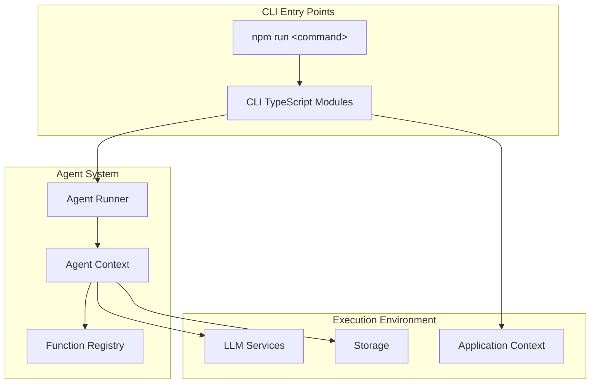
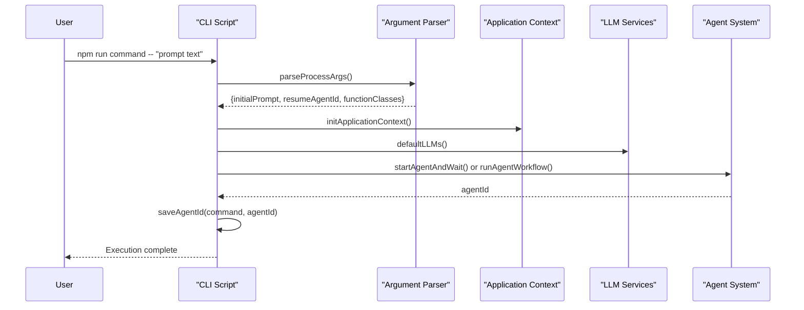
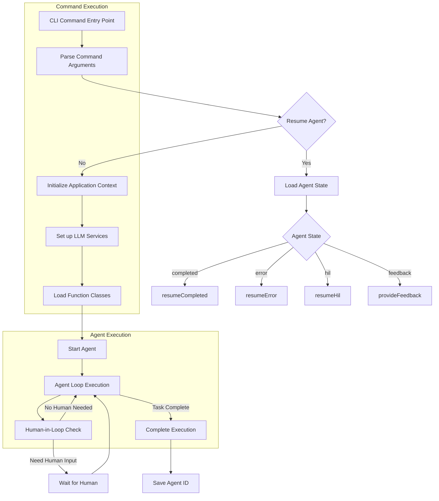
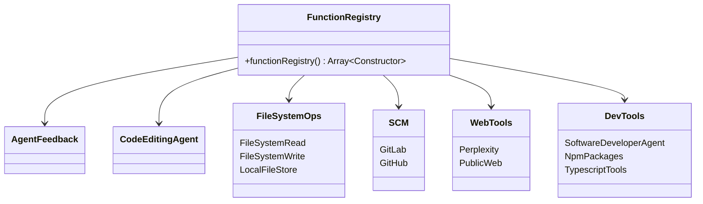
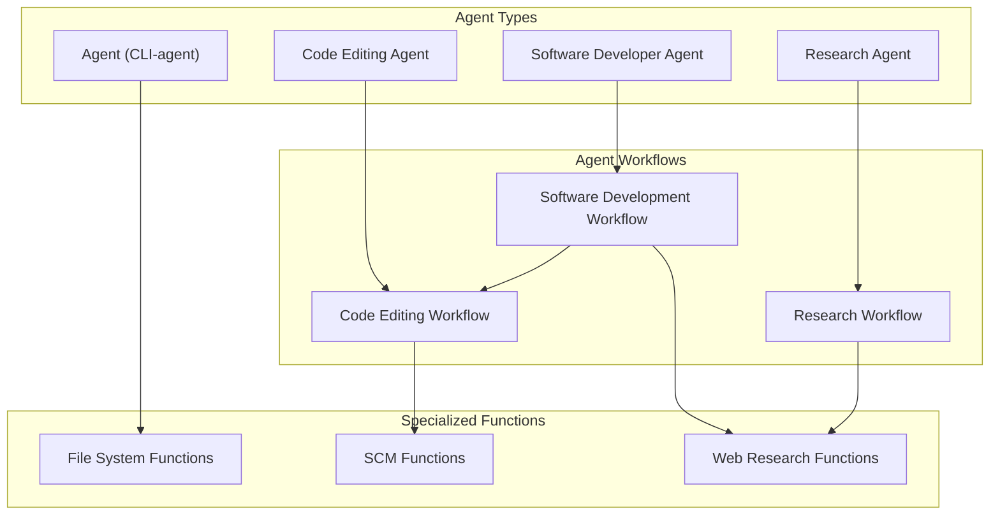
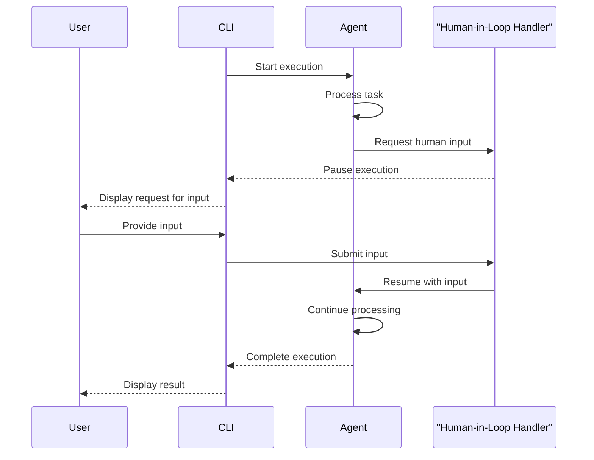

<!-- source: DeepWiki mcp.deepwiki.com · repo TrafficGuard/typedai · page 7 CLI Interface · fetched 2026-10-26 -->

# CLI Interface

<details>
<summary>Relevant source files</summary>

The following files were used as context for generating this wiki page:

- [frontend/package-lock.json](frontend/package-lock.json)
- [frontend/package.json](frontend/package.json)
- [package-lock.json](package-lock.json)
- [package.json](package.json)
- [src/cli/agent.ts](src/cli/agent.ts)
- [src/cli/code.ts](src/cli/code.ts)
- [src/cli/research.ts](src/cli/research.ts)
- [src/cli/swe.ts](src/cli/swe.ts)
- [src/cli/util.ts](src/cli/util.ts)
- [src/functionRegistry.ts](src/functionRegistry.ts)
- [variables/local.env.example](variables/local.env.example)

</details>


This document describes the command-line interface (CLI) for TypedAI, which provides programmatic access to the platform's agents, LLM workflows, and utilities. The CLI enables developers to run various AI agents, access function libraries, and automate tasks without using the web interface.

## Overview 

TypedAI's CLI provides multiple entry points for different agent types and workflows through npm scripts that invoke TypeScript modules in the `src/cli/` directory. Each command initializes specific agent configurations, sets up function registries, and manages execution contexts.



Sources: [package.json:11-31](), [src/cli/agent.ts:11-52](), [src/cli/code.ts:14-41]()

## Available CLI Commands

TypedAI includes multiple specialized CLI commands, each designed for specific use cases:

| Command | Purpose | Script |
|---------|---------|--------|
| `agent` | Run the general-purpose autonomous agent | `src/cli/agent.ts` |
| `code` | Edit code with CodeEditingAgent | `src/cli/code.ts` |
| `swe` | Execute Software Developer Agent workflows | `src/cli/swe.ts` |
| `research` | Perform web research via Perplexity and PublicWeb | `src/cli/research.ts` |
| `util` | Run utility functions and test code | `src/cli/util.ts` |
| `gen` | Generate content | `src/cli/gen.ts` |
| `files` | File system operations | `src/cli/files.ts` |
| `repos` | Repository management | `src/cli/repos.ts` |
| `scrape` | Web scraping | `src/cli/scrape.ts` |
| `slack` | Slack integration | `src/cli/slack.ts` |
| `summarize` | Generate summaries | `src/cli/summarize.ts` |

Sources: [package.json:11-31]()

### Command Structure

All CLI commands follow a common execution pattern:



Sources: [src/cli/agent.ts:11-52](), [src/cli/research.ts:17-34](), [src/cli/code.ts:14-41](), [src/cli/swe.ts:19-44]()

## Command-Line Arguments

All CLI commands accept the following common arguments:

| Argument | Description |
|----------|-------------|
| Initial prompt | Free-text prompt for the agent (provided after `--`) |
| `--resume=<agent-id>` | Resume an existing agent execution with the given ID |
| `--functions=<function-names>` | Comma-separated list of function classes to load (agent-specific) |

Example usage:

```bash
# Run a general agent with a prompt
npm run agent -- "Create a simple Node.js web server"

# Run the SWE agent with a resume ID
npm run swe -- --resume=abc123 "Add error handling to the server code"

# Run the code editor with specific functions
npm run code -- --functions=GitLab,FileSystemRead "Refactor this code"
```

Sources: [src/cli/agent.ts:15-26](), [src/cli/research.ts:20-22]()

## Agent Execution Flow

When running an agent through the CLI, the following execution flow is followed:



Sources: [src/cli/agent.ts:28-52](), [src/cli/code.ts:33-41](), [src/cli/swe.ts:25-38]()

## Function Integration

TypedAI's CLI interfaces with various function classes that provide capabilities to agents. These functions can be specified explicitly when running commands or default sets will be used based on the agent type.

### Function Registry

The platform includes a registry of available functions:



Sources: [src/functionRegistry.ts:24-46]()

### Agent-Specific Functions

Different CLI commands use different sets of functions:

| Command | Default Functions |
|---------|------------------|
| `agent` | FileSystemRead |
| `code` | GitLab, CodeEditingAgent |
| `swe` | FileSystemRead, CodeEditingAgent, Perplexity |
| `research` | Perplexity, PublicWeb |

Sources: [src/cli/agent.ts:22-25](), [src/cli/code.ts:25-26](), [src/cli/swe.ts:28](), [src/cli/research.ts:26-27]()

## Agent Types

The CLI provides access to several specialized agent types:



Sources: [src/cli/agent.ts:41-48](), [src/cli/code.ts:33-35](), [src/cli/swe.ts:33-35](), [src/cli/research.ts:22-28]()

### General Agent

The `agent` command provides a flexible autonomous agent that can use various functions and respond to prompts:

```bash
npm run agent -- "Your prompt here"
```

It supports resuming previous executions and specifying custom function sets:

```bash
npm run agent -- --resume=agent_123abc "Continue with this prompt"
npm run agent -- --functions=GitLab,FileSystemRead,Perplexity "Use these tools"
```

Sources: [src/cli/agent.ts:11-52]()

### Code Editing Agent

The `code` command provides specialized code editing capabilities:

```bash
npm run code -- "Refactor the authentication module"
```

This agent focuses on code manipulation tasks, with built-in integration with source control management.

Sources: [src/cli/code.ts:14-41]()

### Software Developer Agent

The `swe` command runs a comprehensive software development workflow:

```bash
npm run swe -- "Create a REST API for user management"
```

This agent combines code editing with web research and project management capabilities.

Sources: [src/cli/swe.ts:19-44]()

### Research Agent

The `research` command focuses on web research capabilities:

```bash
npm run research -- "Research recent advances in transformer models"
```

This agent uses Perplexity for semantic search and PublicWeb for browsing content.

Sources: [src/cli/research.ts:17-34]()

## Environment Configuration

TypedAI's CLI relies on environment variables for configuration. These can be set in the `variables/local.env` file:

| Variable | Purpose |
|----------|---------|
| LOG_LEVEL | Controls logging verbosity (debug, info, etc.) |
| LOG_PRETTY | Enables human-readable logs when true |
| ANTHROPIC_API_KEY | API key for Anthropic Claude |
| OPENAI_API_KEY | API key for OpenAI |
| PERPLEXITY_KEY | API key for Perplexity |
| GITLAB_TOKEN | Authentication token for GitLab |
| GITHUB_TOKEN | Authentication token for GitHub |
| HIL_BUDGET | Budget for human-in-the-loop interactions |
| HIL_COUNT | Maximum number of human interactions |

Sources: [variables/local.env.example:1-67]()

## Human-in-the-Loop Interaction

The CLI agents support human-in-the-loop (HIL) interaction, where execution pauses to receive human input. This is configured through environment variables:



Sources: [src/cli/code.ts:28-30](), [variables/local.env.example:24-28]()

## Resuming Agent Execution

All CLI commands support resuming previous agent executions using the `--resume` flag. This loads the agent state and continues execution based on its current state:

| Agent State | Resumption Behavior |
|-------------|---------------------|
| `completed` | Reuses results from the completed execution |
| `error` | Reviews the error and attempts recovery |
| `hil` | Continues from the point waiting for human input |
| `feedback` | Processes provided feedback and continues |

Sources: [src/cli/agent.ts:28-39]()

## Usage Examples

### Basic Agent Execution

```bash
# Run a general agent with a prompt
npm run agent -- "Create a file called hello.js that prints 'Hello World'"
```

### Code Editing

```bash
# Edit code in a repository
npm run code -- "Refactor the auth.js file to use async/await instead of callbacks"
```

### Software Development Workflow

```bash
# Start a software development task
npm run swe -- "Create a REST API endpoint for user profile updates"
```

### Web Research

```bash
# Research a topic
npm run research -- "Summarize the latest advances in transformer architecture"
```

### Resuming Previous Work

```bash
# Resume from a previous execution point
npm run agent -- --resume=agent_abc123 "Continue with the previous task"
```

Sources: [src/cli/agent.ts:11-52](), [src/cli/code.ts:14-41](), [src/cli/swe.ts:19-44](), [src/cli/research.ts:17-34]()

---

