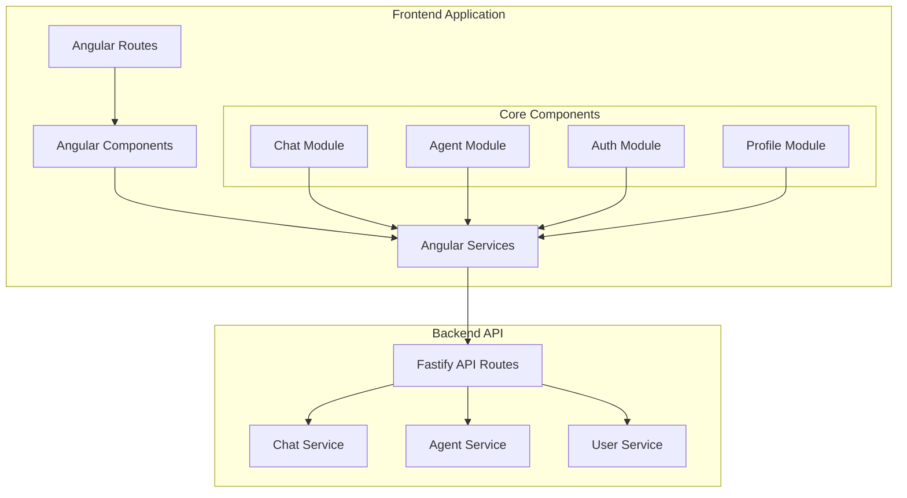
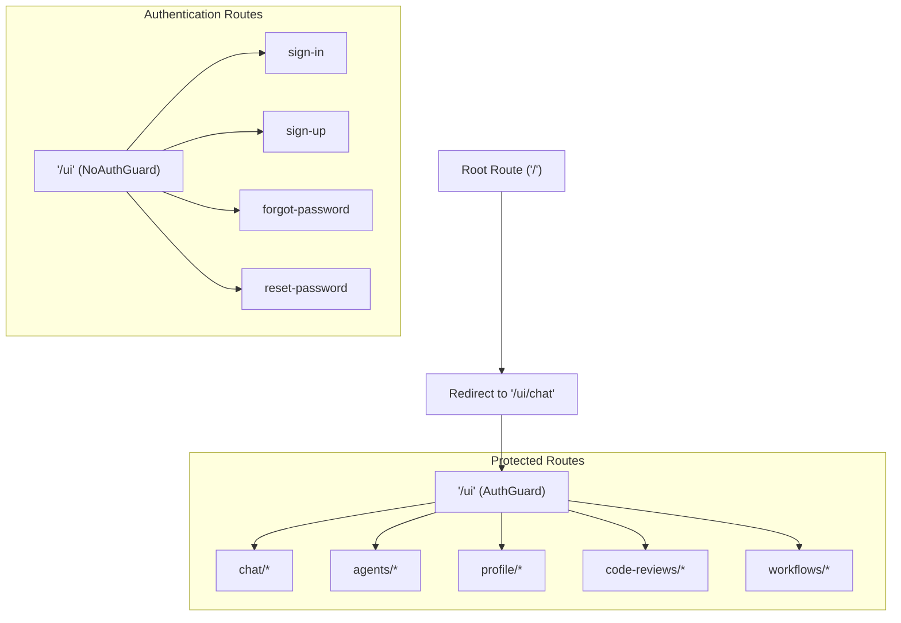
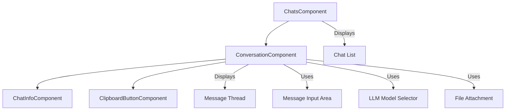
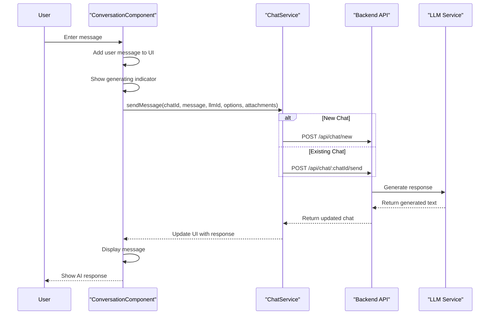
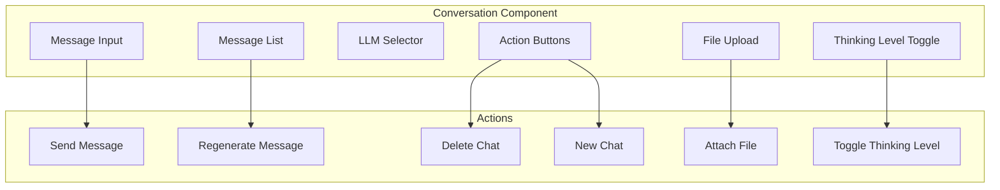
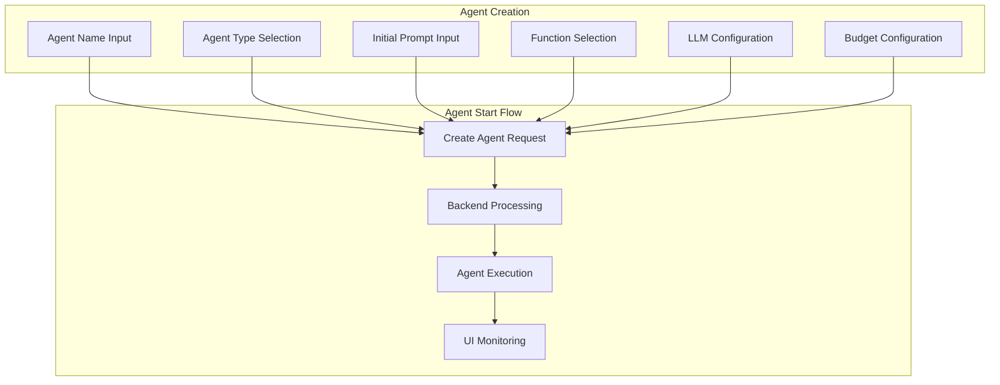

<!-- source: DeepWiki mcp.deepwiki.com · repo TrafficGuard/typedai · page 8 Web UI · fetched 2026-10-26 -->

# Web UI

Relevant source files

The following files were used as context for generating this wiki page:

- [docs/docs/agent-concepts.md](docs/docs/agent-concepts.md)
- [frontend/src/app/app.routes.ts](frontend/src/app/app.routes.ts)
- [frontend/src/app/modules/chat/chat.service.ts](frontend/src/app/modules/chat/chat.service.ts)
- [frontend/src/app/modules/chat/chat.types.ts](frontend/src/app/modules/chat/chat.types.ts)
- [frontend/src/app/modules/chat/chats/chats.component.html](frontend/src/app/modules/chat/chats/chats.component.html)
- [frontend/src/app/modules/chat/chats/chats.component.ts](frontend/src/app/modules/chat/chats/chats.component.ts)
- [frontend/src/app/modules/chat/conversation/conversation.component.ts](frontend/src/app/modules/chat/conversation/conversation.component.ts)
- [src/chat/chatTypes.ts](src/chat/chatTypes.ts)
- [src/modules/firestore/firestoreChatService.ts](src/modules/firestore/firestoreChatService.ts)
- [src/modules/memory/inMemoryChatService.ts](src/modules/memory/inMemoryChatService.ts)
- [src/routes/agent/agent-start-route.ts](src/routes/agent/agent-start-route.ts)
- [src/routes/chat/chat-routes.ts](src/routes/chat/chat-routes.ts)

The TypedAI web interface provides a user-friendly way to interact with the platform's AI capabilities, including chat conversations and agent management. This document describes the architecture and components of the Angular-based frontend application, its integration with the Fastify backend, and how it enables users to interact with various TypedAI features.

For information about the CLI interface, see [CLI Interface](#7). For details about the backend API that supports the web UI, see [API & Backend](#9).

## Architecture Overview

The Web UI is built using Angular with Material Design components, providing a responsive and modern user experience. The application follows a modular architecture with clear separation of components, services, and routes.

**Diagram: Web UI Architecture Overview**

Sources:
- [frontend/src/app/app.routes.ts:1-86]()
- [src/routes/chat/chat-routes.ts:1-242]()
- [src/routes/agent/agent-start-route.ts:1-70]()

### Routing Structure

The application uses Angular's routing system to navigate between different features. The main route structure directs users to chat, agent, profile, and authentication-related pages.

**Diagram: Application Routing Structure**

Sources:
- [frontend/src/app/app.routes.ts:1-86]()

## Chat Interface

The chat interface is a core component of the TypedAI Web UI, allowing users to interact with various LLM providers through a user-friendly conversation interface.

### Chat Components Hierarchy

**Diagram: Chat Components Hierarchy**

Sources:
- [frontend/src/app/modules/chat/conversation/conversation.component.ts:1-711]()
- [frontend/src/app/modules/chat/chats/chats.component.ts:1-174]()
- [frontend/src/app/modules/chat/chats/chats.component.html:1-107]()

### Chat Data Flow

The following diagram illustrates how data flows between the frontend components and the backend services for chat functionality:

**Diagram: Chat Message Flow**

Sources:
- [frontend/src/app/modules/chat/conversation/conversation.component.ts:373-480]()
- [frontend/src/app/modules/chat/chat.service.ts:107-394]()
- [src/routes/chat/chat-routes.ts:38-109]()

### Chat Data Structure

The chat system uses different data structures for the client-side rendering and server-side storage:

| Client-side (Angular) | Server-side (TypeScript) | Description |
|-----------------------|--------------------------|-------------|
| `Chat` | `Chat` | Main chat container with metadata and messages |
| `ChatMessage` | `LlmMessage` | Individual messages in the conversation |
| `Attachment` | `FilePartExt`/`ImagePartExt` | Files or images attached to messages |

Sources:
- [frontend/src/app/modules/chat/chat.types.ts:1-65]()
- [src/chat/chatTypes.ts:1-34]()

## Key Features

### Chat Conversation

The Conversation component is the main interface for users to interact with LLMs. It provides the following key features:

1. **Message Thread**: Displays the conversation between the user and AI
2. **LLM Selection**: Allows users to choose which LLM to use for the current conversation
3. **File Attachments**: Supports uploading and attaching files to messages
4. **Thinking Levels**: For supported models, allows adjusting the "thinking" verbosity
5. **Keyboard Shortcuts**: Provides keyboard shortcuts for common actions
6. **Message Regeneration**: Ability to regenerate AI responses

**Diagram: Conversation Component Features**

Sources:
- [frontend/src/app/modules/chat/conversation/conversation.component.ts:80-311]()
- [frontend/src/app/modules/chat/conversation/conversation.component.ts:373-480]()

### Chat Management

The Chats component provides a list of available conversations and allows users to:

1. Create new chats
2. Navigate between existing chats
3. Delete chats
4. Search through chat titles

Sources:
- [frontend/src/app/modules/chat/chats/chats.component.ts:41-173]()
- [frontend/src/app/modules/chat/chats/chats.component.html:1-107]()

### Backend Integration

The chat interface communicates with backend API routes to:

1. Fetch existing chats
2. Create new chats
3. Send messages to LLMs
4. Delete chats

The backend handles chat persistence through either an in-memory store (for development) or Firestore (for production).

Sources:
- [src/routes/chat/chat-routes.ts:17-151]()
- [src/modules/memory/inMemoryChatService.ts:12-119]() 
- [src/modules/firestore/firestoreChatService.ts:12-151]()

## Agent Interface

The Agent module provides a UI for creating, configuring, and monitoring AI agents. Users can:

1. Select agent types (XML, CodeGen)
2. Configure LLM models for different complexity levels
3. Provide initial prompts
4. Add available functions
5. Set budget constraints

**Diagram: Agent Creation and Execution Flow**

Sources:
- [src/routes/agent/agent-start-route.ts:1-70]()
- [docs/docs/agent-concepts.md:1-67]()

## Data Storage

The platform supports two storage implementations for chat data:

1. **In-Memory Storage**: Used for development and testing
   - Stores chats in a Map data structure
   - Simple implementation for local development

2. **Firestore Storage**: Used for production deployments
   - Persistent storage in Google Firestore
   - Supports multi-user environments

Both implementations provide the same interface for chat operations, making them interchangeable from the application's perspective.

Sources:
- [src/modules/memory/inMemoryChatService.ts:12-119]()
- [src/modules/firestore/firestoreChatService.ts:12-151]()

## Keyboard Shortcuts

The Web UI provides several keyboard shortcuts to improve user experience:

| Shortcut | Action |
|----------|--------|
| Ctrl+M | Open LLM model selector |
| Ctrl+A | Open file attachment dialog |
| Ctrl+E | Toggle Send on Enter mode |
| Ctrl+I | Toggle chat info sidebar |
| Ctrl+T | Toggle thinking level (for supported models) |
| Enter | Send message (when Send on Enter is enabled) |
| Shift+Enter | Line break (when Send on Enter is enabled) |

Sources:
- [frontend/src/app/modules/chat/conversation/conversation.component.ts:536-559]()

## Authentication and Authorization

The Web UI integrates with an authentication system to protect routes and ensure users can only access their own data. The application uses Angular route guards (`AuthGuard` and `NoAuthGuard`) to control access to different parts of the application.

Chat data is tied to user accounts, and the backend enforces access control to ensure users can only view and modify their own chats.

Sources:
- [frontend/src/app/app.routes.ts:10-85]()
- [src/routes/chat/chat-routes.ts:28-36]()
- [src/routes/chat/chat-routes.ts:135-150]()

---

