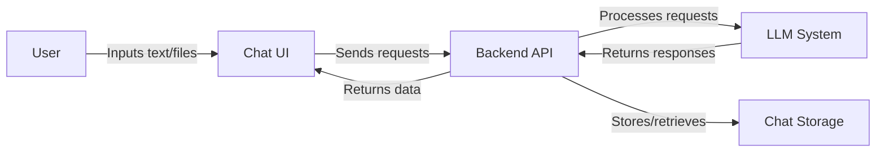
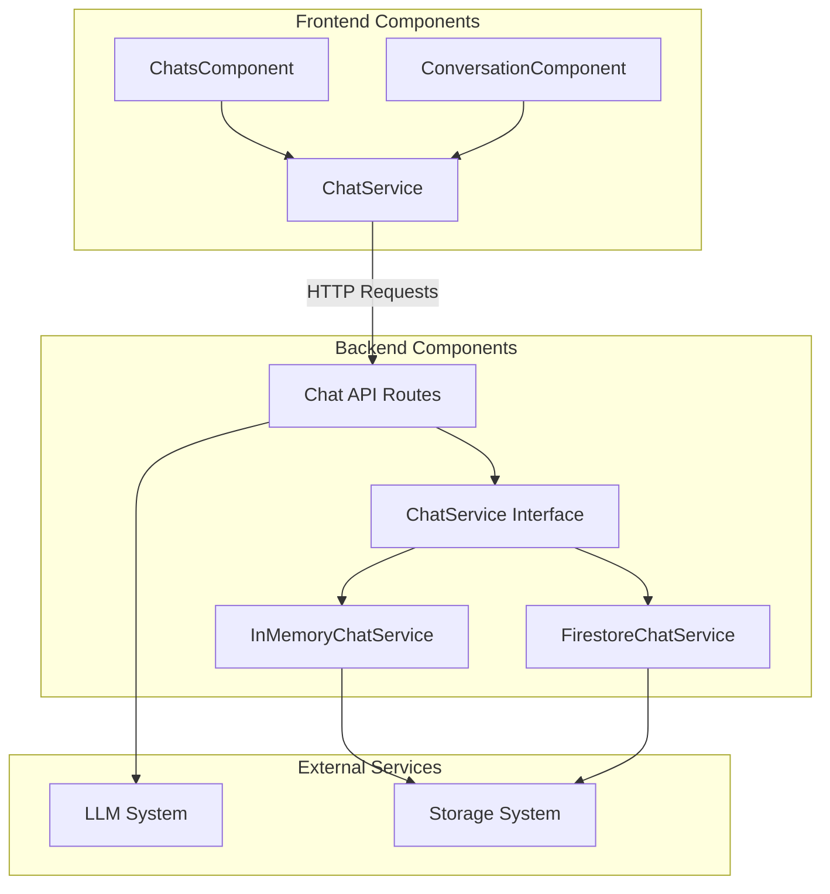
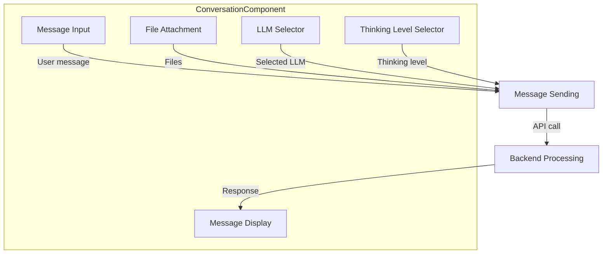
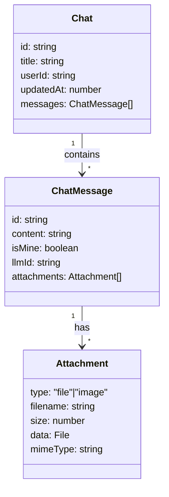
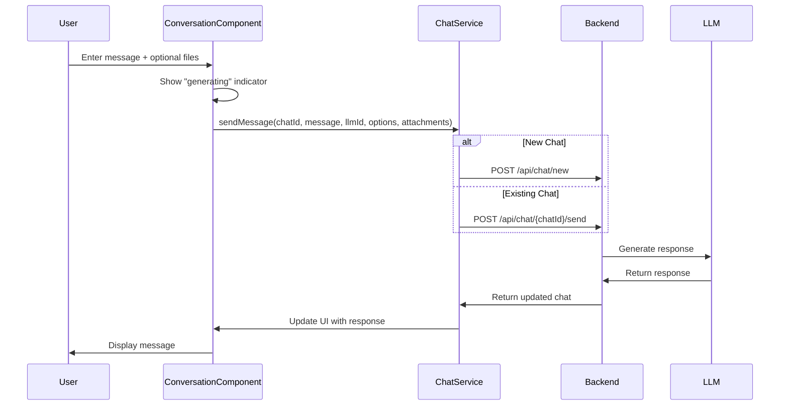

<!-- source: DeepWiki mcp.deepwiki.com · repo TrafficGuard/typedai · page 8.1 Chat Interface · fetched 2026-10-26 -->

# Chat Interface

<details>
<summary>Relevant source files</summary>

The following files were used as context for generating this wiki page:

- [frontend/src/app/app.routes.ts](frontend/src/app/app.routes.ts)
- [frontend/src/app/modules/chat/chat.service.ts](frontend/src/app/modules/chat/chat.service.ts)
- [frontend/src/app/modules/chat/chat.types.ts](frontend/src/app/modules/chat/chat.types.ts)
- [frontend/src/app/modules/chat/chats/chats.component.html](frontend/src/app/modules/chat/chats/chats.component.html)
- [frontend/src/app/modules/chat/chats/chats.component.ts](frontend/src/app/modules/chat/chats/chats.component.ts)
- [frontend/src/app/modules/chat/conversation/conversation.component.ts](frontend/src/app/modules/chat/conversation/conversation.component.ts)
- [src/chat/chatTypes.ts](src/chat/chatTypes.ts)
- [src/modules/firestore/firestoreChatService.ts](src/modules/firestore/firestoreChatService.ts)
- [src/modules/memory/inMemoryChatService.ts](src/modules/memory/inMemoryChatService.ts)
- [src/routes/chat/chat-routes.ts](src/routes/chat/chat-routes.ts)

</details>


This page documents the chat conversation system in TypedAI, which provides users with a text-based interface for interacting with various LLM providers. The chat interface supports message history, file attachments, and model selection capabilities. For information on the agent-specific UI components, see [Agent UI](#8.2).

## 1. Overview

The Chat Interface provides a messaging system where users can have persistent conversations with different Language Model providers. The system consists of a chat list navigation panel and a conversation area that displays message exchanges and input controls.



Sources: frontend/src/app/modules/chat/conversation/conversation.component.ts, src/routes/chat/chat-routes.ts

## 2. Component Architecture

The chat interface is implemented as a set of Angular components with a Fastify backend that handles data persistence and LLM interactions.



Sources: frontend/src/app/modules/chat/chats/chats.component.ts, frontend/src/app/modules/chat/conversation/conversation.component.ts, frontend/src/app/modules/chat/chat.service.ts, src/routes/chat/chat-routes.ts, src/modules/memory/inMemoryChatService.ts, src/modules/firestore/firestoreChatService.ts

## 3. User Interface

The chat interface consists of two main components: the chat list navigation pane and the conversation area.

### 3.1 Chat List (ChatsComponent)

The `ChatsComponent` displays a list of existing conversations and provides controls for creating new chats and searching through existing ones.

Key features:
- Chat creation button
- Search functionality for filtering chats
- List of chat items with titles
- Delete chat capability

Sources: frontend/src/app/modules/chat/chats/chats.component.ts, frontend/src/app/modules/chat/chats/chats.component.html

### 3.2 Conversation Area (ConversationComponent)

The `ConversationComponent` handles the display of messages and provides the interface for sending new messages.

Key features:
- Message history display with support for Markdown rendering
- Text input area with auto-resizing
- LLM model selection dropdown
- File attachment support
- Keyboard shortcuts
- Thinking level configuration (for supported models)



Sources: frontend/src/app/modules/chat/conversation/conversation.component.ts

## 4. Data Models

The chat system uses several data models to represent conversations and messages:

### 4.1 Chat Models

| Frontend Model | Backend Model | Description |
|----------------|---------------|-------------|
| `Chat` | `Chat` | Represents a conversation with metadata and messages |
| `ChatMessage` | `LlmMessage` | Individual message in a conversation |
| `Attachment` | `ImagePartExt`/`FilePartExt` | Files or images attached to messages |



Sources: frontend/src/app/modules/chat/chat.types.ts, src/chat/chatTypes.ts

## 5. Key Functionality

### 5.1 Creating a New Chat

When a user creates a new chat:

1. The `ChatsComponent` calls `createNewChat()` [frontend/src/app/modules/chat/chats/chats.component.ts:116-128]()
2. A temporary chat object with id `NEW_CHAT_ID` is created
3. The UI navigates to the conversation component
4. When the first message is sent, a proper chat is created on the backend

Sources: frontend/src/app/modules/chat/chats/chats.component.ts, frontend/src/app/modules/chat/chat.service.ts

### 5.2 Sending Messages

The message sending process:

1. User enters text and optionally attaches files
2. `ConversationComponent.sendMessage()` is called [frontend/src/app/modules/chat/conversation/conversation.component.ts:373-480]()
3. For new chats, `ChatService.createChat()` is called
4. For existing chats, `ChatService.sendMessage()` is called
5. Frontend service makes HTTP request to backend
6. Backend processes the message and forwards it to the appropriate LLM
7. Response is returned and displayed in the conversation



Sources: frontend/src/app/modules/chat/conversation/conversation.component.ts, frontend/src/app/modules/chat/chat.service.ts, src/routes/chat/chat-routes.ts

### 5.3 File Attachments

The chat interface supports file attachments:

1. Files can be added via drag-and-drop or file selector
2. The `ConversationComponent` processes files and validates size limits (10MB per file)
3. Files are included as part of the message formData when sending to backend
4. The backend extracts files and converts them to the appropriate format for LLM processing

Sources: frontend/src/app/modules/chat/conversation/conversation.component.ts, src/routes/chat/chat-routes.ts

### 5.4 LLM Selection and Thinking Level

Users can select different LLM models and configure thinking levels:

1. Available LLMs are loaded from the `LlmService`
2. The UI displays a dropdown with available models
3. When a model that supports thinking levels (like Claude 3 or GPT models) is selected, thinking level controls are shown
4. Thinking levels can be toggled between `off`, `low`, `medium`, and `high`
5. The selected model and thinking level are sent with each message

Sources: frontend/src/app/modules/chat/conversation/conversation.component.ts

## 6. Backend Integration

### 6.1 API Endpoints

The chat system exposes the following API endpoints:

| Endpoint | Method | Description |
|----------|--------|-------------|
| `/api/chat/:chatId` | GET | Load a specific chat |
| `/api/chat/new` | POST | Create a new chat |
| `/api/chat/:chatId/send` | POST | Send a message in an existing chat |
| `/api/chats` | GET | List all chats |
| `/api/chat/:chatId` | DELETE | Delete a chat |

Sources: src/routes/chat/chat-routes.ts

### 6.2 Chat Storage

Chat data can be stored in two backends:

1. `InMemoryChatService`: For development/testing, stores chats in memory
2. `FirestoreChatService`: For production, stores chats in Google Firestore

Both implementations conform to the `ChatService` interface, which defines methods for creating, retrieving, updating, and deleting chats.

Sources: src/modules/memory/inMemoryChatService.ts, src/modules/firestore/firestoreChatService.ts, src/chat/chatTypes.ts

## 7. User Experience Features

### 7.1 Keyboard Shortcuts

The conversation component supports several keyboard shortcuts:

| Shortcut | Action |
|----------|--------|
| `Ctrl+M` | Open LLM selector |
| `Ctrl+A` | Open file attachment dialog |
| `Ctrl+E` | Toggle Enter to send |
| `Ctrl+I` | Toggle chat info panel |
| `Ctrl+T` | Toggle thinking level (for supported models) |
| `Enter` | Send message (when enabled) |
| `Shift+Enter` | New line (when Enter to send is enabled) |

Sources: frontend/src/app/modules/chat/conversation/conversation.component.ts

### 7.2 Error Handling

The chat interface implements error handling for various scenarios:

1. Failed message sending: Shows error notification and restores the unsent message
2. Connection issues: Displays appropriate error messages
3. Authentication problems: Redirects to login when necessary

Sources: frontend/src/app/modules/chat/conversation/conversation.component.ts, frontend/src/app/modules/chat/chat.service.ts

## 8. Technical Implementation Notes

### 8.1 Message Rendering

Messages are rendered using the `ngx-markdown` library with syntax highlighting support for code blocks. The Markdown parser is configured with options for GitHub Flavored Markdown (GFM) and line breaks.

Sources: frontend/src/app/modules/chat/conversation/conversation.component.ts

### 8.2 Message Generation Indicators

When a response is being generated, the UI shows a typing indicator. The component uses a timer to animate dots to indicate ongoing generation:

```
generatingTimer = setInterval(() => {
    generatingMessage.content = generatingMessage.content.length === 3 ? '.' : generatingMessage.content + '.';
    this._changeDetectorRef.markForCheck();
}, 800);
```

Sources: frontend/src/app/modules/chat/conversation/conversation.component.ts

### 8.3 Message Regeneration

Users can regenerate AI responses:

1. The `regenerateMessage` method finds the last user message before the AI message
2. Messages after the regeneration point are removed
3. The system resends the user message to get a new AI response

Sources: frontend/src/app/modules/chat/conversation/conversation.component.ts

### 8.4 Audio Messages

The interface includes preliminary support for audio messages using the browser's MediaRecorder API, though this feature appears to be in development.

Sources: frontend/src/app/modules/chat/conversation/conversation.component.ts

---

