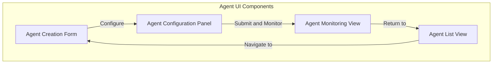
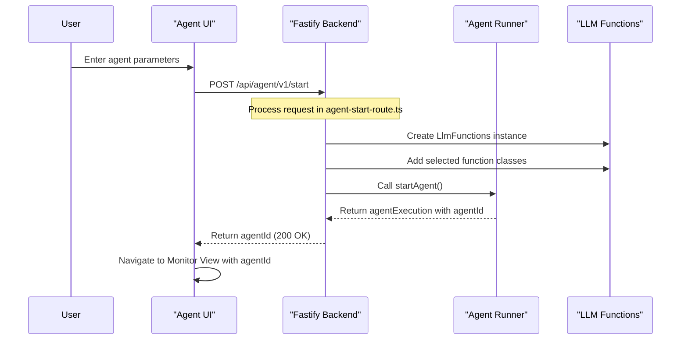
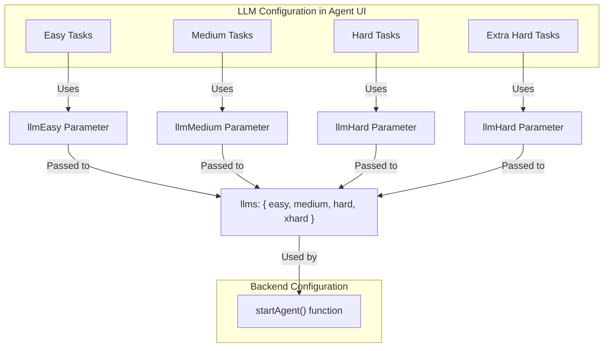
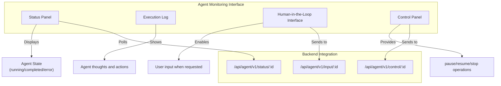
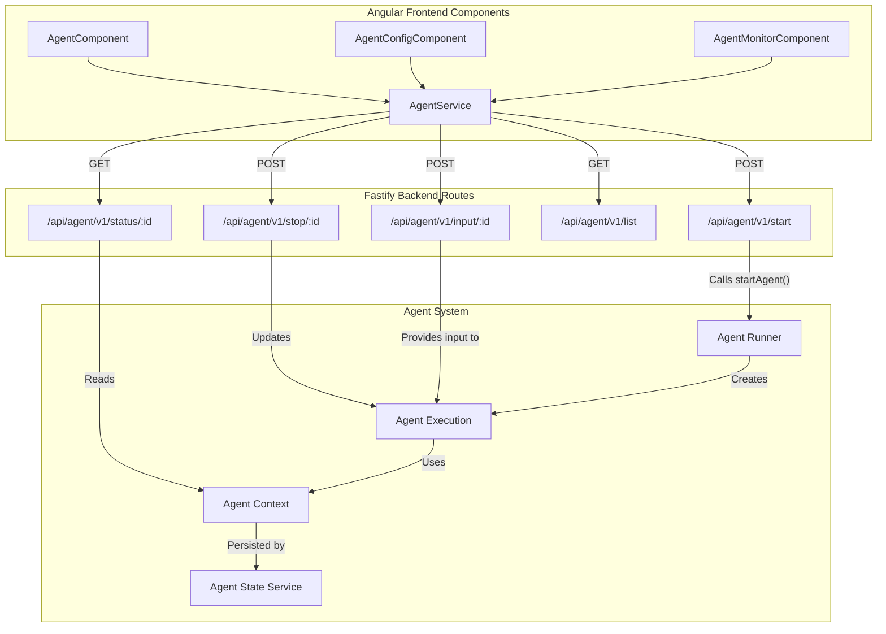

<!-- source: DeepWiki mcp.deepwiki.com · repo TrafficGuard/typedai · page 8.2 Agent UI · fetched 2026-10-26 -->

# Agent UI

Relevant source files

The following files were used as context for generating this wiki page:

- [docs/docs/agent-concepts.md](docs/docs/agent-concepts.md)
- [src/routes/agent/agent-start-route.ts](src/routes/agent/agent-start-route.ts)

## Purpose and Scope

The Agent UI provides a user-friendly interface for creating, configuring, and monitoring AI agents within the TypedAI platform. This document explains how to use the Agent UI to interact with TypedAI's agent system without writing code. For information about the conversational interface, see [Chat Interface](#8.1).

## Agent UI Architecture

The Agent UI consists of several interconnected components that work together to provide a comprehensive agent management experience.

Sources: [src/routes/agent/agent-start-route.ts]()

### Agent Creation Form
The Agent Creation Form allows users to specify the basic parameters required to instantiate a new agent:
- Agent name (a descriptive identifier)
- Initial prompt or task for the agent
- Agent type selection (XML, CodeGen)

### Agent Configuration Panel
The Configuration Panel provides options for:
- Selecting LLMs for different complexity levels (easy, medium, hard)
- Choosing functions the agent can use
- Setting human-in-the-loop parameters (budget and interaction count)

### Agent Monitoring View
The Monitoring View displays:
- Real-time agent execution status
- Agent's thought process and actions
- Human-in-the-loop interaction prompts
- Control options (pause, resume, stop)

### Agent List View
The List View provides:
- A list of all created agents
- Current status of each agent
- Options to monitor, resume, or delete agents

## Creating an Agent

The agent creation process in the UI maps directly to the backend API endpoint for starting agents.

Sources: [src/routes/agent/agent-start-route.ts:16-69]()

### Agent Types
TypedAI supports multiple agent types as defined in the codebase:

| Agent Type | Description |
|------------|-------------|
| XML | An autonomous agent that uses XML-based reasoning to break down tasks |
| CodeGen | An autonomous agent specialized for code generation tasks |

These are categorized as "autonomous agents" that dynamically direct their own processes and tool usage, as opposed to workflow agents which follow predefined paths.

Sources: [src/routes/agent/agent-start-route.ts:14](), [docs/docs/agent-concepts.md:13-20]()

### Required Parameters
When creating an agent through the UI, users must provide these parameters which map directly to the backend API:

| Parameter | Description | Type |
|-----------|-------------|------|
| name | Agent name | String |
| userPrompt | Initial instruction or task | String |
| functions | Array of function names the agent can use | Array of Strings |
| type | Agent type (xml, codegen) | String (enum) |
| budget | Maximum cost allowed for execution | Number |
| count | Number of human interactions allowed | Integer |
| llmEasy | LLM to use for easy tasks | String |
| llmMedium | LLM to use for medium-complexity tasks | String |
| llmHard | LLM to use for hard and extra-hard tasks | String |

Sources: [src/routes/agent/agent-start-route.ts:22-32]()

## Configuring Agent Parameters

### LLM Configuration
TypedAI uses a tiered approach to LLM selection based on task complexity:

Sources: [src/routes/agent/agent-start-route.ts:57-62](), [docs/docs/agent-concepts.md:66-69]()

### Function Selection
The function selection process works as follows:

1. Available functions are displayed in the UI
2. User selects relevant functions for the agent's task
3. Selected function names are passed to the backend
4. Backend retrieves function classes using `functionFactory()`
5. Functions are added to a `LlmFunctions` instance
6. The configured `LlmFunctions` instance is passed to the agent

This process gives the agent access to the specific tools it needs to complete its assigned task.

Sources: [src/routes/agent/agent-start-route.ts:40-49]()

## Monitoring Agent Execution

Once an agent is created, the Agent UI provides a comprehensive monitoring interface:

Sources: [docs/docs/agent-concepts.md:27-65]()

### Status Panel
The Status Panel shows the current state of the agent:
- `running` - The agent is actively executing its task
- `completed` - The agent has successfully completed its task
- `error` - The agent encountered an error during execution

These states directly correspond to the agent states in the `AgentContext` system.

### Execution Log
The Execution Log displays:
- Agent's reasoning and planning process
- Function calls made by the agent
- Results returned from functions
- Progress updates as the agent works

### Human-in-the-Loop Interface
When the agent requires human input:
1. The execution pauses
2. A prompt is displayed to the user
3. The user provides the requested input
4. The agent continues execution with the provided input

This interface respects the `budget` and `count` parameters set during agent creation, ensuring the agent doesn't exceed the specified limits for human interaction.

### Control Panel
The Control Panel offers buttons to:
- Pause a running agent
- Resume a paused agent
- Stop an agent completely
- View detailed execution logs and traces

## Agent UI to Backend Integration

The Agent UI communicates with the backend through a set of API endpoints:

Sources: [src/routes/agent/agent-start-route.ts:12-69](), [docs/docs/agent-concepts.md:33-65]()

### Key API Endpoints

The Agent UI interacts with these primary endpoints:

1. **Start Agent**
   - Endpoint: `/api/agent/v1/start`
   - Method: POST
   - Purpose: Creates a new agent with specified parameters
   - Implementation: [src/routes/agent/agent-start-route.ts:18-68]()

2. **Get Agent Status**
   - Endpoint: `/api/agent/v1/status/:id`
   - Method: GET
   - Purpose: Retrieves current agent state and outputs

3. **Control Agent**
   - Endpoint: `/api/agent/v1/control/:id`
   - Method: POST
   - Purpose: Sends pause/resume/stop commands

4. **Provide Input**
   - Endpoint: `/api/agent/v1/input/:id`
   - Method: POST
   - Purpose: Submits human input for human-in-the-loop interactions

5. **List Agents**
   - Endpoint: `/api/agent/v1/list`
   - Method: GET
   - Purpose: Retrieves all agents and their current states

## Integration with Agent System

The Agent UI relies on the underlying agent system architecture, which uses `AsyncLocalStorage` to maintain agent context across asynchronous operations. This architecture, as described in the agent concepts documentation, provides a unified way to access agent state, user context, tool configuration, and default LLMs.

When an agent is started through the UI:

1. An `AgentContext` is created
2. The agent runs within an `AsyncLocalStorage` context
3. The agent execution is wrapped in an OpenTelemetry span for tracing
4. Agent state is persisted to allow for UI monitoring and interaction

This design allows the Agent UI to provide a seamless interface to the powerful agent capabilities of TypedAI while abstracting away the underlying complexity.

Sources: [docs/docs/agent-concepts.md:27-65]()

---

