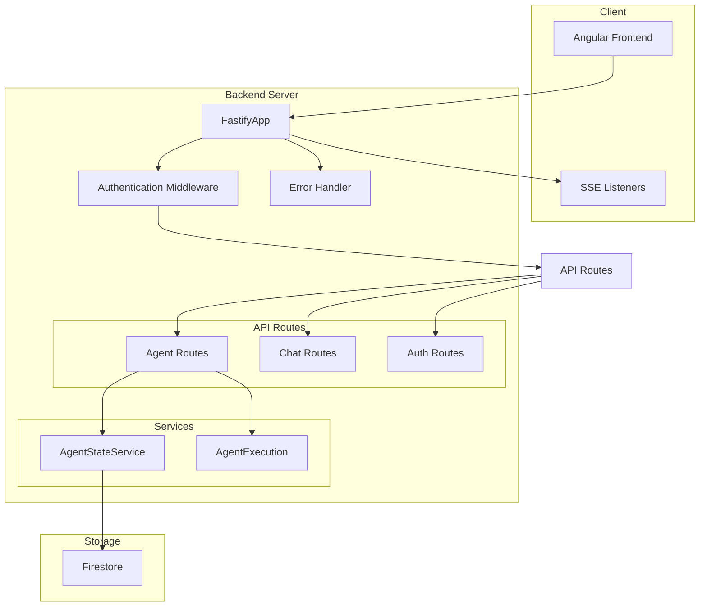
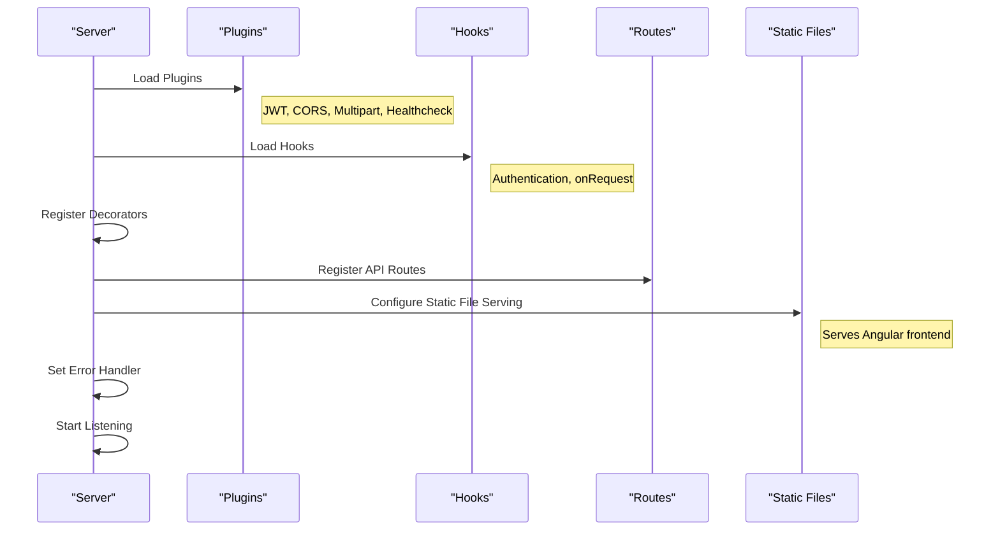
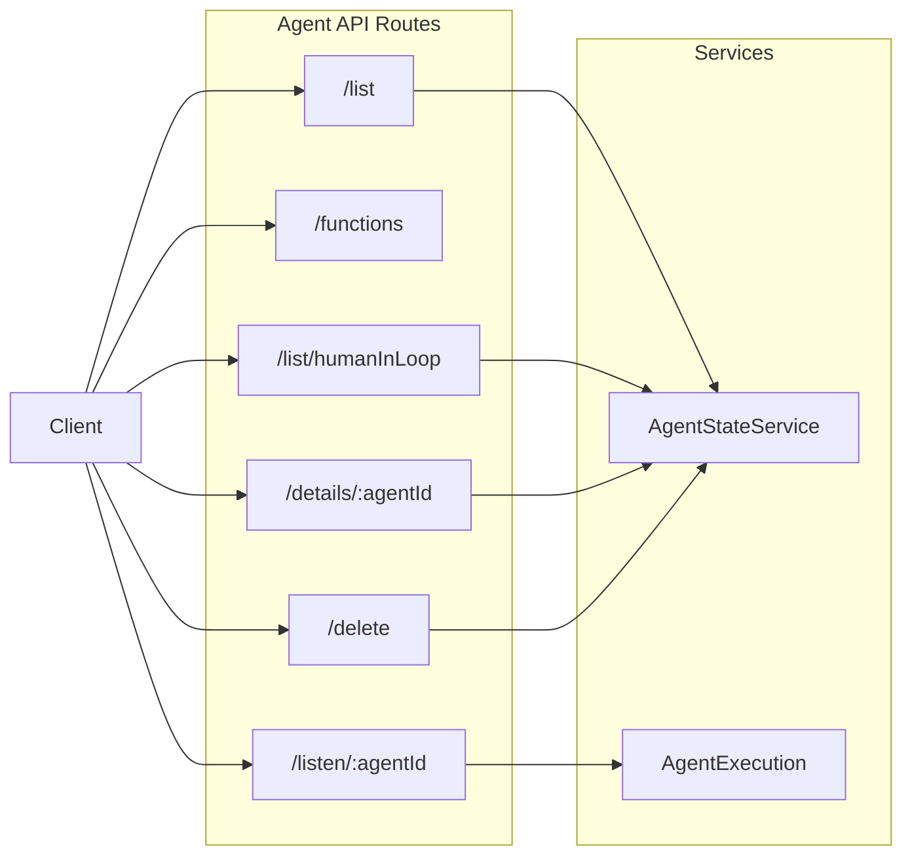
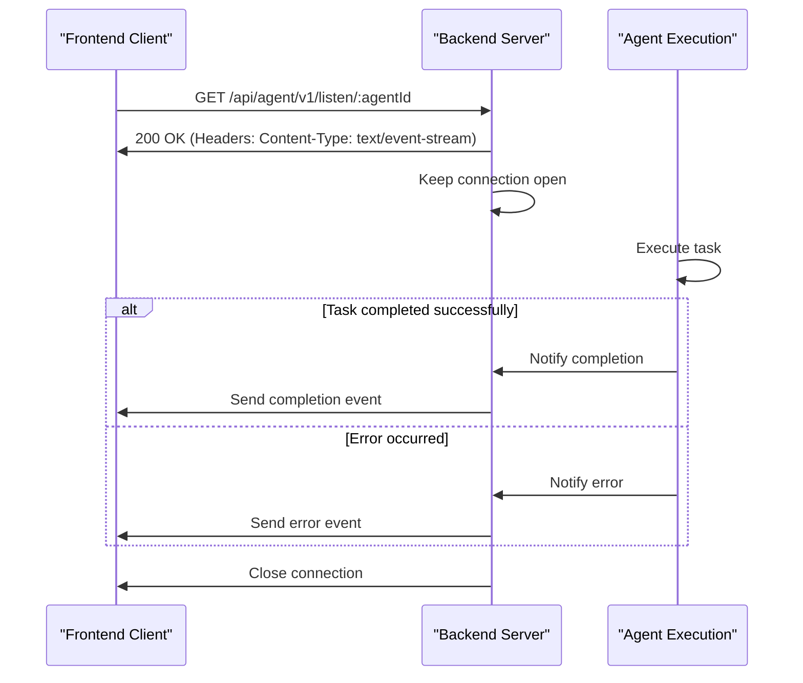
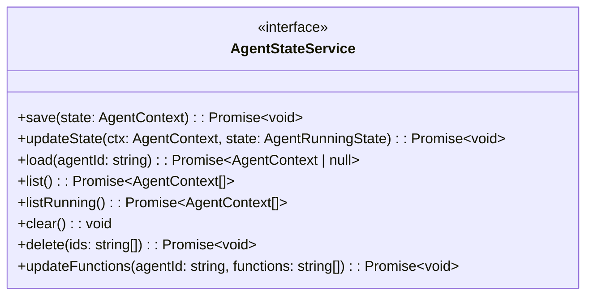
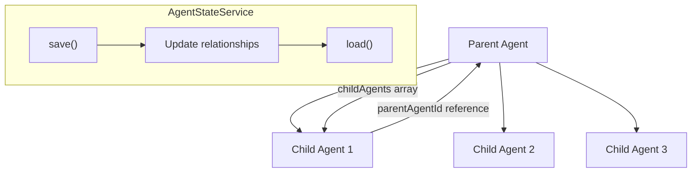
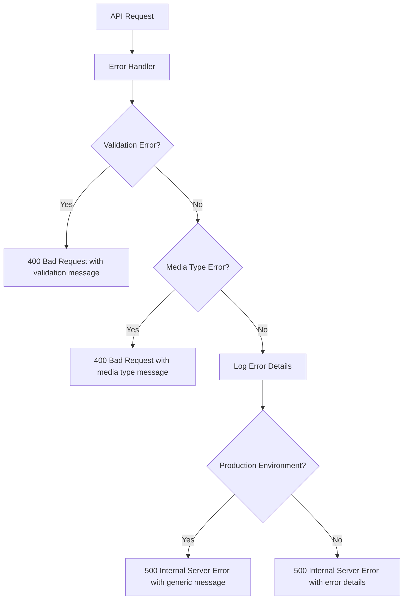

<!-- source: DeepWiki mcp.deepwiki.com · repo TrafficGuard/typedai · page 9 API & Backend · fetched 2026-10-26 -->

# API & Backend

Relevant source files

The following files were used as context for generating this wiki page:

- [src/agent/agentStateService/agentStateService.int.ts](src/agent/agentStateService/agentStateService.int.ts)
- [src/agent/agentStateService/agentStateService.ts](src/agent/agentStateService/agentStateService.ts)
- [src/fastify/fastifyApp.ts](src/fastify/fastifyApp.ts)
- [src/fastify/hooks.ts](src/fastify/hooks.ts)
- [src/routes/agent/agent-details-routes.ts](src/routes/agent/agent-details-routes.ts)

This page documents the backend architecture and API endpoints of TypedAI. It covers the Fastify-based server implementation, API routes, authentication mechanisms, and server-side services for agent state management. For information about the frontend user interface, see [Web UI](#8).

## Backend Architecture Overview

TypedAI's backend is built on the Fastify framework, providing a high-performance HTTP server with TypeScript support via TypeBox. The backend handles API requests from the Angular frontend, manages agent state, and serves static content.

Sources: [src/fastify/fastifyApp.ts:37-116](), [src/routes/agent/agent-details-routes.ts:11-109]()

## Fastify Server Configuration

The backend server uses Fastify with TypeBox for type safety. The server is initialized with a configuration object that specifies routes, port, and other settings.

### Server Initialization

The server initialization process follows this sequence:
1. Load plugins (JWT, CORS, multipart, healthcheck)
2. Set up hooks (authentication, request handling)
3. Register decorators (for instance and request)
4. Register routes
5. Configure static file serving
6. Set up error handling
7. Start listening on the configured port

Sources: [src/fastify/fastifyApp.ts:58-116](), [src/fastify/fastifyApp.ts:133-155]()

### Authentication Methods

The backend supports three authentication methods, configurable via environment variables:

| Authentication Method | Environment Setting | Description |
|----------------------|---------------------|-------------|
| Google IAP | `AUTH=google_iap` | Authentication using Google Identity-Aware Proxy |
| Single User | `AUTH=single_user` | Simple single-user authentication for development |
| JWT | `AUTH=password` | Password-based authentication with JWT tokens |

Authentication is implemented as a middleware that runs on every request, with exceptions for public endpoints like health checks.

Sources: [src/fastify/fastifyApp.ts:157-174]()

## API Routes

The backend exposes RESTful API endpoints, all prefixed with `/api/`. Unmatched routes under this prefix return 404 errors.

### Agent API

The agent API provides endpoints for managing and monitoring agents:

| Endpoint | Method | Description |
|----------|--------|-------------|
| `/api/agent/v1/list` | GET | List all agents |
| `/api/agent/v1/functions` | GET | List available functions for agents |
| `/api/agent/v1/list/humanInLoop` | GET | List agents in human-in-loop state |
| `/api/agent/v1/details/:agentId` | GET | Get detailed information about a specific agent |
| `/api/agent/v1/delete` | POST | Delete specified agents |
| `/api/agent/v1/listen/:agentId` | GET | SSE endpoint for real-time agent updates |

Sources: [src/routes/agent/agent-details-routes.ts:11-109]()

## Server-Sent Events (SSE)

The backend uses Server-Sent Events to provide real-time updates about agent execution to the frontend. This is implemented in the `/api/agent/v1/listen/:agentId` endpoint.

The SSE protocol allows the server to push updates to the client without the client having to poll for changes. The server keeps the connection open and sends events when they occur.

Sources: [src/routes/agent/agent-details-routes.ts:74-108]()

## Agent State Management

TypedAI uses an `AgentStateService` to manage agent state persistence and retrieval. This service provides methods for saving, loading, and managing agent contexts.

### AgentStateService Interface

The `AgentStateService` interface defines the following operations:

The implementation of this interface can vary based on the storage backend. The primary implementation uses Firestore for persistence.

Sources: [src/agent/agentStateService/agentStateService.ts:1-22]()

### Parent-Child Agent Relationships

TypedAI supports hierarchical relationships between agents, where a parent agent can spawn child agents. The `AgentStateService` manages these relationships and ensures consistency:

1. When a child agent is created with a `parentAgentId`, the service verifies the parent exists
2. The parent agent's `childAgents` array is updated to include the new child
3. This relationship is maintained during state persistence and retrieval

Sources: [src/agent/agentStateService/agentStateService.int.ts:21-108]()

## Error Handling

The backend implements a centralized error handler that captures and processes different types of errors:

1. Validation errors (400 Bad Request)
2. Media type errors (400 Bad Request)
3. Other errors (500 Internal Server Error)

In production environments, detailed error messages are suppressed in responses to prevent information leakage, while development environments receive full error details to aid debugging.

Sources: [src/fastify/fastifyApp.ts:203-236]()

## Static File Serving

The backend serves the Angular frontend as static files, with special handling for Angular routes:

1. Static files (HTML, CSS, JS) are served from a configured directory
2. A fallback route serves the Angular `index.html` for any frontend route under `/ui/`
3. Headers prevent caching of the Angular index file to ensure users always get the latest version

Sources: [src/fastify/fastifyApp.ts:80-97]()

## Development and Testing

The backend includes support for different environments:

1. Development: Enhanced error details and in-memory storage options
2. Production: Limited error details and persistent storage with Firestore
3. Testing: Supports testing with emulators and mock implementations

Integration tests ensure that complex operations like parent-child agent relationships work correctly across the storage layer.

Sources: [src/agent/agentStateService/agentStateService.int.ts:8-144]()

---

