# Page: Overview

# Overview

<details>
<summary>Relevant source files</summary>

The following files were used as context for generating this wiki page:

- [README.md](README.md)
- [docs/docs/autonomous-agents.md](docs/docs/autonomous-agents.md)
- [docs/docs/examples.md](docs/docs/examples.md)
- [docs/docs/index.md](docs/docs/index.md)
- [docs/docs/roadmap.md](docs/docs/roadmap.md)
- [docs/docs/setup.md](docs/docs/setup.md)
- [docs/docs/software-engineer.md](docs/docs/software-engineer.md)
- [docs/mkdocs.yml](docs/mkdocs.yml)
- [frontend/package-lock.json](frontend/package-lock.json)
- [frontend/package.json](frontend/package.json)
- [package-lock.json](package-lock.json)
- [package.json](package.json)
- [variables/local.env.example](variables/local.env.example)

</details>


TypedAI is a comprehensive TypeScript-first platform designed for building and running autonomous AI agents and LLM-based workflows. It provides a flexible framework for developing AI agents that can perform complex tasks, with particular strength in software engineering workflows. This page provides a high-level overview of the platform's architecture, core components, and functionality.

For detailed information about getting started with TypedAI, see [Getting Started](#2). For information on specific agent implementations, see [Agent System](#3).

## System Architecture

TypedAI is organized into several interconnected components that work together to provide its capabilities. The platform is built with TypeScript/Node.js and follows a modular design that enables flexibility in deployment and usage.

### Core System Architecture

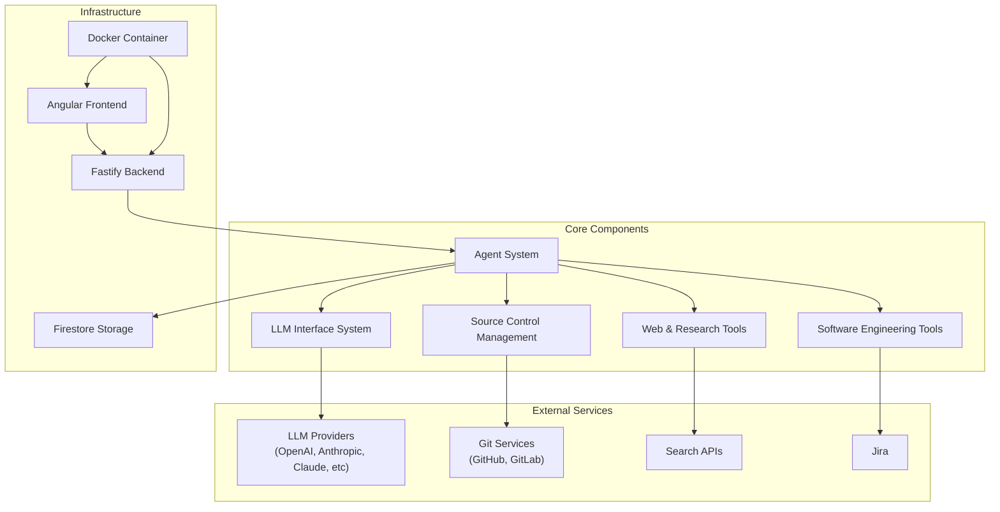

Sources:
- [README.md:1-192]()
- [package.json:1-177]()
- [docs/docs/index.md:1-192]()

The platform consists of several key components:

1. **Agent System**: The core of the platform, providing autonomous and workflow-based AI agents.
2. **LLM Interface System**: Abstracts away LLM provider details, supporting multiple services like OpenAI, Anthropic, and others.
3. **Software Engineering Tools**: Specialized tools for code editing, source control, and software development tasks.
4. **Web & Research Tools**: Tools that enable agents to perform web research and interact with online services.
5. **Infrastructure**: Components that support deployment and storage, including Docker containers, Firestore database, and Angular/Fastify for the frontend and backend.

## Key Features

TypedAI offers a wide range of capabilities:

- Autonomous AI agents with memory, planning, and human-in-the-loop functionality
- Software developer agents that can write and modify code
- Pull request code review agent
- AI chat interface
- Slack chatbot
- Multi-agent implementations for extended reasoning
- Functional tool integrations with various services
- OpenTelemetry-based observability
- Python ecosystem integration

Sources:
- [README.md:23-47]()
- [docs/docs/index.md:17-37]()

## Agent Types and Execution Flow

TypedAI implements different types of agents to handle various use cases:

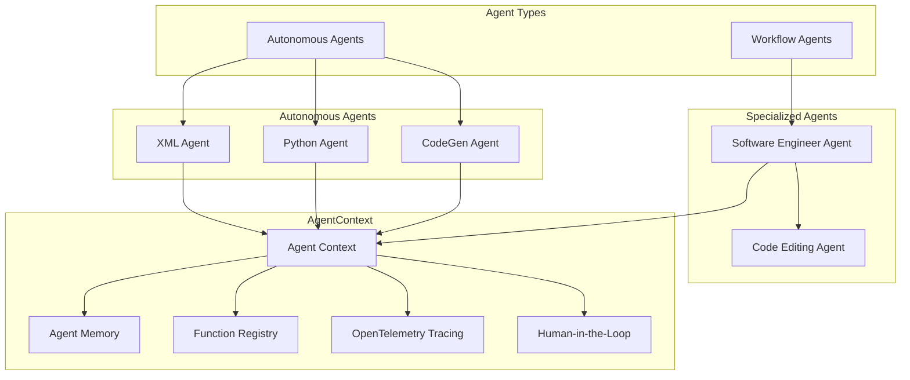

Sources:
- [docs/docs/autonomous-agents.md:1-61]()
- [docs/docs/software-engineer.md:1-105]()

The agent system includes two main types:

1. **Autonomous Agents**: Dynamic agents that reason through tasks:
   - **XML Agent**: Returns function calls in a custom XML format
   - **Python Agent**: Generates and executes Python code in a WebAssembly sandbox
   - **CodeGen Agent**: Specialized for code generation tasks

2. **Workflow Agents**: Follow predefined patterns with LLMs determining conditional paths:
   - **Software Engineer Agent**: Orchestrates software development workflows
   - **Code Editing Agent**: Handles code modification tasks

All agents share a common context structure that includes memory, function registry, tracing, and human-in-the-loop capabilities.

## LLM Integration

TypedAI employs a flexible architecture to abstract away provider-specific details while offering advanced capabilities:

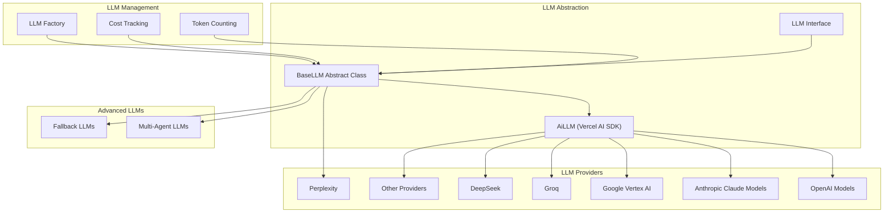

Sources:
- [package.json:54-91]()
- [docs/docs/index.md:32-34]()

The LLM integration system supports:

- Multiple LLM providers including OpenAI, Anthropic, Google Vertex AI, Groq, DeepSeek, and more
- Abstract interfaces for consistent function calls across providers
- Advanced patterns like multi-agent reasoning and fallback strategies
- Cost tracking and token counting

TypedAI leverages the Vercel AI SDK for many provider integrations while adding tracing and cost tracking capabilities.

## Software Engineering Workflow

One of TypedAI's key strengths is its software engineering capabilities:

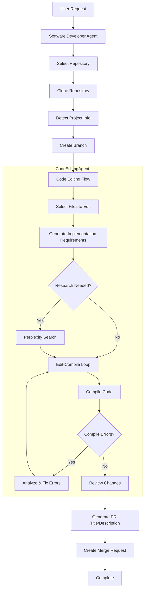

Sources:
- [docs/docs/software-engineer.md:1-105]()

The Software Engineering workflow includes:

1. **Project Selection**: Finding and selecting the appropriate repository
2. **Code Editing**: Selecting files, generating requirements, and implementing changes
3. **Testing & Debugging**: Compiling, analyzing errors, and fixing issues
4. **Integration**: Creating merge/pull requests for code changes

TypedAI's Code Editing Agent integrates with Aider for efficient diff editing and provides advanced capabilities like auto-detection of project initialization, compile, test, and lint commands.

## Backend and Frontend Integration

TypedAI uses a modern web architecture:

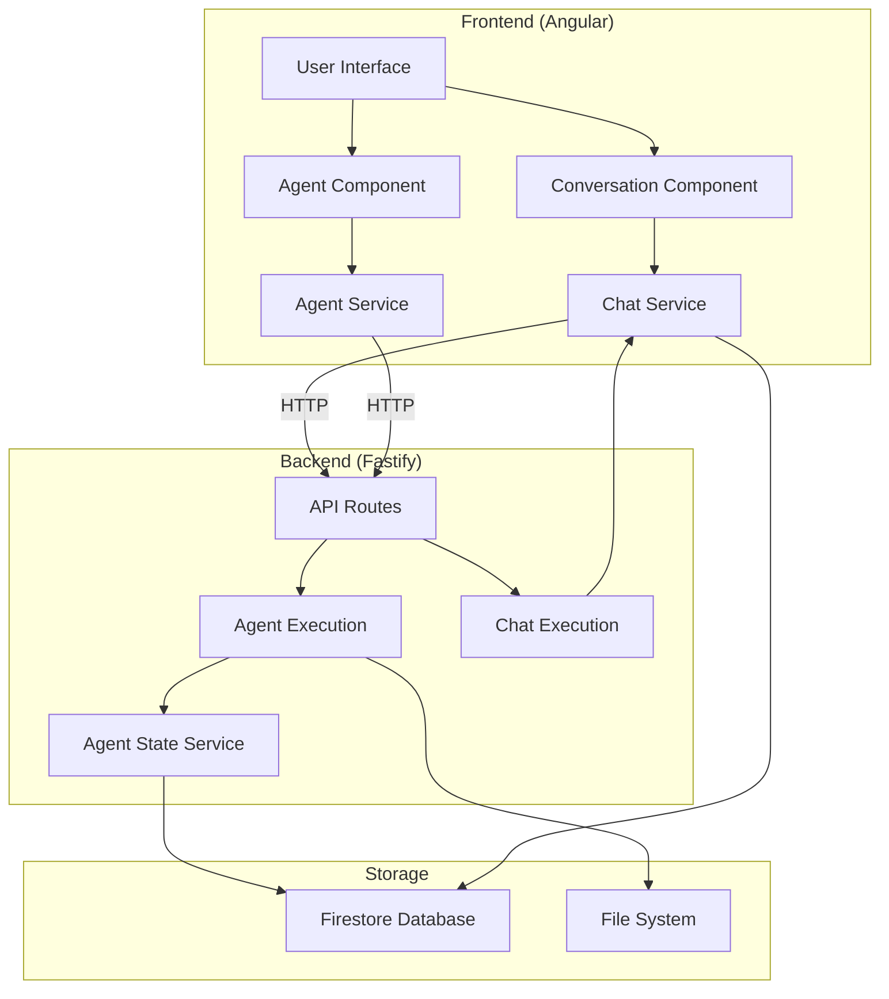

Sources:
- [frontend/package.json:1-86]()
- [package.json:67-75]()

The system uses:

1. **Frontend**: Angular-based web interface for interacting with agents and chats
2. **Backend**: Fastify server for handling API requests and agent execution
3. **Storage**: Firestore for persistence and file system for local operations

The frontend communicates with the backend through HTTP APIs, while the backend manages agent execution and persists state to Firestore. Server-sent events enable real-time updates for agent progress.

## Deployment Options

TypedAI offers flexible deployment options:

| Deployment Type | Description | Authentication | Storage |
|---|---|---|---|
| Local Development | Run directly from repository | Single user | In-memory or Firestore |
| Docker Container | Provided Dockerfile | Single user | In-memory or Firestore |
| Cloud Run | Scale-to-zero deployment | Multi-user SSO (Google Cloud IAP) | Firestore |
| Enterprise | Multi-user deployment | SSO integration | Firestore |

Sources:
- [docs/docs/setup.md:1-113]()
- [variables/local.env.example:1-67]()

The platform supports both local development with in-memory storage and production deployments with multi-user authentication, making it suitable for individual developers and enterprise teams.

## Key Technology Stack

TypedAI is built on a modern technology stack:

| Component | Technologies |
|---|---|
| Core Framework | Node.js with TypeScript |
| Frontend | Angular 18 with Material Design |
| Backend | Fastify |
| LLM Integration | Multiple providers via abstraction layers |
| Containerization | Docker |
| Storage | Google Firestore / In-memory |
| Monitoring | OpenTelemetry for tracing |
| Source Control | Integration with GitHub and GitLab |
| Development Tools | Code editing capabilities via Aider |

Sources:
- [package.json:54-135]()
- [frontend/package.json:25-53]()

## CLI Interface

TypedAI provides a powerful command-line interface for running agents and workflows:

```
npm run agent    # Run autonomous agent
npm run swe      # Run software engineer agent
npm run code     # Run code editing agent
npm run research # Run research agent
npm run easy     # Run simple LLM text generation
```

Sources:
- [package.json:10-32]()

## Comparison with Other Frameworks

TypedAI offers an alternative to frameworks like LangChain, emphasizing direct code flow over complex abstractions:

| TypedAI | LangChain |
|---|---|
| Direct control flow with async/await | Chain-based abstractions |
| Static typing with TypeScript | More complex type handling |
| Automated function schema generation | Manual schema definition |
| Debugging with standard tools | Custom debugging tools |

Sources:
- [README.md:124-185]()
- [docs/docs/index.md:91-152]()

TypedAI's approach allows for simpler code with standard TypeScript control flow, making it easier to debug and maintain.

## Function Calling

A key feature of TypedAI is automated LLM function schema generation using decorators:

```typescript
@funcClass(__filename)
export class Jira {
    /**
     * Gets the description of a JIRA issue
     * @param {string} issueId - the issue id (e.g. XYZ-123)
     * @returns {Promise<string>} the issue description
     */
    @func()
    async getJiraDescription(issueId: string): Promise<string> {
        // Implementation
    }
}
```

Sources:
- [README.md:186-219]()
- [docs/docs/index.md:165-186]()

This approach avoids schema duplication and leverages TypeScript's type system for function definitions.

---

# Page: Getting Started

# Getting Started

<details>
<summary>Relevant source files</summary>

The following files were used as context for generating this wiki page:

- [Dockerfile](Dockerfile)
- [Dockerfile.dev](Dockerfile.dev)
- [README.md](README.md)
- [bin/aider](bin/aider)
- [docker-compose.yml](docker-compose.yml)
- [docs/docs/autonomous-agents.md](docs/docs/autonomous-agents.md)
- [docs/docs/environment-variables.md](docs/docs/environment-variables.md)
- [docs/docs/examples.md](docs/docs/examples.md)
- [docs/docs/index.md](docs/docs/index.md)
- [docs/docs/roadmap.md](docs/docs/roadmap.md)
- [docs/docs/setup.md](docs/docs/setup.md)
- [docs/docs/software-engineer.md](docs/docs/software-engineer.md)
- [docs/mkdocs.yml](docs/mkdocs.yml)
- [frontend/package-lock.json](frontend/package-lock.json)
- [frontend/package.json](frontend/package.json)
- [package-lock.json](package-lock.json)
- [package.json](package.json)
- [src/initTiktokenizer.ts](src/initTiktokenizer.ts)
- [src/modules/firestore/firestoreLlmCallService.ts](src/modules/firestore/firestoreLlmCallService.ts)
- [variables/local.env.example](variables/local.env.example)

</details>


This page provides a comprehensive guide to setting up and running the TypedAI platform. It covers installation options, configuration requirements, and running your first agent. For more in-depth information about agents and their capabilities, see [Agent System](#3).

## Overview

TypedAI is a platform for developing and running autonomous AI agents, LLM-based workflows, and chatbots. Before diving into its extensive capabilities, you'll need to set up the environment and understand the basic system components.

### System Requirements

- Node.js ≥ 20.6.0
- Git (for repository management)
- Python 3.11 (for aider-chat and other Python dependencies)
- Internet access (for API calls to LLM providers)

Sources: [package.json:7-9](), [Dockerfile:2-14]()

## Installation Options

There are three primary ways to set up TypedAI:

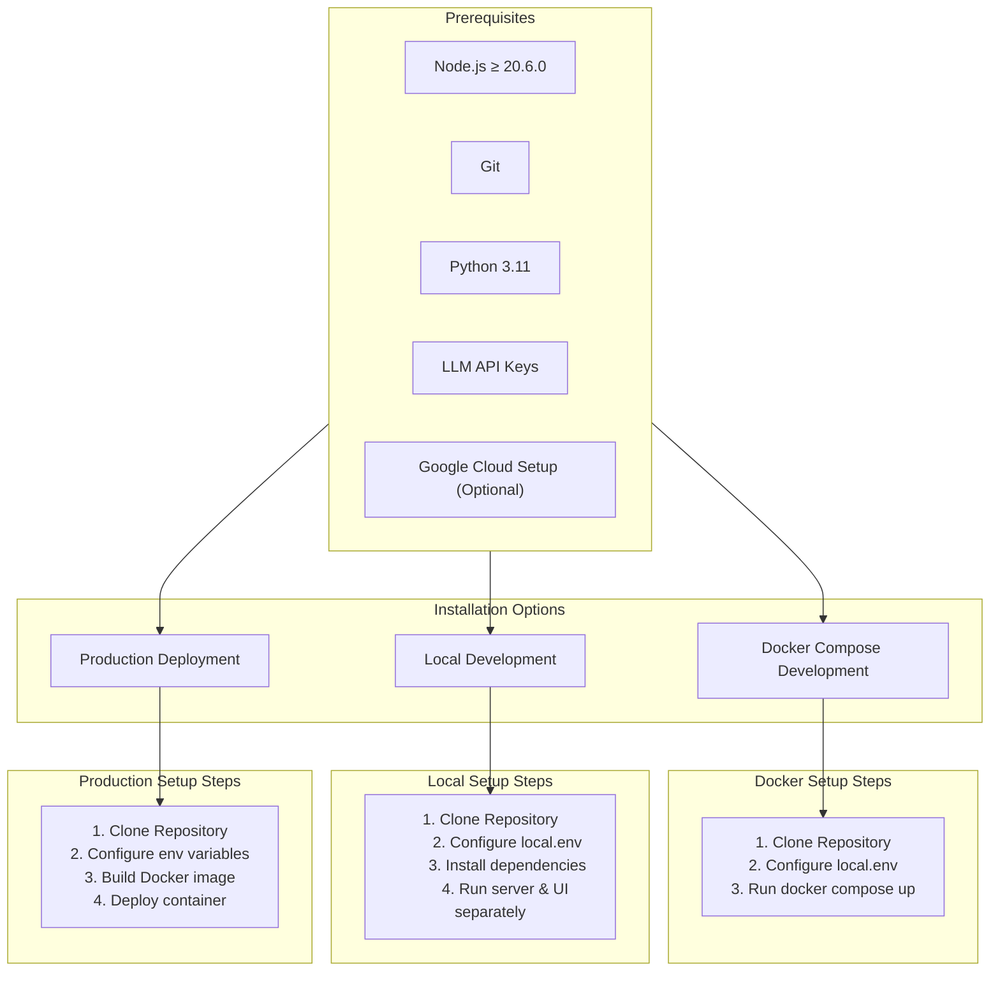

Sources: [README.md:72-79](), [Dockerfile:1-48](), [Dockerfile.dev:1-50](), [docker-compose.yml:1-21]()

### Docker Compose (Recommended for Development)

This option provides a complete environment with both backend and frontend components:

1. Clone the repository:
   ```bash
   git clone https://github.com/TrafficGuard/typedai.git
   cd typedai
   ```

2. Create your configuration file:
   ```bash
   cd variables
   cp local.env.example local.env
   ```

3. Edit `local.env` to add your configuration (see Configuration section below)

4. Start the development container:
   ```bash
   docker compose up --build
   ```

Sources: [docker-compose.yml:1-21](), [docs/docs/setup.md:1-9](), [docs/docs/setup.md:72-76]()

### Local Development Setup

For development directly on your host machine:

1. Clone the repository:
   ```bash
   git clone https://github.com/TrafficGuard/typedai.git
   cd typedai
   ```

2. Configure your environment:
   ```bash
   cd variables
   cp local.env.example local.env
   ```

3. Run the configuration script:
   ```bash
   source ./bin/configure
   ```

4. Start the server:
   ```bash
   npm run start:local
   ```

5. In a separate terminal, start the UI:
   ```bash
   cd frontend
   npm run start:local
   ```

The UI will be available at http://localhost:4200

Sources: [docs/docs/setup.md:79-105](), [package.json:10-49](), [frontend/package.json:8-23]()

### Production Deployment

TypedAI provides a production Dockerfile for deployment:

1. Configure environment variables according to your deployment environment
2. Build the Docker image:
   ```bash
   docker build -t typedai .
   ```
3. Run the container:
   ```bash
   docker run -p 8080:8080 -e NODE_ENV=production typedai
   ```

Sources: [Dockerfile:1-48]()

## Configuration

TypedAI uses environment variables for configuration. These can be set in the `variables/local.env` file or directly as environment variables.

### Essential Configuration

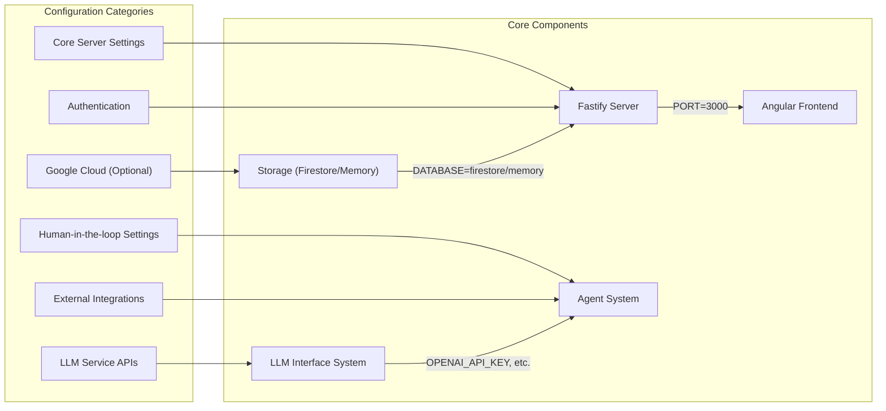

Sources: [variables/local.env.example:1-67](), [docs/docs/environment-variables.md:1-198]()

Here are the minimum required settings to get started:

| Setting | Description | Default |
|---------|-------------|---------|
| `DATABASE` | Storage type (`firestore` or `memory`) | `firestore` |
| `AUTH` | Authentication mode | `single_user` |
| `SINGLE_USER_EMAIL` | User email for single-user mode | (required) |
| At least one LLM API key | e.g., `OPENAI_API_KEY`, `ANTHROPIC_API_KEY` | (required) |

For a quick start without Google Cloud:
- Set `DATABASE=memory` 
- Set `TRACE_AGENT_ENABLED=false`

Sources: [variables/local.env.example:1-67](), [docs/docs/setup.md:61-66]()

### LLM API Keys

TypedAI supports multiple LLM providers. Configure at least one of these in your environment:

| Provider | Environment Variable | Link to obtain key |
|----------|---------------------|-------------------|
| Anthropic | `ANTHROPIC_API_KEY` | https://console.anthropic.com/settings/keys |
| OpenAI | `OPENAI_API_KEY` | https://platform.openai.com/api-keys |
| Groq | `GROQ_API_KEY` | https://console.groq.com/keys |
| Together.ai | `TOGETHERAI_API_KEY` | https://api.together.ai/settings/api-keys |
| Fireworks | `FIREWORKS_API_KEY` | https://fireworks.ai/api-keys |
| DeepSeek | `DEEPSEEK_API_KEY` | https://platform.deepseek.com/api_keys |

Sources: [variables/local.env.example:30-41](), [docs/docs/setup.md:21-31]()

### Google Cloud Configuration (Recommended)

For persistent storage and additional features:

1. Install the [gcloud](https://cloud.google.com/sdk/docs/install) command line tool
2. Create a Google Cloud project
3. Update `GCLOUD_PROJECT` and `GCLOUD_REGION` variables in your `local.env`
4. Run the setup script:
   ```bash
   ./bin/gcp_setup
   ```
5. Authenticate with Google Cloud:
   ```bash
   gcloud auth application-default login
   ```

Sources: [docs/docs/setup.md:38-52](), [variables/local.env.example:11-16]()

## Running Your First Agent

TypedAI offers multiple ways to run agents: through the CLI, the web UI, or programmatically.

### Using the CLI

The TypedAI CLI provides various commands for running different types of agents:

```bash
# Run a generic agent
npm run agent -- --name "My First Agent" --prompt "Research the latest AI trends and summarize them"

# Run a software engineering agent
npm run swe -- --name "Feature Implementation" --prompt "Add a search feature to a React application"

# Run a Python agent
npm run py -- --name "Data Analysis" --prompt "Analyze this CSV file and create visualizations"
```

Sources: [package.json:13-31]()

### Using the Web UI

Once you have the system running:

1. Navigate to http://localhost:4200 (or your configured UI URL)
2. Login with your configured credentials
3. Click "New Agent" to create an agent
4. Choose the agent type, configure functions, and enter your prompt
5. Click "Run Agent" to start the agent

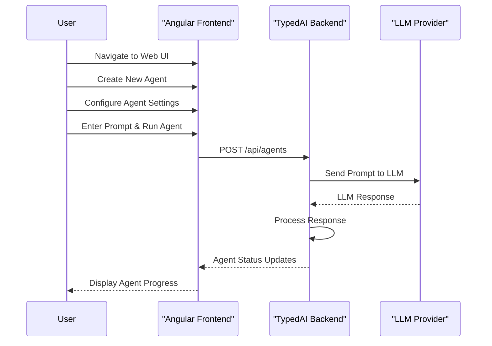

Sources: [README.md:83-94](), [docs/docs/index.md:50-56]()

## Human-in-the-Loop Controls

TypedAI incorporates human-in-the-loop controls to manage agent behavior:

| Setting | Description | Default |
|---------|-------------|---------|
| `HIL_BUDGET` | Budget threshold in USD | 1.0 |
| `HIL_COUNT` | Maximum iterations before human intervention | 5 |

When an agent reaches these thresholds or encounters an error, it will pause and request human feedback before continuing.

Sources: [variables/local.env.example:25-28](), [docs/docs/autonomous-agents.md:44-60]()

## Next Steps

After setting up TypedAI and running your first agent, explore these topics:

- [Agent System](#3) - Learn about different agent types and their capabilities
- [LLM Integration](#4) - Understand how TypedAI interfaces with various LLM providers
- [Software Engineering Tools](#5) - Explore the code editing and source control capabilities
- [CLI Interface](#7) - Discover all the CLI commands and options
- [Web UI](#8) - Learn about the web interface features

Sources: [README.md:17-37]()

---

# Page: Installation & Setup

# Installation & Setup

<details>
<summary>Relevant source files</summary>

The following files were used as context for generating this wiki page:

- [Dockerfile](Dockerfile)
- [Dockerfile.dev](Dockerfile.dev)
- [bin/aider](bin/aider)
- [docker-compose.yml](docker-compose.yml)
- [docs/docs/environment-variables.md](docs/docs/environment-variables.md)
- [frontend/package-lock.json](frontend/package-lock.json)
- [frontend/package.json](frontend/package.json)
- [frontend/scripts/env.js](frontend/scripts/env.js)
- [frontend/src/app/mock-api/common/navigation/data.ts](frontend/src/app/mock-api/common/navigation/data.ts)
- [frontend/src/app/modules/chat/conversation/clipboard-button.component.ts](frontend/src/app/modules/chat/conversation/clipboard-button.component.ts)
- [frontend/src/app/modules/chat/conversation/conversation.component.html](frontend/src/app/modules/chat/conversation/conversation.component.html)
- [frontend/src/environments/environment.prod.ts](frontend/src/environments/environment.prod.ts)
- [frontend/src/environments/environment.ts](frontend/src/environments/environment.ts)
- [package-lock.json](package-lock.json)
- [package.json](package.json)
- [src/initTiktokenizer.ts](src/initTiktokenizer.ts)
- [src/modules/firestore/firestoreLlmCallService.ts](src/modules/firestore/firestoreLlmCallService.ts)
- [variables/local.env.example](variables/local.env.example)

</details>


This guide provides detailed instructions for installing and configuring the TypedAI platform. It covers system requirements, installation options, environment configuration, and initial startup procedures. For information about using the platform after installation, see [Getting Started](#2).

## System Requirements

TypedAI requires the following minimum system requirements:

- **Node.js**: Version 20.6.0 or higher
- **Python**: Version 3.11 (for aider-chat integration)
- **Operating System**: Linux, macOS, or Windows (via Docker)
- **Recommended Hardware**:
  - 4GB RAM minimum, 8GB+ recommended
  - 10GB free disk space
  - Modern multi-core CPU

Sources: [package.json:7-9](), [Dockerfile:2]()

## Installation Options

TypedAI offers two primary installation methods:

1. **Local Installation**: Direct installation on your system
2. **Docker-based Installation**: Containerized setup for development or production

### Installation Architecture

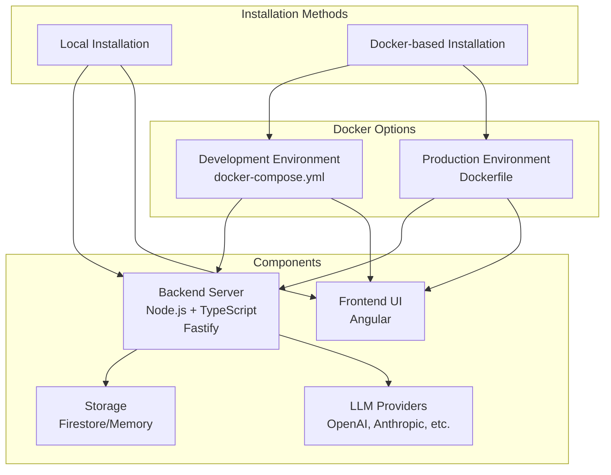

Sources: [Dockerfile](), [Dockerfile.dev](), [docker-compose.yml]()

### Local Installation

Follow these steps to install TypedAI locally:

1. **Clone the repository**:
   ```bash
   git clone https://github.com/TrafficGuard/typedai.git
   cd typedai
   ```

2. **Install dependencies**:
   ```bash
   npm ci
   ```

3. **Initialize the tokenizer model**:
   ```bash
   npm run initTiktokenizer
   ```

4. **Generate function schemas**:
   ```bash
   npm run functionSchemas
   ```

5. **Configure environment variables**:
   ```bash
   cp variables/local.env.example variables/local.env
   # Edit variables/local.env with your preferred editor
   ```

6. **Install frontend dependencies**:
   ```bash
   cd frontend
   npm ci
   cd ..
   ```

Sources: [package.json:11-49](), [src/initTiktokenizer.ts]()

### Docker-based Installation

#### Development Environment

The development environment uses Docker Compose for easy setup:

1. **Clone the repository**:
   ```bash
   git clone https://github.com/TrafficGuard/typedai.git
   cd typedai
   ```

2. **Configure environment variables**:
   ```bash
   cp variables/local.env.example variables/local.env
   # Edit variables/local.env with your preferred editor
   ```

3. **Start the Docker Compose environment**:
   ```bash
   docker compose up --build
   ```

This will create a container named `typedai-dev` with the application running in development mode.

Sources: [docker-compose.yml](), [Dockerfile.dev]()

#### Production Environment

For production deployment:

1. **Build the Docker image**:
   ```bash
   docker build -t typedai:latest .
   ```

2. **Run the container with environment variables**:
   ```bash
   docker run -p 8080:8080 --env-file ./variables/prod.env typedai:latest
   ```

Sources: [Dockerfile]()

## Environment Configuration

TypedAI requires configuration through environment variables. These can be set in a `.env` file or provided directly to the application.

### Core Configuration

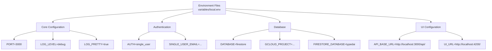

Essential environment variables:

| Variable | Description | Default | Required |
|----------|-------------|---------|----------|
| `PORT` | Backend server port | `3000` | No |
| `DATABASE` | Storage backend type | `firestore` | No |
| `AUTH` | Authentication method | `single_user` | No |
| `SINGLE_USER_EMAIL` | Email for single-user mode | - | Yes (if AUTH=single_user) |
| `API_BASE_URL` | Backend API URL | `http://localhost:3000/api/` | Yes |
| `UI_URL` | Frontend URL | `http://localhost:4200/` | Yes |
| `GCLOUD_PROJECT` | Google Cloud project ID | - | Yes (if DATABASE=firestore) |
| `FIRESTORE_DATABASE` | Firestore database name | `typedai` | No |

Sources: [variables/local.env.example:1-23]()

### LLM Provider Configuration

Configure at least one LLM provider API key to use the platform. TypedAI supports multiple LLM providers:

| Provider | Environment Variable | Required |
|----------|-------------|----------|
| Anthropic | `ANTHROPIC_API_KEY` | No |
| OpenAI | `OPENAI_API_KEY` | No |
| Groq | `GROQ_API_KEY` | No |
| Together AI | `TOGETHERAI_API_KEY` | No |
| Fireworks | `FIREWORKS_API_KEY` | No |
| DeepSeek | `DEEPSEEK_API_KEY` | No |
| Cerebras | `CEREBRAS_API_KEY` | No |
| Deep Infra | `DEEPINFRA_API_KEY` | No |
| Nebius | `NEBIUS_API_KEY` | No |
| SambaNova | `SAMBANOVA_API_KEY` | No |

At least one provider API key must be configured for the system to function properly.

Sources: [variables/local.env.example:30-42](), [package.json:54-91]()

### Integration Configuration

TypedAI can integrate with various external services:

#### Source Control Management

| Integration | Environment Variables | Description |
|-------------|----------------------|-------------|
| GitLab | `GITLAB_TOKEN`, `GITLAB_HOST`, `GITLAB_GROUPS` | GitLab integration for repository access |
| GitHub | `GITHUB_TOKEN`, `GITHUB_ORG`, `GITHUB_USER` | GitHub integration for repository access |

#### Project Management

| Integration | Environment Variables | Description |
|-------------|----------------------|-------------|
| Jira | `JIRA_BASE_URL`, `JIRA_EMAIL`, `JIRA_API_TOKEN` | Jira integration for issue tracking |

#### Web Search and Research

| Integration | Environment Variables | Description |
|-------------|----------------------|-------------|
| Perplexity | `PERPLEXITY_KEY` | Perplexity AI search integration |
| Google Search | `GOOGLE_CUSTOM_SEARCH_ENGINE_ID`, `GOOGLE_CUSTOM_SEARCH_KEY` | Google Custom Search integration |
| SERP API | `SERP_API_KEY` | SERP API for search results |

Sources: [variables/local.env.example:44-66]()

## Frontend Configuration

The Angular frontend requires environment configuration:

1. **Environment Variables**: The frontend reads environment variables from the same `.env` file used by the backend. The script `frontend/scripts/env.js` generates the appropriate environment configuration.

2. **Starting the Frontend**:
   - Local development: `cd frontend && npm run start:local`
   - Inside Docker: The frontend is automatically started at port 4200

The frontend environment configuration includes:

| Variable | Source Environment Variable | Description |
|----------|----------------------------|-------------|
| `apiBaseUrl` | `API_BASE_URL` | Backend API URL |
| `gcpProject` | `GCLOUD_PROJECT` | Google Cloud project ID |
| `firestoreDb` | `FIRESTORE_DATABASE` | Firestore database name |
| `auth` | `AUTH` | Authentication method |
| `modules` | `MODULES` | Enabled UI modules |

The frontend supports configuring which modules are displayed in the UI via the `MODULES` environment variable. Available modules include:

- `chat` - Chat interface
- `agents` - Agent management 
- `workflows` - Workflow management
- `codeReview` - Code review functionality

Sources: [frontend/scripts/env.js](), [frontend/src/environments/environment.ts](), [frontend/src/environments/environment.prod.ts](), [frontend/src/app/mock-api/common/navigation/data.ts:54-63]()

## Starting the System

### Development Mode

To start the TypedAI platform in development mode:

1. **Backend**:
   ```bash
   npm run start:local
   ```

2. **Frontend** (in a separate terminal):
   ```bash
   cd frontend
   npm run start:local
   ```

The backend will be available at http://localhost:3000 and the frontend at http://localhost:4200.

### Docker Development Mode

```bash
docker compose up
```

Both frontend and backend will be accessible from the host machine (frontend on port 4200, backend on port 3000).

### Production Mode

```bash
npm run build
npm run start
```

Or using Docker:

```bash
docker run -p 8080:8080 --env-file ./variables/prod.env typedai:latest
```

In production mode, the server serves both the API and the static frontend files on the same port (default: 8080).

Sources: [package.json:32-38](), [frontend/package.json:8-23](), [Dockerfile:45-48]()

## Verification

After installation, verify the system is working correctly:

1. **Backend Health Check**: Navigate to http://localhost:3000/health (or the configured port) to verify the backend is running.

2. **Frontend Access**: Open http://localhost:4200 in your browser and verify the login page appears.

3. **LLM Connection Test**: Create a simple chat conversation to test connectivity to the configured LLM providers.

4. **Storage Verification**: If using Firestore, check that data is being properly saved by examining LLM calls in the Firestore database.

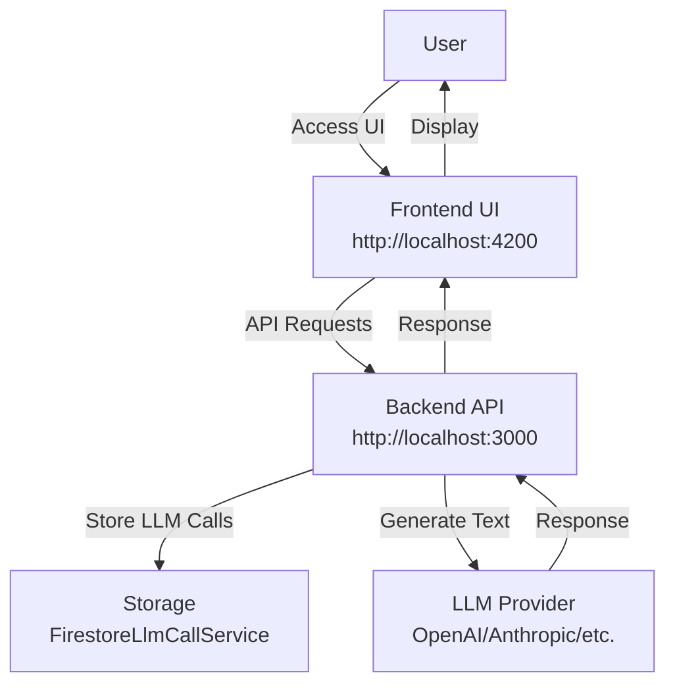

Sources: [src/modules/firestore/firestoreLlmCallService.ts](), [frontend/src/app/modules/chat/conversation/conversation.component.html]()

## Troubleshooting

### Common Issues

1. **Node.js Version**: Ensure you're using Node.js 20.6.0 or higher.
   ```bash
   node --version
   ```

2. **Environment Variables**: Check that all required environment variables are properly set.

3. **API Keys**: Verify that at least one LLM provider API key is correctly configured.

4. **Firestore Access**: If using Firestore, ensure the service account has proper permissions and the project ID is correct.

5. **Port Conflicts**: If ports 3000 or 4200 are already in use, modify the `PORT` environment variable and Angular configuration.

### Docker Issues

1. **Container Access**: For development with Docker, ensure ports 3000 and 4200 are not blocked by firewalls.

2. **Volume Mounting**: Verify that the Docker volumes are correctly mounted.

3. **Node Modules**: In some cases, you may need to rebuild node modules by removing the volume mounts for node_modules:
   ```bash
   docker compose down
   docker compose up --build
   ```

### Logs and Debugging

- Check the application logs for any errors
- Set `LOG_LEVEL=debug` and `LOG_PRETTY=true` for more detailed logging
- For tracing, set `TRACE_AGENT_ENABLED=true` to enable OpenTelemetry tracing

Sources: [variables/local.env.example:1-23](), [Dockerfile:45-48](), [Dockerfile.dev:47-49]()

---

# Page: Agent System

# Agent System

<details>
<summary>Relevant source files</summary>

The following files were used as context for generating this wiki page:

- [README.md](README.md)
- [docs/docs/autonomous-agents.md](docs/docs/autonomous-agents.md)
- [docs/docs/examples.md](docs/docs/examples.md)
- [docs/docs/index.md](docs/docs/index.md)
- [docs/docs/roadmap.md](docs/docs/roadmap.md)
- [docs/docs/setup.md](docs/docs/setup.md)
- [docs/docs/software-engineer.md](docs/docs/software-engineer.md)
- [docs/mkdocs.yml](docs/mkdocs.yml)
- [src/agent/agentContext.test.ts](src/agent/agentContext.test.ts)
- [src/agent/agentFunctions.ts](src/agent/agentFunctions.ts)
- [src/agent/xmlAgentRunner.ts](src/agent/xmlAgentRunner.ts)
- [src/routes/agent/agent-execution-routes.ts](src/routes/agent/agent-execution-routes.ts)

</details>


The Agent System is the core infrastructure that powers TypedAI's autonomous AI agents. This page explains the architecture, execution model, and key components that allow agents to plan, execute functions, and maintain state. For information about specific agent implementations like human-in-the-loop mechanisms, see [Agent Context & Memory](#3.1) and [Agent Types](#3.2).

## Architecture Overview

The Agent System provides a framework for different types of agents to operate with consistent state management, memory persistence, and function execution patterns. It follows a control loop architecture where agents repeatedly plan actions, execute functions, and evaluate results until completing their tasks or requiring human intervention.

**Agent System Architecture**
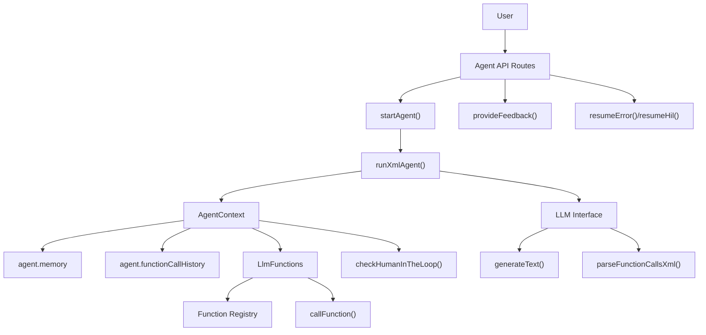

Sources: [src/agent/xmlAgentRunner.ts](), [README.md:39-48]()

## Agent Context

At the foundation of the Agent System is the `AgentContext` interface, which maintains all state and information needed for an agent's execution:

**Agent Context Structure**
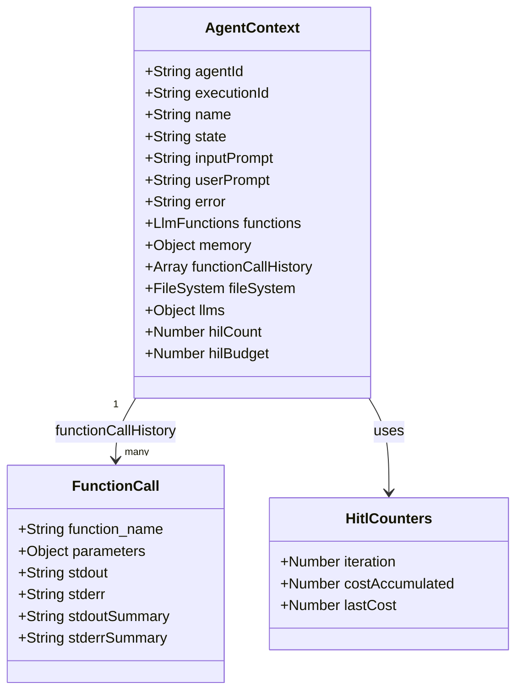

Key components of the agent context:

- **Identity**: `agentId`, `executionId`, and `name` uniquely identify each agent instance
- **State**: The `state` field tracks execution status (agent, functions, completed, error, feedback, hil)
- **Prompts**: `inputPrompt` and `userPrompt` contain the current and initial instructions
- **Functions**: `functions` (LlmFunctions instance) manages callable functions
- **Memory**: `memory` provides persistent storage across execution cycles
- **History**: `functionCallHistory` records all function calls and results
- **FileSystem**: File operations interface with configurable working directory
- **LLMs**: Different LLM interfaces for varying task complexity levels
- **HIL Settings**: `hilCount` and `hilBudget` control when human intervention is required

The agent context is serializable for persistence across executions using `serializeContext()` and `deserializeAgentContext()` functions.

Sources: [src/agent/agentContext.test.ts](), [src/agent/agentContextTypes.ts]()

## Agent Types

TypedAI supports multiple agent implementations with different execution models and capabilities:

**Agent Types Comparison**
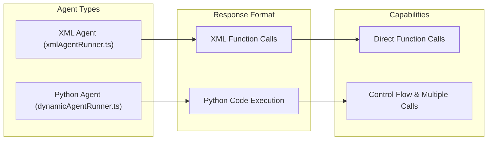

### XML Agent

The XML Agent (`runXmlAgent()`) uses an XML-based format for function calling:
- Implemented in [src/agent/xmlAgentRunner.ts]()
- Generates function calls in XML format using the format defined in [src/agent/xml-agent-system-prompt]()
- Executes functions sequentially with no conditional logic between calls
- Uses `parseFunctionCallsXml()` to extract function calls from LLM responses
- Works with a wide range of LLMs as it requires only basic text generation

### Python/Dynamic Agent

The Dynamic Agent uses executable Python code for more complex logic:
- Generates Python code that is executed in a sandboxed environment
- Allows conditional logic, loops, and multiple interdependent function calls
- More efficient for complex tasks requiring programmatic control flow
- Generally requires more capable LLMs to generate correct Python code

Sources: [docs/docs/autonomous-agents.md:10-26](), [src/agent/xmlAgentRunner.ts]()

## Execution Flow

The agent execution follows a control loop pattern, where the agent iteratively generates and executes function calls until the task is completed or intervention is needed:

**Agent Execution Flow**
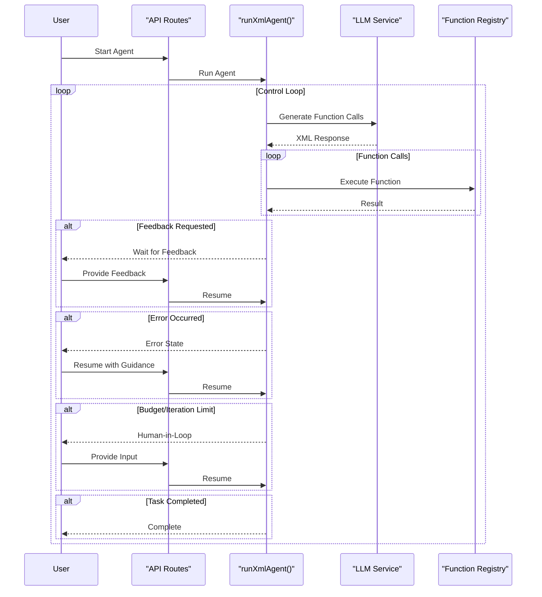

Key steps in the execution flow:

1. **Initialization**: Agent context is created with initial state, functions, and LLM instances
2. **Control Loop Entry**: The agent enters its main execution loop
3. **Prompt Construction**: The system builds prompts incorporating memory, function history, and current state
4. **Function Generation**: The LLM generates function calls based on the context
5. **Function Execution**: Each function is executed and results are captured
6. **State Updates**: Function results are added to history and state is updated
7. **Condition Checks**: 
   - If `Agent_completed` is called, the agent completes successfully
   - If `AgentFeedback_requestFeedback` is called, the agent pauses for user input
   - If a function error occurs, the agent may retry or enter error state
   - If budget/iteration limits are reached, human-in-the-loop is triggered
8. **Loop Continuation**: If no terminal conditions are met, the loop continues

Sources: [src/agent/xmlAgentRunner.ts:60-227](), [docs/docs/autonomous-agents.md:10-26]()

## Function Calling System

Agents interact with the system and external resources through a function registry:

### Function Registration

Functions are registered with the agent through the `LlmFunctions` class:

```typescript
// Adding functions to an agent
agent.functions = new LlmFunctions(FileSystem, Perplexity, CodeEditingAgent);
```

Functions are implemented as TypeScript classes with methods decorated using the `@func` decorator:

```typescript
@funcClass(__filename)
export class Agent {
    @func()
    async completed(note: string): Promise<void> {
        await this.saveMemory('Agent_competed_note', note);
    }
}
```

### Built-in Functions

Every agent has access to these built-in functions:

| Function | Purpose |
|----------|---------|
| `Agent_completed` | Signal task completion with final results |
| `Agent_saveMemory` | Store data in the agent's memory |
| `Agent_deleteMemory` | Remove items from memory |
| `Agent_getMemory` | Retrieve previously stored memory items |
| `AgentFeedback_requestFeedback` | Request human input during execution |

### Function Execution

When a function is called:
1. The agent finds the function in its registry
2. Parameters are validated and passed to the function
3. Results are captured (stdout) or errors are logged (stderr)
4. Function call is added to history for context in future iterations
5. For long outputs, a summary is generated to keep context manageable

Sources: [src/agent/agentFunctions.ts](), [src/agent/xmlAgentRunner.ts:150-196]()

## Memory Management

Agents have persistent memory that allows them to store and retrieve information across execution cycles:

```typescript
// Memory usage example
// Agent storing a search result
await agent.saveMemory("search_result", "Python was created by Guido van Rossum");

// Agent retrieving the stored information later
const result = await agent.getMemory("search_result");
```

The memory system provides:
- Persistent key-value storage across execution cycles
- Ability to accumulate information during complex tasks
- Context maintenance when generating new function calls
- State preservation when agents are paused and resumed

Memory is included in the agent prompt as part of the context, allowing the LLM to reference previously stored information when deciding on the next actions.

Sources: [src/agent/agentFunctions.ts:16-67](), [src/agent/agentPromptUtils.ts]()

## Human-in-the-Loop

The Human-in-the-Loop (HIL) system allows for user intervention during agent execution:

```typescript
// HIL counters structure
let hitlCounters: HitlCounters = { 
    iteration: 0, 
    costAccumulated: 0, 
    lastCost: 0 
};
```

HIL is triggered in several scenarios:
- **Budget Limits**: When the accumulated cost exceeds `hilBudget`
- **Iteration Limits**: After `hilCount` iterations of the control loop
- **Feedback Requests**: When the agent explicitly calls `AgentFeedback_requestFeedback`
- **Function Errors**: When multiple function calls return errors

When HIL is triggered, the agent:
1. Sets its state to `feedback`, `error`, or `hil`
2. Saves its current context
3. Awaits user input through the API
4. Resumes execution with the provided feedback

Sources: [src/agent/xmlAgentRunner.ts:45-54](), [src/agent/xmlAgentRunner.ts:80](), [docs/docs/autonomous-agents.md:44-62]()

## Agent API Integration

The Agent System exposes several API endpoints for controlling agents:

| API Endpoint | Function | Purpose |
|--------------|----------|---------|
| `/api/agent/v1/force-stop` | `forceStopAgent` | Immediately terminate an agent |
| `/api/agent/v1/feedback` | `provideFeedback` | Provide feedback to a waiting agent |
| `/api/agent/v1/resume-error` | `resumeError` | Resume an agent that encountered an error |
| `/api/agent/v1/resume-hil` | `resumeHil` | Resume after human-in-the-loop intervention |
| `/api/agent/v1/resume-completed` | `resumeCompleted` | Continue a completed agent with new instructions |
| `/api/agent/v1/cancel` | `cancelAgent` | Gracefully cancel an agent execution |
| `/api/agent/v1/update-functions` | Custom handler | Update the functions available to an agent |

These APIs enable seamless integration with:
- The TypedAI web interface
- CLI tools for agent management
- External systems through HTTP requests
- Notification systems (e.g., Slack) for HIL events

Sources: [src/routes/agent/agent-execution-routes.ts]()

## Agent Persistence

Agents maintain persistent state between executions through a serialization mechanism:

1. The `AgentStateService` handles saving and loading agents from storage
2. `serializeContext()` converts an agent context to a serializable object
3. `deserializeAgentContext()` reconstructs an agent from a serialized state
4. State is stored in Firestore or in-memory depending on configuration

The persistence system enables:
- Resuming agents after system restarts
- Human-in-the-loop interactions across sessions
- Async workflows where agents can be paused and resumed later
- Multi-user environments where different users can interact with agents

Sources: [src/agent/agentContext.test.ts:40-67](), [src/routes/agent/agent-execution-routes.ts]()

## Practical Applications

The Agent System powers various capabilities in TypedAI:

1. **Autonomous Research Agents**: Investigate topics using web search and process findings
2. **Software Engineering Agents**: Modify code, create implementations, and generate PRs
3. **Code Review Agents**: Analyze code changes and provide feedback
4. **Workflow Automation**: Execute complex multi-step processes with decision points
5. **Interactive Assistants**: Chat and perform actions based on user instructions

The flexibility of the agent system allows for new agent types to be developed by composing different function sets and specialized prompts.

Sources: [README.md:19-48](), [docs/docs/software-engineer.md]()

---

# Page: Agent Context & Memory

# Agent Context & Memory

<details>
<summary>Relevant source files</summary>

The following files were used as context for generating this wiki page:

- [src/agent/agentContext.test.ts](src/agent/agentContext.test.ts)
- [src/agent/agentFunctions.ts](src/agent/agentFunctions.ts)
- [src/agent/agentStateService/agentStateService.int.ts](src/agent/agentStateService/agentStateService.int.ts)
- [src/agent/agentStateService/agentStateService.ts](src/agent/agentStateService/agentStateService.ts)
- [src/routes/agent/agent-details-routes.ts](src/routes/agent/agent-details-routes.ts)

</details>


This document explains the agent context and memory systems in TypedAI, which provide state management and persistence for autonomous agents. The agent context serves as the comprehensive execution environment for agents, while the memory system offers a structured way for agents to store and retrieve information during their operation.

For information on different agent implementations, see [Agent Types](#3.2).

## Overview

The Agent Context & Memory system serves as the foundation for agent state management in TypedAI. It provides:

1. A comprehensive execution environment for agents
2. Persistent memory for storing and retrieving information
3. Function execution history tracking
4. Serialization for persistence and recovery
5. Parent-child agent relationship management

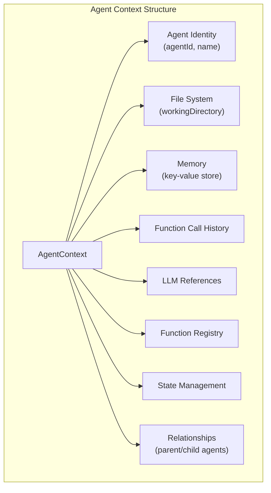

Sources: [src/agent/agentContext.test.ts:15-66](), [src/agent/agentStateService/agentStateService.ts:1-22]()

## Agent Context Structure

The `AgentContext` object serves as the execution environment and state container for each agent. It encapsulates all the information required for an agent to perform its tasks, including:

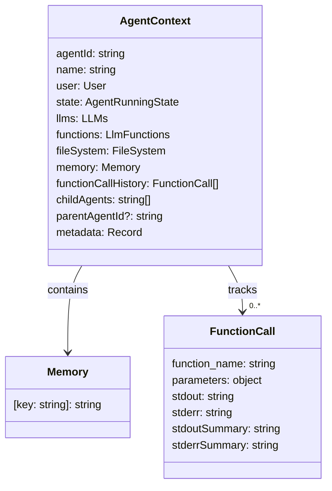

Sources: [src/agent/agentContext.test.ts:39-52](), [src/agent/agentStateService/agentStateService.int.ts:23-37]()

### Key Components

1. **Identity** - Unique identifiers including `agentId` and `name`
2. **State** - Current execution state (running, completed, human-in-loop)
3. **Resources** - Access to LLMs and available functions
4. **File System** - Virtual file system with working directory
5. **Memory** - Key-value store for retaining information
6. **Function Call History** - Record of executed functions and their results
7. **Relationships** - References to parent or child agents
8. **Metadata** - Additional contextual information

## Agent Memory System

The memory system provides agents with the ability to store and retrieve information through a simple key-value store. This allows agents to maintain state across interactions and build context throughout their execution.

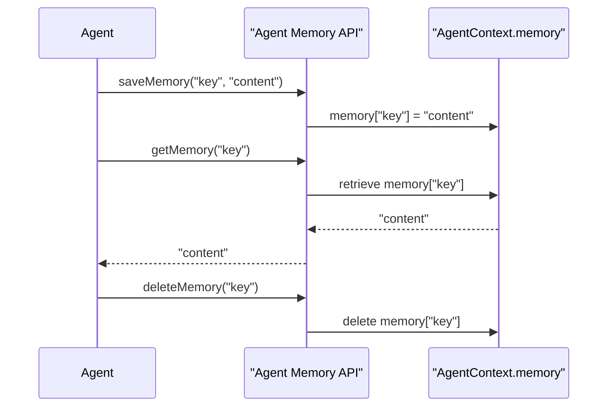

Sources: [src/agent/agentFunctions.ts:16-67]()

### Memory Operations

The `Agent` class provides the following methods for memory management:

| Method | Description | Parameters |
|--------|-------------|------------|
| `saveMemory` | Stores content in memory | `key`: Identifier, `content`: Data to store |
| `getMemory` | Retrieves content from memory | `key`: Identifier of data to retrieve |
| `deleteMemory` | Removes content from memory | `key`: Identifier of data to remove |
| `completed` | Marks agent as complete with final note | `note`: Final agent output |

Example usage:
```typescript
// Store information
await agent.saveMemory("research_results", "The analysis indicates...");

// Retrieve information
const results = await agent.getMemory("research_results");

// Remove information
await agent.deleteMemory("outdated_data");
```

Sources: [src/agent/agentFunctions.ts:22-66]()

## Serialization and Persistence

The AgentContext can be serialized for storage and deserialized when needed, enabling persistence across sessions and recovery from failures.

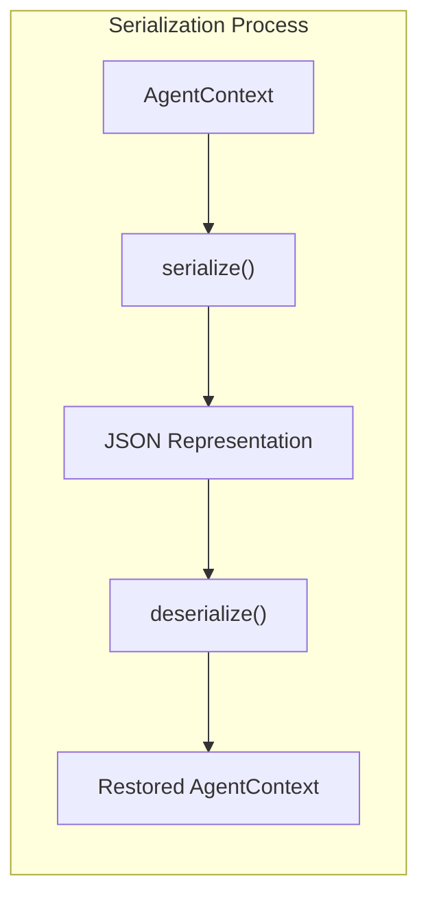

Sources: [src/agent/agentContext.test.ts:20-67]()

The serialization process:
1. Converts the agent context to a JSON-compatible format
2. Preserves all key properties (memory, functions, LLMs, etc.)
3. Handles function references appropriately
4. Allows reconstruction of the original context

When deserializing:
1. The function registry is used to reattach function implementations
2. LLM providers are reconnected
3. State is fully restored to continue execution

Sources: [src/agent/agentContext.test.ts:53-66]()

## Agent State Service

The `AgentStateService` interface provides methods for persisting and retrieving agent contexts:

| Method | Purpose |
|--------|---------|
| `save` | Persists an agent context |
| `updateState` | Updates an agent's running state |
| `load` | Retrieves an agent context by ID |
| `list` | Lists all agent contexts |
| `listRunning` | Lists non-completed agent contexts |
| `clear` | Removes all agent contexts |
| `delete` | Deletes specified agent contexts |
| `updateFunctions` | Updates an agent's available functions |

Sources: [src/agent/agentStateService/agentStateService.ts:3-22]()

## Agent Relationships

TypedAI supports hierarchical agent relationships, allowing parent agents to spawn child agents for delegated tasks.

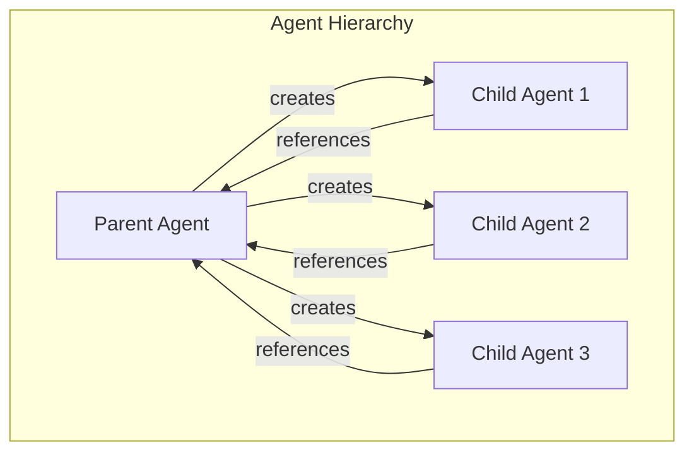

Sources: [src/agent/agentStateService/agentStateService.int.ts:21-107]()

### Parent-Child Relationships

1. **Parent Agents**:
   - Maintain a list of child agent IDs in the `childAgents` array
   - Can create and manage multiple child agents

2. **Child Agents**:
   - Reference their parent through the `parentAgentId` property
   - Are automatically added to their parent's child list when saved

Sources: [src/agent/agentStateService/agentStateService.int.ts:23-54]()

## Human-in-the-Loop Interaction

The agent context supports human-in-the-loop (HIL) interactions, where agents can pause execution to request human input before continuing.

```mermaid
stateDiagram-v2
    [*] --> Running
    Running --> HumanInLoop: wait for input
    HumanInLoop --> Running: receive input
    Running --> Completed: task finished
    HumanInLoop --> Completed: cancel agent
    Completed --> [*]
```

The agent context's `state` property can have the following values:
- `'running'`: Agent is actively executing
- `'hil'`: Agent is waiting for human input
- `'completed'`: Agent has finished execution

Sources: [src/routes/agent/agent-details-routes.ts:27-31]()

## API Integration

The Agent Context & Memory system is exposed through REST API endpoints:

| Endpoint | Method | Purpose |
|----------|--------|---------|
| `/api/agent/v1/list` | GET | List all agents |
| `/api/agent/v1/list/humanInLoop` | GET | List agents waiting for human input |
| `/api/agent/v1/details/:agentId` | GET | Get detailed agent context |
| `/api/agent/v1/delete` | POST | Delete specified agents |
| `/api/agent/v1/listen/:agentId` | GET | Subscribe to agent updates (SSE) |

The API uses Server-Sent Events (SSE) to provide real-time updates on agent progress and state changes.

Sources: [src/routes/agent/agent-details-routes.ts:11-109]()

## Best Practices for Using Agent Memory

1. **Structured Keys**:
   - Use descriptive, consistent naming patterns for memory keys
   - Keep keys under 30 characters and use alphanumeric characters with underscores

2. **Content Organization**:
   - Store focused, single-purpose content in each memory entry
   - For complex data, consider using JSON strings with appropriate parsing

3. **Memory Management**:
   - Clean up temporary memory entries when no longer needed
   - Use the `completed` method to properly signal task completion

4. **Parent-Child Communication**:
   - Use memory to share information between parent and child agents
   - Establish conventions for memory keys shared across agent hierarchies

Sources: [src/agent/agentFunctions.ts:28-53]()

## Summary

The Agent Context & Memory system provides a robust foundation for maintaining agent state and enabling persistence in TypedAI. It gives agents the ability to:

1. Store and retrieve information throughout their execution lifecycle
2. Track function execution history
3. Maintain file system state
4. Participate in hierarchical agent relationships
5. Support human-in-the-loop interaction
6. Persist state across sessions

This system is fundamental to enabling complex, multi-step agent workflows that can be interrupted, resumed, and audited.

---

# Page: Agent Types

# Agent Types

<details>
<summary>Relevant source files</summary>

The following files were used as context for generating this wiki page:

- [README.md](README.md)
- [docs/docs/autonomous-agents.md](docs/docs/autonomous-agents.md)
- [docs/docs/examples.md](docs/docs/examples.md)
- [docs/docs/index.md](docs/docs/index.md)
- [docs/docs/roadmap.md](docs/docs/roadmap.md)
- [docs/docs/setup.md](docs/docs/setup.md)
- [docs/docs/software-engineer.md](docs/docs/software-engineer.md)
- [docs/mkdocs.yml](docs/mkdocs.yml)
- [src/agent/xmlAgentRunner.ts](src/agent/xmlAgentRunner.ts)
- [src/cli/agent.ts](src/cli/agent.ts)
- [src/cli/code.ts](src/cli/code.ts)
- [src/cli/research.ts](src/cli/research.ts)
- [src/cli/swe.ts](src/cli/swe.ts)
- [src/cli/util.ts](src/cli/util.ts)
- [src/functionRegistry.ts](src/functionRegistry.ts)
- [src/routes/agent/agent-execution-routes.ts](src/routes/agent/agent-execution-routes.ts)

</details>


This document details the different agent implementations available in TypedAI and explains their unique characteristics, capabilities, and ideal use cases. TypedAI provides several agent types that serve different purposes within the platform's architecture. For information about how agents manage state and memory, see [Agent Context & Memory](#3.1).

## Agent Type Overview

TypedAI implements a flexible agent architecture that offers two primary categories of agents:

1. **Autonomous Agents** - Designed for general-purpose task completion with dynamic reasoning
   - XML Agent
   - Python/CodeGen Agent

2. **Workflow Agents** - Tailored for specific domains with more structured execution patterns
   - Software Engineer Agent
   - Code Editing Agent

```mermaid
flowchart TD
    classDef agentType fill:#f9f9f9,stroke:#333,stroke-width:1px
    classDef commonComponent fill:#f9f9f9,stroke:#333,stroke-width:1px
    
    Agents[/"TypedAI Agent System"/]
    
    subgraph "Agent Types"
        direction TB
        AutonomousAgents["Autonomous Agents"]:::agentType
        WorkflowAgents["Workflow Agents"]:::agentType
    end
    
    subgraph "Autonomous Implementations"
        XMLAgent["XML Agent"]:::agentType
        PythonAgent["Python/CodeGen Agent"]:::agentType
    end
    
    subgraph "Workflow Implementations"
        SWEAgent["Software Engineer Agent"]:::agentType
        CodeEditAgent["Code Editing Agent"]:::agentType
    end
    
    subgraph "Common Components"
        AgentContext["AgentContext"]:::commonComponent
        AgentMemory["Agent Memory"]:::commonComponent
        FunctionRegistry["Function Registry"]:::commonComponent
        HITL["Human-in-the-Loop"]:::commonComponent
    end
    
    Agents --> AutonomousAgents
    Agents --> WorkflowAgents
    
    AutonomousAgents --> XMLAgent
    AutonomousAgents --> PythonAgent
    
    WorkflowAgents --> SWEAgent
    WorkflowAgents --> CodeEditAgent
    SWEAgent --> CodeEditAgent
    
    XMLAgent & PythonAgent & SWEAgent & CodeEditAgent --> AgentContext
    
    AgentContext --> AgentMemory
    AgentContext --> FunctionRegistry
    AgentContext --> HITL
```

Sources: [README.md:24-47](). [docs/docs/autonomous-agents.md:10-26](). [docs/docs/index.md:19-29]().

## Autonomous Agents

Autonomous agents are general-purpose agents designed to solve a wide range of tasks through dynamic reasoning, planning, and execution. They use a control loop architecture that iteratively plans and executes functions to achieve the desired goal.

### Common Features of Autonomous Agents

- Reasoning/planning inspired by Google's Self-Discover paper and other research
- Memory and function call history for managing complex workflows
- Iterative planning with hierarchical task decomposition
- Human-in-the-loop capability for budget control, error handling, and decision making
- Configurable settings for cost management

```mermaid
flowchart TD
    subgraph "Autonomous Agent Control Loop"
        direction TB
        Start["User Request"] --> ReadState["Read Agent State"]
        ReadState --> Plan["Evaluate and Plan"]
        Plan --> Execute["Execute Function Calls"]
        Execute --> StoreResults["Store Results"]
        StoreResults --> CheckCompletion{{"Task Complete?"}}
        CheckCompletion --> |"No"| ReadState
        CheckCompletion --> |"Yes"| End["Return Results"]
        
        Feedback["Human Feedback"] -.-> |"If needed"| Plan
        Error["Error Handling"] -.-> Execute
    end
```

Sources: [docs/docs/autonomous-agents.md:1-9](). [src/agent/xmlAgentRunner.ts:61-223]().

### XML Agent

The XML Agent is an autonomous agent implementation that uses a specialized XML format for function calling and response parsing. It's designed to work with any sufficiently capable LLM by structuring the interaction in a standardized XML format.

#### How it works:

1. The agent constructs a prompt that includes:
   - The current function call history
   - Agent memory contents
   - The user's original request
   - Current file/tool state information

2. The prompt is sent to the LLM which returns an XML-formatted response containing function calls to execute.

3. The agent parses the XML response using `parseFunctionCallsXml` and executes the requested functions.

4. Results are formatted and added to the prompt for the next iteration.

5. This cycle continues until the agent reaches a conclusion or encounters an error.

```mermaid
flowchart TB
    subgraph "XML Agent Workflow"
        direction TB
        UserPrompt["User Prompt"] --> BuildPrompt["Build Prompt with Context"]
        BuildPrompt --> GenerateFunctionCalls["Generate XML Function Calls"]
        GenerateFunctionCalls --> ParseXML["Parse XML Response"]
        ParseXML --> ExecuteFunctions["Execute Functions"]
        ExecuteFunctions --> FormatResults["Format Results in XML"]
        FormatResults --> CheckCompletion{{"Complete?"}}
        CheckCompletion --> |"No"| BuildPrompt
        CheckCompletion --> |"Yes"| ReturnResults["Return Results"]
    end
    
    subgraph "XML Format Example"
        direction TB
        XMLResponse["<response>
        <function_calls>
            <function_call>
                <function_name>someFunction</function_name>
                <parameters>
                    <param1>value</param1>
                </parameters>
            </function_call>
        </function_calls>
        </response>"]
    end
    
    GenerateFunctionCalls --> XMLResponse
```

Sources: [src/agent/xmlAgentRunner.ts:24-227](). [docs/docs/autonomous-agents.md:17-18]().

### Python/CodeGen Agent

The Python/CodeGen Agent (also referred to as the "dynamic agent") executes Python code generated by the LLM in a WebAssembly sandbox. This approach allows for more complex operations including conditional logic, loops, and multiple function calls in a single step.

#### How it works:

1. The agent receives a prompt and constructs a context including memory, function history, and available tools.

2. The LLM generates Python code that will execute the necessary steps to fulfill the request.

3. This code is executed in a secure WebAssembly sandbox with function calls bound to the global scope.

4. The agent can perform multiple operations, validate results, and make conditional decisions in a single iteration.

#### Advantages:

- More efficient execution with multiple function calls per LLM request
- Ability to implement conditional logic and validation
- Reduced round-trips to the LLM, resulting in lower costs and faster execution

```mermaid
flowchart TB
    subgraph "Python/CodeGen Agent Workflow"
        direction TB
        UserPrompt["User Prompt"] --> BuildContext["Build Agent Context"]
        BuildContext --> GeneratePythonCode["Generate Python Code"]
        GeneratePythonCode --> ExecuteInSandbox["Execute in WASM Sandbox"]
        ExecuteInSandbox --> ProcessResults["Process Results"]
        ProcessResults --> CheckCompletion{{"Complete?"}}
        CheckCompletion --> |"No"| BuildContext
        CheckCompletion --> |"Yes"| ReturnResults["Return Results"]
    end
    
    subgraph "Python Code Example"
        direction TB
        PythonCode["```python
        # Check if file exists
        if FileSystem.fileExists('config.json'):
            config = FileSystem.readFile('config.json')
            parsed = json.loads(config)
            
            # Conditionally update config
            if 'version' in parsed:
                parsed['version'] += 1
                FileSystem.writeFile('config.json', json.dumps(parsed))
            else:
                requestFeedback('Config missing version')
        else:
            # Create new config
            FileSystem.writeFile('config.json', '{"version": 1}')
        ```"]
    end
    
    GeneratePythonCode --> PythonCode
```

Sources: [docs/docs/autonomous-agents.md:15-26](). [cli/agent.ts:46-48]().

### Comparison of Autonomous Agents

| Feature | XML Agent | Python/CodeGen Agent |
|---------|-----------|----------------------|
| **Execution Model** | Single function call per iteration | Multiple function calls in one iteration |
| **Logic Capability** | Limited to LLM planning | Full Python logic with conditionals and loops |
| **Implementation** | XML parsing and formatting | Python code execution in WebAssembly |
| **Efficiency** | More LLM calls for complex tasks | Fewer LLM calls for complex tasks |
| **Flexibility** | Works with any capable LLM | Works with LLMs that can generate valid Python |
| **Use Case** | General purpose tasks | Complex workflows with conditional logic |

Sources: [docs/docs/autonomous-agents.md:14-26](). [src/agent/xmlAgentRunner.ts:20-227]().

## Workflow Agents

Workflow agents follow predefined patterns optimized for specific domains. Unlike autonomous agents that dynamically determine each step, workflow agents have a more structured flow with LLMs determining conditional paths within that structure.

### Software Engineer Agent

The Software Engineer Agent specializes in implementing software development tasks from requirements to completed pull requests. It orchestrates the entire development process across multiple repositories.

#### Key Features:

- Repository discovery and selection from SCM systems (GitLab, GitHub)
- Project initialization and branch creation
- Requirements analysis and implementation planning
- Code modification via the Code Editing Agent
- Pull/merge request creation

```mermaid
flowchart TD
    subgraph "Software Engineer Agent Workflow"
        direction TB
        Start["Requirements Input"] --> AnalyzeReq["Analyze Requirements"]
        AnalyzeReq --> FindRepo["Find Repository"]
        FindRepo --> CloneRepo["Clone & Create Branch"]
        CloneRepo --> DetectProject["Detect Project Setup"]
        DetectProject --> InitProject["Initialize Project"]
        InitProject --> CallCodeEditor["Call Code Editing Agent"]
        CallCodeEditor --> ReviewChanges["Review Changes"]
        ReviewChanges --> CreatePR["Create Pull Request"]
        CreatePR --> End["Complete"]
    end
```

Sources: [docs/docs/software-engineer.md:49-65](). [src/cli/swe.ts:33-38]().

### Code Editing Agent

The Code Editing Agent handles the task of modifying code in local repositories. It can be used independently or as part of the Software Engineer Agent's workflow.

#### Key Features:

- Automatic detection of project commands (init/compile/test/lint)
- Intelligent file selection for editing
- Implementation planning based on requirements
- Edit-compile-lint-test cycle
- Advanced error handling with online research capabilities
- Language-specific tooling support

```mermaid
flowchart TD
    subgraph "Code Editing Agent Workflow"
        direction TB
        TaskRequirements["Task Requirements"] --> DetectCommands["Detect Project Commands"]
        DetectCommands --> SelectFiles["Select Relevant Files"]
        SelectFiles --> CreatePlan["Create Implementation Plan"]
        CreatePlan --> EditFiles["Edit Files with Aider"]
        EditFiles --> RunCompile["Run Compile"]
        RunCompile --> CheckErrors{{"Errors?"}}
        CheckErrors --> |"Yes"| ErrorAnalysis["Error Analysis"]
        ErrorAnalysis --> PossiblyResearch{{"Research Needed?"}}
        PossiblyResearch --> |"Yes"| PerformResearch["Online Research"]
        PerformResearch --> FixError["Fix Errors"]
        FixError --> EditFiles
        PossiblyResearch --> |"No"| FixError
        CheckErrors --> |"No"| RunTests["Run Tests"]
        RunTests --> TestErrors{{"Test Failures?"}}
        TestErrors --> |"Yes"| ErrorAnalysis
        TestErrors --> |"No"| ReviewChanges["Review Changes"]
        ReviewChanges --> Complete["Complete"]
    end
```

Sources: [docs/docs/software-engineer.md:9-46](). [src/cli/code.ts:33-37]().

## Agent Selection Guide

Choosing the right agent type depends on the task requirements and complexity. The following table provides guidance on when to use each agent type:

| Use Case | Recommended Agent Type | Reasoning |
|----------|------------------------|-----------|
| General-purpose tasks | XML Agent | Simple, robust implementation for diverse tasks |
| Complex workflows with logic | Python/CodeGen Agent | More efficient with conditional logic and multiple function calls |
| Software development workflow | Software Engineer Agent | End-to-end implementation from requirements to PR |
| Local code editing | Code Editing Agent | Specialized for modifying existing codebases |
| Research and information gathering | XML Agent | Good for sequential research steps without complex logic |

```mermaid
flowchart TD
    Start["Choose Agent Type"] --> NeedsCode{"Involves Code\nEditing?"}
    NeedsCode --> |"Yes"| NeedsMultiRepo{"Multiple\nRepositories?"}
    NeedsMultiRepo --> |"Yes"| SoftwareEngineer["Software Engineer Agent"]
    NeedsMultiRepo --> |"No"| CodeEditing["Code Editing Agent"]
    
    NeedsCode --> |"No"| ComplexLogic{"Needs Complex\nLogic?"}
    ComplexLogic --> |"Yes"| Python["Python/CodeGen Agent"]
    ComplexLogic --> |"No"| XML["XML Agent"]
    
    SoftwareEngineer & CodeEditing & Python & XML --> End["Implement Solution"]
```

Sources: [README.md:24-36](). [docs/docs/autonomous-agents.md:14-26](). [docs/docs/software-engineer.md:5-8](). [cli/agent.ts:46-48]().

## Implementation and Command Line Usage

Each agent type can be invoked through different command line scripts in the TypedAI platform:

### Invoking Autonomous Agents

To run an autonomous agent:

```bash
# Run XML agent (default)
npm run agent "Your task description here"

# Run Python/CodeGen agent
npm run agent -- --type=codegen "Your task description here"
```

Sources: [src/cli/agent.ts:40-52]().

### Invoking Workflow Agents

To run workflow agents:

```bash
# Run Software Engineer Agent
npm run swe "Implement feature X in repository Y"

# Run Code Editing Agent
npm run code "Modify files to implement feature X"
```

Sources: [src/cli/code.ts:21-37](). [src/cli/swe.ts:25-38]().

## Conclusion

TypedAI offers a flexible framework with different agent types optimized for various use cases. Autonomous agents (XML and Python/CodeGen) provide general-purpose problem-solving with different execution models, while workflow agents (Software Engineer and Code Editing) offer specialized capabilities for software development tasks.

All agent types share common infrastructure components, including agent context, memory, function registry, and human-in-the-loop capabilities, providing a consistent foundation while serving different use cases.

---

# Page: Human-in-the-Loop

# Human-in-the-Loop

<details>
<summary>Relevant source files</summary>

The following files were used as context for generating this wiki page:

- [README.md](README.md)
- [docs/docs/agent-concepts.md](docs/docs/agent-concepts.md)
- [docs/docs/autonomous-agents.md](docs/docs/autonomous-agents.md)
- [docs/docs/examples.md](docs/docs/examples.md)
- [docs/docs/index.md](docs/docs/index.md)
- [docs/docs/roadmap.md](docs/docs/roadmap.md)
- [docs/docs/setup.md](docs/docs/setup.md)
- [docs/docs/software-engineer.md](docs/docs/software-engineer.md)
- [docs/mkdocs.yml](docs/mkdocs.yml)
- [src/agent/xmlAgentRunner.ts](src/agent/xmlAgentRunner.ts)
- [src/routes/agent/agent-execution-routes.ts](src/routes/agent/agent-execution-routes.ts)
- [src/routes/agent/agent-start-route.ts](src/routes/agent/agent-start-route.ts)

</details>


## Purpose and Scope

This document describes the Human-in-the-Loop (HITL) system in TypedAI, which enables controlled human supervision and intervention during agent execution. The HITL system provides mechanisms for pausing agent execution, notifying users, collecting human feedback, and resuming execution based on that feedback. For information about the broader Agent system architecture, see [Agent System](#3).

## Overview

Human-in-the-Loop functionality in TypedAI serves as a critical component in the agent execution framework, ensuring that autonomous agents operate safely, cost-effectively, and with appropriate guidance when needed.

```mermaid
flowchart TD
    subgraph "Agent Execution"
        AgentLoop["Agent Control Loop"]
        HILCheck["Human-in-the-Loop Check"]
        FunctionCall["Agent Function Execution"]
    end

    subgraph "Human Intervention"
        UINotification["UI Notification"]
        SlackNotification["Slack Notification"]
        FeedbackCollection["Feedback Collection"]
        ResumeProcess["Resume Process"]
    end

    subgraph "Trigger Conditions"
        BudgetLimit["Budget Limit"]
        IterationCount["Iteration Count"]
        AgentRequest["Agent Feedback Request"]
        FunctionError["Function Error"]
    end

    AgentLoop --> HILCheck
    HILCheck --> FunctionCall
    HILCheck --> |"HITL Triggered"| UINotification
    HILCheck --> |"HITL Triggered"| SlackNotification
    
    BudgetLimit --> HILCheck
    IterationCount --> HILCheck
    AgentRequest --> HILCheck
    FunctionError --> HILCheck

    UINotification --> FeedbackCollection
    SlackNotification --> FeedbackCollection
    FeedbackCollection --> ResumeProcess
    ResumeProcess --> AgentLoop
```

Sources:
- [src/agent/xmlAgentRunner.ts:44-54]()
- [src/agent/xmlAgentRunner.ts:80]()
- [docs/docs/autonomous-agents.md:44-60]()

## Trigger Mechanisms

The HITL system can be triggered through multiple mechanisms:

### 1. Cost-Based Triggers

The system can be configured to pause agent execution after a certain budget threshold has been reached. This is primarily used to control costs when using expensive frontier LLM models.

### 2. Iteration-Based Triggers

Agents can be configured to request human intervention after a specific number of control loop iterations. This helps maintain agent focus and prevent infinite loops.

### 3. Agent-Initiated Feedback Requests

Agents can explicitly request human feedback by calling the `AgentFeedback_requestFeedback` function. This typically occurs when the agent:
- Needs clarification on requirements
- Requires a decision to proceed
- Encounters an ambiguous situation
- Wants to confirm approach before proceeding with significant actions

### 4. Error Handling

When function calls fail during agent execution, the HITL system can engage to allow humans to provide guidance on how to resolve the error.

```mermaid
flowchart LR
    subgraph "HITL Configuration"
        Config["Agent Configuration"]
        Budget["hilBudget: $$$"]
        Count["hilCount: n iterations"]
    end

    subgraph "In-Flight Triggers"
        FeedbackRequest["Agent Calls requestFeedback()"]
        ErrorTrigger["Function Error"]
    end

    subgraph "AgentContext"
        state["state: 'feedback' | 'error' | 'hil'"]
    end

    Config --> Budget
    Config --> Count
    Budget --> |"Threshold Reached"| state
    Count --> |"Threshold Reached"| state
    FeedbackRequest --> |"Sets"| state
    ErrorTrigger --> |"Sets"| state
```

Sources:
- [src/agent/xmlAgentRunner.ts:44-53]()
- [src/agent/xmlAgentRunner.ts:174-180]()
- [src/routes/agent/agent-start-route.ts:51-56]()

## Implementation Details

### Configuration

HITL settings are configured when starting an agent:

1. **Budget-based configuration** (`hilBudget`): Maximum dollar amount the agent can spend before requesting human input
2. **Count-based configuration** (`hilCount`): Maximum number of iterations before requesting human input

If neither is specified, a default budget of $2 is applied as a safety measure.

### Human-in-the-Loop Checkpoint

Before each agent iteration, the system calls `checkHumanInTheLoop()` which:

1. Increments the iteration counter
2. Accumulates the cost of LLM calls
3. Evaluates if threshold conditions are met
4. If triggered, sets the agent state to 'hil' and saves the state

### Agent State Management

The agent context has several state values related to HITL:

- `agent.state = 'feedback'`: When the agent explicitly requests feedback
- `agent.state = 'error'`: When a function call fails
- `agent.state = 'hil'`: When budget/count thresholds are reached

These states pause agent execution until human intervention occurs.

```mermaid
stateDiagram-v2
    [*] --> "agent"
    "agent" --> "functions": Generate function calls
    "functions" --> "agent": Function calls complete
    
    "functions" --> "error": Function call error
    "agent" --> "feedback": Agent requests feedback
    "agent" --> "hil": Budget/count threshold reached
    
    "error" --> "agent": Human provides error guidance
    "feedback" --> "agent": Human provides feedback
    "hil" --> "agent": Human provides guidance
    
    "agent" --> "completed": Task complete
    "completed" --> [*]
```

Sources:
- [src/agent/xmlAgentRunner.ts:80]()
- [src/agent/xmlAgentRunner.ts:174-180]()
- [src/agent/xmlAgentRunner.ts:185-196]()

## Notification Methods

When HITL is triggered, several notification mechanisms can be employed:

1. **Web UI**: The agent state changes in the UI, showing a feedback input form
2. **Slack Notifications**: If Slack integration is configured, notifications are sent to a designated channel
3. **Console**: For CLI execution, the console will require an `Enter` keypress to continue

## API Routes

The system provides several API routes for human-in-the-loop interactions:

### Providing Feedback

```
POST /api/agent/v1/feedback
```
This route is used when an agent has explicitly requested feedback via the `AgentFeedback_requestFeedback` function.

### Resuming from Error

```
POST /api/agent/v1/resume-error
```
This route is used when an agent is in the error state due to a function call failure.

### Resuming from HIL

```
POST /api/agent/v1/resume-hil
```
This route is used when an agent is paused due to reaching budget or iteration thresholds.

Sources:
- [src/routes/agent/agent-execution-routes.ts:36-60]()
- [src/routes/agent/agent-execution-routes.ts:62-82]()
- [src/routes/agent/agent-execution-routes.ts:84-104]()

## UI Integration

The TypedAI web interface provides a dedicated panel for human-in-the-loop interactions:


The UI allows users to:
1. View the reason for the HITL trigger
2. See the agent's current state and request
3. Provide feedback or guidance via a text input
4. Resume the agent's execution

Sources:
- [docs/docs/index.md:70-72]()
- [README.md:104-105]()

## Examples

### Budget Control Example

When an agent reaches its configured budget limit:

1. The agent state changes to 'hil'
2. Execution pauses, awaiting human input
3. The human can review costs incurred so far
4. The human provides feedback, potentially adjusting the plan
5. The agent resumes execution with the new guidance

### Agent-Requested Feedback Example

When an agent explicitly requests feedback:

1. The agent calls `AgentFeedback_requestFeedback` with a specific question
2. The agent state changes to 'feedback'
3. The human receives the question via UI/Slack notification
4. The human provides a response
5. The agent incorporates the feedback and continues execution

## Best Practices

1. **Set Appropriate Thresholds**: Configure budget and iteration thresholds based on the complexity of the task
2. **Provide Clear Guidance**: When responding to HITL requests, be specific and actionable
3. **Monitor Execution**: Even with HITL enabled, regularly check agent progress
4. **Use Notifications**: Configure Slack notifications for timely responses to HITL requests
5. **Review Error States**: For agents in error state, provide guidance on alternative approaches

Sources:
- [docs/docs/autonomous-agents.md:44-60]()

---

# Page: LLM Integration

# LLM Integration

<details>
<summary>Relevant source files</summary>

The following files were used as context for generating this wiki page:

- [frontend/package-lock.json](frontend/package-lock.json)
- [frontend/package.json](frontend/package.json)
- [package-lock.json](package-lock.json)
- [package.json](package.json)
- [src/llm/base-llm.ts](src/llm/base-llm.ts)
- [src/llm/llm.ts](src/llm/llm.ts)
- [src/llm/llmFactory.ts](src/llm/llmFactory.ts)
- [src/llm/multi-agent/blueberry.ts](src/llm/multi-agent/blueberry.ts)
- [src/llm/multi-agent/reasoning-debate.ts](src/llm/multi-agent/reasoning-debate.ts)
- [variables/local.env.example](variables/local.env.example)

</details>


This page provides an overview of TypedAI's Large Language Model (LLM) integration system, which serves as a unified abstraction layer over multiple LLM providers. The LLM system enables consistent interaction with various AI models through a standardized interface while handling provider-specific implementation details.

For information about implementing specific providers, see [LLM Interface & Abstraction](#4.1). For details on the supported models from each provider, see [Supported LLM Providers](#4.2).

## Architecture Overview

TypedAI's LLM integration is designed with a layered architecture that abstracts away provider-specific implementations behind a common interface. This allows the rest of the application to interact with any LLM through a consistent API regardless of the underlying provider.

```mermaid
flowchart TD
    subgraph "TypedAI Agent System"
        AgentContext["Agent Context"]
        FunctionRegistry["Function Registry"]
    end

    subgraph "LLM Abstraction Layer"
        LLMInterface["LLM Interface"]
        BaseLLM["BaseLLM Abstract Class"]
        LLMFactory["LLM Factory"]
    end

    subgraph "LLM Implementations"
        ProviderLLMs["Provider-Specific LLMs"]
        MultiAgentLLMs["Multi-Agent LLMs"]
        FallbackLLMs["Fallback LLMs"]
    end
    
    subgraph "External LLM Providers"
        OpenAI["OpenAI API"]
        Claude["Anthropic Claude API"]
        Vertex["Google Vertex AI"]
        Groq["Groq API"]
        DeepSeek["DeepSeek API"]
        Others["Other Providers"]
    end

    AgentContext --> LLMInterface
    FunctionRegistry --> LLMInterface
    
    LLMInterface --> BaseLLM
    BaseLLM --> ProviderLLMs
    BaseLLM --> MultiAgentLLMs
    BaseLLM --> FallbackLLMs
    
    LLMFactory --> ProviderLLMs
    LLMFactory --> MultiAgentLLMs
    LLMFactory --> FallbackLLMs
    
    ProviderLLMs --> OpenAI
    ProviderLLMs --> Claude
    ProviderLLMs --> Vertex
    ProviderLLMs --> Groq
    ProviderLLMs --> DeepSeek
    ProviderLLMs --> Others
```

Sources: [src/llm/llm.ts](), [src/llm/base-llm.ts](), [src/llm/llmFactory.ts]()

## Core Components

### LLM Interface

The foundation of the LLM integration system is the `LLM` interface, which defines a standard contract that all LLM implementations must fulfill. This interface provides methods for text generation, JSON handling, and token management.

```mermaid
classDiagram
    class LLM {
        <<interface>>
        +generateText(...) Promise~string~
        +generateTextWithJson~T~(...) Promise~T~
        +generateJson~T~(...) Promise~T~
        +generateTextWithResult(...) Promise~string~
        +streamText(...) Promise~StreamTextResult~
        +getService() string
        +getModel() string
        +getDisplayName() string
        +getId() string
        +getMaxInputTokens() number
        +countTokens(text) Promise~number~
        +isConfigured() boolean
    }

    class BaseLLM {
        <<abstract>>
        #displayName string
        #service string
        #model string
        #maxInputTokens number
        #calculateInputCost InputCostFunction
        #calculateOutputCost OutputCostFunction
        +generateText(...) Promise~string~
        +generateTextWithJson~T~(...) Promise~T~
        +generateJson~T~(...) Promise~T~
        +generateTextWithResult(...) Promise~string~
        #_generateText(...) Promise~string~
        #supportsGenerateTextFromMessages() boolean
        #parseGenerateTextParameters(...) object
        #generateTextFromMessages(...) Promise~string~
    }

    LLM <|.. BaseLLM
```

The `LLM` interface [src/llm/llm.ts:155-227]() supports multiple overloaded methods to handle different input patterns:
- Simple prompting with just a user message
- System and user message combinations
- Full message arrays with complex conversation history

Key capabilities include:
- **Text generation**: Standard text completions 
- **JSON generation**: Structured outputs following a schema
- **Result extraction**: Extracting specific tagged portions from responses
- **Streaming**: Real-time streaming of responses
- **Token counting**: Model-specific token counting
- **Provider metadata**: Information about the LLM service and model

Sources: [src/llm/llm.ts]()

### BaseLLM Implementation

The `BaseLLM` abstract class [src/llm/base-llm.ts:19-200]() provides a foundation for all LLM implementations with common functionality:

- Parameter parsing and normalization
- Message handling and formatting
- Response extraction and parsing
- Cost tracking

This class handles the complex logic of converting between different input formats (string prompts vs. message arrays) so that provider implementations can focus on their specific API requirements.

Sources: [src/llm/base-llm.ts]()

## LLM Factory System

The `LLM_FACTORY` registry [src/llm/llmFactory.ts:25-45]() serves as a central repository of all available LLM implementations. It maps service:model identifiers to factory functions that create LLM instances.

```mermaid
flowchart TD
    subgraph "LLM Factory System"
        LLMFactory["LLM_FACTORY Registry"]
        getLLM["getLLM(llmId)"]
        llmTypes["llmTypes()"]
    end

    subgraph "Provider Registries"
        AnthropicRegistry["anthropicLLMRegistry()"]
        OpenAIRegistry["openAiLLMRegistry()"]
        GroqRegistry["groqLLMRegistry()"]
        VertexRegistry["vertexLLMRegistry()"]
        DeepSeekRegistry["deepseekLLMRegistry()"]
        PerplexityRegistry["perplexityLLMRegistry()"]
        OtherRegistries["Other Provider Registries"]
    end

    subgraph "Advanced LLM Registries"
        MultiAgentRegistry["MoA_reasoningLLMRegistry()"]
        FallbackRegistry["deepSeekFallbackRegistry()"]
    end

    LLMFactory --> AnthropicRegistry
    LLMFactory --> OpenAIRegistry
    LLMFactory --> GroqRegistry
    LLMFactory --> VertexRegistry
    LLMFactory --> DeepSeekRegistry
    LLMFactory --> PerplexityRegistry
    LLMFactory --> OtherRegistries
    LLMFactory --> MultiAgentRegistry
    LLMFactory --> FallbackRegistry

    getLLM --> LLMFactory
    llmTypes --> LLMFactory
```

The factory provides several key functions:
- `getLLM(llmId)`: Creates an LLM instance from an identifier (e.g., "openai:gpt-4")
- `llmTypes()`: Lists all available LLM types with their identifiers and display names
- `deserializeLLMs(obj)`: Converts serialized LLM configurations back to LLM instances

This system makes it easy to add new providers by simply creating a registry function that returns LLM implementations mapped to their identifiers.

Sources: [src/llm/llmFactory.ts]()

## Supported LLM Providers

TypedAI integrates with a wide range of LLM providers through its abstraction layer. The `package.json` dependencies [package.json:55-93]() indicate the integrated services:

| Provider | Integration | Models |
|----------|-------------|--------|
| OpenAI | @ai-sdk/openai | GPT-4, GPT-4o, GPT-3.5 Turbo |
| Anthropic | @ai-sdk/anthropic, @anthropic-ai/sdk | Claude 3 (Opus, Sonnet, Haiku) |
| Google | @ai-sdk/google-vertex | Gemini models |
| Groq | @ai-sdk/groq | LLama, Mixtral |
| DeepSeek | @ai-sdk/deepseek | DeepSeek models |
| Together AI | @ai-sdk/togetherai | Various models |
| Cerebras | @ai-sdk/cerebras | Cerebras models |
| Perplexity | Custom implementation | Perplexity models |
| Others | Various SDKs | XAI, Nebius, SambaNova |

Each provider is implemented as an extension of the `BaseLLM` class, with provider-specific logic for API communication, token counting, and response formatting.

Sources: [package.json](), [src/llm/llmFactory.ts]()

## Request Flow

When a text generation request is made through the TypedAI system, it follows a specific path through the LLM abstraction layer:

```mermaid
sequenceDiagram
    participant Agent as Agent Context
    participant Interface as LLM Interface
    participant Base as BaseLLM
    participant Provider as Provider Implementation
    participant API as LLM Provider API

    Agent->>Interface: generateText(messages, options)
    Interface->>Base: generateText(messages, options)
    Base->>Base: parseGenerateTextParameters()
    
    alt Supports Message Array
        Base->>Provider: generateTextFromMessages(messages, options)
    else Simple Prompt
        Base->>Base: Extract system/user prompts
        Base->>Provider: _generateText(systemPrompt, userPrompt, options)
    end
    
    Provider->>API: Make API-specific request
    API->>Provider: Raw response
    Provider->>Base: Processed response
    Base->>Interface: Formatted result
    Interface->>Agent: Text completion
```

This abstraction allows the system to handle different provider APIs uniformly while maintaining the specific requirements of each LLM service.

Sources: [src/llm/base-llm.ts:78-91](), [src/llm/llm.ts:156-159]()

## Advanced LLM Patterns

### Multi-Agent Implementations

TypedAI implements advanced multi-agent patterns that coordinate multiple LLMs for improved reasoning capabilities:

```mermaid
flowchart TD
    subgraph "Multi-Agent LLM System"
        Mediator["Mediator LLM"]
        Agent1["Agent LLM 1"]
        Agent2["Agent LLM 2"]
        Agent3["Agent LLM 3"]
    end

    UserPrompt["User Prompt"] --> Agent1
    UserPrompt --> Agent2
    UserPrompt --> Agent3
    
    Agent1 --> InitialResponse1["Initial Response 1"]
    Agent2 --> InitialResponse2["Initial Response 2"]
    Agent3 --> InitialResponse3["Initial Response 3"]
    
    InitialResponse1 --> Agent1Debate["Agent 1 Debate"]
    InitialResponse2 --> Agent2Debate["Agent 2 Debate"]
    InitialResponse3 --> Agent3Debate["Agent 3 Debate"]
    
    Agent1Debate --> FinalResponse1["Final Response 1"]
    Agent2Debate --> FinalResponse2["Final Response 2"]
    Agent3Debate --> FinalResponse3["Final Response 3"]
    
    FinalResponse1 --> Mediator
    FinalResponse2 --> Mediator
    FinalResponse3 --> Mediator
    
    Mediator --> MergedResponse["Merged Response"]
```

The `ReasonerDebateLLM` class [src/llm/multi-agent/reasoning-debate.ts:65-184]() implements a multi-agent debate pattern where:
1. Multiple LLMs generate initial responses
2. LLMs review each other's responses in sparse communication topology
3. A mediator LLM evaluates and combines the best elements into a final response

This approach can produce higher quality results by combining the strengths of different models and enabling a form of self-critique.

Sources: [src/llm/multi-agent/reasoning-debate.ts](), [src/llm/multi-agent/blueberry.ts]()

### Fallback Strategies

TypedAI implements fallback strategies for reliability, where if a primary LLM fails, the system can automatically try alternative models:

```mermaid
flowchart TD
    UserRequest["User Request"] --> PrimaryLLM["Primary LLM"]
    
    PrimaryLLM -- Success --> Response["Response"]
    PrimaryLLM -- Error --> Fallback1["Fallback LLM 1"]
    
    Fallback1 -- Success --> Response
    Fallback1 -- Error --> Fallback2["Fallback LLM 2"]
    
    Fallback2 -- Success --> Response
    Fallback2 -- Error --> FallbackFailed["Fallback Failed"]
```

This ensures the system remains operational even when specific providers experience downtime or rate limiting issues.

Sources: [src/llm/llmFactory.ts:41]()

## Configuration

LLM providers are configured using environment variables defined in the application's environment files:

```
ANTHROPIC_API_KEY=
OPENAI_API_KEY=
GROQ_API_KEY=
TOGETHERAI_API_KEY=
FIREWORKS_API_KEY=
DEEPSEEK_API_KEY=
DEEPINFRA_API_KEY=
CEREBRAS_API_KEY=
XAI_API_KEY=
NEBIUS_API_KEY=
SAMBANOVA_API_KEY=
PERPLEXITY_KEY=
```

Each provider implementation includes an `isConfigured()` method that checks if the necessary API keys are available before attempting to use the service.

Sources: [variables/local.env.example:30-42](), [src/llm/base-llm.ts:182-185]()

## Usage in the Agent System

The LLM integration is a core component of TypedAI's agent system, providing the intelligence behind various agent types:

```mermaid
flowchart TD
    subgraph "Agent System"
        AgentContext["Agent Context"]
        AgentMemory["Agent Memory"]
        FunctionRegistry["Function Registry"]
    end

    subgraph "LLM Integration"
        LLMSystem["LLM System"]
        ProviderAPI["Provider API"]
    end

    subgraph "Agent Types"
        XMLAgent["XML Agent"]
        PythonAgent["Python Agent"]
        CodeGenAgent["CodeGen Agent"]
        SWEAgent["Software Engineer Agent"]
    end

    AgentContext --> LLMSystem
    XMLAgent --> AgentContext
    PythonAgent --> AgentContext
    CodeGenAgent --> AgentContext
    SWEAgent --> AgentContext
    
    LLMSystem --> ProviderAPI

    AgentContext --> AgentMemory
    AgentContext --> FunctionRegistry
```

Each agent uses the LLM interface to generate responses, make decisions, and process information based on its specific purpose and implementation.

Sources: [src/llm/llm.ts](), [src/llm/base-llm.ts]()

## Summary

The LLM Integration system provides a flexible, extensible foundation for TypedAI's intelligent agents. Key features include:

1. **Unified Interface**: A consistent API for interacting with any LLM provider
2. **Provider Abstraction**: Provider-specific implementations hidden behind common interfaces
3. **Factory Pattern**: Centralized creation and management of LLM instances
4. **Advanced Patterns**: Support for multi-agent reasoning and fallback strategies
5. **Cost Tracking**: Built-in mechanisms for tracking token usage and costs
6. **Extensibility**: Easy addition of new LLM providers

This architecture allows TypedAI to leverage the strengths of different LLM providers while maintaining a consistent development experience.

---

# Page: LLM Interface & Abstraction

# LLM Interface & Abstraction

<details>
<summary>Relevant source files</summary>

The following files were used as context for generating this wiki page:

- [src/llm/base-llm.ts](src/llm/base-llm.ts)
- [src/llm/llm.ts](src/llm/llm.ts)

</details>


## Purpose and Scope

This document details the LLM (Large Language Model) interface and abstraction layer in TypedAI. It explains the core interfaces, base classes, and how to implement new LLM providers. This abstraction layer enables the platform to work with multiple LLM providers through a consistent API, isolating provider-specific details from the rest of the system.

For information about specific supported LLM providers, see [Supported LLM Providers](#4.2). For advanced multi-agent LLM implementations, see [Multi-Agent LLM Implementations](#4.3).

## Architecture Overview

The LLM abstraction layer is designed to provide a uniform interface for interacting with various language model providers while handling the complexities of different APIs and implementations.

### LLM Abstraction Layer Structure

```mermaid
classDiagram
    class LLM {
        <<interface>>
        +generateText()
        +generateJson()
        +generateTextWithJson()
        +generateTextWithResult()
        +streamText()
        +getService()
        +getModel()
        +getDisplayName()
        +getId()
        +getMaxInputTokens()
        +countTokens()
        +isConfigured()
    }
    
    class BaseLLM {
        <<abstract>>
        #displayName: string
        #service: string
        #model: string
        #maxInputTokens: number
        +calculateInputCost()
        +calculateOutputCost()
        #_generateText()
        #supportsGenerateTextFromMessages()
        #parseGenerateTextParameters()
        #generateTextFromMessages()
        #isRetryableError()
        #callStack()
    }
    
    class SerializedLLM {
        service: string
        model: string
    }
    
    LLM <|.. BaseLLM : implements
    BaseLLM <-- SerializedLLM : serializes to
    
    class OpenAILLM {
        +model: string
        +temperature: number
        +constructor()
        +_generateText()
        +streamText()
        +override methods...
    }
    
    class ClaudeLLM {
        +model: string
        +temperature: number
        +constructor()
        +_generateText()
        +streamText()
        +override methods...
    }
    
    class GroqLLM {
        +model: string
        +temperature: number
        +constructor()
        +_generateText()
        +streamText()
        +override methods...
    }
    
    class MultiAgentLLM {
        +agents: LLM[]
        +constructor()
        +_generateText()
        +override methods...
    }
    
    BaseLLM <|-- OpenAILLM : extends
    BaseLLM <|-- ClaudeLLM : extends
    BaseLLM <|-- GroqLLM : extends
    BaseLLM <|-- MultiAgentLLM : extends
```

Sources: [src/llm/llm.ts:155-227](), [src/llm/base-llm.ts:19-200]()

### Integration with Other Components

```mermaid
flowchart TD
    subgraph "Agent System"
        AgentContext["AgentContext"]
        XMLAgent["XMLAgent"]
        PythonAgent["PythonAgent"]
        WorkflowAgent["WorkflowAgent"]
    end
    
    subgraph "LLM Abstraction Layer"
        LLMInterface["LLM Interface"]
        BaseLLM["BaseLLM Abstract Class"]
        LLMProviders["LLM Provider Implementations"]
    end
    
    subgraph "External LLM Services"
        OpenAI["OpenAI"]
        Claude["Claude/Anthropic"]
        VertexAI["Google Vertex AI"]
        Groq["Groq"]
        Others["Other Providers"]
    end
    
    AgentContext --> LLMInterface : "uses"
    XMLAgent --> LLMInterface : "uses"
    PythonAgent --> LLMInterface : "uses"
    WorkflowAgent --> LLMInterface : "uses"
    
    LLMInterface --> BaseLLM : "defines contract"
    BaseLLM --> LLMProviders : "extended by"
    
    LLMProviders --> OpenAI : "connects to"
    LLMProviders --> Claude : "connects to"
    LLMProviders --> VertexAI : "connects to"
    LLMProviders --> Groq : "connects to"
    LLMProviders --> Others : "connects to"
```

Sources: [src/llm/llm.ts:155-227](), [src/llm/base-llm.ts:19-200]()

## LLM Interface

The core of the abstraction layer is the `LLM` interface defined in [src/llm/llm.ts:155-227](). This interface establishes the contract that all LLM implementations must fulfill, providing a standard set of methods for text generation, JSON generation, and utility functions.

### Core Methods

| Method | Description | Return Type |
|--------|-------------|-------------|
| `generateText()` | Generates text from various input formats | `Promise<string>` |
| `generateTextWithJson()` | Generates a response ending with a JSON object (allowing reasoning before the JSON) | `Promise<T>` |
| `generateJson()` | Generates a response that only returns a JSON object | `Promise<T>` |
| `generateTextWithResult()` | Generates a response with a `<result></result>` element | `Promise<string>` |
| `streamText()` | Streams text from the LLM with chunk callbacks | `Promise<StreamTextResult>` |
| `getService()` | Returns the service provider name | `string` |
| `getModel()` | Returns the model identifier | `string` |
| `getDisplayName()` | Returns the UI display name | `string` |
| `getId()` | Returns the LLM identifier in the format `service:model` | `string` |
| `getMaxInputTokens()` | Returns the maximum number of input tokens | `number` |
| `countTokens()` | Counts the number of tokens in a text string | `Promise<number>` |
| `isConfigured()` | Checks if the LLM is properly configured | `boolean` |

Sources: [src/llm/llm.ts:155-227]()

### Message Format

The interface uses a standardized message format based on the OpenAI chat completion model, with extensions for TypedAI-specific functionality:

```mermaid
classDiagram
    class LlmMessage {
        role: "system" | "user" | "assistant" | "tool"
        content: string | UserContentExt
        llmId?: string
        cache?: "ephemeral"
        time?: number
    }
    
    class UserContentExt {
        string | Array~TextPart | ImagePartExt | FilePartExt~
    }
    
    class TextPart {
        type: "text"
        text: string
    }
    
    class ImagePartExt {
        type: "image"
        image: DataContent | URL
        mimeType?: string
        filename: string
        size: number
    }
    
    class FilePartExt {
        type: "file"
        image: DataContent | URL
        mimeType: string
        filename: string
        size: number
    }
    
    LlmMessage --> UserContentExt : "content can be"
    UserContentExt --> TextPart : "can contain"
    UserContentExt --> ImagePartExt : "can contain"
    UserContentExt --> FilePartExt : "can contain"
```

Sources: [src/llm/llm.ts:102-121]()

### Generation Options

The interface defines options for controlling the text generation process:

```typescript
export interface GenerateOptions {
    temperature?: number;           // Controls randomness (0-2)
    topP?: number;                  // Token selection probability threshold
    topK?: number;                  // Only sample from top K options
    presencePenalty?: number;       // Penalize repetition of information (-1 to 1)
    frequencyPenalty?: number;      // Penalize word/phrase repetition (-1 to 1)
    stopSequences?: string[];       // Sequences that stop generation
    maxRetries?: number;            // Maximum number of retries
}

export interface GenerateTextOptions extends GenerateOptions {
    type?: 'text' | 'json';         // Expected response type
    id?: string;                    // Identifier for tracing
    thinking?: 'low' | 'medium' | 'high'; // Thinking depth for supported models
}
```

Sources: [src/llm/llm.ts:5-54]()

## BaseLLM Abstract Class

The `BaseLLM` abstract class provides a foundation for implementing the `LLM` interface, handling common functionality so that specific providers only need to implement certain core methods. It's defined in [src/llm/base-llm.ts:19-200]().

### Key Responsibilities

1. Parameter parsing and standardization
2. Default implementations of interface methods
3. Extraction of JSON and result tags from responses
4. Cost tracking and calculation
5. Error handling and retries

### Class Structure

```mermaid
classDiagram
    class BaseLLM {
        #displayName: string
        #service: string
        #model: string
        #maxInputTokens: number
        +calculateInputCost: InputCostFunction
        +calculateOutputCost: OutputCostFunction
        +constructor(displayName, service, model, maxInputTokens, calculateInputCost, calculateOutputCost)
        +generateText()
        +generateTextWithResult()
        +generateTextWithJson()
        +generateJson()
        +getMaxInputTokens()
        +isRetryableError()
        +getModel()
        +getService()
        +getId()
        +getDisplayName()
        +countTokens()
        +isConfigured()
        #_generateText()
        #supportsGenerateTextFromMessages()
        #parseGenerateTextParameters()
        #generateTextFromMessages()
        #callStack()
    }
    
    class InputCostFunction {
        <<type>>
        function(input: string, inputTokens: number, usage?: any): number
    }
    
    class OutputCostFunction {
        <<type>>
        function(output: string, outputTokens: number): number
    }
    
    BaseLLM --> InputCostFunction : uses
    BaseLLM --> OutputCostFunction : uses
```

Sources: [src/llm/base-llm.ts:12-14](), [src/llm/base-llm.ts:19-200]()

### Methods to Override

When implementing a specific LLM provider, the following methods must be overridden:

| Method | Purpose |
|--------|---------|
| `_generateText()` | Core text generation implementation |
| `generateTextFromMessages()` | Process multiple messages (if supported) |
| `streamText()` | Handle streaming responses |
| `countTokens()` | Implement provider-specific token counting |
| `isRetryableError()` | Identify errors that should trigger retries |
| `isConfigured()` | Check if provider configuration is valid |

Sources: [src/llm/base-llm.ts:29-186]()

### Cost Tracking

The `BaseLLM` class includes support for tracking the cost of LLM API calls:

```typescript
export type InputCostFunction = (input: string, inputTokens: number, usage?: any) => number;
export type OutputCostFunction = (output: string, outputTokens: number) => number;

export function perMilTokens(dollarsPerMillionTokens: number): InputCostFunction {
    return (_, tokens) => (tokens * dollarsPerMillionTokens) / 1_000_000;
}
```

These functions calculate costs based on the number of tokens processed, using provider-specific pricing.

Sources: [src/llm/base-llm.ts:12-17]()

## Implementing a New LLM Provider

To implement a new LLM provider, you need to create a class that extends `BaseLLM` and implements the required methods.

### Implementation Steps

1. Create a new class that extends `BaseLLM`
2. Implement the required methods, particularly `_generateText()` and `streamText()`
3. Define token counting and cost calculation functions
4. Register the new provider with the LLM factory system

### Implementation Example Template

```typescript
import { BaseLLM } from './base-llm';
import { GenerateTextOptions, LlmMessage } from './llm';

export class NewProviderLLM extends BaseLLM {
    constructor(model: string, private apiKey: string) {
        // Define display name, service name, model name, max input tokens,
        // and cost calculation functions
        super(
            `NewProvider ${model}`,  // displayName
            'newprovider',           // service
            model,                   // model
            32000,                   // maxInputTokens
            perMilTokens(0.0005),    // calculateInputCost
            perMilTokens(0.0015)     // calculateOutputCost
        );
    }
    
    protected async _generateText(
        systemPrompt: string | undefined, 
        userPrompt: string, 
        opts?: GenerateTextOptions
    ): Promise<string> {
        // Implement provider-specific API call
        // Return generated text
    }
    
    protected async streamText(
        messages: LlmMessage[], 
        onChunk: ({ string }) => void, 
        opts?: GenerateTextOptions
    ): Promise<StreamTextResult<any, any>> {
        // Implement streaming functionality
    }
    
    isConfigured(): boolean {
        return !!this.apiKey;
    }
}
```

Sources: [src/llm/base-llm.ts:19-200]()

## Response Parsing

The LLM abstraction layer provides utilities for extracting structured data from LLM responses:

### JSON Extraction

The `generateJson` and `generateTextWithJson` methods extract JSON from responses. The LLM may return JSON in various formats:

1. Raw JSON object
2. JSON wrapped in `<json></json>` tags
3. JSON in markdown code blocks (```json ... ```)

### Result Tag Extraction

The `generateTextWithResult` method extracts content from within `<result></result>` tags, allowing the LLM to show its work before providing a final answer.

### Function Call Parsing

The system can also parse function calls from responses:

```mermaid
classDiagram
    class FunctionResponse {
        textResponse: string
        functions: FunctionCalls
    }
    
    class FunctionCalls {
        functionCalls: FunctionCall[]
    }
    
    class FunctionCall {
        iteration?: number
        function_name: string
        parameters: object
    }
    
    class FunctionCallResult {
        stdout?: string
        stdoutSummary?: string
        stderr?: string
        stderrSummary?: string
    }
    
    FunctionResponse --> FunctionCalls : contains
    FunctionCalls --> FunctionCall : contains array of
    FunctionCall <|-- FunctionCallResult : extends
```

Sources: [src/llm/llm.ts:229-258]()

## LLM Messages and Helpers

The interface provides helper functions for creating standardized messages:

```typescript
// Create a system message
function system(text: string, cache = false): LlmMessage

// Create a user message
function user(text: string, cache = false): LlmMessage

// Create an assistant message (for response prefilling)
function assistant(text: string): LlmMessage
```

These helpers ensure consistent message formatting across the system.

Sources: [src/llm/llm.ts:127-153]()

## Integration with Agent System

The LLM abstraction layer is designed to be used by the Agent System. The `BaseLLM` class includes a `callStack` method that integrates with the `AgentContext` to provide better tracing and context awareness.

```typescript
protected callStack(agent?: AgentContext): string {
    if (!agent) return '';
    const arr: string[] = agent.callStack;
    if (!arr || arr.length === 0) return '';
    if (arr.length === 1) return arr[0];
    // Remove duplicates from when we call multiple in parallel
    let i = arr.length - 1;
    while (i > 0 && arr[i] === arr[i - 1]) {
        i--;
    }
    return arr.slice(0, i + 1).join(' > ');
}
```

This provides context information that can be included in prompts to the LLM.

Sources: [src/llm/base-llm.ts:187-199]()

## Summary

The LLM Interface & Abstraction layer is a core component of TypedAI that provides:

1. A unified interface for interacting with various LLM providers
2. Abstract base implementation that handles common functionality
3. Standardized message formats and generation options
4. Utilities for extracting structured data from responses
5. Cost tracking and token counting mechanisms
6. Integration points with the Agent System

This abstraction enables the rest of the TypedAI system to work with different LLM providers interchangeably, isolating provider-specific implementation details and providing a consistent API for text and JSON generation.

---

# Page: Supported LLM Providers

# Supported LLM Providers

<details>
<summary>Relevant source files</summary>

The following files were used as context for generating this wiki page:

- [src/functions/scm/github.int.ts](src/functions/scm/github.int.ts)
- [src/functions/web/perplexity.ts](src/functions/web/perplexity.ts)
- [src/llm/services/cerebras.ts](src/llm/services/cerebras.ts)
- [src/llm/services/deepseek.ts](src/llm/services/deepseek.ts)
- [src/llm/services/fireworks.ts](src/llm/services/fireworks.ts)
- [src/llm/services/groq.ts](src/llm/services/groq.ts)
- [src/llm/services/llm.int.ts](src/llm/services/llm.int.ts)
- [src/llm/services/perplexity-llm.ts](src/llm/services/perplexity-llm.ts)
- [src/llm/services/together.ts](src/llm/services/together.ts)
- [src/modules/firestore/firestoreUserService.ts](src/modules/firestore/firestoreUserService.ts)
- [src/swe/aiderCodeEditor.ts](src/swe/aiderCodeEditor.ts)
- [src/user/userService/userContext.ts](src/user/userService/userContext.ts)

</details>


This document details the various Large Language Model (LLM) providers supported by TypedAI's abstraction layer. It covers the specific models available from each provider, their capabilities, cost structures, and configuration requirements. For information about the underlying LLM abstraction architecture, see [LLM Interface & Abstraction](#4.1).

## Architecture Overview

TypedAI implements a provider-agnostic approach to LLM integration, allowing agents to interact with multiple LLM providers through a consistent interface. Each provider is implemented as a specialized class that handles authentication, request formatting, response processing, and cost tracking.

```mermaid
graph TD
    subgraph "LLM Abstraction Layer"
        LLMInterface["LLM Interface"]
        BaseLLM["BaseLLM Abstract Class"]
        AiLLM["AiLLM<T> (Vercel AI SDK)"]
    end
    
    subgraph "Provider Implementations"
        AiLLM --> GroqLLM["GroqLLM"]
        AiLLM --> DeepSeekLLM["DeepSeekLLM"]
        AiLLM --> CerebrasLLM["CerebrasLLM"]
        AiLLM --> FireworksLLM["FireworksLLM"]
        AiLLM --> TogetherLLM["TogetherLLM"]
        BaseLLM --> PerplexityLLM["PerplexityLLM"]
    end
    
    subgraph "Provider Services"
        GroqLLM --> Groq["Groq API"]
        DeepSeekLLM --> DeepSeek["DeepSeek API"]
        CerebrasLLM --> Cerebras["Cerebras API"]
        FireworksLLM --> Fireworks["Fireworks API"]
        TogetherLLM --> Together["Together API"]
        PerplexityLLM --> Perplexity["Perplexity API"]
    end
```

Sources: [src/llm/services/ai-llm.ts](), [src/llm/base-llm.ts](), [src/llm/llm.ts]()

## Provider Registry System

Each LLM provider defines a registry function that maps model identifiers to factory functions. These functions create properly configured instances of the respective LLM class with the appropriate model parameters, token limits, and cost calculations.

```mermaid
graph TD
    subgraph "Registry Functions"
        groqRegistry["groqLLMRegistry()"]
        perplexityRegistry["perplexityLLMRegistry()"]
        cerebrasRegistry["cerebrasLLMRegistry()"]
        deepseekRegistry["deepseekLLMRegistry()"]
        fireworksRegistry["fireworksLLMRegistry()"]
        togetherRegistry["togetherLLMRegistry()"]
    end
    
    subgraph "Factory Functions"
        groqRegistry --> groqLlama["groqLlama3_3_70B()"]
        groqRegistry --> groqQwen["groqQwenQwq32b()"]
        perplexityRegistry --> perplexityDeep["perplexityDeepResearchLLM()"]
        perplexityRegistry --> perplexityLlm["perplexityLLM()"]
        cerebrasRegistry --> cerebrasLlama["cerebrasLlama3_8b()"]
        deepseekRegistry --> deepSeekV3["deepSeekV3()"]
    end
    
    subgraph "LLM Instances"
        groqLlama --> GroqLLMInstance["GroqLLM Instance"]
        groqQwen --> GroqLLMInstance
        perplexityDeep --> PerplexityLLMInstance["PerplexityLLM Instance"]
        perplexityLlm --> PerplexityLLMInstance
        cerebrasLlama --> CerebrasLLMInstance["CerebrasLLM Instance"]
        deepSeekV3 --> DeepSeekLLMInstance["DeepSeekLLM Instance"]
    end
```

Sources: [src/llm/services/groq.ts:9-15](), [src/llm/services/perplexity-llm.ts:25-31](), [src/llm/services/cerebras.ts:10-15](), [src/llm/services/deepseek.ts:9-14]()

## Supported Providers and Models

### OpenAI

OpenAI provides some of the most widely used LLMs, including the GPT series models. These models support text generation, vision-language processing, and function calling capabilities.

| Model | Context Length | Input Cost (per M tokens) | Output Cost (per M tokens) |
|-------|-----------------|----------------------------|----------------------------|
| GPT-4o | 128,000 | $10.00 | $30.00 |
| GPT-4o mini | 128,000 | $2.50 | $7.50 |
| GPT-4 Turbo | 128,000 | $10.00 | $30.00 |
| GPT-3.5 Turbo | 16,000 | $0.50 | $1.50 |

Sources: [src/swe/aiderCodeEditor.ts:65-71]()

### Anthropic Claude

Anthropic's Claude models offer strong reasoning capabilities and long context windows. They support both text and image inputs, with particular strengths in document understanding.

| Model | Context Length | Input Cost (per M tokens) | Output Cost (per M tokens) |
|-------|-----------------|----------------------------|----------------------------|
| Claude 3.7 Sonnet | 200,000 | $3.00 | $15.00 |
| Claude 3.5 Sonnet | 200,000 | $3.00 | $15.00 |
| Claude 3 Opus | 200,000 | $15.00 | $75.00 |
| Claude 3 Sonnet | 200,000 | $3.00 | $15.00 |
| Claude 3 Haiku | 200,000 | $0.25 | $1.25 |

Sources: [src/swe/aiderCodeEditor.ts:55-59]()

### Google Vertex AI (Gemini)

Google's Gemini models are available through the Vertex AI service. They support multimodal inputs including text, images, and PDFs.

| Model | Context Length | Features |
|-------|---------------|----------|
| Gemini 2.0 Flash | 1,000,000 | Fast, general-purpose |
| Gemini 2.0 Flash Lite | 1,000,000 | Cost-effective variant |
| Gemini 2.0 Experimental | 1,000,000 | Advanced capabilities |
| Gemini 2.0 Flash Thinking | 1,000,000 | Chain-of-thought reasoning |

Sources: [src/llm/services/llm.int.ts:232-245]()

### Perplexity

Perplexity models specialize in web-based research and citation generation. They're particularly useful for agent tasks requiring up-to-date information from the web.

| Model | Context Length | Input Cost (per M tokens) | Output Cost (per M tokens) | Search Cost |
|-------|---------------|----------------------------|----------------------------|------------|
| Sonar | 127,000 | $1.00 | $1.00 | $5 per 1000 searches |
| Sonar Reasoning Pro | 127,000 | $2.00 | $8.00 | $5 per 1000 searches |
| Sonar Deep Research | 60,000 | $2.00 | $8.00 | $5 per 1000 searches |

The `Perplexity` class also provides a specialized `research` function that connects to Perplexity's web search capabilities.

```typescript
async research(researchQuery: string, saveToMemory: boolean): Promise<string>
```

Sources: [src/llm/services/perplexity-llm.ts:16-61](), [src/functions/web/perplexity.ts:14-41]()

### Groq

Groq provides high-performance inference for various open models, particularly Llama and Qwen models.

| Model | Context Length | Input Cost (per M tokens) | Output Cost (per M tokens) |
|-------|---------------|----------------------------|----------------------------|
| Llama-3.3-70b-versatile | 131,072 | $0.59 | $0.79 |
| DeepSeek-R1-Distill-Llama-70b | 128,000 | $0.59 | $0.79 |
| Qwen-QWQ-32b | 128,000 | $0.29 | $0.39 |
| Qwen-32b-R1-Distill | 128,000 | $0.59 | $0.79 |

Sources: [src/llm/services/groq.ts:17-51]()

### DeepSeek

DeepSeek provides models optimized for reasoning and general-purpose tasks.

| Model | Context Length | Input Cost (per M tokens) | Output Cost (per M tokens) |
|-------|---------------|----------------------------|----------------------------|
| DeepSeek Chat (v3) | 64,000 | $0.14 | $0.28 |
| DeepSeek Reasoner (R1) | 64,000 | $0.55 | $2.19 |

Sources: [src/llm/services/deepseek.ts:16-22]()

### Cerebras

Cerebras offers efficient inference for various open models including Llama models.

| Model | Context Length | Input Cost (per M tokens) | Output Cost (per M tokens) |
|-------|---------------|----------------------------|----------------------------|
| Llama 3.1 8b | 8,192 | $0.10 | $0.10 |
| Llama 3.3 70b | 8,192 | $0.85 | $1.20 |

Sources: [src/llm/services/cerebras.ts:17-22]()

### Fireworks

Fireworks provides high-performance inference for a variety of models including Llama and DeepSeek.

| Model | Context Length | Input Cost (per M tokens) | Output Cost (per M tokens) |
|-------|---------------|----------------------------|----------------------------|
| Llama-3.3-70b-instruct | 131,072 | $0.90 | $0.90 |
| Llama-3.3-405b-instruct | 131,072 | $3.00 | $3.00 |
| DeepSeek v3 | 131,072 | $0.90 | $0.90 |
| DeepSeek R1 | 160,000 | $3.00 | $8.00 |

Sources: [src/llm/services/fireworks.ts:40-54]()

### Together AI

Together AI provides access to various open and proprietary models.

| Model | Context Length | Input Cost (per M tokens) | Output Cost (per M tokens) |
|-------|---------------|----------------------------|----------------------------|
| Llama-3-70b-chat-hf | 8,000 | $0.90 | $0.90 |
| DeepSeek-R1 | 64,000 | $3.00 | $7.00 |
| DeepSeek-R1-Distill-Llama-70B | 128,000 | $2.00 | $2.00 |

Sources: [src/llm/services/together.ts:18-28]()

### Other Providers

The system also supports additional providers as shown in the integration tests:

- SambaNova (Llama 3.3 70b, DeepSeek R1)
- Ollama (Phi 3) - for local development
- Deepinfra (Qwen 2.5 Coder 32B, QwQ 32B)
- Nebius (DeepSeek R1)

Sources: [src/llm/services/llm.int.ts:186-201]()

## API Key Configuration

LLM providers require API keys for authentication. TypedAI supports two configuration methods:

1. **User-specific configuration** through the user profile
2. **Environment variables** for system-wide defaults

### User Configuration

API keys are stored in the user's profile under the `llmConfig` property:

```json
{
  "llmConfig": {
    "openaiKey": "sk-...",
    "anthropicKey": "sk-ant-...",
    "groqKey": "gsk_...",
    "deepseekKey": "...",
    "fireworksKey": "...",
    "togetheraiKey": "...",
    "cerebrasKey": "..."
  }
}
```

The system uses the `currentUser()` function to access the user's configuration:

```typescript
protected apiKey(): string {
  return currentUser().llmConfig.groqKey || process.env.GROQ_API_KEY;
}
```

Sources: [src/user/userService/userContext.ts:24-36](), [src/llm/services/groq.ts:61-63]()

### Environment Variables

For environment-wide configuration, these environment variables are supported:

| Provider | Environment Variable |
|----------|---------------------|
| OpenAI | `OPENAI_API_KEY` |
| Anthropic | `ANTHROPIC_API_KEY` |
| Groq | `GROQ_API_KEY` |
| DeepSeek | `DEEPSEEK_API_KEY` |
| Fireworks | `FIREWORKS_API_KEY` |
| Together | `TOGETHERAI_API_KEY` |
| Cerebras | `CEREBRAS_API_KEY` |
| Perplexity | `PERPLEXITY_KEY` |
| Google Vertex AI | `GCLOUD_PROJECT` and `GCLOUD_CLAUDE_REGION` |

Sources: [src/modules/firestore/firestoreUserService.ts:191-203](), [src/llm/services/perplexity-llm.ts:83-86]()

## Using LLMs in TypedAI

### Direct Usage

LLMs can be accessed directly using factory functions:

```typescript
// For web research
const report = await perplexityDeepResearchLLM().generateText(researchQuery);

// For code editing tasks
const llm = Claude3_7_Sonnet_Vertex();
```

Sources: [src/functions/web/perplexity.ts:25](), [src/swe/aiderCodeEditor.ts:51-54]()

### Best Practices for Model Selection

- Use more powerful models (Claude 3.7 Sonnet, GPT-4o) for complex reasoning
- Use efficient models (Claude 3 Haiku, GPT-3.5 Turbo) for simple text generation
- Use specialized models (Perplexity) for web research tasks
- Consider context window size for large input/output requirements
- Balance cost and performance based on task requirements

## Multimodal Capabilities

Several providers support multimodal inputs, allowing agents to process both text and images:

| Provider | Text | Images | PDF Files |
|----------|------|--------|-----------|
| OpenAI GPT-4o | ✓ | ✓ | ✓ |
| Anthropic Claude | ✓ | ✓ | ✓ |
| Google Gemini | ✓ | ✓ | ✓ |
| Perplexity | ✓ | ✗ | ✗ |

Sources: [src/llm/services/llm.int.ts:42-60](), [src/llm/services/perplexity-llm.ts:100-122]()

## Cost Tracking

TypedAI automatically tracks the cost of LLM operations. Each provider implementation includes cost-tracking logic based on the specific pricing model:

```typescript
const cost = Number((promptTokens * this.costPerPromptToken + 
                     completionTokens * this.costPerCompletionToken + 
                     searchCost + thinkingCost).toFixed(6));
addCost(cost);
```

This tracking enables budget monitoring and cost optimization across different providers and models.

Sources: [src/llm/services/perplexity-llm.ts:164-165]()

## Conclusion

TypedAI's LLM abstraction layer provides a flexible way to interact with multiple providers through a unified interface. By supporting a wide range of providers and models, the system allows users to select the most appropriate LLM for their specific needs, considering factors such as capabilities, context size, and cost.

For more information on implementing custom LLM providers or using advanced features like multi-agent patterns, see [Multi-Agent LLM Implementations](#4.3).

---

# Page: Multi-Agent LLM Implementations

# Multi-Agent LLM Implementations

<details>
<summary>Relevant source files</summary>

The following files were used as context for generating this wiki page:

- [src/llm/llmFactory.ts](src/llm/llmFactory.ts)
- [src/llm/multi-agent/blueberry.ts](src/llm/multi-agent/blueberry.ts)
- [src/llm/multi-agent/reasoning-debate.ts](src/llm/multi-agent/reasoning-debate.ts)

</details>


## Purpose and Scope

This document covers the multi-agent LLM patterns implemented in TypedAI that use multiple language models working together to generate higher quality responses. The system implements research-based approaches that leverage model debate, criticism, and refinement to enhance reasoning capabilities beyond what single models can achieve.

For information about basic LLM interfaces and abstraction, see [LLM Interface & Abstraction](#4.1). For details on individual LLM providers, see [Supported LLM Providers](#4.2).

## Overview of Multi-Agent Patterns

TypedAI implements two primary multi-agent patterns:

1. **MoA (Multi-agent of Agents)** - A sparse communication topology debate system where multiple LLMs generate responses, debate with neighboring models, and have their outputs synthesized by a mediator LLM
2. **Blueberry** - A structured reasoning approach based on the "Mind over Data" methodology to enhance LLM reasoning through comparative analysis and direct reasoning

Both implementations extend the `BaseLLM` class and integrate with the LLM factory system, making them available throughout the platform.

```mermaid
flowchart TD
    subgraph "Multi-Agent LLM Patterns"
        ReasonerDebateLLM["ReasonerDebateLLM (MoA)"]
        Blueberry["Blueberry"]
    end
    
    subgraph "Base Architecture"
        BaseLLM["BaseLLM (abstract)"]
        LLMInterface["LLM (interface)"]
    end
    
    subgraph "Factory System"
        LLMFactory["LLM Factory"]
        MoARegistry["MoA_reasoningLLMRegistry()"]
        BlueberryRegistry["blueberryLLMRegistry()"]
    end
    
    LLMInterface --> BaseLLM
    BaseLLM --> ReasonerDebateLLM
    BaseLLM --> Blueberry
    
    ReasonerDebateLLM --> MoARegistry
    Blueberry --> BlueberryRegistry
    
    MoARegistry --> LLMFactory
    BlueberryRegistry --> LLMFactory
```

Sources: [src/llm/multi-agent/reasoning-debate.ts:1-184](), [src/llm/multi-agent/blueberry.ts:1-193](), [src/llm/llmFactory.ts:1-92]()

## ReasonerDebateLLM Implementation

The `ReasonerDebateLLM` class implements a sparse multi-agent debate pattern based on research ([arxiv.org/abs/2406.11776](https://arxiv.org/abs/2406.11776)). In this approach, multiple LLMs generate responses and debate with neighboring models to refine their answers. A mediator LLM then synthesizes the final response.

### Architecture and Flow

```mermaid
sequenceDiagram
    participant User
    participant Mediator as "Mediator LLM"
    participant LLM1 as "Debater LLM 1"
    participant LLM2 as "Debater LLM 2"
    participant LLM3 as "Debater LLM 3"
    
    User->>Mediator: Input prompt
    Mediator->>LLM1: Forward prompt
    Mediator->>LLM2: Forward prompt
    Mediator->>LLM3: Forward prompt
    
    LLM1-->>Mediator: Initial response 1
    LLM2-->>Mediator: Initial response 2
    LLM3-->>Mediator: Initial response 3
    
    Mediator->>LLM1: Receive neighbors' responses (3, 2)
    Mediator->>LLM2: Receive neighbors' responses (1, 3)
    Mediator->>LLM3: Receive neighbors' responses (2, 1)
    
    LLM1-->>Mediator: Refined response 1
    LLM2-->>Mediator: Refined response 2
    LLM3-->>Mediator: Refined response 3
    
    Mediator->>Mediator: Synthesize final response
    Mediator-->>User: Final synthesized response
```

Sources: [src/llm/multi-agent/reasoning-debate.ts:64-184]()

### Implementation Details

The `ReasonerDebateLLM` class has the following key components:

- **Mediator LLM**: A single LLM responsible for synthesizing the final response
- **Debater LLMs**: An array of LLMs that generate initial responses and engage in debate
- **Debate Rounds**: Configurable number of rounds for refinement (default: 2)

The process follows these steps:

1. **Initial Response Generation**: Each debater LLM generates a response to the user prompt
2. **Multi-Agent Debate**: For multiple rounds, each LLM refines its response after seeing responses from its left and right neighbors
3. **Response Synthesis**: The mediator LLM synthesizes a final response by analyzing all debater outputs

```mermaid
flowchart TD
    Start["User Prompt"] --> InitialResponses["Generate Initial Responses"]
    InitialResponses --> DebateRound["Multi-Agent Debate Rounds"]
    DebateRound --> Synthesis["Mediator Synthesizes Final Response"]
    Synthesis --> Output["Final Response"]
    
    subgraph "generateTextFromMessages()"
        InitialResponses --> |"generateInitialResponses()"| DebateRound
        DebateRound --> |"multiAgentDebate()"| Synthesis
        Synthesis --> |"mergeBestResponses()"| Output
    end
```

Sources: [src/llm/multi-agent/reasoning-debate.ts:121-132]()

### Registered MoA Configurations

The system provides several pre-configured MoA implementations with different model combinations:

| Registry ID | Mediator | Debaters | Description |
|-------------|----------|----------|-------------|
| `MoA:R1x3 DeepSeek` | deepSeekV3 | [deepSeekR1, deepSeekR1, deepSeekR1] | DeepSeek models only |
| `MoA:R1x3-Together-Fireworks` | DeepSeekR1_Together_Fireworks_Nebius_SambaNova | [DeepSeekR1_Together_Fireworks_Nebius_SambaNova, DeepSeekR1_Together_Fireworks_Nebius_SambaNova, DeepSeekR1_Together_Fireworks_Nebius_SambaNova] | DeepSeek with Together and Fireworks backends |
| `MoA:Sonnet_Sonnet,o3-mini,R1` | Claude3_7_Sonnet_Vertex | [DeepSeekR1_Together_Fireworks_Nebius_SambaNova, openAIo3mini, Claude3_7_Sonnet_Vertex] | Multi-provider implementation with Claude, DeepSeek and OpenAI |
| `MoA:Sonnet-Claude-R1,o1,Gemini` | Claude3_7_Sonnet_Vertex | [togetherDeepSeekR1, openAIo1, Gemini_2_0_Flash_Thinking] | Multi-provider implementation with Claude, DeepSeek, OpenAI and Gemini |

Sources: [src/llm/multi-agent/reasoning-debate.ts:14-27](), [src/llm/multi-agent/reasoning-debate.ts:30-59]()

## Blueberry Implementation

The `Blueberry` class implements another multi-agent pattern that focuses more on structured reasoning techniques. It's based on multiple research papers including:
- Sparse multi-agent debate (arxiv.org/abs/2406.11776)
- Self-refine (arxiv.org/pdf/2303.17651)
- "Mind over Data: Elevating LLMs from Memorization to Cognition"

### Architecture and Flow

```mermaid
sequenceDiagram
    participant User
    participant Mediator as "Mediator LLM"
    participant LLM1 as "Reasoning LLM 1"
    participant LLM2 as "Reasoning LLM 2"
    participant LLM3 as "Reasoning LLM 3"
    participant LLM4 as "Reasoning LLM 4"
    participant LLM5 as "Reasoning LLM 5"
    
    User->>Mediator: Input prompt
    Note over Mediator,LLM5: Using "Mind over Data" system prompt
    
    Mediator->>LLM1: Forward prompt with system prompt
    Mediator->>LLM2: Forward prompt with system prompt
    Mediator->>LLM3: Forward prompt with system prompt
    Mediator->>LLM4: Forward prompt with system prompt
    Mediator->>LLM5: Forward prompt with system prompt
    
    LLM1-->>Mediator: Initial response 1
    LLM2-->>Mediator: Initial response 2
    LLM3-->>Mediator: Initial response 3
    LLM4-->>Mediator: Initial response 4
    LLM5-->>Mediator: Initial response 5
    
    loop 4 Rounds
        Mediator->>LLM1: Receive neighbors' responses
        Mediator->>LLM2: Receive neighbors' responses
        Mediator->>LLM3: Receive neighbors' responses
        Mediator->>LLM4: Receive neighbors' responses
        Mediator->>LLM5: Receive neighbors' responses
        
        LLM1-->>Mediator: Refined response
        LLM2-->>Mediator: Refined response
        LLM3-->>Mediator: Refined response
        LLM4-->>Mediator: Refined response
        LLM5-->>Mediator: Refined response
    end
    
    Mediator->>Mediator: Comparative analysis and critical evaluation
    Mediator-->>User: Synthesized response
```

Sources: [src/llm/multi-agent/blueberry.ts:77-192]()

### Mind over Data Methodology

The Blueberry implementation uses a structured reasoning methodology called "Mind over Data" which guides LLMs through a rigorous process of comparative problem analysis and direct reasoning. This system prompt includes 14 steps:

1. Problem Transcription
2. Similar Problem Identification
3. Comparative Analysis
4. Direct Observation
5. Assumption Awareness
6. Direct Reasoning
7. Solution Proposal
8. Verification
9. Differentiation Explanation
10. Devil's Advocate Analysis
11. Alternative Perspectives
12. Refinement and Synthesis
13. Limitations and Future Work

This structured approach helps models avoid relying on memorized patterns and instead develop solutions through critical thinking and reasoning.

Sources: [src/llm/multi-agent/blueberry.ts:18-75]()

### Implementation Details

The `Blueberry` class follows a flow similar to `ReasonerDebateLLM` but with some key differences:

1. Uses a fixed system prompt from the "Mind over Data" methodology
2. Implements 4 debate rounds (compared to 2 in ReasonerDebateLLM)
3. Uses a more sophisticated synthesis prompt focusing on:
   - Comparative analysis of different responses
   - Critical evaluation including logical fallacies and cognitive biases
   - Synthesized response based on analysis

By default, Blueberry uses Gemini 2.0 Flash as both mediator and reasoning LLMs, though this can be customized.

Sources: [src/llm/multi-agent/blueberry.ts:113-115](), [src/llm/multi-agent/blueberry.ts:138-154](), [src/llm/multi-agent/blueberry.ts:156-191]()

## Integration with LLM Factory

Both multi-agent implementations are integrated with the TypedAI LLM factory system, making them available throughout the platform. They are registered in the factory using specific registry functions:

```mermaid
classDiagram
    class LLM_FACTORY {
        +Record~string, () => LLM~
    }
    
    class MoA_reasoningLLMRegistry {
        +() => Record~string, () => LLM~
    }
    
    class blueberryLLMRegistry {
        +() => Record~string, () => LLM~
    }
    
    class ReasonerDebateLLM {
        -mediator: LLM
        -llms: LLM[]
        +constructor(modelIds, providedMediator, providedDebateLLMs, name)
        +generateTextFromMessages(llmMessages, opts)
        -generateInitialResponses(llmMessages, opts)
        -multiAgentDebate(llmMessages, responses, opts, rounds)
        -mergeBestResponses(llmMessages, responses, systemPrompt)
    }
    
    class Blueberry {
        -mediator: LLM
        -llms: LLM[]
        +constructor(model)
        +_generateText(systemPrompt, userPrompt, opts)
        -generateInitialResponses(userPrompt, systemPrompt, opts)
        -multiAgentDebate(userPrompt, responses, systemPromptSrc, opts, rounds)
        -mergeBestResponses(userPrompt, responses, systemPrompt)
    }
    
    LLM_FACTORY --> MoA_reasoningLLMRegistry: includes
    LLM_FACTORY --> blueberryLLMRegistry: includes
    MoA_reasoningLLMRegistry --> ReasonerDebateLLM: creates
    blueberryLLMRegistry --> Blueberry: creates
```

The integration works as follows:

1. `MoA_reasoningLLMRegistry()` and `blueberryLLMRegistry()` functions return objects mapping IDs to factory functions
2. These mappings are included in the global `LLM_FACTORY` registry
3. The `getLLM()` function can instantiate these implementations by their IDs
4. This allows the multi-agent LLMs to be used interchangeably with other LLM implementations

Sources: [src/llm/llmFactory.ts:1-45](), [src/llm/multi-agent/reasoning-debate.ts:14-27](), [src/llm/multi-agent/blueberry.ts:12-16]()

## Usage and Configuration

Multi-agent LLMs can be configured and used in two ways:

### 1. Using Predefined Configurations

The system includes several predefined configurations registered with specific IDs:

```
// Using a predefined MoA configuration
const moa = getLLM('MoA:R1x3-Together-Fireworks');

// Using the Blueberry implementation
const blueberry = getLLM('MoA:blueberry');
```

### 2. Custom Configuration

Custom multi-agent configurations can be created by specifying a model string with the format:

```
mediatorLLMId|debaterLLMId1|debaterLLMId2|debaterLLMId3...
```

For example:
```
// Custom MoA with Claude mediator and mix of debater LLMs
const customMoa = new ReasonerDebateLLM('anthropic:claude-3-7-sonnet|openai:gpt-4o|google:gemini-pro|deepseek:deepseek-coder');
```

The system supports any combination of available LLM models and can leverage the strengths of different provider implementations to create robust multi-agent systems.

Sources: [src/llm/multi-agent/reasoning-debate.ts:64-107](), [src/llm/multi-agent/blueberry.ts:84-116]()

---

# Page: Software Engineering Tools

# Software Engineering Tools

<details>
<summary>Relevant source files</summary>

The following files were used as context for generating this wiki page:

- [README.md](README.md)
- [docs/docs/autonomous-agents.md](docs/docs/autonomous-agents.md)
- [docs/docs/examples.md](docs/docs/examples.md)
- [docs/docs/index.md](docs/docs/index.md)
- [docs/docs/roadmap.md](docs/docs/roadmap.md)
- [docs/docs/setup.md](docs/docs/setup.md)
- [docs/docs/software-engineer.md](docs/docs/software-engineer.md)
- [docs/mkdocs.yml](docs/mkdocs.yml)
- [src/functions/scm/gitProject.ts](src/functions/scm/gitProject.ts)
- [src/functions/scm/github.ts](src/functions/scm/github.ts)
- [src/functions/scm/gitlab.ts](src/functions/scm/gitlab.ts)
- [src/functions/scm/sourceControlManagement.ts](src/functions/scm/sourceControlManagement.ts)
- [src/swe/projectDetection.ts](src/swe/projectDetection.ts)
- [src/swe/pullRequestTitleDescription.ts](src/swe/pullRequestTitleDescription.ts)
- [src/swe/selectProject.ts](src/swe/selectProject.ts)
- [src/swe/softwareDeveloperAgent.ts](src/swe/softwareDeveloperAgent.ts)
- [src/utils/exec.ts](src/utils/exec.ts)

</details>


This document provides an overview of the Software Engineering Tools component in TypedAI, which enables autonomous agents to perform software development tasks by interacting with source code repositories, detecting project structures, making code changes, and creating pull/merge requests. For information about specific code editing capabilities, see [Code Editing Agent](#5.2).

## Overview

The Software Engineering Tools module provides a comprehensive set of components that enable TypedAI agents to perform software engineering tasks. These tools facilitate source code management, project configuration detection, code editing, and automated pull/merge request creation.

```mermaid
flowchart TD
    subgraph "Software Engineering Tools"
        SCM["Source Control Management"]
        PD["Project Detection"]
        SDA["Software Developer Agent"]
        CEA["Code Editing Agent"]
        PR["Pull Request Generation"]
    end
    
    subgraph "External Services"
        GitHub["GitHub"]
        GitLab["GitLab"]
        Jira["Jira"]
    end
    
    SCM --> GitHub
    SCM --> GitLab
    SDA --> SCM
    SDA --> PD
    SDA --> CEA
    SDA --> PR
    SDA -.-> Jira
```

Sources: [src/functions/scm/sourceControlManagement.ts](), [src/swe/softwareDeveloperAgent.ts](), [src/swe/projectDetection.ts]()

## Source Control Management

The Source Control Management (SCM) component provides a unified interface for interacting with different Git providers such as GitHub and GitLab. It abstracts away the platform-specific details, allowing TypedAI to work with multiple source control systems through a consistent API.

### SCM Interface

The `SourceControlManagement` interface defines the core operations that can be performed on Git repositories:

```mermaid
classDiagram
    class SourceControlManagement {
        +getProjects() Promise~GitProject[]~
        +cloneProject(projectPathWithNamespace, branchOrCommit?) Promise~string~
        +createMergeRequest(projectId, title, description, sourceBranch, targetBranch) Promise~MergeRequest~
        +getJobLogs(projectPath, jobId) Promise~string~
    }
    
    class GitProject {
        +id: number
        +name: string
        +namespace: string
        +fullPath: string
        +description: string
        +defaultBranch: string
        +visibility: string
        +archived: boolean
    }
    
    class MergeRequest {
        +id: number
        +iid: number
        +url: string
        +title: string
    }
    
    class GitLab {
        +getProjects()
        +cloneProject()
        +createMergeRequest()
        +getJobLogs()
        +reviewMergeRequest()
    }
    
    class GitHub {
        +getProjects()
        +cloneProject()
        +createMergeRequest()
        +getJobLogs()
    }
    
    SourceControlManagement <|-- GitLab
    SourceControlManagement <|-- GitHub
    SourceControlManagement --> GitProject: returns
    SourceControlManagement --> MergeRequest: returns
```

Sources: [src/functions/scm/sourceControlManagement.ts](), [src/functions/scm/gitProject.ts]()

### SCM Implementations

TypedAI includes implementations for two popular Git platforms:

1. **GitLab** - Provides integration with GitLab repositories, supporting project discovery, code cloning, merge request creation, and code review.
2. **GitHub** - Offers similar capabilities for GitHub repositories, allowing agents to interact with GitHub projects.

Both implementations use authentication tokens for secure access to repositories and API endpoints.

Sources: [src/functions/scm/gitlab.ts](), [src/functions/scm/github.ts]()

### Key SCM Operations

| Operation | Description | 
|-----------|-------------|
| `getProjects()` | Retrieves a list of accessible Git projects from the provider |
| `cloneProject()` | Clones a repository to the local filesystem |
| `createMergeRequest()` | Creates a pull/merge request with changes |
| `getJobLogs()` | Fetches logs from CI/CD pipeline jobs |

Sources: [src/functions/scm/sourceControlManagement.ts:15-22](), [src/functions/scm/github.ts:124-218](), [src/functions/scm/gitlab.ts:131-546]()

## Project Detection and Configuration

The Project Detection system analyzes repository contents to automatically determine project structure, language, and build tools. This information is crucial for the automated workflow to properly initialize, build, test, and deploy changes.

```mermaid
flowchart TD
    PD["detectProjectInfo()"]
    FST["File System Tree"]
    PIP["Parse Project Info"]
    LLM["LLM Analysis"]
    PS["projectInfo.json"]
    
    PD --> FST["Get File System Tree"]
    PD --> PIP["Check for existing projectInfo.json"]
    PIP -->|"Not Found"| LLM["Analyze files with LLM"]
    LLM --> DL["Detect Language"]
    DL --> DC["Determine Commands"]
    DC --> PS["Write projectInfo.json"]
    PS --> PInfo["Return ProjectInfo"]
    PIP -->|"Found"| PInfo
```

Sources: [src/swe/projectDetection.ts]()

### Project Info Structure

The project detection process creates a `projectInfo.json` file containing essential information about the project:

| Field | Description |
|-------|-------------|
| `baseDir` | The base directory of the project |
| `language` | Detected programming language (nodejs, typescript, python, etc.) |
| `initialise` | Command to initialize the project |
| `compile` | Command to compile the project |
| `format` | Command to format code |
| `staticAnalysis` | Command for static analysis/linting |
| `test` | Command to run tests |
| `devBranch` | Default development branch for creating feature branches |
| `languageTools` | Language-specific tooling for the project |

Sources: [src/swe/projectDetection.ts:33-43](), [src/swe/projectDetection.ts:81-202]()

### Language-Specific Tools

The system includes specialized tools for different programming languages:

```mermaid
classDiagram
    class LanguageTools {
        +generateProjectMap()
        +getInstalledPackages()
        +installPackage()
    }
    
    class TypescriptTools {
        +generateProjectMap()
        +getInstalledPackages()
        +installPackage()
    }
    
    class PythonTools {
        +generateProjectMap()
        +getInstalledPackages()
        +installPackage()
    }
    
    class PhpTools {
        +generateProjectMap()
        +getInstalledPackages()
        +installPackage()
    }
    
    class TerraformTools {
        +generateProjectMap()
        +getInstalledPackages()
        +installPackage()
    }
    
    LanguageTools <|-- TypescriptTools
    LanguageTools <|-- PythonTools
    LanguageTools <|-- PhpTools
    LanguageTools <|-- TerraformTools
```

Sources: [src/swe/projectDetection.ts:206-224]()

## Software Developer Workflow

The Software Developer Agent orchestrates the end-to-end workflow for implementing software changes across repositories. It encapsulates the entire process from requirements analysis to merge request creation.

```mermaid
flowchart TD
    Start["User Request"] --> Requirements["Summarize Requirements"]
    Requirements --> SelectProject["Select Git Project"]
    SelectProject --> CloneProject["Clone Repository"]
    CloneProject --> DetectProject["Detect Project Info"]
    DetectProject --> CreateBranch["Create Feature Branch"]
    CreateBranch --> CodeEditing["Run Code Editing Workflow"]
    CodeEditing --> PR["Generate PR Title/Description"]
    PR --> CreateMR["Create Merge Request"]
    CreateMR --> End["Complete"]
    
    subgraph "Code Editing"
        CodeEditing --> CEAgent["Code Editing Agent"]
        CEAgent --> Compile["Compile Code"]
        Compile --> Test["Run Tests"]
        Test --> Lint["Lint/Format Code"]
    end
```

Sources: [src/swe/softwareDeveloperAgent.ts](), [docs/docs/software-engineer.md:6-65]()

### Workflow Steps

1. **Requirements Analysis**: The agent first summarizes and clarifies the requirements to ensure a clear understanding of the task.
2. **Project Selection**: It searches through available repositories to identify the correct project for implementation.
3. **Repository Setup**: Clones the repository and creates a feature branch for the changes.
4. **Code Editing**: Delegates to the Code Editing Agent to make the necessary code changes.
5. **Pull Request Creation**: Generates a descriptive title and description for the pull/merge request and submits it.

Sources: [src/swe/softwareDeveloperAgent.ts:39-92](), [docs/docs/software-engineer.md:54-65]()

### Project Selection

The project selection process uses LLM reasoning to identify the most relevant repository for a given task:

```mermaid
flowchart LR
    Requirements["Task Requirements"] --> SelectProject["selectProject()"]
    SCM["Source Control API"] --> Projects["Get All Projects"]
    Projects --> SelectProject
    SelectProject --> LLM["LLM Reasoning"]
    LLM --> SelectedProject["Selected Git Project"]
```

Sources: [src/swe/selectProject.ts](), [src/swe/softwareDeveloperAgent.ts:110-114]()

### Pull Request Generation

The system automatically generates appropriate titles and descriptions for pull/merge requests based on the changes made:

```mermaid
flowchart LR
    Requirements["Requirements"] --> GenPR["generatePullRequestTitleDescription()"]
    DiffChanges["Branch Diff"] --> GenPR
    GenPR --> LLM["LLM Analysis"]
    LLM --> PRDescription["PR Description"]
    PRDescription --> PRTitle["PR Title"]
```

Sources: [src/swe/pullRequestTitleDescription.ts](), [src/swe/softwareDeveloperAgent.ts:88-89]()

## Command Execution Utilities

The Software Engineering Tools include robust utilities for executing shell commands, which are essential for interacting with the local file system, running build tools, and performing Git operations.

```mermaid
flowchart TD
    subgraph "Command Execution"
        execCmd["execCmd()"]
        execCommand["execCommand()"]
        spawnCommand["spawnCommand()"]
        runShellCommand["runShellCommand()"]
        failOnError["failOnError()"]
    end
    
    Command["Shell Command"] --> Shell["Detect Available Shell"]
    Shell --> Options["Set Options (cwd, env)"]
    Options --> Execute["Execute Command"]
    Execute --> Result["Capture stdout/stderr"]
    Result --> Check["Check for Errors"]
    Check -->|"Error"| ErrorHandling["Error Handling"]
    Check -->|"Success"| Return["Return Result"]
    
    execCommand --> Options
    failOnError --> Check
```

Sources: [src/utils/exec.ts]()

### Key Command Utilities

| Utility | Description |
|---------|-------------|
| `execCommand()` | Executes a shell command and returns stdout/stderr |
| `spawnCommand()` | Spawns a process for running a shell command |
| `failOnError()` | Throws an error if command execution fails |
| `shellEscape()` | Properly escapes strings for shell commands |

These utilities handle shell detection, working directory management, environment variables, and proper error handling to ensure reliable command execution.

Sources: [src/utils/exec.ts:152-191](), [src/utils/exec.ts:193-225](), [src/utils/exec.ts:133-140](), [src/utils/exec.ts:357-360]()

## Code Review Capabilities

The Software Engineering Tools include capabilities for automated code reviews, particularly implemented in the GitLab integration. These features allow the system to review merge requests, apply code review configurations, and add comments directly to the code.

```mermaid
flowchart TD
    MR["Merge Request"] --> GetDiffs["Get Diffs"]
    GetDiffs --> ApplyConfig["Apply Code Review Config"]
    ApplyConfig --> ReviewDiff["Review Each Diff"]
    ReviewDiff --> LLM["LLM Code Analysis"]
    LLM --> Comments["Generate Comments"]
    Comments --> AddComments["Add Comments to MR"]
```

Sources: [src/functions/scm/gitlab.ts:367-431]()

### Code Review Configuration

Code reviews are configured through project-specific rules that determine what types of issues to look for in the code. These configurations include:

- File extension filters
- Project path patterns
- Required text patterns
- Review guidelines and standards

The system applies these configurations to the diffs in a merge request and uses LLM to analyze the code and generate appropriate comments.

Sources: [src/functions/scm/gitlab.ts:437-451](), [src/functions/scm/gitlab.ts:458-524]()

## Integration with TypedAI Platform

The Software Engineering Tools integrate with the broader TypedAI platform, particularly with the Agent System and LLM components.

```mermaid
flowchart TD
    subgraph "TypedAI Platform"
        AgentSystem["Agent System"]
        LLMSystem["LLM System"]
        SETools["Software Engineering Tools"]
        WebTools["Web & Research Tools"]
    end
    
    User["User"] --> AgentSystem
    AgentSystem --> SoftwareEngineerAgent["Software Engineer Agent"]
    SoftwareEngineerAgent --> SETools
    SETools --> SCM["Source Control Management"]
    SETools --> ProjectDetect["Project Detection"]
    SETools --> CodeEdit["Code Editing"]
    SETools --> PullRequest["Pull Request Generation"]
    
    CodeEdit --> LLMSystem
    ProjectDetect --> LLMSystem
    PullRequest --> LLMSystem
    
    CodeEdit -.-> WebTools
```

Sources: [README.md:19-71](), [docs/docs/index.md:19-37]()

### Function Decorators

The Software Engineering Tools use TypedAI's function decoration system to expose their capabilities to agents:

```typescript
@funcClass(__filename)
export class SoftwareDeveloperAgent {
    @func()
    async runSoftwareDeveloperWorkflow(requirements: string, scmFullProjectPath?: string): Promise<MergeRequest> {
        // Implementation
    }
}
```

This allows agents to discover and call these functions with proper type information and documentation.

Sources: [src/swe/softwareDeveloperAgent.ts:30-39](), [src/functions/scm/gitlab.ts:77-141](), [src/functions/scm/github.ts:26-61]()

## Conclusion

The Software Engineering Tools provide TypedAI with powerful capabilities for automating software development tasks. By integrating with source control systems, detecting project configurations, and orchestrating the development workflow, these tools enable AI agents to make meaningful contributions to software projects.

The modular design allows for extending the system with additional SCM implementations, language tools, and workflow improvements, making it adaptable to various development environments and requirements.

---

# Page: Source Control Management

# Source Control Management

<details>
<summary>Relevant source files</summary>

The following files were used as context for generating this wiki page:

- [src/functionSchema/functionSchemaParser.ts](src/functionSchema/functionSchemaParser.ts)
- [src/functions/scm/git.ts](src/functions/scm/git.ts)
- [src/functions/scm/gitProject.ts](src/functions/scm/gitProject.ts)
- [src/functions/scm/github.int.ts](src/functions/scm/github.int.ts)
- [src/functions/scm/github.ts](src/functions/scm/github.ts)
- [src/functions/scm/gitlab.ts](src/functions/scm/gitlab.ts)
- [src/functions/scm/sourceControlManagement.ts](src/functions/scm/sourceControlManagement.ts)
- [src/swe/analyzeCompileErrors.ts](src/swe/analyzeCompileErrors.ts)
- [src/swe/documentationBuilder.ts](src/swe/documentationBuilder.ts)
- [src/swe/projectDetection.ts](src/swe/projectDetection.ts)
- [src/swe/pullRequestTitleDescription.ts](src/swe/pullRequestTitleDescription.ts)
- [src/swe/reviewChanges.ts](src/swe/reviewChanges.ts)
- [src/swe/selectProject.ts](src/swe/selectProject.ts)
- [src/swe/softwareDeveloperAgent.ts](src/swe/softwareDeveloperAgent.ts)

</details>


## Purpose and Scope

This document details the Source Control Management (SCM) system within TypedAI, which provides integration with Git services like GitHub and GitLab. The SCM system enables TypedAI agents to interact with repositories, manage branches, create merge/pull requests, and analyze code changes. This system is a key component that allows AI agents to autonomously participate in software development workflows.

For information about file system operations used within repositories, see [File System Operations](#5.3). For details about how the code editing agent works with files, see [Code Editing Agent](#5.2).

## Overview

The SCM system provides a uniform interface for interacting with different Git hosting services while offering provider-specific functionality when needed. It abstracts the complexities of Git operations and API interactions, presenting a consistent set of operations for agent workflows.

```mermaid
flowchart TB
    subgraph "SCM System"
        SCMInterface["SourceControlManagement Interface"]
        GitProject["GitProject Interface"]
        
        GitLabImpl["GitLab Class"]
        GitHubImpl["GitHub Class"]
        GitOps["Git Operations"]
        
        SCMFactory["getSourceControlManagementTool()"]
    end
    
    subgraph "Agent System"
        SWEAgent["SoftwareDeveloperAgent"]
        Function["Function Registry"]
    end
    
    subgraph "External Services"
        GitLabAPI["GitLab API"]
        GitHubAPI["GitHub API"]
    end
    
    SCMInterface --> GitLabImpl
    SCMInterface --> GitHubImpl
    
    GitLabImpl --> GitLabAPI
    GitHubImpl --> GitHubAPI
    
    SCMFactory --> GitLabImpl
    SCMFactory --> GitHubImpl
    
    GitOps --> GitLabImpl
    GitOps --> GitHubImpl
    
    SWEAgent --> SCMFactory
    Function --> SCMFactory
```

Sources: [src/functions/scm/sourceControlManagement.ts:1-43](), [src/functions/scm/gitlab.ts:1-33](), [src/functions/scm/github.ts:1-33]()

## Core Interfaces and Classes

### SourceControlManagement Interface

The `SourceControlManagement` interface defines the contract that all SCM implementations must fulfill. It provides methods for repository management and interactions with Git hosting services.

```typescript
interface SourceControlManagement {
    getProjects(): Promise<GitProject[]>;
    cloneProject(projectPathWithNamespace: string, branchOrCommit?: string): Promise<string>;
    createMergeRequest(projectId: string | number, title: string, description: string, sourceBranch: string, targetBranch: string): Promise<MergeRequest>;
    getJobLogs(projectPath: string, jobId: string): Promise<string>;
}
```

Sources: [src/functions/scm/sourceControlManagement.ts:5-23]()

### GitProject Interface

The `GitProject` interface provides a common representation of Git repositories across different providers.

```typescript
interface GitProject {
    id: number;
    name: string;
    namespace: string;
    fullPath: string;
    description: string | null;
    defaultBranch: string;
    visibility: string;
    archived: boolean;
    extra?: Record<string, any>;
}
```

Sources: [src/functions/scm/gitProject.ts:1-17]()

### SCM Factory Function

The `getSourceControlManagementTool()` function acts as a factory that provides access to the appropriate SCM implementation. It searches for SCM implementations in the agent context or falls back to the function registry.

```mermaid
flowchart LR
    getSourceControlManagementTool["getSourceControlManagementTool()"]
    
    AgentFunctions["Agent Functions"]
    FunctionRegistry["Function Registry"]
    
    SCMImplementation["SCM Implementation"]
    
    getSourceControlManagementTool --> AgentFunctions
    getSourceControlManagementTool --> FunctionRegistry
    
    AgentFunctions --> SCMImplementation
    FunctionRegistry --> SCMImplementation
    
    SCMImplementation --> GitLab["GitLab"]
    SCMImplementation --> GitHub["GitHub"]
```

Sources: [src/functions/scm/sourceControlManagement.ts:25-43]()

## Provider Implementations

### GitLab Implementation

The `GitLab` class implements the `SourceControlManagement` interface for GitLab repositories. It offers functionality for:

1. Project management
2. Repository cloning
3. Merge request creation and analysis
4. Pipeline and job information retrieval
5. Code review functionality

Configuration is handled through user-specific settings or environment variables:

```typescript
export interface GitLabConfig {
    host: string;
    token: string;
    secretName?: string;
    secretProject?: string;
    topLevelGroups: string[];
    groupExcludes?: Set<string>;
}
```

Sources: [src/functions/scm/gitlab.ts:34-42](), [src/functions/scm/gitlab.ts:77-100]()

### GitHub Implementation

The `GitHub` class implements the `SourceControlManagement` interface for GitHub repositories with similar functionality to the GitLab implementation.

Configuration is specific to GitHub:

```typescript
export interface GitHubConfig {
    username: string;
    organisation: string;
    token: string;
}
```

Sources: [src/functions/scm/github.ts:16-20](), [src/functions/scm/github.ts:26-92]()

## Git Operations

The `Git` class provides low-level Git operations for repository management, independent of the hosting service:

1. Clone repositories
2. Create and switch branches
3. Commit changes
4. Pull updates
5. Retrieve diffs and repository information

```mermaid
flowchart TD
    Git["Git Class"] --> Clone["clone()"]
    Git --> Branch["createBranch(), switchToBranch()"]
    Git --> Commit["commit(), addAllTrackedAndCommit()"]
    Git --> Pull["pull()"]
    Git --> Diff["getDiff(), getBranchDiff()"]
    Git --> Info["getHeadSha(), getBranchName()"]
    
    Clone -- "Creates local copy" --> Repository["Local Repository"]
    Branch -- "Manages branches" --> Repository
    Commit -- "Saves changes" --> Repository
    Pull -- "Updates from remote" --> Repository
    Diff -- "Shows changes" --> Repository
    Info -- "Retrieves metadata" --> Repository
```

Sources: [src/functions/scm/git.ts:12-166]()

## SCM in the Software Development Workflow

The SCM system plays a crucial role in the TypedAI Software Developer Agent workflow. The agent uses SCM to:

1. Select appropriate repositories for a task
2. Clone repositories locally
3. Create feature branches
4. Implement changes through the Code Editing Agent
5. Create merge/pull requests with the changes

```mermaid
sequenceDiagram
    participant User as "User"
    participant SWE as "SoftwareDeveloperAgent"
    participant SCM as "Source Control Management"
    participant FS as "File System"
    participant CE as "Code Editing Agent"
    
    User->>SWE: "runSoftwareDeveloperWorkflow(requirements)"
    SWE->>SCM: "getProjects()"
    SCM-->>SWE: "Return GitProject list"
    SWE->>SWE: "selectProject(requirements)"
    SWE->>SCM: "cloneProject(project.fullPath)"
    SCM-->>SWE: "Return local repository path"
    SWE->>FS: "setWorkingDirectory(repoPath)"
    SWE->>SWE: "createBranchName(requirements)"
    SWE->>FS: "vcs.switchToBranch(featureBranchName)"
    SWE->>CE: "runCodeEditWorkflow(requirements)"
    CE-->>SWE: "Changes implemented"
    SWE->>SWE: "generatePullRequestTitleDescription()"
    SWE->>SCM: "createMergeRequest()"
    SCM-->>SWE: "Return MergeRequest details"
    SWE-->>User: "Return MergeRequest details"
```

Sources: [src/swe/softwareDeveloperAgent.ts:29-91]()

### Project Selection

The SCM system helps identify the appropriate repository for implementing requirements. The agent can either use a specified repository or search through available projects.

```typescript
async selectProject(requirements: string): Promise<GitProject> {
    const scm: SourceControlManagement = getSourceControlManagementTool();
    const projects: GitProject[] = await scm.getProjects();
    // ... LLM-based selection of the appropriate project
}
```

Sources: [src/swe/selectProject.ts:1-17]()

### Repository Cloning

Once a project is selected, the SCM system clones it locally:

```mermaid
flowchart LR
    SWE["SoftwareDeveloperAgent"] -->|"cloneProject()"| SCM["Source Control Management"]
    SCM -->|"Clone repository"| Local["Local Repository"]
    SCM -->|"Return repository path"| SWE
    SWE -->|"setWorkingDirectory()"| FS["File System"]
```

Sources: [src/functions/scm/gitlab.ts:130-241](), [src/functions/scm/github.ts:73-116]()

### Project Information Detection

After cloning, the system detects project-specific information, including:

1. Programming language/runtime
2. Project structure
3. Development branch configuration
4. Build and test commands

This information guides subsequent operations like branch creation and code editing.

```typescript
export interface ProjectInfo extends ProjectScripts {
    baseDir: string;
    language: LanguageRuntime | '';
    languageTools: LanguageTools | null;
    devBranch: string;
    fileSelection: string;
    indexDocs: string[];
}
```

Sources: [src/swe/projectDetection.ts:33-43]()

### Branch Management

The SCM system creates and manages feature branches for implementing changes:

```typescript
async createBranch(branchName: string): Promise<boolean> {
    this.previousBranch = await this.getBranchName();
    
    const { stdout, stderr, exitCode } = await execCommand(`git branch ${branchName}`);
    if (exitCode === 0) {
        return true;
    }
    if (exitCode > 0 && stderr?.includes('already exists')) {
        logger.info(`Branch ${branchName} already exists. Switching to it`);
        await this.switchToBranch(branchName);
        return false;
    }
    if (exitCode > 0) throw new Error(`${stdout}\n${stderr}`);
}
```

Sources: [src/functions/scm/git.ts:104-119]()

### Merge/Pull Request Creation

After implementing changes, the SCM system creates merge or pull requests for code review:

```typescript
async createMergeRequest(projectId: string | number, title: string, description: string, sourceBranch: string, targetBranch: string): Promise<MergeRequest> {
    // Push changes to remote
    const cmd = `git push --set-upstream origin '${sourceBranch}'`;
    const { exitCode, stdout, stderr } = await execCommand(cmd);
    if (exitCode > 0) throw new Error(`${stdout}\n${stderr}`);
    
    // Create merge request using provider-specific API
    const options: CreateMergeRequestOptions = { 
        description, 
        squash: true, 
        removeSourceBranch: true, 
        assigneeId: user?.id, 
        reviewerId: user?.id 
    };
    const mr: ExpandedMergeRequestSchema = await this.api().MergeRequests.create(
        projectId, 
        sourceBranch, 
        targetBranch, 
        title, 
        options
    );
    
    return {
        id: mr.id,
        iid: mr.iid,
        url: mr.web_url,
        title: mr.title,
    };
}
```

Sources: [src/functions/scm/gitlab.ts:251-277](), [src/functions/scm/github.ts:124-148]()

## Advanced SCM Features

### Code Review

For GitLab, the SCM system includes functionality for automated code review of merge requests:

```mermaid
flowchart TD
    ReviewMR["reviewMergeRequest()"] --> GetDiffs["getDiffs()"]
    GetDiffs --> FindConfigs["Find applicable code review configs"]
    FindConfigs --> ReviewDiffs["reviewDiff() for each applicable diff"]
    ReviewDiffs --> GenerateComments["Generate AI review comments"]
    GenerateComments --> PostComments["Post comments to merge request"]
```

The code review system:
1. Retrieves diffs from a merge request
2. Applies appropriate code review configurations based on file types and content
3. Generates AI-powered review comments
4. Posts comments to the merge request via the GitLab API

Sources: [src/functions/scm/gitlab.ts:367-431](), [src/functions/scm/gitlab.ts:458-523]()

### Pipeline Analysis

For GitLab projects, the SCM system can analyze CI/CD pipeline results and retrieve logs for failed jobs:

```typescript
async getLatestMergeRequestPipeline(gitlabProjectId: string | number, mergeRequestIId: number): Promise<PipelineWithJobs>
async getFailedJobLogs(gitlabProjectId: string | number, mergeRequestIId: number)
```

Sources: [src/functions/scm/gitlab.ts:279-336]()

## Configuration

SCM implementations are configured through user-specific settings or environment variables:

### GitLab Configuration

```typescript
private config(): GitLabConfig {
    if (!this._config) {
        const config = functionConfig(GitLab);
        this._config = {
            host: config.host || envVar('GITLAB_HOST'),
            token: config.token || envVar('GITLAB_TOKEN'),
            topLevelGroups: (config.topLevelGroups || envVar('GITLAB_GROUPS')).split(',').map((group: string) => group.trim()),
        };
    }
    return this._config;
}
```

Sources: [src/functions/scm/gitlab.ts:89-100]()

### GitHub Configuration

```typescript
config(): GitHubConfig {
    if (!this._config) {
        const userConfig = functionConfig(GitHub) as GitHubConfig;
        this._config = {
            username: userConfig.username || process.env.GITHUB_USER,
            organisation: userConfig.organisation || process.env.GITHUB_ORG,
            token: userConfig.token || envVar('GITHUB_TOKEN'),
        };
    }
    return this._config;
}
```

Sources: [src/functions/scm/github.ts:32-44]()

## Integration Points

The SCM system integrates with several other components of TypedAI:

1. **Software Developer Agent**: Uses SCM to implement software changes
2. **Function Registry**: Provides access to SCM implementations
3. **File System Service**: Used for working with local repositories
4. **Agent Context**: Stores SCM-related state during agent execution

```mermaid
flowchart TD
    SCM["Source Control Management"] --> FS["File System Service"]
    SCM --> FunctionRegistry["Function Registry"]
    SCM --> AgentContext["Agent Context"]
    
    SoftwareDeveloper["Software Developer Agent"] --> SCM
    CodeEditingAgent["Code Editing Agent"] --> FS
    
    SCM --> GitHub["GitHub API"]
    SCM --> GitLab["GitLab API"]
```

Sources: [src/swe/softwareDeveloperAgent.ts:29-91](), [src/functions/scm/sourceControlManagement.ts:25-43]()

## Summary

The Source Control Management system provides a robust foundation for TypedAI's software development capabilities. By abstracting Git operations and service-specific APIs, it enables AI agents to interact with source code repositories in a natural and efficient manner. The system supports the complete software development workflow from repository selection to merge request creation, facilitating autonomous code contributions by AI agents.

Human Review: To get the most out of the SCM system, ensure that proper credentials are configured for the Git hosting services and that repositories have appropriate permissions for the operations being performed.

---

# Page: Code Editing Agent

# Code Editing Agent

<details>
<summary>Relevant source files</summary>

The following files were used as context for generating this wiki page:

- [src/swe/codeEditingAgent.ts](src/swe/codeEditingAgent.ts)
- [src/swe/lang/nodejs/typescriptTools.ts](src/swe/lang/nodejs/typescriptTools.ts)
- [src/utils/exec.ts](src/utils/exec.ts)

</details>


## Purpose and Overview

The Code Editing Agent is a specialized component within TypedAI that handles automated code modifications, compilation, and error correction. It serves as the core implementation behind automated software development tasks, working in conjunction with the Software Engineer Agent (see [Software Engineering Tools](#5)) to implement requirements through code changes.

This document details the architecture, workflow, and capabilities of the Code Editing Agent component. For information about source control management, see [Source Control Management](#5.1).

## Architecture Overview

The Code Editing Agent operates as part of an edit-compile feedback loop, making code changes and validating them through compilation to ensure correctness.

```mermaid
graph TD
    subgraph "Code Editing Agent System"
        CEA["CodeEditingAgent"]
        ACE["AiderCodeEditor"]
        CEA -->|"uses"| ACE
        
        subgraph "Supporting Components"
            FSS["FileSystemService"]
            PerplexitySearch["Perplexity Research"]
            CompileAnalysis["CompileErrorAnalysis"]
            ExecUtils["Execution Utilities"]
        end
        
        CEA -->|"reads/writes files"| FSS
        CEA -->|"research APIs"| PerplexitySearch
        CEA -->|"analyzes errors"| CompileAnalysis
        CEA -->|"runs commands"| ExecUtils
    end
    
    subgraph "External Tools"
        LanguageTools["LanguageTools"]
        VCS["Version Control"]
        ProjectInfo["Project Detection"]
    end
    
    CEA -->|"uses"| LanguageTools
    CEA -->|"commits changes"| VCS
    CEA -->|"gets"| ProjectInfo
```

Sources: [src/swe/codeEditingAgent.ts:30-424]()

## Workflow Overview

The Code Editing Agent implements an iterative workflow that:
1. Detects project information
2. Selects relevant files for editing
3. Generates implementation requirements with optional web research
4. Executes an edit-compile loop until code is correct
5. Performs code review and addresses any issues

```mermaid
sequenceDiagram
    participant SWE as "Software Engineer Agent"
    participant CEA as "CodeEditingAgent"
    participant ACE as "AiderCodeEditor"
    participant FS as "FileSystem"
    participant Compiler as "Compilation Tools"
    participant Web as "Perplexity Research"
    
    SWE->>CEA: runCodeEditWorkflow(requirements)
    CEA->>FS: detectProjectInfo()
    CEA->>CEA: selectFiles(requirements)
    CEA->>+CEA: Generate implementation requirements
    
    opt Research needed
        CEA->>Web: research(query)
        Web-->>CEA: research results
    end
    
    loop Edit-Compile Loop
        CEA->>ACE: editFilesToMeetRequirements()
        ACE->>FS: Write file changes
        CEA->>Compiler: compile()
        
        alt Compile errors
            Compiler-->>CEA: Error output
            CEA->>CEA: analyzeCompileErrors()
            note over CEA: Generate fixes for errors
        else Success
            Compiler-->>CEA: Success
            CEA->>FS: Commit changes
        end
    end
    
    CEA->>CEA: reviewChanges()
    CEA-->>SWE: Completed changes
```

Sources: [src/swe/codeEditingAgent.ts:45-162]()

## Core Implementation

### CodeEditingAgent Class

The `CodeEditingAgent` class is the central implementation of the code editing functionality, providing methods to:
- Run the complete code editing workflow
- Manage the edit-compile loop
- Handle compilation and static analysis
- Process and fix compilation errors
- Review code changes

```mermaid
classDiagram
    class CodeEditingAgent {
        +runCodeEditWorkflow(requirements, fileSelection?, altOptions?)
        -editCompileLoop(projectInfo, initialSelectedFiles, implementationRequirements)
        -failOnCompileError(compileErrorAnalysis)
        +compile(projectInfo)
        +selectFilesToEdit(requirements, projectInfo)
        +selectFiles(requirements, projectInfo)
        +runStaticAnalysis(projectInfo)
        +runTests(projectInfo)
        +testLoop(requirements, projectInfo, initialSelectedFiles)
        +summariseRequirements(requirements)
        +reviewChanges(requirements, sourceBranchOrCommit, fileSelection)
        +extractFilenames(summary)
    }
```

Sources: [src/swe/codeEditingAgent.ts:30-424]()

### Key Components

| Component | Role |
|-----------|------|
| `AiderCodeEditor` | Makes actual changes to code files |
| `CompileErrorAnalysis` | Analyzes compiler output to determine issues |
| `FileSystemService` | Manages file reading/writing and VCS operations |
| `Perplexity` | Performs web research when needed |
| `LanguageTools` | Provides language-specific functions |

Sources: [src/swe/codeEditingAgent.ts:1-17]()

## Edit-Compile Loop

The edit-compile loop is the core process where code changes are made and validated. The process works as follows:

1. Start with selected files and implementation requirements
2. Edit files using AiderCodeEditor
3. Compile the project
4. If there are compile errors:
   - Analyze errors to determine cause
   - Potentially search online for solutions
   - Generate fix requirements
   - Make changes to fix errors
5. If compilation succeeds:
   - Optionally run static analysis
   - Review changes
   - Commit changes

```mermaid
flowchart TD
    Start["Start Edit-Compile Loop"] --> EditFiles["Edit Files with AiderCodeEditor"]
    EditFiles --> Compile["Compile Project"]
    Compile --> CompileSuccess{"Compilation Successful?"}
    
    CompileSuccess -->|"No"| AnalyzeErrors["Analyze Compile Errors"]
    AnalyzeErrors --> NeedResearch{"Research Needed?"}
    NeedResearch -->|"Yes"| PerformResearch["Perform Web Research"]
    PerformResearch --> FixErrors["Generate Error Fix Requirements"]
    NeedResearch -->|"No"| FixErrors
    FixErrors --> EditFiles
    
    CompileSuccess -->|"Yes"| StaticAnalysis["Run Static Analysis"]
    StaticAnalysis --> AnalysisSuccess{"Analysis Successful?"}
    AnalysisSuccess -->|"No"| FixStaticIssues["Fix Static Analysis Issues"]
    FixStaticIssues --> EditFiles
    
    AnalysisSuccess -->|"Yes"| CommitChanges["Commit Changes"]
    CommitChanges --> End["End Edit-Compile Loop"]
```

Sources: [src/swe/codeEditingAgent.ts:172-326]()

## File Selection

Before editing can begin, the agent must determine which files need to be modified. This is handled by two methods:
- `selectFilesToEdit`: Uses an AI-driven approach to identify relevant files
- `selectFiles`: A simplified version that returns a list of selected files

The selected files are then provided to the AiderCodeEditor for making changes.

Sources: [src/swe/codeEditingAgent.ts:348-356]()

## Requirements Processing

The agent transforms high-level requirements into detailed implementation specifications:

1. It first gathers repository and package information
2. Generates comprehensive implementation requirements using an LLM
3. Determines if web research is needed for external APIs or techniques
4. If research is needed, uses Perplexity to gather information
5. Combines research results with implementation requirements

This comprehensive specification is then provided to the AiderCodeEditor to guide code changes.

Sources: [src/swe/codeEditingAgent.ts:91-139]()

## Compile Error Handling

A critical aspect of the Code Editing Agent is its ability to handle and fix compilation errors automatically:

1. When compilation fails, the error output is captured and analyzed
2. The `analyzeCompileErrors` function extracts key information:
   - Summary of compile issues
   - Specific error messages
   - Files involved in errors
   - Potential package dependencies needed
   - Research queries for solving complex errors
3. If the agent has made multiple attempts to fix the same error, it tracks error history
4. Web research may be performed to find solutions for specific errors
5. A specialized set of requirements focused on fixing the errors is generated
6. The AiderCodeEditor is then tasked with fixing the errors before continuing

Sources: [src/swe/codeEditingAgent.ts:229-252]()

## Command Execution

The Code Editing Agent relies heavily on executing shell commands for operations like:
- Compiling code
- Running static analysis
- Installing packages
- Running tests

These operations are performed using the execution utilities from `exec.ts`, which provide:
- Error handling and formatting
- Command output capture
- Environment variable management
- Shell detection and configuration

```mermaid
flowchart TD
    CEA["CodeEditingAgent"] -->|"calls"| Compile["compile()"]
    Compile -->|"calls"| ExecCommand["execCommand()"]
    
    CEA -->|"calls"| RunStatic["runStaticAnalysis()"]
    RunStatic -->|"calls"| ExecCommand
    
    CEA -->|"calls"| RunTests["runTests()"]
    RunTests -->|"calls"| ExecCommand
    
    ExecCommand -->|"uses"| Shell["Shell Process"]
    ExecCommand -->|"captures"| StdOut["Standard Output"]
    ExecCommand -->|"captures"| StdErr["Standard Error"]
    ExecCommand -->|"returns"| ExecResult["ExecResult"]
```

Sources: [src/swe/codeEditingAgent.ts:328-345](), [src/utils/exec.ts:152-191]()

## Language-Specific Tools Integration

The Code Editing Agent integrates with language-specific tools to handle package management, compilation, and other language-specific operations. For TypeScript/Node.js projects, this includes:

1. Package management:
   - Detecting package manager (npm, yarn, pnpm)
   - Installing dependencies
   - Retrieving installed package information

2. TypeScript-specific operations:
   - Running npm scripts
   - Generating project type definitions
   - Managing TypeScript compilation

3. Environment setup:
   - Setting NODE_ENV appropriately
   - Managing nvm when present
   - Handling language-specific error messages

Sources: [src/swe/lang/nodejs/typescriptTools.ts:13-118]()

## Code Review and Refinement

After successful compilation, the agent performs a review of the changes:

1. It compares the changes against the original requirements
2. Identifies any inconsistencies or improvements
3. If issues are found, it generates a new set of requirements focusing on the review items
4. Runs another edit-compile loop to address review findings

This ensures the final code not only compiles correctly but also meets the intended requirements and maintains code quality.

Sources: [src/swe/codeEditingAgent.ts:145-158]()

## Conclusion

The Code Editing Agent represents a sophisticated approach to automated code editing, leveraging AI to understand requirements, make appropriate code changes, and handle the complexities of compilation and error correction. It forms a core part of TypedAI's software engineering capabilities, enabling automated implementation of code changes while maintaining quality and correctness.

---

# Page: File System Operations

# File System Operations

<details>
<summary>Relevant source files</summary>

The following files were used as context for generating this wiki page:

- [src/functions/cloud/google/google-cloud.ts](src/functions/cloud/google/google-cloud.ts)
- [src/functions/storage/fileSystemService.ts](src/functions/storage/fileSystemService.ts)
- [src/llm/multi-agent/blackberry.ts](src/llm/multi-agent/blackberry.ts)
- [src/llm/multi-agent/deepSeekR1_Fallbacks.ts](src/llm/multi-agent/deepSeekR1_Fallbacks.ts)
- [src/llm/services/vertexai.ts](src/llm/services/vertexai.ts)
- [src/utils/exec.ts](src/utils/exec.ts)

</details>


The TypedAI platform provides a robust file system abstraction layer that enables agents to interact with the local file system in a controlled, traceable manner. This document details the file system operations available to agents, how they are implemented, and best practices for using them.

For information about code editing capabilities built on top of these file system operations, see [Code Editing Agent](#5.2).

## 1. Overview

The file system operations in TypedAI are primarily implemented through the `FileSystemService` class, which provides a structured interface for agents to access, manipulate, and navigate files and directories. This service maintains working directory state, respects version control systems, and integrates with the platform's tracing and logging systems.

```mermaid
graph TD
    subgraph "Application Context"
        Agent["Agent Context"]
        Function["Function Registry"]
    end
    
    subgraph "File System Layer"
        FS["FileSystemService"]
        Exec["Command Execution"]
        VCS["Version Control System"]
    end
    
    subgraph "OS Interface"
        NodeFS["Node.js fs Module"]
        Shell["Shell Commands"]
        Git["Git Commands"]
    end
    
    Agent --> Function
    Function --> FS
    FS --> NodeFS
    FS --> Exec
    FS --> VCS
    Exec --> Shell
    VCS --> Git
```

The file system operations are designed with several key principles:

- **Working Directory Awareness**: All operations respect a current working directory context
- **Safety**: Operations prevent access outside allowed directories
- **Integration**: Full integration with Git and other version control systems
- **Observability**: Operations are automatically traced and logged

Sources: [src/functions/storage/fileSystemService.ts:38-51](), [src/utils/exec.ts:8-10]()

## 2. Core Architecture

### 2.1 FileSystemService

The `FileSystemService` class is the central component for file system operations. It provides a virtual file system abstraction on top of the physical file system.

```mermaid
classDiagram
    class FileSystemService {
        -workingDirectory: string
        -basePath: string
        -vcs: VersionControlSystem|null
        -log: Pino.Logger
        +constructor(basePath?: string)
        +getWorkingDirectory(): string
        +setWorkingDirectory(dir: string): void
        +readFile(filePath: string): Promise~string~
        +writeFile(filePath: string, contents: string): Promise~void~
        +listFilesRecursively(dirPath: string): Promise~string[]~
        +searchFilesMatchingName(fileNameRegex: string): Promise~string[]~
        +searchFilesMatchingContents(contentsRegex: string): Promise~string~
        +getFileSystemTree(dirPath: string): Promise~string~
        +getVcsRoot(): string|null
    }
```

Key configuration parameters:

| Parameter | Description | Default Value |
|-----------|-------------|---------------|
| `basePath` | The root directory that can be accessed by the file system service | Current working directory of process |
| `workingDirectory` | The current working directory within basePath | Same as basePath initially |

Sources: [src/functions/storage/fileSystemService.ts:51-87]()

### 2.2 Path Resolution

The service maintains two important path concepts:

1. **Base Path**: The root directory that can be accessed (the virtual root)
2. **Working Directory**: The current directory context for relative paths

All file operations use path resolution to determine the actual file system path:

```mermaid
flowchart TD
    Input["Input Path"] --> IsAbsolute{"Is Absolute?"}
    IsAbsolute -->|Yes| CheckExists1{"Exists?"}
    IsAbsolute -->|No| JoinWithWorking["Join with Working Directory"]
    JoinWithWorking --> CheckExists2{"Exists?"}
    CheckExists1 -->|Yes| UseDirectly["Use Path Directly"]
    CheckExists1 -->|No| TryRelative["Try as Relative Path"]
    TryRelative --> JoinWithWorking
    CheckExists2 -->|Yes| UseResolved["Use Resolved Path"]
    CheckExists2 -->|No| Error["Error: Path Not Found"]
```

Sources: [src/functions/storage/fileSystemService.ts:102-141]()

## 3. File Operations

### 3.1 Reading Files

The service provides several methods for reading files:

| Method | Description | Use Case |
|--------|-------------|----------|
| `readFile(filePath)` | Reads a single file's contents | Reading configuration files |
| `readFileAsXML(filePath)` | Reads a file and formats as XML | Presenting file contents to LLMs |
| `readFiles(filePaths)` | Reads multiple files into a Map | Analyzing related files |
| `readFilesAsXml(filePaths)` | Reads multiple files as XML format | Presenting multiple files to LLMs |
| `getFileContentsRecursively(dirPath)` | Gets all files under a directory | Project analysis |

Example XML format for file contents:

```xml
<file_content file_path="src/index.ts">
// File contents here
</file_content>
```

Sources: [src/functions/storage/fileSystemService.ts:286-376]()

### 3.2 Writing Files

The service provides methods for writing to files:

| Method | Description | Safety Features |
|--------|-------------|----------------|
| `writeFile(filePath, contents)` | Writes/overwrites a file | Creates parent directories automatically |
| `writeNewFile(filePath, contents)` | Writes only if file doesn't exist | Prevents accidental overwrites |
| `editFileContents(filePath, descriptionOfChanges)` | Modifies file using LLM | Simplifies complex edits |

Sources: [src/functions/storage/fileSystemService.ts:406-439]()

### 3.3 Searching Files

The file system provides powerful search capabilities:

```mermaid
flowchart LR
    subgraph "Search Methods"
        direction TB
        ByName["searchFilesMatchingName()"]
        ByContent["searchFilesMatchingContents()"]
    end
    
    subgraph "Implementation"
        direction TB
        RegexSearch["JavaScript Regex"]
        RipGrepUtil["ripgrep (rg)"]
    end
    
    ByName --> RegexSearch
    ByContent --> RipGrepUtil
```

Example for searching files by content:
```typescript
// Search for files containing "function calculateTotal"
const matchingFiles = await fs.searchFilesMatchingContents("function calculateTotal");
```

Sources: [src/functions/storage/fileSystemService.ts:166-191]()

## 4. Directory Operations

### 4.1 Listing Files and Directories

The service provides methods for working with directories:

| Method | Description | Notes |
|--------|-------------|-------|
| `listFilesInDirectory(dirPath)` | Lists files/folders in a single directory | Folders end with `/` |
| `listFilesRecursively(dirPath, useGitIgnore)` | Lists all files under a directory | Respects .gitignore by default |
| `listFolders(dirPath)` | Lists only folders in a directory | Returns folder names only |
| `getAllFoldersRecursively(dirPath)` | Gets all folders under a directory | Respects .gitignore |

Directory listing operations respect `.gitignore` rules by default:

```mermaid
flowchart TD
    ListRequest["List Files Request"] --> GitIgnoreCheck{"Use .gitignore?"}
    GitIgnoreCheck -->|Yes| LoadIgnoreRules["Load .gitignore Rules"]
    GitIgnoreCheck -->|No| SkipRules["Skip Rule Loading"]
    LoadIgnoreRules --> RecurseDirs["Recursively Traverse Directories"]
    SkipRules --> RecurseDirs
    RecurseDirs --> CheckIgnore{"Check Against Rules"}
    CheckIgnore -->|Ignored| Skip["Skip File/Directory"]
    CheckIgnore -->|Not Ignored| Add["Add to Results"]
    Skip --> NextItem["Process Next Item"]
    Add --> NextItem
    NextItem --> ResultsReady{"All Items Processed?"}
    ResultsReady -->|No| RecurseDirs
    ResultsReady -->|Yes| ReturnResults["Return Results"]
```

Sources: [src/functions/storage/fileSystemService.ts:198-285](), [src/functions/storage/fileSystemService.ts:440-477]()

### 4.2 Directory Visualization

The system provides methods to visualize the file system structure:

| Method | Description | Output |
|--------|-------------|--------|
| `getFileSystemTree(dirPath)` | Textual tree representation | Indented directory structure text |
| `getFileSystemTreeStructure(dirPath)` | Object representation | Record with folders as keys and file arrays as values |

Example tree output:
```
file1.txt
images/
  logo.png
src/utils/
  helper.js
```

Sources: [src/functions/storage/fileSystemService.ts:536-611]()

## 5. Command Execution

For operations that go beyond the capabilities of the Node.js fs module, the system uses command-line utilities through several execution methods:

```mermaid
graph TD
    subgraph "Command Execution Methods"
        execCmd["execCmd()"]
        execCmdSync["execCmdSync()"]
        execCommand["execCommand()"]
        spawnCommand["spawnCommand()"]
        runShellCommand["runShellCommand()"]
    end
    
    subgraph "Node.js Modules"
        ChildProcess["child_process Module"]
        Util["util.promisify()"]
        OS["os Module"]
    end
    
    subgraph "Shell Detection"
        getAvailableShell["getAvailableShell()"]
        DetectOS["Detect Operating System"]
    end
    
    execCmd --> ChildProcess
    execCmdSync --> ChildProcess
    execCommand --> Util
    spawnCommand --> ChildProcess
    runShellCommand --> ChildProcess
    
    execCmd --> getAvailableShell
    execCmdSync --> getAvailableShell
    execCommand --> getAvailableShell
    spawnCommand --> DetectOS
    runShellCommand --> DetectOS
```

Command execution functions provide:

- **Consistent environment**: Path and shell settings standardized
- **Error handling**: Structured error returns
- **Tracing**: OpenTelemetry integration for observability
- **Working directory**: All commands execute in the current FileSystemService working directory

Sources: [src/utils/exec.ts:12-266]()

## 6. Version Control Integration

The file system service integrates with version control systems (currently Git) to provide context-aware operations:

```mermaid
flowchart TD
    FileSystemService --> GetVcsRoot["getVcsRoot()"]
    GetVcsRoot --> IsGitRepo{"Is Git Repository?"}
    IsGitRepo -->|Yes| CreateGitInstance["Create Git Instance"]
    IsGitRepo -->|No| NullVCS["vcs = null"]
    CreateGitInstance --> GitCommands["Git Commands Via execCmd"]
    
    subgraph "VCS Benefits"
        RespectGitIgnore["Respect .gitignore Files"]
        GitRoot["Repository Root Detection"]
        GitOperations["SCM Operations"]
    end
    
    CreateGitInstance --> RespectGitIgnore
    CreateGitInstance --> GitRoot
    CreateGitInstance --> GitOperations
```

The version control integration:

1. Automatically detects Git repositories
2. Caches repository roots for performance
3. Provides .gitignore-aware file operations
4. Enables source control operations via the VCS class

Sources: [src/functions/storage/fileSystemService.ts:612-640]()

## 7. Best Practices

### 7.1 Managing Working Directory

When working with the file system, it's important to maintain proper working directory context:

```typescript
// Bad practice - using absolute paths
fs.readFile('/absolute/path/to/file.txt');

// Good practice - using relative paths
fs.setWorkingDirectory('project/directory');
fs.readFile('file.txt');
```

### 7.2 Error Handling

File operations can fail for various reasons (permissions, file not found, etc.). Always handle these errors appropriately:

```typescript
try {
  const fileContents = await fs.readFile('config.json');
  // Process file contents
} catch (error) {
  // Handle error: file might not exist or be inaccessible
}
```

### 7.3 Working with Large File Sets

When working with large directories:

1. Use `listFilesRecursively` with appropriate filters
2. Process files in batches rather than loading all at once
3. Consider using search functions to target specific files first

## 8. Internal Implementation

The file system service internally uses:

1. **Node.js fs module**: For basic file operations
2. **ripgrep utility**: For efficient content searching
3. **Shell commands**: For operations not directly available through Node.js
4. **Ignore package**: For handling .gitignore parsing and matching

### 8.1 Path Handling

Path manipulation uses Node.js path module for cross-platform compatibility:

```mermaid
flowchart LR
    subgraph "Path Handling"
        Join["path.join()"]
        Resolve["path.resolve()"]
        Relative["path.relative()"]
        IsAbsolute["path.isAbsolute()"]
    end
    
    FileSystemService --> Join
    FileSystemService --> Resolve
    FileSystemService --> Relative
    FileSystemService --> IsAbsolute
```

### 8.2 Performance Optimizations

The file system service includes several performance optimizations:

1. **Caching Git Roots**: Repository roots are cached to prevent repeated lookup
2. **Caching .gitignore Paths**: Known .gitignore locations are cached
3. **Custom Implementation**: Custom recursion logic for more efficient directory traversal

Sources: [src/functions/storage/fileSystemService.ts:33-36](), [src/functions/storage/fileSystemService.ts:440-477]()

## 9. Integration with Agent System

The file system service is integrated into the agent system through the agent context:

```mermaid
graph TD
    subgraph "Agent Runtime"
        AgentContext["Agent Context"]
        Memory["Agent Memory"]
        FunctionRegistry["Function Registry"]
    end
    
    subgraph "File System Access"
        GetFileSystem["getFileSystem()"]
        FileSystemService["FileSystemService"]
        ExecUtils["Command Execution Utilities"]
    end
    
    AgentContext --> GetFileSystem
    GetFileSystem --> FileSystemService
    FileSystemService --> ExecUtils
    FileSystemService --> Memory
```

Agents can access the file system through:

1. **Direct function calls**: Using registered file system functions
2. **Tools layer**: Higher-level tools for specific file operations
3. **Memory integration**: Storing file contents in agent memory with the `storeToMemory` option

Sources: [src/utils/exec.ts:8](), [src/functions/storage/fileSystemService.ts:158-164]()

## 10. Summary

The file system operations in TypedAI provide a comprehensive interface for agents to work with files and directories. The `FileSystemService` class offers a secure, traceable, and flexible way to perform file operations while respecting the context of the current working directory and version control settings.

Key capabilities include:
- Reading and writing files
- Searching file contents and names
- Listing and traversing directories
- Generating file system structure visualizations
- Integrating with version control systems

By leveraging these operations, agents can effectively analyze, modify, and manage code repositories and other file-based resources.

---

# Page: Web & Research Tools

# Web & Research Tools

<details>
<summary>Relevant source files</summary>

The following files were used as context for generating this wiki page:

- [src/functions/web/perplexity.ts](src/functions/web/perplexity.ts)
- [src/functions/web/web.ts](src/functions/web/web.ts)
- [src/llm/services/groq.ts](src/llm/services/groq.ts)
- [src/llm/services/perplexity-llm.ts](src/llm/services/perplexity-llm.ts)
- [src/llm/services/together.ts](src/llm/services/together.ts)
- [src/modules/firestore/firestoreUserService.ts](src/modules/firestore/firestoreUserService.ts)
- [src/user/userService/userContext.ts](src/user/userService/userContext.ts)

</details>


## Purpose and Overview

The Web & Research Tools system enables TypedAI agents to interact with online resources, search for information, extract content from websites, and perform deep research using specialized AI services. These capabilities are essential for agents that need to access up-to-date information beyond their training data or gather domain-specific knowledge.

This document covers the components, architecture, and usage of web research capabilities within TypedAI. For information about Source Control Management, see [Source Control Management](#5.1).

## System Architecture

The Web & Research tools consist of several key components that work together to provide comprehensive web interaction capabilities:

```mermaid
graph TD
    subgraph "Agent Layer"
        Agent["Agent Context"]
    end
    
    subgraph "Web Research Components"
        PublicWeb["PublicWeb Class"]
        Perplexity["Perplexity Class"]
        PerplexityLLM["PerplexityLLM"]
    end
    
    subgraph "External Services"
        PerplexityAPI["Perplexity API"]
        SerpAPI["SerpAPI"]
        WebSites["Public Websites"]
    end
    
    subgraph "Utility Components"
        Readability["Readability"]
        Turndown["Turndown"]
        PuppeteerBlocker["PuppeteerBlocker"]
    end
    
    Agent -->|"calls"| PublicWeb
    Agent -->|"calls"| Perplexity
    
    PublicWeb -->|"searches"| SerpAPI
    PublicWeb -->|"retrieves"| WebSites
    PublicWeb -->|"uses"| Readability
    PublicWeb -->|"uses"| Turndown
    PublicWeb -->|"uses"| PuppeteerBlocker
    
    Perplexity -->|"uses"| PerplexityLLM
    PerplexityLLM -->|"calls"| PerplexityAPI
```

Sources: [src/functions/web/web.ts:30-262](), [src/functions/web/perplexity.ts:13-42](), [src/llm/services/perplexity-llm.ts:1-223]()

## Perplexity Research

The Perplexity integration provides agents with deep research capabilities powered by Perplexity's AI models. This integration enables agents to find and synthesize information across the web.

### Perplexity Models

TypedAI supports multiple Perplexity models, each with different capabilities and pricing:

| Model | Description | Use Case | Input Cost/M tokens | Output Cost/M tokens |
|-------|-------------|----------|---------------------|----------------------|
| sonar | Basic model | Simple searches | $1 | $1 |
| sonar-reasoning-pro | Advanced reasoning | Complex research | $2 | $8 |
| sonar-deep-research | Specialized research | In-depth investigation | $2 | $8 |

### Research Function

The `Perplexity` class provides a single primary method:

```mermaid
classDiagram
    class Perplexity {
        +research(researchQuery: string, saveToMemory: boolean): Promise~string~
    }

    class PerplexityConfig {
        +key: string
    }

    Perplexity -- PerplexityConfig : uses
```

The `research` method:
1. Takes a natural language query and a flag indicating whether to save results to agent memory
2. Uses the `perplexityDeepResearchLLM` model to generate comprehensive research results
3. Optionally saves results to agent memory with a summarized key
4. Returns either the memory key (if saved) or the research content directly

Sources: [src/functions/web/perplexity.ts:13-42](), [src/llm/services/perplexity-llm.ts:25-61]()

### PerplexityLLM Implementation

TypedAI implements a custom `PerplexityLLM` class that extends the `BaseLLM` abstract class, providing:

1. Model configuration with appropriate token limits and costs
2. Integration with the Perplexity API
3. Handling of citations returned by the Perplexity service
4. Cost tracking for API usage

```mermaid
sequenceDiagram
    participant Agent as "Agent"
    participant PerplexityClass as "Perplexity.research()"
    participant PerplexityLLM as "PerplexityLLM"
    participant API as "Perplexity API"
    
    Agent->>PerplexityClass: research(query, saveToMemory)
    PerplexityClass->>PerplexityLLM: generateText(query)
    PerplexityLLM->>API: OpenAI.chat.completions.create()
    API->>PerplexityLLM: response with content & citations
    
    alt saveToMemory is true
        PerplexityLLM->>PerplexityClass: research results
        PerplexityClass->>Agent: memory key
    else saveToMemory is false
        PerplexityLLM->>PerplexityClass: research results
        PerplexityClass->>Agent: research content
    end
```

Sources: [src/llm/services/perplexity-llm.ts:63-206](), [src/functions/web/perplexity.ts:21-36]()

## PublicWeb Functions

The `PublicWeb` class provides a comprehensive set of functions for interacting with web content. This class is the primary interface for agents to access and manipulate web data.

### Web Content Retrieval

The system provides several methods for retrieving and processing web content:

```mermaid
classDiagram
    class PublicWeb {
        +getWebPage(url: string): Promise~string~
        +getWebPageExtract(url: string, dataExtractionInstructions: string, memoryKey?: string): Promise~string~
        +readableVersionFromHtml(html: string, url?: string): string
        +htmlToMarkdown(html: string, url?: string): string
        +takeScreenshotAndLogs(url: string): Promise~{image: Buffer, logs: string[]}~
        +serpApiSearch(searchTerm: string): Promise~OrganicSearchResult[]~
        +googleSearch(searchTerm: string): Promise~string[]~
    }

    class OrganicSearchResult {
        +url: string
        +title: string
        +content?: string
    }

    PublicWeb -- OrganicSearchResult : returns
```

Sources: [src/functions/web/web.ts:30-262]()

### Content Extraction and Processing

When retrieving web content, the system performs several processing steps to make the content more usable by AI agents:

1. **HTML Retrieval**: Uses Puppeteer (headless browser) to load and render web pages, handling JavaScript execution
2. **Content Extraction**: Employs Mozilla's Readability library to extract the main content from web pages, removing clutter
3. **Markdown Conversion**: Transforms HTML into Markdown format using Turndown service, making it more compact and suitable for LLM processing

```mermaid
flowchart TD
    A["getWebPage(url)"] --> B["Launch Puppeteer Browser"]
    B --> C["Load Page with Puppeteer"]
    C --> D["Extract HTML Content"]
    D --> E["readableVersionFromHtml()"]
    E --> F["htmlToMarkdown()"]
    F --> G["Return Markdown Content"]
```

Sources: [src/functions/web/web.ts:77-126]()

### Web Search Capabilities

The system integrates with search engines to find relevant information:

1. **SerpAPI Integration**: Provides structured search results from Google via the SerpAPI service
2. **Organic Search Results**: Returns title, URL, and optional content snippets

```mermaid
sequenceDiagram
    participant Agent as "Agent"
    participant PublicWeb as "PublicWeb"
    participant SerpAPI as "SerpAPI Service"
    participant WebPage as "Web Page"
    
    Agent->>PublicWeb: serpApiSearch(searchTerm)
    PublicWeb->>SerpAPI: getJson(q: searchTerm)
    SerpAPI->>PublicWeb: organic_results
    PublicWeb->>Agent: OrganicSearchResult[]
    
    Agent->>PublicWeb: getWebPage(url)
    PublicWeb->>WebPage: fetch and process
    WebPage->>PublicWeb: HTML content
    PublicWeb->>Agent: Markdown content
```

Sources: [src/functions/web/web.ts:170-192]()

### Web Visualization

The system can capture visual representations of web pages:

1. **Screenshot Capability**: Takes screenshots of web pages using Puppeteer
2. **Cookie Banner Handling**: Uses PuppeteerBlocker to hide cookie consent banners for cleaner screenshots
3. **Logging**: Captures browser console logs and errors during screenshot process

Sources: [src/functions/web/web.ts:218-261]()

## Configuration and Authentication

Web research tools are configured on a per-user basis, allowing customization of API keys and service access.

### User Configuration

API keys for services like Perplexity are stored in the user's function configuration:

```mermaid
graph TD
    subgraph "User Object"
        User["User"]
        FunctionConfig["functionConfig: Record<string, any>"]
        User -->|"contains"| FunctionConfig
    end
    
    subgraph "Function Configuration"
        PerplexityConfig["Perplexity: { key: string }"]
        FunctionConfig -->|"contains"| PerplexityConfig
    end
    
    subgraph "Usage Flow"
        FunctionCall["Function Call"]
        FunctionClass["Perplexity/PublicWeb Class"]
        UserContext["functionConfig() helper"]
        
        FunctionCall -->|"invokes"| FunctionClass
        FunctionClass -->|"retrieves config via"| UserContext
        UserContext -->|"accesses"| PerplexityConfig
    end
```

The configuration can be accessed through the `functionConfig()` helper function, which retrieves the appropriate configuration for a given function class from the current user's settings.

Sources: [src/user/userService/userContext.ts:42-46](), [src/llm/services/perplexity-llm.ts:83-90]()

### Fallback to Environment Variables

When user-specific configuration is not available, the system falls back to environment variables:

```mermaid
flowchart TD
    A["Get API Key"] --> B{"functionConfig key available?"}
    B -->|"Yes"| C["Use user-specific key"]
    B -->|"No"| D{"Environment variable available?"}
    D -->|"Yes"| E["Use environment variable"]
    D -->|"No"| F["Service not configured"]
```

Sources: [src/llm/services/perplexity-llm.ts:81-86](), [src/functions/web/web.ts:177-188]()

## Usage Patterns

### Research Workflow

A typical research workflow using these tools follows this pattern:

```mermaid
flowchart TD
    A["Agent needs information"] --> B["Determine research query"]
    B --> C{"Is this a deep research question?"}
    
    C -->|"Yes"| D["Use Perplexity.research()"]
    D --> E["Process research results"]
    
    C -->|"No"| F["Use PublicWeb.serpApiSearch()"]
    F --> G["Retrieve top search results"]
    G --> H["For each result, use PublicWeb.getWebPage()"]
    H --> I["Process and synthesize information"]
    
    E --> J["Agent continues with task"]
    I --> J
```

### Data Extraction Example

For targeted data extraction from websites:

```mermaid
flowchart TD
    A["Agent needs specific data"] --> B["Identify source website"]
    B --> C["Use PublicWeb.getWebPageExtract()"]
    C --> D["Provide data extraction instructions"]
    D --> E["Save to agent memory"]
    E --> F["Reference extracted data in future steps"]
```

Sources: [src/functions/web/web.ts:57-70](), [src/functions/web/perplexity.ts:21-36]()

## Integration with Agent System

Web & Research tools are integrated with the Agent Context system, allowing agents to:

1. Store research results in memory for later reference
2. Track costs of web research operations (particularly for Perplexity)
3. Maintain a contextual understanding of gathered information

This integration makes web research a seamless part of agent capabilities, enabling complex research-based tasks.

Sources: [src/functions/web/perplexity.ts:28-33](), [src/llm/services/perplexity-llm.ts:3-164]()

---

# Page: CLI Interface

# CLI Interface

<details>
<summary>Relevant source files</summary>

The following files were used as context for generating this wiki page:

- [frontend/package-lock.json](frontend/package-lock.json)
- [frontend/package.json](frontend/package.json)
- [package-lock.json](package-lock.json)
- [package.json](package.json)
- [src/cli/agent.ts](src/cli/agent.ts)
- [src/cli/code.ts](src/cli/code.ts)
- [src/cli/research.ts](src/cli/research.ts)
- [src/cli/swe.ts](src/cli/swe.ts)
- [src/cli/util.ts](src/cli/util.ts)
- [src/functionRegistry.ts](src/functionRegistry.ts)
- [variables/local.env.example](variables/local.env.example)

</details>


This document describes the command-line interface (CLI) for TypedAI, which provides programmatic access to the platform's agents, LLM workflows, and utilities. The CLI enables developers to run various AI agents, access function libraries, and automate tasks without using the web interface.

## Overview 

TypedAI's CLI provides multiple entry points for different agent types and workflows through npm scripts that invoke TypeScript modules in the `src/cli/` directory. Each command initializes specific agent configurations, sets up function registries, and manages execution contexts.

```mermaid
flowchart TD
    subgraph "CLI Entry Points"
        npmScripts["npm run &lt;command&gt;"]
        cliModules["CLI TypeScript Modules"]
    end
    
    subgraph "Agent System"
        agentRunner["Agent Runner"]
        agentContext["Agent Context"]
        functionRegistry["Function Registry"]
    end
    
    subgraph "Execution Environment"
        applicationContext["Application Context"]
        llmServices["LLM Services"]
        storage["Storage"]
    end
    
    npmScripts --> cliModules
    cliModules --> agentRunner
    cliModules --> applicationContext
    agentRunner --> agentContext
    agentContext --> functionRegistry
    agentContext --> llmServices
    agentContext --> storage
```

Sources: [package.json:11-31](), [src/cli/agent.ts:11-52](), [src/cli/code.ts:14-41]()

## Available CLI Commands

TypedAI includes multiple specialized CLI commands, each designed for specific use cases:

| Command | Purpose | Script |
|---------|---------|--------|
| `agent` | Run the general-purpose autonomous agent | `src/cli/agent.ts` |
| `code` | Edit code with CodeEditingAgent | `src/cli/code.ts` |
| `swe` | Execute Software Developer Agent workflows | `src/cli/swe.ts` |
| `research` | Perform web research via Perplexity and PublicWeb | `src/cli/research.ts` |
| `util` | Run utility functions and test code | `src/cli/util.ts` |
| `gen` | Generate content | `src/cli/gen.ts` |
| `files` | File system operations | `src/cli/files.ts` |
| `repos` | Repository management | `src/cli/repos.ts` |
| `scrape` | Web scraping | `src/cli/scrape.ts` |
| `slack` | Slack integration | `src/cli/slack.ts` |
| `summarize` | Generate summaries | `src/cli/summarize.ts` |

Sources: [package.json:11-31]()

### Command Structure

All CLI commands follow a common execution pattern:

```mermaid
sequenceDiagram
    participant User
    participant CLI as "CLI Script"
    participant Parser as "Argument Parser"
    participant Context as "Application Context"
    participant LLM as "LLM Services"
    participant Agent as "Agent System"
    
    User->>CLI: npm run command -- "prompt text"
    CLI->>Parser: parseProcessArgs()
    Parser-->>CLI: {initialPrompt, resumeAgentId, functionClasses}
    CLI->>Context: initApplicationContext()
    CLI->>LLM: defaultLLMs()
    CLI->>Agent: startAgentAndWait() or runAgentWorkflow()
    Agent-->>CLI: agentId
    CLI->>CLI: saveAgentId(command, agentId)
    CLI-->>User: Execution complete
```

Sources: [src/cli/agent.ts:11-52](), [src/cli/research.ts:17-34](), [src/cli/code.ts:14-41](), [src/cli/swe.ts:19-44]()

## Command-Line Arguments

All CLI commands accept the following common arguments:

| Argument | Description |
|----------|-------------|
| Initial prompt | Free-text prompt for the agent (provided after `--`) |
| `--resume=<agent-id>` | Resume an existing agent execution with the given ID |
| `--functions=<function-names>` | Comma-separated list of function classes to load (agent-specific) |

Example usage:

```bash
# Run a general agent with a prompt
npm run agent -- "Create a simple Node.js web server"

# Run the SWE agent with a resume ID
npm run swe -- --resume=abc123 "Add error handling to the server code"

# Run the code editor with specific functions
npm run code -- --functions=GitLab,FileSystemRead "Refactor this code"
```

Sources: [src/cli/agent.ts:15-26](), [src/cli/research.ts:20-22]()

## Agent Execution Flow

When running an agent through the CLI, the following execution flow is followed:

```mermaid
flowchart TD
    subgraph "Command Execution"
        command["CLI Command Entry Point"]
        parseArgs["Parse Command Arguments"]
        initContext["Initialize Application Context"]
        setupLLMs["Set up LLM Services"]
        loadFunctions["Load Function Classes"]
    end
    
    subgraph "Agent Execution"
        startAgent["Start Agent"]
        agentLoop["Agent Loop Execution"]
        hilCheck["Human-in-Loop Check"]
        complete["Complete Execution"]
    end
    
    command --> parseArgs
    parseArgs --> resumeCheck{"Resume Agent?"}
    resumeCheck -->|"Yes"| loadAgentState["Load Agent State"]
    resumeCheck -->|"No"| initContext
    loadAgentState --> checkState{"Agent State"}
    checkState -->|"completed"| resumeCompleted
    checkState -->|"error"| resumeError
    checkState -->|"hil"| resumeHil
    checkState -->|"feedback"| provideFeedback
    
    initContext --> setupLLMs
    setupLLMs --> loadFunctions
    loadFunctions --> startAgent
    
    startAgent --> agentLoop
    agentLoop --> hilCheck
    hilCheck -->|"Need Human Input"| waitForHuman["Wait for Human"]
    waitForHuman --> agentLoop
    hilCheck -->|"No Human Needed"| agentLoop
    
    agentLoop -->|"Task Complete"| complete
    complete --> saveAgent["Save Agent ID"]
```

Sources: [src/cli/agent.ts:28-52](), [src/cli/code.ts:33-41](), [src/cli/swe.ts:25-38]()

## Function Integration

TypedAI's CLI interfaces with various function classes that provide capabilities to agents. These functions can be specified explicitly when running commands or default sets will be used based on the agent type.

### Function Registry

The platform includes a registry of available functions:

```mermaid
classDiagram
    class FunctionRegistry {
        +functionRegistry() Array~Constructor~
    }
    
    FunctionRegistry --> AgentFeedback
    FunctionRegistry --> CodeEditingAgent
    FunctionRegistry --> FileSystemOps
    FunctionRegistry --> SCM
    FunctionRegistry --> WebTools
    FunctionRegistry --> DevTools
    
    class FileSystemOps {
        FileSystemRead
        FileSystemWrite
        LocalFileStore
    }
    
    class SCM {
        GitLab
        GitHub
    }
    
    class WebTools {
        Perplexity
        PublicWeb
    }
    
    class DevTools {
        SoftwareDeveloperAgent
        NpmPackages
        TypescriptTools
    }
```

Sources: [src/functionRegistry.ts:24-46]()

### Agent-Specific Functions

Different CLI commands use different sets of functions:

| Command | Default Functions |
|---------|------------------|
| `agent` | FileSystemRead |
| `code` | GitLab, CodeEditingAgent |
| `swe` | FileSystemRead, CodeEditingAgent, Perplexity |
| `research` | Perplexity, PublicWeb |

Sources: [src/cli/agent.ts:22-25](), [src/cli/code.ts:25-26](), [src/cli/swe.ts:28](), [src/cli/research.ts:26-27]()

## Agent Types

The CLI provides access to several specialized agent types:

```mermaid
flowchart TD
    subgraph "Agent Types"
        direction TB
        cliAgent["Agent (CLI-agent)"]
        codeAgent["Code Editing Agent"]
        sweAgent["Software Developer Agent"]
        researchAgent["Research Agent"]
    end
    
    subgraph "Agent Workflows"
        direction TB
        codeWorkflow["Code Editing Workflow"]
        sweWorkflow["Software Development Workflow"]
        researchWorkflow["Research Workflow"]
    end
    
    subgraph "Specialized Functions"
        direction TB
        gitFunctions["SCM Functions"]
        fileFunctions["File System Functions"]
        webFunctions["Web Research Functions"]
    end
    
    cliAgent --> fileFunctions
    
    codeAgent --> codeWorkflow
    codeWorkflow --> gitFunctions
    
    sweAgent --> sweWorkflow
    sweWorkflow --> codeWorkflow
    sweWorkflow --> webFunctions
    
    researchAgent --> researchWorkflow
    researchWorkflow --> webFunctions
```

Sources: [src/cli/agent.ts:41-48](), [src/cli/code.ts:33-35](), [src/cli/swe.ts:33-35](), [src/cli/research.ts:22-28]()

### General Agent

The `agent` command provides a flexible autonomous agent that can use various functions and respond to prompts:

```bash
npm run agent -- "Your prompt here"
```

It supports resuming previous executions and specifying custom function sets:

```bash
npm run agent -- --resume=agent_123abc "Continue with this prompt"
npm run agent -- --functions=GitLab,FileSystemRead,Perplexity "Use these tools"
```

Sources: [src/cli/agent.ts:11-52]()

### Code Editing Agent

The `code` command provides specialized code editing capabilities:

```bash
npm run code -- "Refactor the authentication module"
```

This agent focuses on code manipulation tasks, with built-in integration with source control management.

Sources: [src/cli/code.ts:14-41]()

### Software Developer Agent

The `swe` command runs a comprehensive software development workflow:

```bash
npm run swe -- "Create a REST API for user management"
```

This agent combines code editing with web research and project management capabilities.

Sources: [src/cli/swe.ts:19-44]()

### Research Agent

The `research` command focuses on web research capabilities:

```bash
npm run research -- "Research recent advances in transformer models"
```

This agent uses Perplexity for semantic search and PublicWeb for browsing content.

Sources: [src/cli/research.ts:17-34]()

## Environment Configuration

TypedAI's CLI relies on environment variables for configuration. These can be set in the `variables/local.env` file:

| Variable | Purpose |
|----------|---------|
| LOG_LEVEL | Controls logging verbosity (debug, info, etc.) |
| LOG_PRETTY | Enables human-readable logs when true |
| ANTHROPIC_API_KEY | API key for Anthropic Claude |
| OPENAI_API_KEY | API key for OpenAI |
| PERPLEXITY_KEY | API key for Perplexity |
| GITLAB_TOKEN | Authentication token for GitLab |
| GITHUB_TOKEN | Authentication token for GitHub |
| HIL_BUDGET | Budget for human-in-the-loop interactions |
| HIL_COUNT | Maximum number of human interactions |

Sources: [variables/local.env.example:1-67]()

## Human-in-the-Loop Interaction

The CLI agents support human-in-the-loop (HIL) interaction, where execution pauses to receive human input. This is configured through environment variables:

```mermaid
sequenceDiagram
    participant User
    participant CLI
    participant Agent
    participant HIL as "Human-in-Loop Handler"
    
    CLI->>Agent: Start execution
    Agent->>Agent: Process task
    Agent->>HIL: Request human input
    HIL-->>CLI: Pause execution
    CLI-->>User: Display request for input
    User->>CLI: Provide input
    CLI->>HIL: Submit input
    HIL->>Agent: Resume with input
    Agent->>Agent: Continue processing
    Agent-->>CLI: Complete execution
    CLI-->>User: Display result
```

Sources: [src/cli/code.ts:28-30](), [variables/local.env.example:24-28]()

## Resuming Agent Execution

All CLI commands support resuming previous agent executions using the `--resume` flag. This loads the agent state and continues execution based on its current state:

| Agent State | Resumption Behavior |
|-------------|---------------------|
| `completed` | Reuses results from the completed execution |
| `error` | Reviews the error and attempts recovery |
| `hil` | Continues from the point waiting for human input |
| `feedback` | Processes provided feedback and continues |

Sources: [src/cli/agent.ts:28-39]()

## Usage Examples

### Basic Agent Execution

```bash
# Run a general agent with a prompt
npm run agent -- "Create a file called hello.js that prints 'Hello World'"
```

### Code Editing

```bash
# Edit code in a repository
npm run code -- "Refactor the auth.js file to use async/await instead of callbacks"
```

### Software Development Workflow

```bash
# Start a software development task
npm run swe -- "Create a REST API endpoint for user profile updates"
```

### Web Research

```bash
# Research a topic
npm run research -- "Summarize the latest advances in transformer architecture"
```

### Resuming Previous Work

```bash
# Resume from a previous execution point
npm run agent -- --resume=agent_abc123 "Continue with the previous task"
```

Sources: [src/cli/agent.ts:11-52](), [src/cli/code.ts:14-41](), [src/cli/swe.ts:19-44](), [src/cli/research.ts:17-34]()

---

# Page: Web UI

# Web UI

<details>
<summary>Relevant source files</summary>

The following files were used as context for generating this wiki page:

- [docs/docs/agent-concepts.md](docs/docs/agent-concepts.md)
- [frontend/src/app/app.routes.ts](frontend/src/app/app.routes.ts)
- [frontend/src/app/modules/chat/chat.service.ts](frontend/src/app/modules/chat/chat.service.ts)
- [frontend/src/app/modules/chat/chat.types.ts](frontend/src/app/modules/chat/chat.types.ts)
- [frontend/src/app/modules/chat/chats/chats.component.html](frontend/src/app/modules/chat/chats/chats.component.html)
- [frontend/src/app/modules/chat/chats/chats.component.ts](frontend/src/app/modules/chat/chats/chats.component.ts)
- [frontend/src/app/modules/chat/conversation/conversation.component.ts](frontend/src/app/modules/chat/conversation/conversation.component.ts)
- [src/chat/chatTypes.ts](src/chat/chatTypes.ts)
- [src/modules/firestore/firestoreChatService.ts](src/modules/firestore/firestoreChatService.ts)
- [src/modules/memory/inMemoryChatService.ts](src/modules/memory/inMemoryChatService.ts)
- [src/routes/agent/agent-start-route.ts](src/routes/agent/agent-start-route.ts)
- [src/routes/chat/chat-routes.ts](src/routes/chat/chat-routes.ts)

</details>


The TypedAI web interface provides a user-friendly way to interact with the platform's AI capabilities, including chat conversations and agent management. This document describes the architecture and components of the Angular-based frontend application, its integration with the Fastify backend, and how it enables users to interact with various TypedAI features.

For information about the CLI interface, see [CLI Interface](#7). For details about the backend API that supports the web UI, see [API & Backend](#9).

## Architecture Overview

The Web UI is built using Angular with Material Design components, providing a responsive and modern user experience. The application follows a modular architecture with clear separation of components, services, and routes.

```mermaid
flowchart TD
    subgraph "Frontend Application"
        Routes["Angular Routes"]
        Services["Angular Services"]
        Components["Angular Components"]
        
        subgraph "Core Components"
            Chat["Chat Module"]
            Agent["Agent Module"]
            Auth["Auth Module"]
            Profile["Profile Module"]
        end
    end
    
    subgraph "Backend API"
        APIRoutes["Fastify API Routes"]
        ChatService["Chat Service"]
        AgentService["Agent Service"]
        UserService["User Service"]
    end
    
    Routes --> Components
    Components --> Services
    Services --> APIRoutes
    APIRoutes --> ChatService
    APIRoutes --> AgentService
    APIRoutes --> UserService
    
    Chat --> Services
    Agent --> Services
    Auth --> Services
    Profile --> Services
```

**Diagram: Web UI Architecture Overview**

Sources:
- [frontend/src/app/app.routes.ts:1-86]()
- [src/routes/chat/chat-routes.ts:1-242]()
- [src/routes/agent/agent-start-route.ts:1-70]()

### Routing Structure

The application uses Angular's routing system to navigate between different features. The main route structure directs users to chat, agent, profile, and authentication-related pages.

```mermaid
flowchart TD
    Root["Root Route ('/')"] --> UiRedirect["Redirect to '/ui/chat'"]
    
    subgraph "Authentication Routes"
        Auth["'/ui' (NoAuthGuard)"] --> SignIn["sign-in"]
        Auth --> SignUp["sign-up"]
        Auth --> ForgotPassword["forgot-password"]
        Auth --> ResetPassword["reset-password"]
    end
    
    subgraph "Protected Routes"
        Protected["'/ui' (AuthGuard)"] --> Chat["chat/*"]
        Protected --> Agents["agents/*"]
        Protected --> Profile["profile/*"]
        Protected --> CodeReviews["code-reviews/*"]
        Protected --> Workflows["workflows/*"]
    end
    
    UiRedirect --> Protected
```

**Diagram: Application Routing Structure**

Sources:
- [frontend/src/app/app.routes.ts:1-86]()

## Chat Interface

The chat interface is a core component of the TypedAI Web UI, allowing users to interact with various LLM providers through a user-friendly conversation interface.

### Chat Components Hierarchy

```mermaid
flowchart TD
    ChatsComponent["ChatsComponent"]
    ConversationComponent["ConversationComponent"]
    ChatInfoComponent["ChatInfoComponent"]
    ClipboardButton["ClipboardButtonComponent"]
    
    ChatsComponent --> ConversationComponent
    ConversationComponent --> ChatInfoComponent
    ConversationComponent --> ClipboardButton
    
    ChatsComponent -- "Displays" --> ChatList["Chat List"]
    ConversationComponent -- "Displays" --> Messages["Message Thread"]
    ConversationComponent -- "Uses" --> InputArea["Message Input Area"]
    ConversationComponent -- "Uses" --> LLMSelector["LLM Model Selector"]
    ConversationComponent -- "Uses" --> FileUpload["File Attachment"]
```

**Diagram: Chat Components Hierarchy**

Sources:
- [frontend/src/app/modules/chat/conversation/conversation.component.ts:1-711]()
- [frontend/src/app/modules/chat/chats/chats.component.ts:1-174]()
- [frontend/src/app/modules/chat/chats/chats.component.html:1-107]()

### Chat Data Flow

The following diagram illustrates how data flows between the frontend components and the backend services for chat functionality:

```mermaid
sequenceDiagram
    participant User
    participant ConversationComponent as "ConversationComponent"
    participant ChatService as "ChatService"
    participant BackendAPI as "Backend API"
    participant LLMService as "LLM Service"
    
    User->>ConversationComponent: Enter message
    ConversationComponent->>ConversationComponent: Add user message to UI
    ConversationComponent->>ConversationComponent: Show generating indicator
    ConversationComponent->>ChatService: sendMessage(chatId, message, llmId, options, attachments)
    
    alt New Chat
        ChatService->>BackendAPI: POST /api/chat/new
    else Existing Chat
        ChatService->>BackendAPI: POST /api/chat/:chatId/send
    end
    
    BackendAPI->>LLMService: Generate response
    LLMService-->>BackendAPI: Return generated text
    BackendAPI-->>ChatService: Return updated chat
    ChatService-->>ConversationComponent: Update UI with response
    ConversationComponent->>ConversationComponent: Display message
    ConversationComponent-->>User: Show AI response
```

**Diagram: Chat Message Flow**

Sources:
- [frontend/src/app/modules/chat/conversation/conversation.component.ts:373-480]()
- [frontend/src/app/modules/chat/chat.service.ts:107-394]()
- [src/routes/chat/chat-routes.ts:38-109]()

### Chat Data Structure

The chat system uses different data structures for the client-side rendering and server-side storage:

| Client-side (Angular) | Server-side (TypeScript) | Description |
|-----------------------|--------------------------|-------------|
| `Chat` | `Chat` | Main chat container with metadata and messages |
| `ChatMessage` | `LlmMessage` | Individual messages in the conversation |
| `Attachment` | `FilePartExt`/`ImagePartExt` | Files or images attached to messages |

Sources:
- [frontend/src/app/modules/chat/chat.types.ts:1-65]()
- [src/chat/chatTypes.ts:1-34]()

## Key Features

### Chat Conversation

The Conversation component is the main interface for users to interact with LLMs. It provides the following key features:

1. **Message Thread**: Displays the conversation between the user and AI
2. **LLM Selection**: Allows users to choose which LLM to use for the current conversation
3. **File Attachments**: Supports uploading and attaching files to messages
4. **Thinking Levels**: For supported models, allows adjusting the "thinking" verbosity
5. **Keyboard Shortcuts**: Provides keyboard shortcuts for common actions
6. **Message Regeneration**: Ability to regenerate AI responses

```mermaid
flowchart TD
    subgraph "Conversation Component"
        MessageList["Message List"]
        MessageInput["Message Input"]
        LLMSelector["LLM Selector"]
        FileUpload["File Upload"]
        ThinkingLevel["Thinking Level Toggle"]
        ActionButtons["Action Buttons"]
    end
    
    subgraph "Actions"
        SendMessage["Send Message"]
        RegenerateMessage["Regenerate Message"]
        DeleteChat["Delete Chat"]
        NewChat["New Chat"]
        FileAttach["Attach File"]
        ToggleThinking["Toggle Thinking Level"]
    end
    
    MessageInput --> SendMessage
    MessageList --> RegenerateMessage
    ActionButtons --> DeleteChat
    ActionButtons --> NewChat
    FileUpload --> FileAttach
    ThinkingLevel --> ToggleThinking
```

**Diagram: Conversation Component Features**

Sources:
- [frontend/src/app/modules/chat/conversation/conversation.component.ts:80-311]()
- [frontend/src/app/modules/chat/conversation/conversation.component.ts:373-480]()

### Chat Management

The Chats component provides a list of available conversations and allows users to:

1. Create new chats
2. Navigate between existing chats
3. Delete chats
4. Search through chat titles

Sources:
- [frontend/src/app/modules/chat/chats/chats.component.ts:41-173]()
- [frontend/src/app/modules/chat/chats/chats.component.html:1-107]()

### Backend Integration

The chat interface communicates with backend API routes to:

1. Fetch existing chats
2. Create new chats
3. Send messages to LLMs
4. Delete chats

The backend handles chat persistence through either an in-memory store (for development) or Firestore (for production).

Sources:
- [src/routes/chat/chat-routes.ts:17-151]()
- [src/modules/memory/inMemoryChatService.ts:12-119]() 
- [src/modules/firestore/firestoreChatService.ts:12-151]()

## Agent Interface

The Agent module provides a UI for creating, configuring, and monitoring AI agents. Users can:

1. Select agent types (XML, CodeGen)
2. Configure LLM models for different complexity levels
3. Provide initial prompts
4. Add available functions
5. Set budget constraints

```mermaid
flowchart TD
    subgraph "Agent Creation"
        AgentName["Agent Name Input"]
        AgentType["Agent Type Selection"]
        UserPrompt["Initial Prompt Input"]
        FunctionSelection["Function Selection"]
        LLMConfig["LLM Configuration"]
        BudgetConfig["Budget Configuration"]
    end
    
    subgraph "Agent Start Flow"
        CreateRequest["Create Agent Request"]
        BackendProcessing["Backend Processing"]
        AgentExecution["Agent Execution"]
        UIMonitoring["UI Monitoring"]
    end
    
    AgentName --> CreateRequest
    AgentType --> CreateRequest
    UserPrompt --> CreateRequest
    FunctionSelection --> CreateRequest
    LLMConfig --> CreateRequest
    BudgetConfig --> CreateRequest
    
    CreateRequest --> BackendProcessing
    BackendProcessing --> AgentExecution
    AgentExecution --> UIMonitoring
```

**Diagram: Agent Creation and Execution Flow**

Sources:
- [src/routes/agent/agent-start-route.ts:1-70]()
- [docs/docs/agent-concepts.md:1-67]()

## Data Storage

The platform supports two storage implementations for chat data:

1. **In-Memory Storage**: Used for development and testing
   - Stores chats in a Map data structure
   - Simple implementation for local development

2. **Firestore Storage**: Used for production deployments
   - Persistent storage in Google Firestore
   - Supports multi-user environments

Both implementations provide the same interface for chat operations, making them interchangeable from the application's perspective.

Sources:
- [src/modules/memory/inMemoryChatService.ts:12-119]()
- [src/modules/firestore/firestoreChatService.ts:12-151]()

## Keyboard Shortcuts

The Web UI provides several keyboard shortcuts to improve user experience:

| Shortcut | Action |
|----------|--------|
| Ctrl+M | Open LLM model selector |
| Ctrl+A | Open file attachment dialog |
| Ctrl+E | Toggle Send on Enter mode |
| Ctrl+I | Toggle chat info sidebar |
| Ctrl+T | Toggle thinking level (for supported models) |
| Enter | Send message (when Send on Enter is enabled) |
| Shift+Enter | Line break (when Send on Enter is enabled) |

Sources:
- [frontend/src/app/modules/chat/conversation/conversation.component.ts:536-559]()

## Authentication and Authorization

The Web UI integrates with an authentication system to protect routes and ensure users can only access their own data. The application uses Angular route guards (`AuthGuard` and `NoAuthGuard`) to control access to different parts of the application.

Chat data is tied to user accounts, and the backend enforces access control to ensure users can only view and modify their own chats.

Sources:
- [frontend/src/app/app.routes.ts:10-85]()
- [src/routes/chat/chat-routes.ts:28-36]()
- [src/routes/chat/chat-routes.ts:135-150]()

---

# Page: Chat Interface

# Chat Interface

<details>
<summary>Relevant source files</summary>

The following files were used as context for generating this wiki page:

- [frontend/src/app/app.routes.ts](frontend/src/app/app.routes.ts)
- [frontend/src/app/modules/chat/chat.service.ts](frontend/src/app/modules/chat/chat.service.ts)
- [frontend/src/app/modules/chat/chat.types.ts](frontend/src/app/modules/chat/chat.types.ts)
- [frontend/src/app/modules/chat/chats/chats.component.html](frontend/src/app/modules/chat/chats/chats.component.html)
- [frontend/src/app/modules/chat/chats/chats.component.ts](frontend/src/app/modules/chat/chats/chats.component.ts)
- [frontend/src/app/modules/chat/conversation/conversation.component.ts](frontend/src/app/modules/chat/conversation/conversation.component.ts)
- [src/chat/chatTypes.ts](src/chat/chatTypes.ts)
- [src/modules/firestore/firestoreChatService.ts](src/modules/firestore/firestoreChatService.ts)
- [src/modules/memory/inMemoryChatService.ts](src/modules/memory/inMemoryChatService.ts)
- [src/routes/chat/chat-routes.ts](src/routes/chat/chat-routes.ts)

</details>


This page documents the chat conversation system in TypedAI, which provides users with a text-based interface for interacting with various LLM providers. The chat interface supports message history, file attachments, and model selection capabilities. For information on the agent-specific UI components, see [Agent UI](#8.2).

## 1. Overview

The Chat Interface provides a messaging system where users can have persistent conversations with different Language Model providers. The system consists of a chat list navigation panel and a conversation area that displays message exchanges and input controls.

```mermaid
flowchart LR
    User["User"] -- "Inputs text/files" --> ChatUI["Chat UI"]
    ChatUI -- "Sends requests" --> BackendAPI["Backend API"]
    BackendAPI -- "Processes requests" --> LLMSystem["LLM System"]
    LLMSystem -- "Returns responses" --> BackendAPI
    BackendAPI -- "Returns data" --> ChatUI
    BackendAPI -- "Stores/retrieves" --> Storage["Chat Storage"]
```

Sources: frontend/src/app/modules/chat/conversation/conversation.component.ts, src/routes/chat/chat-routes.ts

## 2. Component Architecture

The chat interface is implemented as a set of Angular components with a Fastify backend that handles data persistence and LLM interactions.

```mermaid
graph TD
    subgraph "Frontend Components"
        ChatsComponent["ChatsComponent"]
        ConversationComponent["ConversationComponent"]
        ChatService["ChatService"]
    end
    
    subgraph "Backend Components"
        ChatRoutes["Chat API Routes"]
        ChatServiceBackend["ChatService Interface"]
        InMemoryChatService["InMemoryChatService"]
        FirestoreChatService["FirestoreChatService"]
    end
    
    subgraph "External Services"
        LLMSystem["LLM System"]
        StorageSystem["Storage System"]
    end
    
    ChatsComponent --> ChatService
    ConversationComponent --> ChatService
    ChatService -- "HTTP Requests" --> ChatRoutes
    ChatRoutes --> ChatServiceBackend
    ChatServiceBackend --> InMemoryChatService
    ChatServiceBackend --> FirestoreChatService
    ChatRoutes --> LLMSystem
    InMemoryChatService --> StorageSystem
    FirestoreChatService --> StorageSystem
```

Sources: frontend/src/app/modules/chat/chats/chats.component.ts, frontend/src/app/modules/chat/conversation/conversation.component.ts, frontend/src/app/modules/chat/chat.service.ts, src/routes/chat/chat-routes.ts, src/modules/memory/inMemoryChatService.ts, src/modules/firestore/firestoreChatService.ts

## 3. User Interface

The chat interface consists of two main components: the chat list navigation pane and the conversation area.

### 3.1 Chat List (ChatsComponent)

The `ChatsComponent` displays a list of existing conversations and provides controls for creating new chats and searching through existing ones.

Key features:
- Chat creation button
- Search functionality for filtering chats
- List of chat items with titles
- Delete chat capability

Sources: frontend/src/app/modules/chat/chats/chats.component.ts, frontend/src/app/modules/chat/chats/chats.component.html

### 3.2 Conversation Area (ConversationComponent)

The `ConversationComponent` handles the display of messages and provides the interface for sending new messages.

Key features:
- Message history display with support for Markdown rendering
- Text input area with auto-resizing
- LLM model selection dropdown
- File attachment support
- Keyboard shortcuts
- Thinking level configuration (for supported models)

```mermaid
graph TD
    subgraph "ConversationComponent"
        MessageDisplay["Message Display"]
        MessageInput["Message Input"]
        LLMSelector["LLM Selector"]
        FileAttachment["File Attachment"]
        ThinkingLevelSelector["Thinking Level Selector"]
    end
    
    MessageInput -- "User message" --> MessageSending["Message Sending"]
    FileAttachment -- "Files" --> MessageSending
    LLMSelector -- "Selected LLM" --> MessageSending
    ThinkingLevelSelector -- "Thinking level" --> MessageSending
    MessageSending -- "API call" --> BackendProcessing["Backend Processing"]
    BackendProcessing -- "Response" --> MessageDisplay
```

Sources: frontend/src/app/modules/chat/conversation/conversation.component.ts

## 4. Data Models

The chat system uses several data models to represent conversations and messages:

### 4.1 Chat Models

| Frontend Model | Backend Model | Description |
|----------------|---------------|-------------|
| `Chat` | `Chat` | Represents a conversation with metadata and messages |
| `ChatMessage` | `LlmMessage` | Individual message in a conversation |
| `Attachment` | `ImagePartExt`/`FilePartExt` | Files or images attached to messages |

```mermaid
classDiagram
    class Chat {
        id: string
        title: string
        userId: string
        updatedAt: number
        messages: ChatMessage[]
    }
    
    class ChatMessage {
        id: string
        content: string
        isMine: boolean
        llmId: string
        attachments: Attachment[]
    }
    
    class Attachment {
        type: "file"|"image"
        filename: string
        size: number
        data: File
        mimeType: string
    }
    
    Chat "1" --> "*" ChatMessage: contains
    ChatMessage "1" --> "*" Attachment: has
```

Sources: frontend/src/app/modules/chat/chat.types.ts, src/chat/chatTypes.ts

## 5. Key Functionality

### 5.1 Creating a New Chat

When a user creates a new chat:

1. The `ChatsComponent` calls `createNewChat()` [frontend/src/app/modules/chat/chats/chats.component.ts:116-128]()
2. A temporary chat object with id `NEW_CHAT_ID` is created
3. The UI navigates to the conversation component
4. When the first message is sent, a proper chat is created on the backend

Sources: frontend/src/app/modules/chat/chats/chats.component.ts, frontend/src/app/modules/chat/chat.service.ts

### 5.2 Sending Messages

The message sending process:

1. User enters text and optionally attaches files
2. `ConversationComponent.sendMessage()` is called [frontend/src/app/modules/chat/conversation/conversation.component.ts:373-480]()
3. For new chats, `ChatService.createChat()` is called
4. For existing chats, `ChatService.sendMessage()` is called
5. Frontend service makes HTTP request to backend
6. Backend processes the message and forwards it to the appropriate LLM
7. Response is returned and displayed in the conversation

```mermaid
sequenceDiagram
    participant User
    participant ConversationComponent
    participant ChatService
    participant Backend
    participant LLM
    
    User->>ConversationComponent: Enter message + optional files
    ConversationComponent->>ConversationComponent: Show "generating" indicator
    ConversationComponent->>ChatService: sendMessage(chatId, message, llmId, options, attachments)
    
    alt New Chat
        ChatService->>Backend: POST /api/chat/new
    else Existing Chat
        ChatService->>Backend: POST /api/chat/{chatId}/send
    end
    
    Backend->>LLM: Generate response
    LLM->>Backend: Return response
    Backend->>ChatService: Return updated chat
    ChatService->>ConversationComponent: Update UI with response
    ConversationComponent->>User: Display message
```

Sources: frontend/src/app/modules/chat/conversation/conversation.component.ts, frontend/src/app/modules/chat/chat.service.ts, src/routes/chat/chat-routes.ts

### 5.3 File Attachments

The chat interface supports file attachments:

1. Files can be added via drag-and-drop or file selector
2. The `ConversationComponent` processes files and validates size limits (10MB per file)
3. Files are included as part of the message formData when sending to backend
4. The backend extracts files and converts them to the appropriate format for LLM processing

Sources: frontend/src/app/modules/chat/conversation/conversation.component.ts, src/routes/chat/chat-routes.ts

### 5.4 LLM Selection and Thinking Level

Users can select different LLM models and configure thinking levels:

1. Available LLMs are loaded from the `LlmService`
2. The UI displays a dropdown with available models
3. When a model that supports thinking levels (like Claude 3 or GPT models) is selected, thinking level controls are shown
4. Thinking levels can be toggled between `off`, `low`, `medium`, and `high`
5. The selected model and thinking level are sent with each message

Sources: frontend/src/app/modules/chat/conversation/conversation.component.ts

## 6. Backend Integration

### 6.1 API Endpoints

The chat system exposes the following API endpoints:

| Endpoint | Method | Description |
|----------|--------|-------------|
| `/api/chat/:chatId` | GET | Load a specific chat |
| `/api/chat/new` | POST | Create a new chat |
| `/api/chat/:chatId/send` | POST | Send a message in an existing chat |
| `/api/chats` | GET | List all chats |
| `/api/chat/:chatId` | DELETE | Delete a chat |

Sources: src/routes/chat/chat-routes.ts

### 6.2 Chat Storage

Chat data can be stored in two backends:

1. `InMemoryChatService`: For development/testing, stores chats in memory
2. `FirestoreChatService`: For production, stores chats in Google Firestore

Both implementations conform to the `ChatService` interface, which defines methods for creating, retrieving, updating, and deleting chats.

Sources: src/modules/memory/inMemoryChatService.ts, src/modules/firestore/firestoreChatService.ts, src/chat/chatTypes.ts

## 7. User Experience Features

### 7.1 Keyboard Shortcuts

The conversation component supports several keyboard shortcuts:

| Shortcut | Action |
|----------|--------|
| `Ctrl+M` | Open LLM selector |
| `Ctrl+A` | Open file attachment dialog |
| `Ctrl+E` | Toggle Enter to send |
| `Ctrl+I` | Toggle chat info panel |
| `Ctrl+T` | Toggle thinking level (for supported models) |
| `Enter` | Send message (when enabled) |
| `Shift+Enter` | New line (when Enter to send is enabled) |

Sources: frontend/src/app/modules/chat/conversation/conversation.component.ts

### 7.2 Error Handling

The chat interface implements error handling for various scenarios:

1. Failed message sending: Shows error notification and restores the unsent message
2. Connection issues: Displays appropriate error messages
3. Authentication problems: Redirects to login when necessary

Sources: frontend/src/app/modules/chat/conversation/conversation.component.ts, frontend/src/app/modules/chat/chat.service.ts

## 8. Technical Implementation Notes

### 8.1 Message Rendering

Messages are rendered using the `ngx-markdown` library with syntax highlighting support for code blocks. The Markdown parser is configured with options for GitHub Flavored Markdown (GFM) and line breaks.

Sources: frontend/src/app/modules/chat/conversation/conversation.component.ts

### 8.2 Message Generation Indicators

When a response is being generated, the UI shows a typing indicator. The component uses a timer to animate dots to indicate ongoing generation:

```
generatingTimer = setInterval(() => {
    generatingMessage.content = generatingMessage.content.length === 3 ? '.' : generatingMessage.content + '.';
    this._changeDetectorRef.markForCheck();
}, 800);
```

Sources: frontend/src/app/modules/chat/conversation/conversation.component.ts

### 8.3 Message Regeneration

Users can regenerate AI responses:

1. The `regenerateMessage` method finds the last user message before the AI message
2. Messages after the regeneration point are removed
3. The system resends the user message to get a new AI response

Sources: frontend/src/app/modules/chat/conversation/conversation.component.ts

### 8.4 Audio Messages

The interface includes preliminary support for audio messages using the browser's MediaRecorder API, though this feature appears to be in development.

Sources: frontend/src/app/modules/chat/conversation/conversation.component.ts

---

# Page: Agent UI

# Agent UI

<details>
<summary>Relevant source files</summary>

The following files were used as context for generating this wiki page:

- [docs/docs/agent-concepts.md](docs/docs/agent-concepts.md)
- [src/routes/agent/agent-start-route.ts](src/routes/agent/agent-start-route.ts)

</details>


## Purpose and Scope

The Agent UI provides a user-friendly interface for creating, configuring, and monitoring AI agents within the TypedAI platform. This document explains how to use the Agent UI to interact with TypedAI's agent system without writing code. For information about the conversational interface, see [Chat Interface](#8.1).

## Agent UI Architecture

The Agent UI consists of several interconnected components that work together to provide a comprehensive agent management experience.

```mermaid
graph TD
    subgraph "Agent UI Components"
        AgentCreationForm["Agent Creation Form"]
        AgentConfigPanel["Agent Configuration Panel"]
        AgentMonitoringView["Agent Monitoring View"]
        AgentListView["Agent List View"]
    end
    
    AgentListView -->|"Navigate to"| AgentCreationForm
    AgentCreationForm -->|"Configure"| AgentConfigPanel
    AgentConfigPanel -->|"Submit and Monitor"| AgentMonitoringView
    AgentMonitoringView -->|"Return to"| AgentListView
```

Sources: [src/routes/agent/agent-start-route.ts]()

### Agent Creation Form
The Agent Creation Form allows users to specify the basic parameters required to instantiate a new agent:
- Agent name (a descriptive identifier)
- Initial prompt or task for the agent
- Agent type selection (XML, CodeGen)

### Agent Configuration Panel
The Configuration Panel provides options for:
- Selecting LLMs for different complexity levels (easy, medium, hard)
- Choosing functions the agent can use
- Setting human-in-the-loop parameters (budget and interaction count)

### Agent Monitoring View
The Monitoring View displays:
- Real-time agent execution status
- Agent's thought process and actions
- Human-in-the-loop interaction prompts
- Control options (pause, resume, stop)

### Agent List View
The List View provides:
- A list of all created agents
- Current status of each agent
- Options to monitor, resume, or delete agents

## Creating an Agent

The agent creation process in the UI maps directly to the backend API endpoint for starting agents.

```mermaid
sequenceDiagram
    participant User
    participant UI as "Agent UI"
    participant Backend as "Fastify Backend"
    participant AgentRunner as "Agent Runner"
    participant LlmFunctions as "LLM Functions"
    
    User->>UI: Enter agent parameters
    UI->>Backend: POST /api/agent/v1/start
    Note over Backend: Process request in agent-start-route.ts
    Backend->>LlmFunctions: Create LlmFunctions instance
    Backend->>LlmFunctions: Add selected function classes
    Backend->>AgentRunner: Call startAgent()
    AgentRunner-->>Backend: Return agentExecution with agentId
    Backend-->>UI: Return agentId (200 OK)
    UI->>UI: Navigate to Monitor View with agentId
```

Sources: [src/routes/agent/agent-start-route.ts:16-69]()

### Agent Types
TypedAI supports multiple agent types as defined in the codebase:

| Agent Type | Description |
|------------|-------------|
| XML | An autonomous agent that uses XML-based reasoning to break down tasks |
| CodeGen | An autonomous agent specialized for code generation tasks |

These are categorized as "autonomous agents" that dynamically direct their own processes and tool usage, as opposed to workflow agents which follow predefined paths.

Sources: [src/routes/agent/agent-start-route.ts:14](), [docs/docs/agent-concepts.md:13-20]()

### Required Parameters
When creating an agent through the UI, users must provide these parameters which map directly to the backend API:

| Parameter | Description | Type |
|-----------|-------------|------|
| name | Agent name | String |
| userPrompt | Initial instruction or task | String |
| functions | Array of function names the agent can use | Array of Strings |
| type | Agent type (xml, codegen) | String (enum) |
| budget | Maximum cost allowed for execution | Number |
| count | Number of human interactions allowed | Integer |
| llmEasy | LLM to use for easy tasks | String |
| llmMedium | LLM to use for medium-complexity tasks | String |
| llmHard | LLM to use for hard and extra-hard tasks | String |

Sources: [src/routes/agent/agent-start-route.ts:22-32]()

## Configuring Agent Parameters

### LLM Configuration
TypedAI uses a tiered approach to LLM selection based on task complexity:

```mermaid
graph TD
    subgraph "LLM Configuration in Agent UI"
        EasyTasks["Easy Tasks"]
        MediumTasks["Medium Tasks"]
        HardTasks["Hard Tasks"]
        XHardTasks["Extra Hard Tasks"]
    end
    
    EasyTasks -->|"Uses"| EasyLLM["llmEasy Parameter"]
    MediumTasks -->|"Uses"| MediumLLM["llmMedium Parameter"]
    HardTasks -->|"Uses"| HardLLM["llmHard Parameter"]
    XHardTasks -->|"Uses"| XHardLLM["llmHard Parameter"]
    
    subgraph "Backend Configuration"
        StartAgent["startAgent() function"]
    end
    
    EasyLLM -->|"Passed to"| LLMsConfig["llms: { easy, medium, hard, xhard }"]
    MediumLLM -->|"Passed to"| LLMsConfig
    HardLLM -->|"Passed to"| LLMsConfig
    XHardLLM -->|"Passed to"| LLMsConfig
    
    LLMsConfig -->|"Used by"| StartAgent
```

Sources: [src/routes/agent/agent-start-route.ts:57-62](), [docs/docs/agent-concepts.md:66-69]()

### Function Selection
The function selection process works as follows:

1. Available functions are displayed in the UI
2. User selects relevant functions for the agent's task
3. Selected function names are passed to the backend
4. Backend retrieves function classes using `functionFactory()`
5. Functions are added to a `LlmFunctions` instance
6. The configured `LlmFunctions` instance is passed to the agent

This process gives the agent access to the specific tools it needs to complete its assigned task.

Sources: [src/routes/agent/agent-start-route.ts:40-49]()

## Monitoring Agent Execution

Once an agent is created, the Agent UI provides a comprehensive monitoring interface:

```mermaid
graph TD
    subgraph "Agent Monitoring Interface"
        StatusPanel["Status Panel"]
        ExecutionLog["Execution Log"]
        HILInterface["Human-in-the-Loop Interface"]
        ControlPanel["Control Panel"]
    end
    
    StatusPanel -->|"Displays"| AgentState["Agent State<br>(running/completed/error)"]
    ExecutionLog -->|"Shows"| AgentActivity["Agent thoughts and actions"]
    HILInterface -->|"Enables"| UserInteraction["User input when requested"]
    ControlPanel -->|"Provides"| ControlActions["pause/resume/stop operations"]
    
    subgraph "Backend Integration"
        StatusEndpoint["/api/agent/v1/status/:id"]
        InputEndpoint["/api/agent/v1/input/:id"]
        ControlEndpoint["/api/agent/v1/control/:id"]
    end
    
    StatusPanel -->|"Polls"| StatusEndpoint
    HILInterface -->|"Sends to"| InputEndpoint
    ControlPanel -->|"Sends to"| ControlEndpoint
```

Sources: [docs/docs/agent-concepts.md:27-65]()

### Status Panel
The Status Panel shows the current state of the agent:
- `running` - The agent is actively executing its task
- `completed` - The agent has successfully completed its task
- `error` - The agent encountered an error during execution

These states directly correspond to the agent states in the `AgentContext` system.

### Execution Log
The Execution Log displays:
- Agent's reasoning and planning process
- Function calls made by the agent
- Results returned from functions
- Progress updates as the agent works

### Human-in-the-Loop Interface
When the agent requires human input:
1. The execution pauses
2. A prompt is displayed to the user
3. The user provides the requested input
4. The agent continues execution with the provided input

This interface respects the `budget` and `count` parameters set during agent creation, ensuring the agent doesn't exceed the specified limits for human interaction.

### Control Panel
The Control Panel offers buttons to:
- Pause a running agent
- Resume a paused agent
- Stop an agent completely
- View detailed execution logs and traces

## Agent UI to Backend Integration

The Agent UI communicates with the backend through a set of API endpoints:

```mermaid
graph TD
    subgraph "Angular Frontend Components"
        AgentComponent["AgentComponent"]
        AgentConfigComponent["AgentConfigComponent"]
        AgentMonitorComponent["AgentMonitorComponent"]
        AgentService["AgentService"]
    end
    
    subgraph "Fastify Backend Routes"
        StartRoute["/api/agent/v1/start"]
        StatusRoute["/api/agent/v1/status/:id"]
        StopRoute["/api/agent/v1/stop/:id"]
        ListRoute["/api/agent/v1/list"]
        InputRoute["/api/agent/v1/input/:id"]
    end
    
    subgraph "Agent System"
        AgentRunner["Agent Runner"]
        AgentContext["Agent Context"]
        AgentExecution["Agent Execution"]
        AgentStateService["Agent State Service"]
    end
    
    AgentService -->|"POST"| StartRoute
    AgentService -->|"GET"| StatusRoute
    AgentService -->|"POST"| StopRoute
    AgentService -->|"GET"| ListRoute
    AgentService -->|"POST"| InputRoute
    
    StartRoute -->|"Calls startAgent()"| AgentRunner
    StatusRoute -->|"Reads"| AgentContext
    StopRoute -->|"Updates"| AgentExecution
    InputRoute -->|"Provides input to"| AgentExecution
    
    AgentComponent --> AgentService
    AgentConfigComponent --> AgentService
    AgentMonitorComponent --> AgentService
    
    AgentRunner -->|"Creates"| AgentExecution
    AgentExecution -->|"Uses"| AgentContext
    AgentContext -->|"Persisted by"| AgentStateService
```

Sources: [src/routes/agent/agent-start-route.ts:12-69](), [docs/docs/agent-concepts.md:33-65]()

### Key API Endpoints

The Agent UI interacts with these primary endpoints:

1. **Start Agent**
   - Endpoint: `/api/agent/v1/start`
   - Method: POST
   - Purpose: Creates a new agent with specified parameters
   - Implementation: [src/routes/agent/agent-start-route.ts:18-68]()

2. **Get Agent Status**
   - Endpoint: `/api/agent/v1/status/:id`
   - Method: GET
   - Purpose: Retrieves current agent state and outputs

3. **Control Agent**
   - Endpoint: `/api/agent/v1/control/:id`
   - Method: POST
   - Purpose: Sends pause/resume/stop commands

4. **Provide Input**
   - Endpoint: `/api/agent/v1/input/:id`
   - Method: POST
   - Purpose: Submits human input for human-in-the-loop interactions

5. **List Agents**
   - Endpoint: `/api/agent/v1/list`
   - Method: GET
   - Purpose: Retrieves all agents and their current states

## Integration with Agent System

The Agent UI relies on the underlying agent system architecture, which uses `AsyncLocalStorage` to maintain agent context across asynchronous operations. This architecture, as described in the agent concepts documentation, provides a unified way to access agent state, user context, tool configuration, and default LLMs.

When an agent is started through the UI:

1. An `AgentContext` is created
2. The agent runs within an `AsyncLocalStorage` context
3. The agent execution is wrapped in an OpenTelemetry span for tracing
4. Agent state is persisted to allow for UI monitoring and interaction

This design allows the Agent UI to provide a seamless interface to the powerful agent capabilities of TypedAI while abstracting away the underlying complexity.

Sources: [docs/docs/agent-concepts.md:27-65]()

---

# Page: API & Backend

# API & Backend

<details>
<summary>Relevant source files</summary>

The following files were used as context for generating this wiki page:

- [src/agent/agentStateService/agentStateService.int.ts](src/agent/agentStateService/agentStateService.int.ts)
- [src/agent/agentStateService/agentStateService.ts](src/agent/agentStateService/agentStateService.ts)
- [src/fastify/fastifyApp.ts](src/fastify/fastifyApp.ts)
- [src/fastify/hooks.ts](src/fastify/hooks.ts)
- [src/routes/agent/agent-details-routes.ts](src/routes/agent/agent-details-routes.ts)

</details>


This page documents the backend architecture and API endpoints of TypedAI. It covers the Fastify-based server implementation, API routes, authentication mechanisms, and server-side services for agent state management. For information about the frontend user interface, see [Web UI](#8).

## Backend Architecture Overview

TypedAI's backend is built on the Fastify framework, providing a high-performance HTTP server with TypeScript support via TypeBox. The backend handles API requests from the Angular frontend, manages agent state, and serves static content.

```mermaid
flowchart TD
    subgraph "Client"
        Angular["Angular Frontend"]
        SSE["SSE Listeners"]
    end
    
    subgraph "Backend Server"
        FastifyApp["FastifyApp"]
        AuthMiddleware["Authentication Middleware"]
        ErrorHandler["Error Handler"]
        
        subgraph "API Routes"
            AgentRoutes["Agent Routes"]
            ChatRoutes["Chat Routes"]
            AuthRoutes["Auth Routes"]
        end
        
        subgraph "Services"
            AgentStateService["AgentStateService"]
            AgentExecution["AgentExecution"]
        end
    end
    
    subgraph "Storage"
        Firestore["Firestore"]
    end
    
    Angular --> FastifyApp
    FastifyApp --> AuthMiddleware
    AuthMiddleware --> API["API Routes"]
    API --> AgentRoutes
    API --> ChatRoutes
    API --> AuthRoutes
    
    AgentRoutes --> AgentStateService
    AgentRoutes --> AgentExecution
    
    AgentStateService --> Firestore
    
    FastifyApp --> ErrorHandler
    
    FastifyApp --> SSE
```

Sources: [src/fastify/fastifyApp.ts:37-116](), [src/routes/agent/agent-details-routes.ts:11-109]()

## Fastify Server Configuration

The backend server uses Fastify with TypeBox for type safety. The server is initialized with a configuration object that specifies routes, port, and other settings.

### Server Initialization

The server initialization process follows this sequence:
1. Load plugins (JWT, CORS, multipart, healthcheck)
2. Set up hooks (authentication, request handling)
3. Register decorators (for instance and request)
4. Register routes
5. Configure static file serving
6. Set up error handling
7. Start listening on the configured port

```mermaid
sequenceDiagram
    participant Server as "Server"
    participant Plugins as "Plugins"
    participant Hooks as "Hooks"
    participant Routes as "Routes"
    participant Static as "Static Files"
    
    Server ->> Plugins: Load Plugins
    Note right of Plugins: JWT, CORS, Multipart, Healthcheck
    
    Server ->> Hooks: Load Hooks
    Note right of Hooks: Authentication, onRequest
    
    Server ->> Server: Register Decorators
    
    Server ->> Routes: Register API Routes
    
    Server ->> Static: Configure Static File Serving
    Note right of Static: Serves Angular frontend
    
    Server ->> Server: Set Error Handler
    
    Server ->> Server: Start Listening
```

Sources: [src/fastify/fastifyApp.ts:58-116](), [src/fastify/fastifyApp.ts:133-155]()

### Authentication Methods

The backend supports three authentication methods, configurable via environment variables:

| Authentication Method | Environment Setting | Description |
|----------------------|---------------------|-------------|
| Google IAP | `AUTH=google_iap` | Authentication using Google Identity-Aware Proxy |
| Single User | `AUTH=single_user` | Simple single-user authentication for development |
| JWT | `AUTH=password` | Password-based authentication with JWT tokens |

Authentication is implemented as a middleware that runs on every request, with exceptions for public endpoints like health checks.

Sources: [src/fastify/fastifyApp.ts:157-174]()

## API Routes

The backend exposes RESTful API endpoints, all prefixed with `/api/`. Unmatched routes under this prefix return 404 errors.

### Agent API

The agent API provides endpoints for managing and monitoring agents:

| Endpoint | Method | Description |
|----------|--------|-------------|
| `/api/agent/v1/list` | GET | List all agents |
| `/api/agent/v1/functions` | GET | List available functions for agents |
| `/api/agent/v1/list/humanInLoop` | GET | List agents in human-in-loop state |
| `/api/agent/v1/details/:agentId` | GET | Get detailed information about a specific agent |
| `/api/agent/v1/delete` | POST | Delete specified agents |
| `/api/agent/v1/listen/:agentId` | GET | SSE endpoint for real-time agent updates |

```mermaid
flowchart LR
    Client["Client"]
    
    subgraph "Agent API Routes"
        List["/list"]
        Functions["/functions"]
        HIL["/list/humanInLoop"]
        Details["/details/:agentId"]
        Delete["/delete"]
        Listen["/listen/:agentId"]
    end
    
    subgraph "Services"
        AgentStateService["AgentStateService"]
        AgentExecution["AgentExecution"]
    end
    
    Client --> List
    Client --> Functions
    Client --> HIL
    Client --> Details
    Client --> Delete
    Client --> Listen
    
    List --> AgentStateService
    HIL --> AgentStateService
    Details --> AgentStateService
    Delete --> AgentStateService
    Listen --> AgentExecution
```

Sources: [src/routes/agent/agent-details-routes.ts:11-109]()

## Server-Sent Events (SSE)

The backend uses Server-Sent Events to provide real-time updates about agent execution to the frontend. This is implemented in the `/api/agent/v1/listen/:agentId` endpoint.

The SSE protocol allows the server to push updates to the client without the client having to poll for changes. The server keeps the connection open and sends events when they occur.

```mermaid
sequenceDiagram
    participant Client as "Frontend Client"
    participant Server as "Backend Server"
    participant Agent as "Agent Execution"
    
    Client ->> Server: GET /api/agent/v1/listen/:agentId
    Server ->> Client: 200 OK (Headers: Content-Type: text/event-stream)
    
    Server ->> Server: Keep connection open
    
    Agent ->> Agent: Execute task
    
    alt Task completed successfully
        Agent ->> Server: Notify completion
        Server ->> Client: Send completion event
    else Error occurred
        Agent ->> Server: Notify error
        Server ->> Client: Send error event
    end
    
    Server ->> Client: Close connection
```

Sources: [src/routes/agent/agent-details-routes.ts:74-108]()

## Agent State Management

TypedAI uses an `AgentStateService` to manage agent state persistence and retrieval. This service provides methods for saving, loading, and managing agent contexts.

### AgentStateService Interface

The `AgentStateService` interface defines the following operations:

```mermaid
classDiagram
    class AgentStateService {
        <<interface>>
        +save(state: AgentContext): Promise~void~
        +updateState(ctx: AgentContext, state: AgentRunningState): Promise~void~
        +load(agentId: string): Promise~AgentContext | null~
        +list(): Promise~AgentContext[]~
        +listRunning(): Promise~AgentContext[]~
        +clear(): void
        +delete(ids: string[]): Promise~void~
        +updateFunctions(agentId: string, functions: string[]): Promise~void~
    }
```

The implementation of this interface can vary based on the storage backend. The primary implementation uses Firestore for persistence.

Sources: [src/agent/agentStateService/agentStateService.ts:1-22]()

### Parent-Child Agent Relationships

TypedAI supports hierarchical relationships between agents, where a parent agent can spawn child agents. The `AgentStateService` manages these relationships and ensures consistency:

1. When a child agent is created with a `parentAgentId`, the service verifies the parent exists
2. The parent agent's `childAgents` array is updated to include the new child
3. This relationship is maintained during state persistence and retrieval

```mermaid
flowchart TD
    ParentAgent["Parent Agent"] --> ChildAgent1["Child Agent 1"]
    ParentAgent --> ChildAgent2["Child Agent 2"]
    ParentAgent --> ChildAgent3["Child Agent 3"]
    
    subgraph "AgentStateService"
        Save["save()"]
        Load["load()"]
        UpdateRel["Update relationships"]
    end
    
    ChildAgent1 -- "parentAgentId reference" --> ParentAgent
    ParentAgent -- "childAgents array" --> ChildAgent1
    
    Save --> UpdateRel
    UpdateRel --> Load
```

Sources: [src/agent/agentStateService/agentStateService.int.ts:21-108]()

## Error Handling

The backend implements a centralized error handler that captures and processes different types of errors:

1. Validation errors (400 Bad Request)
2. Media type errors (400 Bad Request)
3. Other errors (500 Internal Server Error)

In production environments, detailed error messages are suppressed in responses to prevent information leakage, while development environments receive full error details to aid debugging.

```mermaid
flowchart TD
    Request["API Request"] --> ErrorHandler["Error Handler"]
    
    ErrorHandler --> ValidationCheck{"Validation Error?"}
    ValidationCheck -->|Yes| ValidationResponse["400 Bad Request with validation message"]
    ValidationCheck -->|No| MediaTypeCheck{"Media Type Error?"}
    
    MediaTypeCheck -->|Yes| MediaTypeResponse["400 Bad Request with media type message"]
    MediaTypeCheck -->|No| LogError["Log Error Details"]
    
    LogError --> EnvCheck{"Production Environment?"}
    EnvCheck -->|Yes| GenericResponse["500 Internal Server Error with generic message"]
    EnvCheck -->|No| DetailedResponse["500 Internal Server Error with error details"]
```

Sources: [src/fastify/fastifyApp.ts:203-236]()

## Static File Serving

The backend serves the Angular frontend as static files, with special handling for Angular routes:

1. Static files (HTML, CSS, JS) are served from a configured directory
2. A fallback route serves the Angular `index.html` for any frontend route under `/ui/`
3. Headers prevent caching of the Angular index file to ensure users always get the latest version

Sources: [src/fastify/fastifyApp.ts:80-97]()

## Development and Testing

The backend includes support for different environments:

1. Development: Enhanced error details and in-memory storage options
2. Production: Limited error details and persistent storage with Firestore
3. Testing: Supports testing with emulators and mock implementations

Integration tests ensure that complex operations like parent-child agent relationships work correctly across the storage layer.

Sources: [src/agent/agentStateService/agentStateService.int.ts:8-144]()

---

# Page: Development Guide

# Development Guide

<details>
<summary>Relevant source files</summary>

The following files were used as context for generating this wiki page:

- [.github/workflows/ci.yml](.github/workflows/ci.yml)
- [.github/workflows/integration_tests.yml](.github/workflows/integration_tests.yml)
- [frontend/package-lock.json](frontend/package-lock.json)
- [frontend/package.json](frontend/package.json)
- [package-lock.json](package-lock.json)
- [package.json](package.json)
- [src/agent/LlmFunctions.ts](src/agent/LlmFunctions.ts)
- [src/functions/jira.ts](src/functions/jira.ts)
- [src/functions/scm/versionControlSystem.ts](src/functions/scm/versionControlSystem.ts)
- [src/functions/testFunctions.ts](src/functions/testFunctions.ts)
- [src/o11y/trace.ts](src/o11y/trace.ts)
- [variables/local.env.example](variables/local.env.example)

</details>


This guide provides technical information for developers who are contributing to or extending the TypedAI platform. It covers development environment setup, project architecture, workflow processes, and extension patterns.

For information on using TypedAI as an end user, see [Overview](#1). For API reference documentation, see [API & Backend](#9).

Sources: [package.json:2-6]()

## Environment Setup

### Prerequisites

- Node.js v20.6.0 or higher (specified in [package.json:7-9]())
- npm for package management
- Git for source control

### Installation

1. Clone the repository:
```bash
git clone https://github.com/TrafficGuard/typedai.git
cd typedai
```

2. Install backend dependencies:
```bash
npm install
```

3. Install frontend dependencies:
```bash
cd frontend
npm install
```

### Environment Configuration

Copy the example environment file to create your local configuration:
```bash
cp variables/local.env.example variables/local.env
```

Essential configuration parameters include:
- `LOG_LEVEL` and `LOG_PRETTY` for logging configuration
- API keys for LLM providers (OpenAI, Anthropic, Claude, etc.)
- Credentials for external services (GitHub, GitLab, JIRA)
- OpenTelemetry tracing configuration

Sources: [variables/local.env.example:1-67](), [package.json:7-67]()

## Project Architecture

### Core System Components

```mermaid
graph TD
    subgraph "Core System"
        AgentContext["AgentContext"] --> FunctionRegistry["LlmFunctions Registry"]
        AgentContext --> AgentMemory["AgentMemory"]
        AgentContext --> LLMSystem["LLM Interface"]
        FunctionRegistry --> Functions["Function Classes"]
    end
    
    subgraph "Application Services"
        FastifyServer["Fastify Server"] --> AgentService["AgentService"]
        FastifyServer --> ChatService["ChatService"]
        AgentService --> AgentContext
        CLI["CLI Tools"] --> AgentContext
    end
    
    subgraph "Clients"
        AngularApp["Angular Frontend"] --> APIClient["API Client"]
        APIClient --> FastifyServer
    end
    
    subgraph "Storage"
        Firestore["Firestore / Local Storage"]
        FileSystem["File System Operations"]
    end
    
    AgentMemory --> Firestore
    Functions --> FileSystem
```

The TypedAI platform is built around these key components:
- **AgentContext**: Central execution context for agents that manages state and operations
- **LlmFunctions Registry**: Collection of functional capabilities available to agents
- **LLM Interface**: Abstraction layer for communicating with AI models
- **Fastify Server**: Backend API server with routes for agent and chat operations
- **Angular Frontend**: Web UI for interacting with agents and visualizing results

Sources: [package.json:54-91](), [frontend/package.json:25-52]()

### Function Registry System

```mermaid
graph TD
    subgraph "Function Registration"
        FuncClass["@funcClass Decorator"] -->|"Registers class"| FunctionFactory["functionFactory()"]
        FuncDecorator["@func Decorator"] -->|"Registers method"| FunctionSchema["Function Schema"]
    end
    
    subgraph "Function Execution"
        LlmFunctions["LlmFunctions Class"] -->|"Stores instances"| FunctionInstances["Function Instances"]
        LlmFunctions -->|"Calls methods by name"| FunctionSchema
        AgentContext["AgentContext"] -->|"Accesses"| LlmFunctions
    end
    
    subgraph "Function Examples"
        Jira["Jira Integration"]
        VersionControl["Version Control"]
        TestFunctions["Test Functions"]
    end
    
    FunctionFactory -->|"Creates instances"| LlmFunctions
    FunctionInstances --> Jira
    FunctionInstances --> VersionControl
    FunctionInstances --> TestFunctions
```

The function system connects LLMs to real-world capabilities:
- `LlmFunctions` ([src/agent/LlmFunctions.ts]()) - Registry that manages function instances
- `@funcClass` and `@func` decorators - Define function metadata for LLM consumption
- Function schemas - Define parameter types and descriptions for LLM understanding

When an agent needs to perform an action, it:
1. Selects a function from the registry
2. Passes parameters to that function
3. Receives the result for further processing

Sources: [src/agent/LlmFunctions.ts:1-117](), [src/functions/jira.ts:1-539](), [src/functions/scm/versionControlSystem.ts:1-52](), [src/functions/testFunctions.ts:1-52]()

## Development Workflow

### Running the Application

TypedAI provides multiple entry points depending on your development focus:

```mermaid
graph LR
    subgraph "Development Commands"
        Start["npm run start:local"] -->|"Starts backend"| BackendServer["Fastify Server (3000)"]
        UI["cd frontend && npm start"] -->|"Starts frontend"| FrontendServer["Angular Server (4200)"]
        CLI["npm run agent/swe/code"] -->|"Runs CLI tools"| AgentExecution["Agent Execution"]
    end
    
    subgraph "Testing Commands"
        Unit["npm run test:unit"] --> UnitTests["Unit Tests"]
        Integration["npm run test:integration"] --> IntegrationTests["Integration Tests"]
        System["npm run test:system"] --> SystemTests["System Tests"]
    end
    
    subgraph "Utility Commands"
        Format["npm run format"] --> BiomeFormat["Biome Formatter"]
        Lint["npm run lint"] --> BiomeLint["Biome Linter"]
    end
```

Key commands include:
- `npm run start:local` - Start the backend server
- `cd frontend && npm start` - Start the frontend development server
- `npm run agent` - Run the general agent CLI
- `npm run swe` - Run the software engineer agent
- `npm run code` - Run the code editing tool

All available CLI commands are defined in [package.json:10-50]().

Sources: [package.json:10-50](), [frontend/package.json:8-23]()

### Testing

Tests are organized by type and can be run with the following commands:

```bash
# Unit tests
npm run test:unit

# Integration tests
npm run test:integration

# System tests
npm run test:system

# Run all tests (unit + integration)
npm test
```

The project uses:
- **Mocha** as the test runner
- **Chai** for assertions
- **Sinon** for mocking

Unit tests are located alongside source files with a `.test.ts` extension.

Sources: [package.json:36-45]()

### CI/CD Process

The CI/CD pipeline uses GitHub Actions with workflows defined in:

| Workflow | Purpose | Trigger |
|----------|---------|---------|
| CI | Linting and unit tests | Pull requests, pushes to main |
| Integration Tests | End-to-end tests | Pull request approval |

The CI workflow runs:
1. Backend linting checks (`npm run lint:ci`)
2. Backend unit tests (`npm run test:ci`)
3. Frontend tests (`cd frontend && npm run test:ci`)

Integration tests run only after a PR is approved and ready to merge.

Sources: [.github/workflows/ci.yml:1-56](), [.github/workflows/integration_tests.yml:1-52]()

## Extending TypedAI

### Adding New Functions

Functions provide capabilities to agents. To add a new function:

1. Create a new TypeScript class with the `@funcClass` decorator
2. Add methods with the `@func` decorator 
3. Register your function class with an agent's function registry

Example function class pattern:

```typescript
import { func, funcClass } from '#functionSchema/functionDecorators';

@funcClass(__filename)
export class MyFunction {
  /**
   * Function description (visible to the LLM)
   * @param param1 Description of parameter (visible to the LLM)
   * @returns Description of return value
   */
  @func()
  async myFunction(param1: string): Promise<string> {
    // Implementation
    return result;
  }
}
```

Reference implementation: [src/functions/jira.ts:19-162]()

Sources: [src/functions/jira.ts:1-539](), [src/functions/testFunctions.ts:1-52]()

### Creating Custom Agents

To create a custom agent:

1. Configure the agent's context with appropriate functions
2. Set up the agent's memory store
3. Initialize the agent with the desired LLM model

Example agent setup:

```typescript
import { AgentContext } from '#agent/agentContextTypes';
import { LlmFunctions } from '#agent/LlmFunctions';
import { MyFunction } from './myFunction';

// Create function registry
const functions = new LlmFunctions();
functions.addFunctionClass(MyFunction);

// Create agent context
const context = new AgentContext({
  functions,
  // Other configuration
});

// Run the agent
await context.agent.run("Your task instruction");
```

Sources: [src/agent/LlmFunctions.ts:12-75]()

### Integrating with External Services

TypedAI provides integration patterns for external services:

1. **Version Control Systems**: The `VersionControlSystem` interface ([src/functions/scm/versionControlSystem.ts]()) defines methods for interacting with source control. Implementations exist for Git, GitHub, and GitLab.

2. **JIRA Integration**: The `Jira` class ([src/functions/jira.ts]()) provides methods for creating issues and retrieving information from JIRA.

3. **LLM Providers**: The LLM system abstracts provider-specific details, allowing easy integration with different AI models.

Sources: [src/functions/scm/versionControlSystem.ts:1-52](), [src/functions/jira.ts:1-539]()

## Observability and Tracing

TypedAI uses OpenTelemetry for distributed tracing:

```mermaid
graph TD
    subgraph "Tracing Core"
        TraceAPI["@opentelemetry/api"] --> TracerProvider["TracerProvider"]
        TracerProvider --> Exporters["Cloud Trace Exporters"]
        TraceAPI --> SpanAPI["Span API"]
        SugaredTracer["SugaredTracer"] --> SpanAPI
    end
    
    subgraph "Usage Patterns"
        SpanDecorator["@span() Decorator"] --> SugaredTracer
        WithActiveSpan["withActiveSpan()"] --> SugaredTracer
        WithSpan["withSpan()"] --> SugaredTracer
    end
    
    subgraph "Agent Context"
        AgentContext["AgentContext"]
        CallStack["Agent Call Stack"]
    end
    
    SugaredTracer --> CallStack
    CallStack --> AgentContext
```

Tracing can be used in your code through:

1. The `@span()` decorator for class methods ([src/o11y/trace.ts:138-162]()):
```typescript
@span({
  // Attribute extractors
  userId: 0, // Extract from first parameter
  custom: (arg1, arg2) => `${arg1}-${arg2}` // Custom extractor
})
async myFunction(userId: string, data: any) {
  // Function is automatically traced
}
```

2. The `withActiveSpan()` function for ad-hoc tracing ([src/o11y/trace.ts:71-85]()):
```typescript
await withActiveSpan('operation-name', async (span) => {
  span.setAttribute('key', 'value');
  // Work to be traced
});
```

For more details on the observability system, see [Observability & Tracing](#10.1).

Sources: [src/o11y/trace.ts:1-185]()

## Contributing Guidelines

### Code Style and Quality

The project uses:
- TypeScript for type safety
- Biome for linting and formatting
- Conventional commit format for commit messages

Run these commands to ensure code quality:
```bash
npm run format  # Format code using Biome
npm run lint    # Check and fix linting issues
```

Sources: [package.json:46-48]()

### Pull Request Process

1. Create a branch for your changes
2. Make your changes and add tests
3. Ensure tests pass locally: `npm test`
4. Submit a pull request
5. Address review feedback
6. Once approved, the PR will run integration tests before merging

All PRs are validated with:
- Linting: `npm run lint:ci`
- Unit tests: `npm run test:ci`
- Integration tests: `npm run test:integration` (on approval)

For more details on testing practices, see [Testing & CI](#10.2).

Sources: [.github/workflows/ci.yml:1-56](), [.github/workflows/integration_tests.yml:1-52]()

---

# Page: Observability & Tracing

# Observability & Tracing

<details>
<summary>Relevant source files</summary>

The following files were used as context for generating this wiki page:

- [src/agent/LlmFunctions.ts](src/agent/LlmFunctions.ts)
- [src/functions/jira.ts](src/functions/jira.ts)
- [src/functions/scm/versionControlSystem.ts](src/functions/scm/versionControlSystem.ts)
- [src/functions/testFunctions.ts](src/functions/testFunctions.ts)
- [src/o11y/trace.ts](src/o11y/trace.ts)

</details>


## Purpose and Scope

This document describes the observability framework in TypedAI, focusing on the distributed tracing capabilities built using OpenTelemetry. The tracing system enables visibility into agent execution flows, function calls, LLM interactions, and overall system performance. It provides developers and operators with tools to monitor, debug, and analyze the behavior of AI agents in the platform.

For information about testing framework and continuous integration setup, see [Testing & CI](#10.2).

## Tracing Architecture Overview

TypedAI implements a comprehensive tracing system centered around OpenTelemetry that tracks the execution flow across the entire agent ecosystem. The architecture consists of several key components that work together to create a complete observability solution.

```mermaid
graph TD
    subgraph "Application Components"
        AgentSystem["Agent System"]
        LLMSystem["LLM Interface"]
        Functions["Function Registry"]
        SWEAgent["Software Engineer Agent"]
    end
    
    subgraph "Tracing System"
        TraceAPI["Trace API"]
        SpanMethods["Span Methods"]
        AsyncContext["AsyncLocalStorage<AgentContext>"]
        SpanDecorator["@span Decorator"]
    end
    
    subgraph "OpenTelemetry"
        OTelSDK["OpenTelemetry SDK"]
        Exporters["Trace Exporters"]
    end
    
    AgentSystem -->|"uses"| TraceAPI
    LLMSystem -->|"uses"| TraceAPI
    Functions -->|"decorated with"| SpanDecorator
    SWEAgent -->|"uses"| TraceAPI
    
    TraceAPI -->|"provides"| SpanMethods
    TraceAPI -->|"provides"| SpanDecorator
    TraceAPI -->|"manages"| AsyncContext
    
    SpanMethods -->|"creates spans through"| OTelSDK
    SpanDecorator -->|"creates spans through"| OTelSDK
    OTelSDK -->|"sends data to"| Exporters
```

Sources: [src/o11y/trace.ts:1-185]()

## Core Tracing Components

The tracing system is primarily implemented in the `trace.ts` file, which provides a set of functions and decorators for creating and managing trace spans.

### Tracer Management

The module uses a singleton pattern to manage the OpenTelemetry tracer:

```mermaid
sequenceDiagram
    participant App as "Application"
    participant TraceModule as "Trace Module"
    participant OTel as "OpenTelemetry SDK"
    
    App->>TraceModule: setTracer(tracer, agentContextStorage)
    TraceModule->>TraceModule: Store tracer reference
    Note over TraceModule: Initialize with AsyncLocalStorage
    
    App->>TraceModule: getTracer()
    TraceModule-->>App: Return SugaredTracer instance
    
    App->>TraceModule: Create spans via API methods
    TraceModule->>OTel: Forward span operations
    OTel-->>TraceModule: Return spans/results
    TraceModule-->>App: Return spans/results
```

Sources: [src/o11y/trace.ts:37-46]()

### Span Creation Methods

The API provides several methods for creating and managing spans:

| Method | Purpose | Usage |
|--------|---------|-------|
| `startSpan()` | Creates an independent span | For simple operations, must manually end the span |
| `withSpan()` | Creates a span for a synchronous function | Automatically ends the span when function completes |
| `withActiveSpan()` | Creates a span for async functions | Maintains context across async boundaries |
| `@span` decorator | Automatically traces class methods | Declarative method for adding tracing to classes |

Additionally, the module includes fallback implementations (dummy tracer) for when tracing is disabled, ensuring that code using tracing doesn't fail in environments where OpenTelemetry is not configured.

Sources: [src/o11y/trace.ts:55-97]()

## Span Decorator in Detail

The `@span` decorator is a powerful feature that automatically adds tracing to class methods with minimal code changes.

```typescript
@span({
    // Extract attributes from method parameters
    attributeName: parameterIndex,
    // Or compute attributes dynamically
    computedAttribute: (...args) => computeValue(args)
})
```

The decorator handles both synchronous and asynchronous methods, automatically creating spans, extracting attributes, and integrating with the agent context.

Sources: [src/o11y/trace.ts:138-162](), [src/o11y/trace.ts:164-184]()

Here's how the decorator interacts with the method it decorates:

```mermaid
sequenceDiagram
    participant App as "Application Code"
    participant Decorator as "@span Decorator"
    participant Trace as "Trace API"
    participant OTel as "OpenTelemetry"
    
    App->>Decorator: Call decorated method
    Decorator->>Trace: Push method name to callStack
    Decorator->>Trace: withActiveSpan(functionName)
    Trace->>OTel: Create new span
    
    Decorator->>Trace: setFunctionSpanAttributes()
    Trace->>OTel: Set span attributes from parameters
    
    Decorator->>App: Call original method
    App-->>Decorator: Return result
    
    Decorator->>Trace: Pop from callStack
    Trace->>OTel: End span
    Decorator-->>App: Return result to caller
```

Sources: [src/o11y/trace.ts:144-161]()

## Integration with Agent Context

A key feature of the tracing system is its integration with the agent execution context. The system uses `AsyncLocalStorage` to maintain context across asynchronous operations.

```mermaid
graph TD
    subgraph "Agent Context"
        AgentContext["AgentContext"]
        CallStack["callStack: string[]"]
        AgentMemory["Agent Memory"]
    end
    
    subgraph "Tracing System"
        AsyncStorage["AsyncLocalStorage<AgentContext>"]
        WithActiveSpan["withActiveSpan()"]
        SpanDecorator["@span Decorator"]
    end
    
    AgentContext -->|"contains"| CallStack
    AgentContext -->|"contains"| AgentMemory
    
    AsyncStorage -->|"stores"| AgentContext
    WithActiveSpan -->|"pushes/pops"| CallStack
    SpanDecorator -->|"pushes/pops"| CallStack
```

When a traced operation begins, the function name is pushed onto the agent's call stack, creating a breadcrumb trail of execution. When the operation completes, the function name is popped from the stack.

Sources: [src/o11y/trace.ts:71-85](), [src/o11y/trace.ts:144-161]()

## Function Execution Tracing

The tracing system works closely with the function execution system to track function calls made by agents.

```mermaid
sequenceDiagram
    participant Agent as "Agent"
    participant LlmFunctions as "LlmFunctions"
    participant Function as "Function Instance"
    participant Trace as "Tracing System"
    
    Agent->>LlmFunctions: callFunction(functionCall)
    LlmFunctions->>LlmFunctions: Parse function_name
    LlmFunctions->>LlmFunctions: Get function instance
    LlmFunctions->>Function: Call method with parameters
    
    Function->>Trace: Create span via @span decorator
    Trace->>Trace: Record function parameters as attributes
    Function->>Function: Execute function logic
    Function-->>Trace: End span
    
    Function-->>LlmFunctions: Return result
    LlmFunctions-->>Agent: Return function result
```

The `LlmFunctions` class manages function instances and handles function calls from agents. When a function decorated with `@span` is called, it automatically creates a trace span for that function call.

Sources: [src/agent/LlmFunctions.ts:12-117]()

## Practical Usage

### Basic Span Creation

```typescript
import { startSpan, withActiveSpan } from '#o11y/trace';

// For one-off operations:
const span = startSpan('operation-name');
try {
  // Perform work
  span.setAttribute('key', 'value');
} finally {
  span.end();
}

// For async operations:
await withActiveSpan('complex-operation', async (span) => {
  span.setAttribute('parameter', value);
  // Perform async work
  return result;
});
```

### Class Method Tracing

```typescript
import { span } from '#o11y/trace';

export class Service {
  @span({
    // Extract the first parameter as an attribute named 'id'
    id: 0,
    // Compute an attribute from multiple parameters
    complexity: (id, payload) => calculateComplexity(payload)
  })
  async processItem(id: string, payload: object): Promise<Result> {
    // Method implementation
  }
}
```

### Real-world Example: Jira Integration

The TypedAI codebase uses method tracing in various subsystems. For example, the Jira integration uses the `@func()` decorator (which can be enhanced with tracing) for its API methods:

```typescript
@funcClass(__filename)
export class Jira {
  @func()
  @cacheRetry({ retries: 1, backOffMs: 1000 })
  async createIssue(
    projectKey: string,
    title: string,
    description: string,
    reporterEmail: string,
    relatedContentForIssueTypeDetection?: string,
  ): Promise<{ key: string; url: string }> {
    // Implementation
  }
}
```

Sources: [src/functions/jira.ts:20-144]()

## Best Practices

1. **Span Naming**:
   - Use descriptive, consistent names for spans
   - Include the operation type and target (e.g., `fetch-user-data`)

2. **Attribute Management**:
   - Add relevant attributes that help with debugging and analysis
   - Avoid adding sensitive information or very large values as attributes
   - Use the appropriate attribute types (string, number, boolean)

3. **Error Handling**:
   - Record exceptions in spans using `span.recordException(error)`
   - Ensure spans are properly ended in all code paths including error scenarios

4. **Performance Considerations**:
   - Be mindful of the overhead added by extensive tracing
   - Consider using sampling for high-volume operations

5. **Context Propagation**:
   - Use `withActiveSpan()` for asynchronous operations to maintain context
   - Ensure agent context is properly propagated across module boundaries

## Conclusion

The observability and tracing system in TypedAI provides comprehensive visibility into the execution of AI agents and their interactions with various subsystems. By leveraging OpenTelemetry, the platform enables consistent tracing across all components, from LLM calls to function execution.

The tracing system's integration with agent context and function registry makes it particularly powerful for monitoring and debugging complex agent workflows, allowing developers to understand exactly how agents are executing their tasks and where issues might be occurring.

---

# Page: Testing & CI

# Testing & CI

<details>
<summary>Relevant source files</summary>

The following files were used as context for generating this wiki page:

- [.github/workflows/ci.yml](.github/workflows/ci.yml)
- [.github/workflows/integration_tests.yml](.github/workflows/integration_tests.yml)
- [frontend/package-lock.json](frontend/package-lock.json)
- [frontend/package.json](frontend/package.json)
- [package-lock.json](package-lock.json)
- [package.json](package.json)
- [variables/local.env.example](variables/local.env.example)

</details>


This page documents the testing framework and continuous integration setup in the TypedAI platform. It covers how tests are organized, how to run them locally, and how the CI pipeline is configured.

## Test Framework Architecture

TypedAI implements a multi-level testing strategy with different approaches for the backend and frontend codebases.

```mermaid
flowchart TD
    subgraph "Testing Framework"
        BE["Backend Testing"]
        FE["Frontend Testing"]
        
        BE --> BEUnit["Unit Tests<br>*.test.ts"]
        BE --> BEInt["Integration Tests<br>*.int.ts"]
        BE --> BESys["System Tests<br>*.sys.ts"]
        BE --> BETools["Test Tools"]
        
        FE --> FEUnit["Unit Tests<br>*.spec.ts"]
        FE --> FEInt["Integration Tests"]
        
        BETools --> Mocha["Mocha<br>Test Runner"]
        BETools --> Chai["Chai<br>Assertions"]
        BETools --> Sinon["Sinon<br>Mocks & Stubs"]
        
        FEUnit --> Karma["Karma<br>Test Runner"]
        FEUnit --> Jasmine["Jasmine<br>Test Framework"]
    end
```

Sources: [package.json:39-45](), [frontend/package.json:20-21]()

## Backend Testing Setup

The backend utilizes Mocha as the test runner with Chai for assertions. Tests are organized into separate categories based on their scope and purpose.

### Test Categories

| Category | File Pattern | Purpose | Timeout |
|----------|--------------|---------|---------|
| Unit Tests | `*.test.ts` or `*.test.js` | Test individual components in isolation | 10 seconds |
| Integration Tests | `*.int.ts` or `*.int.js` | Test interactions between components | No timeout |
| System Tests | `*.sys.ts` | End-to-end functionality tests | No timeout |
| CLI Tests | `src/cli/**/*.test.ts` | Test command-line interface functions | 10 seconds |

Sources: [package.json:39-46]()

### Running Backend Tests

```mermaid
flowchart LR
    subgraph "Backend Test Commands"
        Start["npm run"] --> UnitTests["test:unit<br>Run unit tests"]
        Start --> Integration["test:integration<br>Run integration tests"]
        Start --> System["test:system<br>Run system tests"]
        Start --> CLI["test:cli<br>Run CLI tests"]
        Start --> All["test<br>Run all unit tests"]
        Start --> CI["test:ci<br>Run with Firestore emulator"]
    end
```

Sources: [package.json:39-46]()

### Test Environment Configuration

Tests use a dedicated environment configuration from `variables/test.env`, which includes settings for:

- Database connections (Firestore emulator)
- OpenTelemetry tracing configuration
- API keys and authentication settings
- Service endpoints

Sources: [package.json:41-44](), [variables/local.env.example:18-22]()

## Frontend Testing Setup

The Angular frontend uses Karma as the test runner with Jasmine as the testing framework.

### Running Frontend Tests

| Command | Purpose |
|---------|---------|
| `npm test` | Run tests in watch mode during development |
| `npm run test:ci` | Run tests once in headless Chrome for CI |

Sources: [frontend/package.json:20-21]()

## Code Quality Tools

TypedAI uses several tools to ensure code quality beyond functional tests.

```mermaid
flowchart TD
    subgraph "Code Quality Tools"
        direction LR
        subgraph "Backend"
            Biome["Biome<br>Linting & Formatting"]
            Biome --> Format["npm run format<br>Format code"]
            Biome --> Lint["npm run lint<br>Lint and fix"]
            Biome --> LintCI["npm run lint:ci<br>Lint for CI"]
        end
        
        subgraph "Frontend"
            ESLint["ESLint/Angular Linting"]
            ESLint --> NgLint["npm run lint<br>Angular CLI lint"]
        end
        
        subgraph "Type Checking"
            TS["TypeScript"]
            TS --> Build["npm run build<br>Type check"]
        end
    end
```

Sources: [package.json:46-48](), [frontend/package.json:23]()

## Continuous Integration Pipeline

TypedAI uses GitHub Actions for continuous integration, with workflows defined in the `.github/workflows` directory.

```mermaid
flowchart TD
    subgraph "CI/CD Pipeline"
        PR["Pull Request / Push to main"] --> CIWorkflow["CI Workflow"]
        
        subgraph "CI Workflow"
            CIWorkflow --> BackendJob["Backend Job"]
            CIWorkflow --> FrontendJob["Frontend Job"]
            
            BackendJob --> BEDeps["Install Dependencies"]
            BEDeps --> BELint["Run Lint Check"]
            BELint --> BETest["Run Tests"]
            
            FrontendJob --> FEDeps["Install Dependencies"]
            FEDeps --> FEChrome["Setup Chrome"]
            FEChrome --> FETest["Run Tests"]
        end
        
        PR --> |"Approved"| IntegrationWorkflow["Integration Tests Workflow"]
        
        subgraph "Integration Tests Workflow"
            IntegrationWorkflow --> CheckPR["Check if PR Ready to Merge"]
            CheckPR --> |"Yes"| RunIntegration["Run Integration Tests"]
        end
    end
```

Sources: [.github/workflows/ci.yml:1-56](), [.github/workflows/integration_tests.yml:1-52]()

### Main CI Workflow

The primary CI workflow runs on pull requests and pushes to the main branch:

1. **Backend Job**:
   - Node.js 20.x environment
   - Installs dependencies with `npm ci`
   - Installs platform-specific Biome linter
   - Runs lint checks with `npm run lint:ci`
   - Runs tests with `npm run test:ci`

2. **Frontend Job**:
   - Node.js 20.x environment
   - Installs frontend dependencies
   - Sets up Chrome browser
   - Runs tests with `npm run test:ci`

Sources: [.github/workflows/ci.yml:9-56]()

### Integration Tests Workflow

A separate workflow runs when a pull request is approved:

1. Checks if the PR is ready to merge
2. If ready, runs backend integration tests with `npm run test:integration`
3. Frontend integration tests are currently commented out in the workflow

Sources: [.github/workflows/integration_tests.yml:8-52]()

## Test File Organization

Tests are located alongside the code they test, following these conventions:

- Unit tests: `[filename].test.ts`
- Integration tests: `[filename].int.ts`
- System tests: `[filename].sys.ts`

This organization makes it easy to find tests related to specific components and encourages developers to write tests as they implement features.

Sources: [package.json:41-44]()

## Firebase Emulator Integration

For tests that interact with Firestore, the TypedAI testing environment uses the Firebase emulator:

```mermaid
flowchart LR
    subgraph "Firebase Emulator Integration"
        direction TB
        Tests["Test Suite"] --> TestCI["npm run test:ci"]
        TestCI --> Emulator["Firebase Emulator<br>(firestore only)"]
        Emulator --> RunTests["Execute Tests"]
    end
```

The Firebase emulator provides a local, in-memory implementation of Firestore for testing, eliminating the need to connect to actual cloud services during test runs.

Sources: [package.json:40](), [variables/local.env.example:16]()

## Best Practices for Testing in TypedAI

1. **Write focused unit tests** for individual functions and components
2. **Use integration tests** for database operations and API interactions
3. **Mock external dependencies** using Sinon
4. **Follow naming conventions** for test files to ensure they're picked up by the correct test runners
5. **Run tests locally** before pushing changes
6. **Check CI results** after opening pull requests

Sources: [package.json:39-46](), [.github/workflows/ci.yml:1-56]()