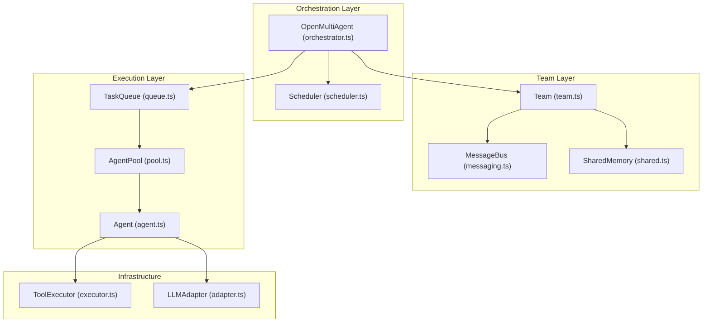

<!-- source: DeepWiki mcp.deepwiki.com · repo JackChen-me/open-multi-agent · page 1 Overview · fetched 2026-10-26 -->

# Overview

<details>
<summary>Relevant source files</summary>

The following files were used as context for generating this wiki page:

- [README.md](README.md)
- [package.json](package.json)
- [src/index.ts](src/index.ts)

</details>


`open-multi-agent` is a production-grade orchestration framework designed to build and manage teams of AI agents that collaborate to solve complex problems. It provides a model-agnostic infrastructure where different agents (e.g., Claude and GPT) can work together within a single Node.js process [package.json:36-49]().

The framework automates the lifecycle of multi-agent collaboration: planning a goal, decomposing it into a Directed Acyclic Graph (DAG) of tasks, and executing those tasks based on dependencies and agent capabilities [README.md:9-15]().

## High-Level Architecture

The system is organized into several layers, starting from high-level orchestration down to individual tool execution and LLM communication.

### System Component Relationship
This diagram maps the logical subsystems to their primary implementation classes in the codebase.


**Sources:** [src/index.ts:57-114](), [README.md:218-223]()

## Key Concepts

### 1. The Orchestrator
The `OpenMultiAgent` class serves as the primary entry point [src/index.ts:57](). It manages the high-level flow, whether running a single agent or a complex team. It handles task decomposition (the "Coordinator" pattern) and synthesizes results from multiple agents into a final output [README.md:82-87]().
*   For details, see **Orchestrator (2.1)**.

### 2. Teams and Messaging
A `Team` represents a collection of agents with a shared context [src/team/team.ts](). Agents within a team communicate via a `MessageBus` for real-time events and use `SharedMemory` to persist state and results across task boundaries [README.md:11-12]().
*   For details, see **Team and Messaging (2.2)** and **Memory System (6)**.

### 3. Task DAG Scheduling
The framework treats work as a series of `Task` objects [src/types.ts:156](). Tasks can depend on one another, forming a graph. The `TaskQueue` and `Scheduler` ensure that independent tasks run in parallel while dependent tasks wait for their requirements to be satisfied [README.md:94-120]().
*   For details, see **Task System (2.3)** and **Scheduler and AgentPool (2.4)**.

### 4. Agents and Tools
An `Agent` is a stateful entity that wraps an LLM and a set of tools [src/agent/agent.ts](). Agents use a "loop" (the `AgentRunner`) to reason, call tools, and process results until a goal is met or a limit is reached [README.md:195-212](). Tools are defined using Zod schemas for strict input validation [src/tool/framework.ts:89]().
*   For details, see **Agent Layer (3)** and **Tool System (5)**.

## Natural Language to Code Entity Mapping

The following diagram illustrates how natural language concepts used in the documentation translate to specific TypeScript entities in the `src/` directory.

```mermaid
giagram
graph LR
  subgraph "Natural Language Concept"
    N1["'The Boss' / Coordinator"]
    N2["'The Workspace'"]
    N3["'The Skills'"]
    N4["'The Brain'"]
  end

  subgraph "Code Entity Space"
    C1["OpenMultiAgent (src/orchestrator/orchestrator.ts)"]
    C2["SharedMemory (src/memory/shared.ts)"]
    C3["ToolRegistry (src/tool/framework.ts)"]
    C4["LLMAdapter (src/llm/adapter.ts)"]
  end

  N1 -- implements --> C1
  N2 -- implements --> C2
  N3 -- implements --> C3
  N4 -- implements --> C4
```
**Sources:** [src/index.ts:57-114](), [README.md:11-14]()

## Next Steps

To begin using the framework, refer to the following child pages:

*   **[Getting Started](#1.1)**: Learn how to install the package and run your first single-agent or multi-agent script.
*   **[Public API Reference](#1.2)**: A complete technical reference of all exported classes and types from the library.

---

