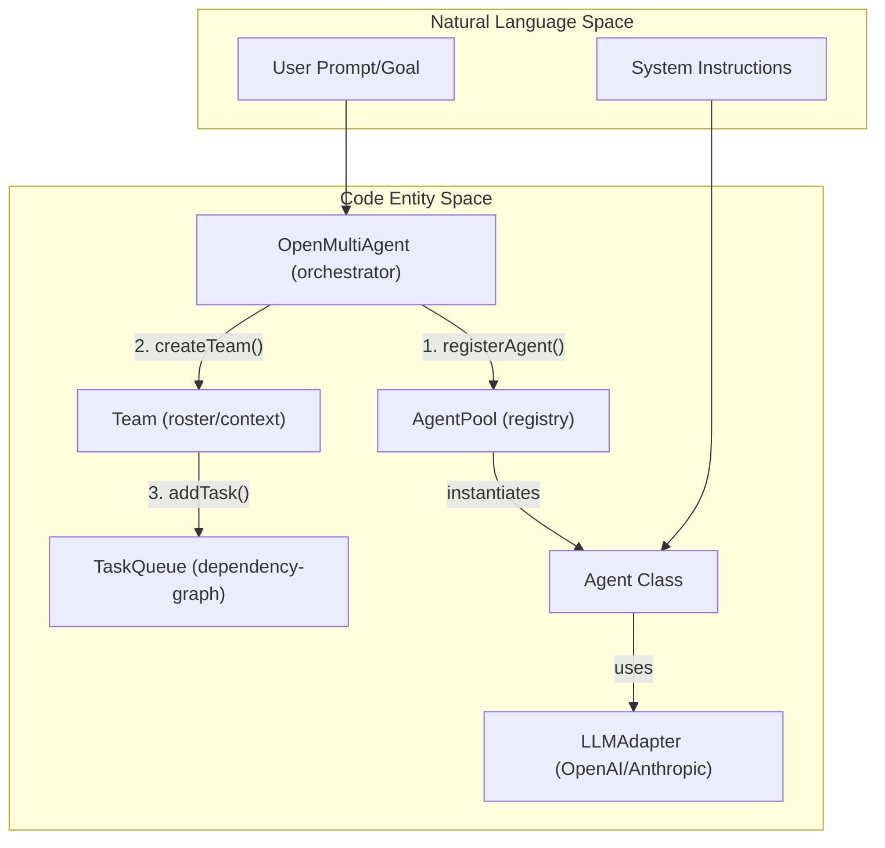
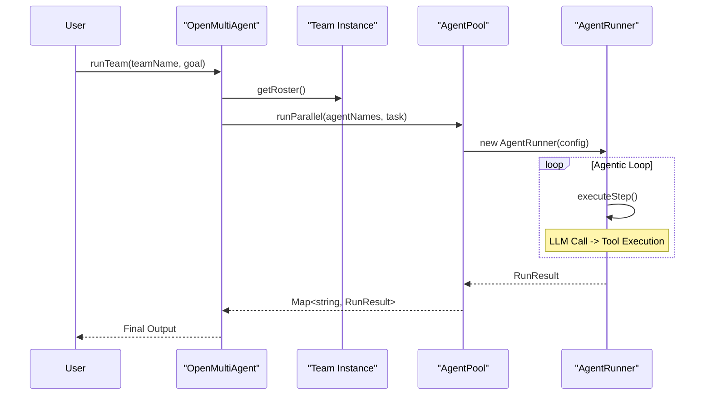

<!-- source: DeepWiki mcp.deepwiki.com · repo JackChen-me/open-multi-agent · page 1.1 Getting Started · fetched 2026-10-26 -->

# Getting Started

<details>
<summary>Relevant source files</summary>

The following files were used as context for generating this wiki page:

- [.gitignore](.gitignore)
- [package-lock.json](package-lock.json)
- [package.json](package.json)
- [tsconfig.json](tsconfig.json)

</details>


This page provides the essential technical instructions for installing, configuring, and running the `open-multi-agent` framework. It covers environment requirements, build scripts, and the fundamental patterns for both single-agent and multi-agent team execution.

## Prerequisites

The framework is built for modern Node.js environments and relies on strong typing via TypeScript.

*   **Node.js**: Version `18.0.0` or higher is required [package.json:36-38]().
*   **Package Manager**: `npm` is used for dependency management and script execution [package.json:14-21]().
*   **API Keys**: You will need valid API keys for the LLM providers you intend to use:
    *   `ANTHROPIC_API_KEY` for Anthropic (Claude) models.
    *   `OPENAI_API_KEY` for OpenAI (GPT) models.

Sources: [package.json:1-49]().

## Installation and Setup

To begin development, clone the repository and install the dependencies defined in `package.json`.

```bash
# Clone the repository
git clone https://github.com/JackChen-me/open-multi-agent.git
cd open-multi-agent

# Install dependencies
npm install
```

### Build and Test Scripts

The project uses `tsc` for compilation and `vitest` for testing.

| Command | Action | File Reference |
| :--- | :--- | :--- |
| `npm run build` | Compiles TypeScript source to the `dist/` directory. | [package.json:15-15]() |
| `npm run dev` | Runs the compiler in watch mode for active development. | [package.json:16-16]() |
| `npm run test` | Executes the test suite once using Vitest. | [package.json:17-17]() |
| `npm run lint` | Performs type-checking without emitting files. | [package.json:19-19]() |

Sources: [package.json:14-21](), [tsconfig.json:1-26]().

## Quick Start: Usage Patterns

The framework's primary entry point is the `OpenMultiAgent` orchestrator class. It abstracts the complexity of managing agents, teams, and task queues.

### Pattern 1: Single Agent Execution
For simple queries or single-turn tasks, use `runAgent`. This pattern bypasses the need for a full team structure.

```typescript
import { OpenMultiAgent } from '@jackchen_me/open-multi-agent';

const orchestrator = new OpenMultiAgent();

const result = await orchestrator.runAgent({
  name: "Assistant",
  instructions: "You are a helpful assistant.",
  model: "claude-3-5-sonnet-20241022",
  prompt: "What is the capital of France?"
});
```

### Pattern 2: Team Collaboration (Coordinator Pattern)
For complex tasks requiring multiple specialists, use `createTeam` and `runTeam`. This initiates a coordinator loop where a lead agent decomposes the request into sub-tasks for the team members.

```typescript
const team = orchestrator.createTeam({
  name: "DevTeam",
  agents: [
    { name: "Coder", instructions: "Write code.", model: "gpt-4o" },
    { name: "Reviewer", instructions: "Review code.", model: "claude-3-5-sonnet-20241022" }
  ]
});

const teamResult = await orchestrator.runTeam("DevTeam", "Build a simple web server.");
```

## System Initialization Flow

The following diagram illustrates how the `OpenMultiAgent` orchestrator initializes its internal components to transition from a configuration object to an active execution state.

**Initialization Data Flow**

Sources: [package.json:4-4](), [tsconfig.json:23-23]().

## Implementation Detail: Component Interaction

When a user calls `runTeam`, the system enters a coordinated lifecycle. The `OpenMultiAgent` orchestrator manages the high-level flow, while the `AgentPool` controls the lifecycle and concurrency of individual `Agent` instances.

**Execution Logic and Code Entities**

Sources: [package.json:39-43](), [tsconfig.json:7-11]().

---

