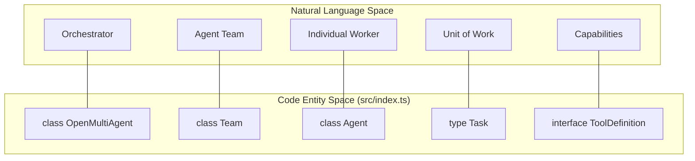
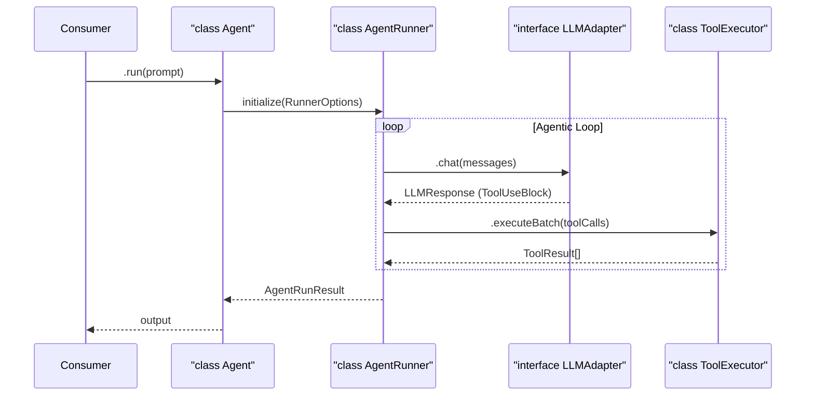

<!-- source: DeepWiki mcp.deepwiki.com · repo JackChen-me/open-multi-agent · page 1.2 Public API Reference · fetched 2026-10-26 -->

# Public API Reference

Relevant source files

The following files were used as context for generating this wiki page:

- [README.md](README.md)
- [src/index.ts](src/index.ts)
- [src/types.ts](src/types.ts)

This page provides a comprehensive reference for the symbols exported from the `open-multi-agent` package via `src/index.ts`. It covers the primary orchestrator, agent primitives, task management, tool systems, and the underlying type definitions.

## Overview of Public Surface

The framework is organized into several layers, with `OpenMultiAgent` serving as the primary entry point for most consumers.

### Code Entity Mapping
The following diagram bridges the natural language concepts of the multi-agent system to the specific code entities exported by the library.

**Entity Mapping: Concepts to Code**

Sources: [src/index.ts:57-166](), [src/types.ts:15-180]()

---

## Orchestrator and Scheduling

The Orchestrator manages the lifecycle of teams and agents, providing high-level methods to execute goals.

### `OpenMultiAgent`
The primary class used to create teams and run tasks. It encapsulates the `AgentPool` and `Scheduler`.
- **`createTeam(id, config)`**: Initializes a `Team` instance with a specific set of agents and shared memory configuration [src/index.ts:57]().
- **`runAgent(config, prompt)`**: A convenience method for single-agent execution without formal team overhead [src/index.ts:57]().
- **`runTeam(team, goal)`**: Uses a "coordinator" pattern to decompose a natural language goal into a `TaskQueue` and execute it [src/index.ts:57]().
- **`runTasks(team, tasks)`**: Executes a predefined list of `Task` objects, respecting their `dependsOn` relationships [src/index.ts:57]().

### `Scheduler`
Handles the assignment of tasks to agents based on availability and capabilities.
- **`SchedulingStrategy`**: An enum or type defining how tasks are distributed (e.g., `round-robin`, `capability-match`) [src/index.ts:58-59]().

Sources: [src/index.ts:57-60](), [src/types.ts:223-238]()

---

## Agent and Pool Layer

Agents are the active entities that interact with LLMs and execute tools.

### `Agent`
The core class representing an autonomous worker.
- **`run(prompt)`**: Executes the agentic loop (LLM call -> Tool Use -> LLM call) until a final answer is reached or `maxTurns` is hit [src/index.ts:65]().
- **`stream(prompt)`**: Returns an `AsyncGenerator` emitting `StreamEvent` objects for real-time output [src/index.ts:65]().

### `AgentPool`
A registry and concurrency controller for agents.
- **`Semaphore`**: Used internally by the pool to limit the number of concurrent LLM requests or tool executions [src/index.ts:66]().

**Agent Data Flow**

Sources: [src/index.ts:65-67](), [src/types.ts:186-214]()

---

## Task and Team Layer

Teams provide the organizational structure, while Tasks define the work graph.

### `Team`
Combines a group of agents with a `MessageBus` and `SharedMemory`.
- **`TeamConfig`**: Configuration object defining agent roles and whether `sharedMemory` is enabled [src/types.ts:243-248]().

### `Task` and `TaskQueue`
- **`Task`**: A unit of work with a `title`, `description`, and optional `assignee`. It supports a `dependsOn` array for DAG (Directed Acyclic Graph) construction [src/types.ts:253-264]().
- **`TaskQueue`**: Manages the lifecycle of tasks (`pending` -> `running` -> `completed`/`failed`). It emits `TaskQueueEvent` when task statuses change [src/index.ts:81-83]().

Sources: [src/index.ts:73-83](), [src/types.ts:243-264]()

---

## Tool System

The tool system allows agents to perform actions in the real world (e.g., file I/O, shell commands).

### `defineTool`
A factory function to create type-safe tools using Zod schemas.
- **`inputSchema`**: A Zod schema used to validate LLM generated arguments [src/types.ts:174-179]().
- **`execute`**: The implementation function receiving validated input and `ToolUseContext` [src/types.ts:178]().

### `ToolRegistry` & `ToolExecutor`
- **`ToolRegistry`**: A container for registered tools, capable of converting them to `LLMToolDef` for provider consumption [src/index.ts:89]().
- **`ToolExecutor`**: Handles the actual invocation of tool functions, including error isolation and `AbortSignal` propagation [src/index.ts:90]().

### Built-in Tools
The framework exports several pre-configured tools:
- `bashTool`, `fileReadTool`, `fileWriteTool`, `fileEditTool`, `grepTool` [src/index.ts:95-99]().
- `registerBuiltInTools(registry)`: Helper to quickly populate a registry [src/index.ts:92]().

Sources: [src/index.ts:89-100](), [src/types.ts:106-179]()

---

## Memory and LLM Adapters

### Memory
- **`InMemoryStore`**: A standard implementation of `MemoryStore` for transient session data [src/index.ts:113]().
- **`SharedMemory`**: A namespaced wrapper around a store that allows agents in a team to share information via a key-value pattern [src/index.ts:114]().

### LLM Adapters
- **`createAdapter(provider, options)`**: Factory function to instantiate an `LLMAdapter` (e.g., Anthropic or OpenAI) [src/index.ts:106]().
- **`SupportedProvider`**: Union type of `'anthropic' | 'openai'` [src/index.ts:107]().

Sources: [src/index.ts:106-114](), [src/types.ts:285-295]()

---

## Core Type Reference

### Content Blocks
The framework uses a unified block format for all message content.
- **`TextBlock`**: Raw text [src/types.ts:15-18]().
- **`ToolUseBlock`**: A request from the LLM to call a tool [src/types.ts:24-29]().
- **`ToolResultBlock`**: The output of a tool execution [src/types.ts:35-40]().

### Execution Results
- **`AgentRunResult`**: Contains `output`, `status`, `tokenUsage`, and a `toolCalls` log [src/types.ts:210-216]().
- **`TeamRunResult`**: Summary of a team execution, including a map of results from all involved agents [src/types.ts:269-275]().

Sources: [src/types.ts:15-53](), [src/types.ts:210-275]()

---

