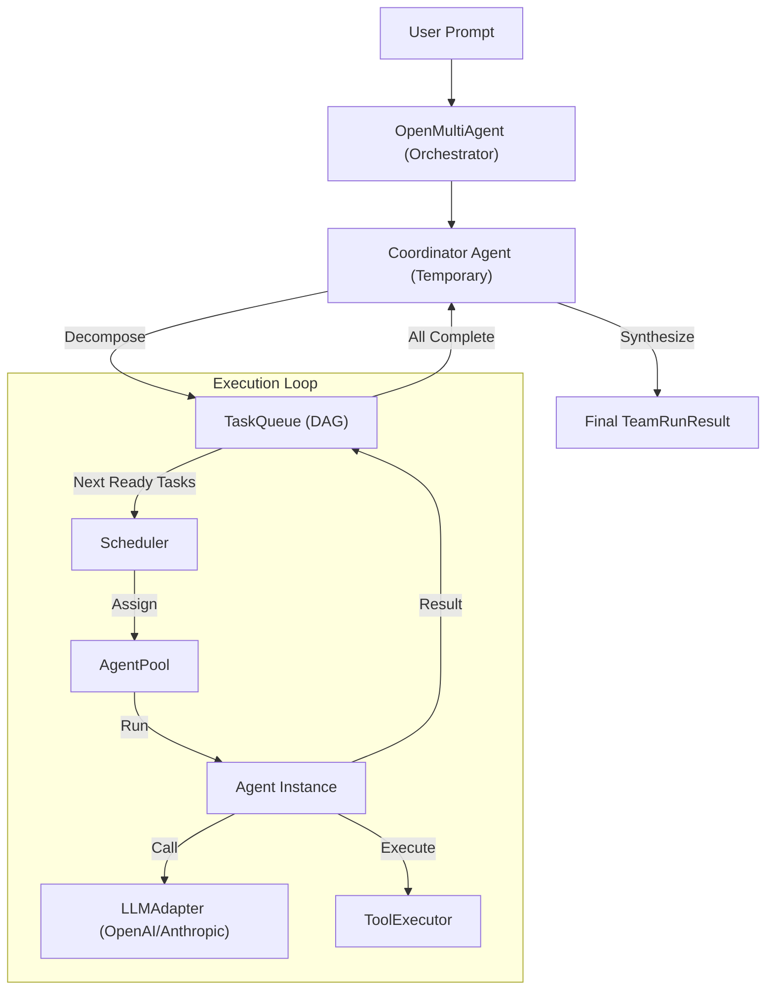
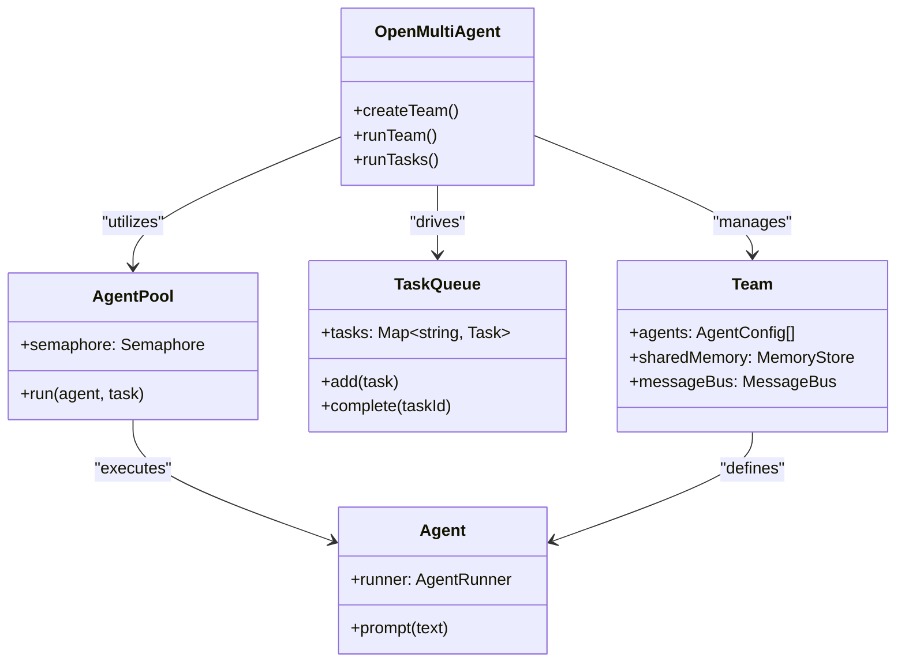

<!-- source: DeepWiki mcp.deepwiki.com · repo JackChen-me/open-multi-agent · page 2 Core Architecture · fetched 2026-10-26 -->

# Core Architecture

Relevant source files

The following files were used as context for generating this wiki page:

- [README.md](README.md)
- [src/orchestrator/orchestrator.ts](src/orchestrator/orchestrator.ts)
- [src/types.ts](src/types.ts)

The `open-multi-agent` framework is designed as a layered ecosystem that transitions from high-level natural language goals to structured, autonomous execution. It manages the complexity of multi-agent collaboration by decomposing goals into a Directed Acyclic Graph (DAG) of tasks, which are then scheduled and executed by a pool of specialized agents.

## Architectural Layers

The framework's architecture is divided into three primary planes:

1.  **Orchestration Plane**: Manages the lifecycle of a "Team" and the flow of "Tasks". It uses a **Coordinator Pattern** to translate user prompts into actionable plans.
2.  **Execution Plane**: Contains the `AgentPool` and `Scheduler`. This layer handles concurrency, resource locking (via semaphores), and matching tasks to the best-suited agents.
3.  **Agent & Tool Plane**: The individual `Agent` instances, their `LLMAdapter` connections, and the `ToolExecutor` that runs validated code against the environment.

### System Data Flow

The following diagram illustrates how a high-level request moves through the system entities.

**Diagram: High-Level Request Flow**

**Sources:** [src/orchestrator/orchestrator.ts:4-42](), [src/orchestrator/orchestrator.ts:158-180](), [README.md:218-240]()

---

## Core Components

### 1. Orchestrator (`OpenMultiAgent`)
The `OpenMultiAgent` class is the entry point for the framework. It coordinates the `Team`, `TaskQueue`, and `AgentPool`. Its primary responsibility is managing the "Coordinator" agent—a temporary agent created during `runTeam()` to break down goals into tasks [src/orchestrator/orchestrator.ts:33-35]().

For details, see [Orchestrator (#2.1)]().

### 2. Team and Messaging
A `Team` represents a roster of `AgentConfig` objects and a `SharedMemory` instance [src/team/team.ts:20-30](). It facilitates communication via a `MessageBus`, allowing agents to broadcast events or send point-to-point messages.

For details, see [Team and Messaging (#2.2)]().

### 3. Task System
Tasks are the unit of work in the framework. The `TaskQueue` manages a set of `Task` objects, tracking their `TaskStatus` (e.g., `pending`, `running`, `completed`, `blocked`). It uses a dependency graph to ensure that tasks only run once their `dependsOn` requirements are met [src/task/queue.ts:15-30]().

For details, see [Task System (#2.3)]().

### 4. Scheduler and AgentPool
The `Scheduler` implements strategies (like `round-robin` or `capability-match`) to pair available agents with pending tasks [src/orchestrator/scheduler.ts:10-25](). The `AgentPool` manages the actual execution, providing concurrency limits via a `Semaphore` to prevent overwhelming LLM rate limits or system resources [src/agent/pool.ts:15-25]().

For details, see [Scheduler and AgentPool (#2.4)]().

---

## Mapping Natural Language to Code Entities

The framework bridges the gap between natural language instructions and programmatic execution by mapping specific concepts to TypeScript classes and interfaces.

**Table: Concept to Code Mapping**

| Natural Language Concept | Code Entity | File Path |
| :--- | :--- | :--- |
| **The Team Goal** | `goal: string` (in `runTeam`) | [src/orchestrator/orchestrator.ts:254-254]() |
| **A Specific Job** | `Task` interface | [src/types.ts:241-255]() |
| **Agent Persona** | `AgentConfig` interface | [src/types.ts:186-196]() |
| **Memory/Context** | `MemoryStore` / `SharedMemory` | [src/types.ts:340-349]() |
| **Action/Capability** | `ToolDefinition` | [src/types.ts:174-179]() |

**Diagram: Entity Relationship and Code Links**

**Sources:** [src/orchestrator/orchestrator.ts:44-64](), [src/types.ts:186-210](), [src/types.ts:241-260]()

---

## Data Flow: From Goal to Result

1.  **Decomposition**: The `Orchestrator` calls a `Coordinator` agent to parse the `goal` into a `ParsedTaskSpec[]` [src/orchestrator/orchestrator.ts:99-104]().
2.  **Queueing**: These specs are converted into `Task` objects and inserted into the `TaskQueue` [src/orchestrator/orchestrator.ts:285-300]().
3.  **Scheduling**: The `executeQueue` loop identifies tasks with status `pending` (all dependencies met) [src/orchestrator/orchestrator.ts:188-192]().
4.  **Execution**: The `AgentPool` runs the assigned `Agent` for each task. The agent interacts with the `LLMAdapter` and `ToolExecutor` to fulfill the task description [src/agent/pool.ts:70-85]().
5.  **Synthesis**: Once the `TaskQueue` is empty, the `Coordinator` agent is called one last time to look at all `Task` results in `SharedMemory` and provide a final summary [src/orchestrator/orchestrator.ts:310-325]().

**Sources:** [src/orchestrator/orchestrator.ts:155-210](), [src/orchestrator/orchestrator.ts:254-330]()

---

