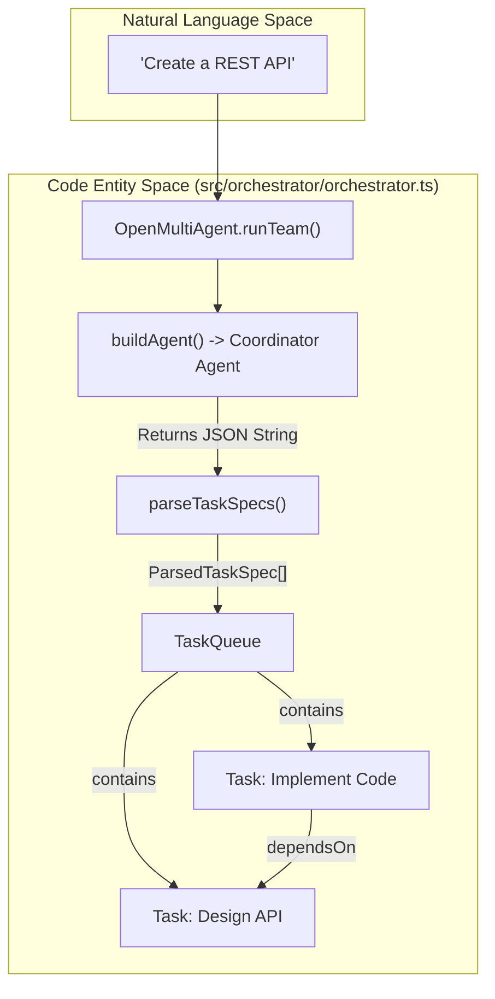
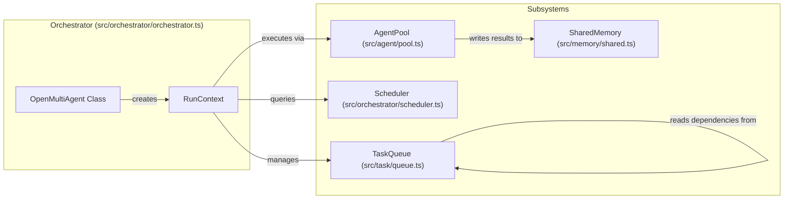

<!-- source: DeepWiki mcp.deepwiki.com · repo JackChen-me/open-multi-agent · page 2.1 Orchestrator · fetched 2026-10-26 -->

# Orchestrator

Relevant source files

The following files were used as context for generating this wiki page:

- [README.md](README.md)
- [src/orchestrator/orchestrator.ts](src/orchestrator/orchestrator.ts)
- [src/orchestrator/scheduler.ts](src/orchestrator/scheduler.ts)

The Orchestrator is the central brain of the `open-multi-agent` framework. Implemented via the `OpenMultiAgent` class, it manages the high-level lifecycle of agentic workflows, transitioning from natural language goals to structured task execution. It coordinates the `Team`, `TaskQueue`, `Scheduler`, and `AgentPool` to ensure that tasks are decomposed, assigned, and executed according to their dependency graph.

### Core Responsibilities
- **Decomposition**: Using the "Coordinator Pattern" to break a high-level goal into a Directed Acyclic Graph (DAG) of tasks [[src/orchestrator/orchestrator.ts:33-35]]().
- **Scheduling**: Mapping unassigned tasks to the most suitable agents based on configurable strategies [[src/orchestrator/scheduler.ts:4-10]]().
- **Execution**: Managing a parallel execution loop that respects task dependencies and agent concurrency limits [[src/orchestrator/orchestrator.ts:167-176]]().
- **Synthesis**: Aggregating results from multiple agents into a final coherent response [[src/orchestrator/orchestrator.ts:33-35]]().

Sources: [src/orchestrator/orchestrator.ts:1-42](), [src/orchestrator/scheduler.ts:1-14]()

---

## The Coordinator Pattern

The "killer feature" of the Orchestrator is the **Coordinator Pattern** used in `runTeam()`. Instead of requiring the user to manually define every task, the Orchestrator spins up a temporary "coordinator" agent.

### Decomposition and Synthesis Loop
1. **Decomposition**: The coordinator receives the `Team` roster and the user's goal. It outputs a JSON array of task specifications (`ParsedTaskSpec`) [[src/orchestrator/orchestrator.ts:99-104]]().
2. **Queueing**: These specs are converted into `Task` objects and injected into a `TaskQueue` [[src/orchestrator/orchestrator.ts:251-260]]().
3. **Execution**: The `executeQueue` function processes the tasks [[src/orchestrator/orchestrator.ts:177-180]]().
4. **Synthesis**: Once all tasks complete, the coordinator is prompted again to look at the `SharedMemory` (containing results from all agents) and produce the final answer [[src/orchestrator/orchestrator.ts:281-295]]().

### Natural Language to Code Entity Mapping: Decomposition
The following diagram shows how the Orchestrator translates a natural language prompt into internal system entities.

**Diagram: Goal Decomposition Flow**

Sources: [src/orchestrator/orchestrator.ts:88-93](), [src/orchestrator/orchestrator.ts:111-149](), [src/orchestrator/orchestrator.ts:245-260]()

---

## Orchestration Loop (executeQueue)

The `executeQueue` function is the engine of the Orchestrator. It runs an iterative loop that continues until the `TaskQueue` is exhausted or stuck.

| Step | Logic | Code Reference |
| :--- | :--- | :--- |
| **1. Auto-Assign** | The `Scheduler` maps pending tasks to agents based on the chosen strategy. | [[src/orchestrator/orchestrator.ts:186-187]]() |
| **2. Identify Ready** | Finds all tasks with status `'pending'` (all dependencies met). | [[src/orchestrator/orchestrator.ts:188-188]]() |
| **3. Dispatch** | Executes tasks in parallel via `AgentPool.run()`. | [[src/orchestrator/orchestrator.ts:194-210]]() |
| **4. Update Memory** | Results are saved to `SharedMemory` for other agents to see. | [[src/orchestrator/orchestrator.ts:213-214]]() |
| **5. Unblock** | The `TaskQueue` marks dependents of finished tasks as `'pending'`. | [[src/orchestrator/orchestrator.ts:218-218]]() |

### Task Scheduling Strategies
The `Scheduler` supports four strategies for mapping tasks to agents [[src/orchestrator/scheduler.ts:23-35]]():
- `round-robin`: Distributes tasks evenly by agent index.
- `least-busy`: Prefers agents with the fewest active tasks.
- `capability-match`: Uses keyword overlap between task descriptions and agent roles.
- `dependency-first`: Prioritizes tasks that unblock the highest number of downstream tasks (Critical Path).

Sources: [src/orchestrator/orchestrator.ts:177-228](), [src/orchestrator/scheduler.ts:157-174]()

---

## System Wiring and Data Flow

The Orchestrator acts as the "glue" that wires together the various subsystems. When `runTeam` or `runTasks` is called, a `RunContext` is assembled to maintain state for that specific execution [[src/orchestrator/orchestrator.ts:158-164]]().

**Diagram: System Wiring**

### Key Public Methods

- **`createTeam(id, config)`**: Initializes a `Team` with a roster of agents and optional shared memory [[src/orchestrator/orchestrator.ts:232-237]]().
- **`runAgent(config, prompt)`**: A shortcut for single-agent execution without the overhead of a team or task queue [[src/orchestrator/orchestrator.ts:311-325]]().
- **`runTeam(team, goal)`**: The primary entry point for the coordinator-led multi-agent workflow [[src/orchestrator/orchestrator.ts:239-244]]().
- **`runTasks(team, tasks)`**: Executes a predefined list of tasks (manual DAG) using the team's agents [[src/orchestrator/orchestrator.ts:297-302]]().
- **`getStatus(runId)`**: Returns the current status of all tasks and agents for an active run [[src/orchestrator/orchestrator.ts:335-341]]().
- **`shutdown()`**: Stops all active agents and clears the execution pool [[src/orchestrator/orchestrator.ts:348-350]]().

Sources: [src/orchestrator/orchestrator.ts:230-352](), [src/orchestrator/orchestrator.ts:158-164]()

---

