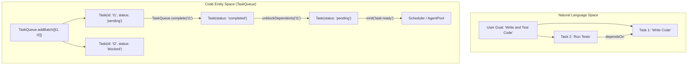
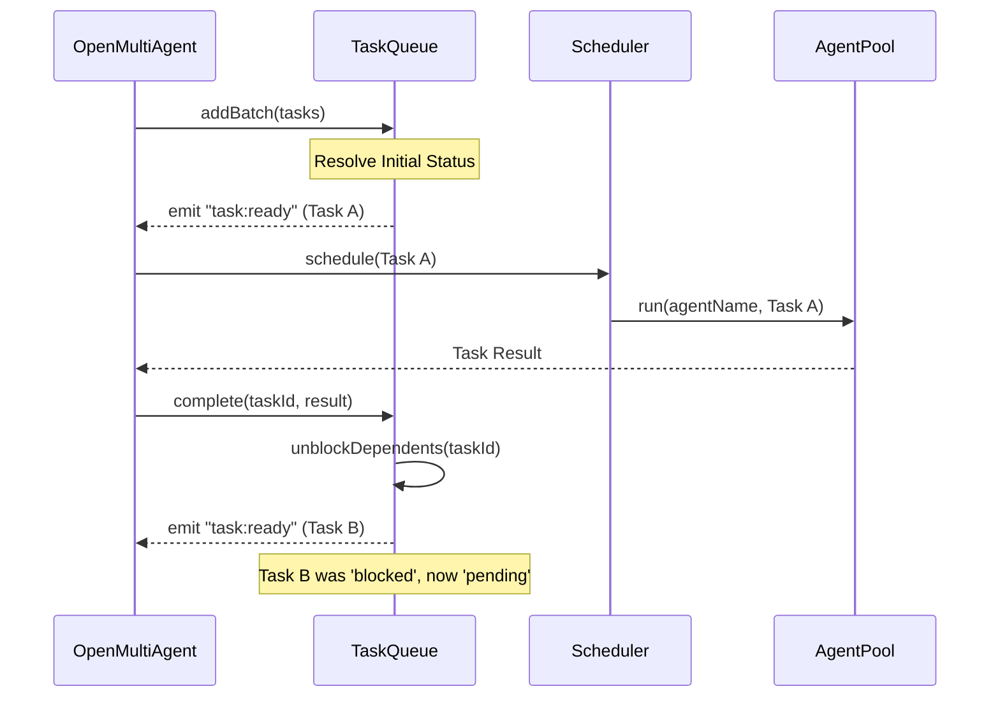

<!-- source: DeepWiki mcp.deepwiki.com · repo JackChen-me/open-multi-agent · page 2.3 Task System · fetched 2026-10-26 -->

# Task System

Relevant source files

The following files were used as context for generating this wiki page:

- [src/task/queue.ts](src/task/queue.ts)
- [src/task/task.ts](src/task/task.ts)
- [src/types.ts](src/types.ts)

The Task System provides a structured way to define, validate, and execute units of work with complex inter-dependencies. It transitions from high-level natural language descriptions to a dependency-aware execution graph managed by the `TaskQueue`.

## Task Model and Lifecycle

A `Task` is the primary unit of work within the framework. It contains metadata about the objective, the assigned agent, and its current position in the execution lifecycle.

### Task Status Lifecycle

Tasks transition through several states defined by the `TaskStatus` type [src/types.ts:228-235]().

| Status | Description |
| :--- | :--- |
| `pending` | The task is created but not yet executing. It may be waiting for dependencies. |
| `blocked` | The task has unresolved dependencies (upstream tasks that are not `completed`). |
| `running` | An agent is currently working on the task. |
| `completed` | The task finished successfully; the `result` field contains the output. |
| `failed` | The task or one of its dependencies encountered an error. |

### The Task Entity

The `Task` interface ensures that every piece of work has a unique identity and clear lineage.

**Task Definition Structure**
[src/types.ts:237-260]()
*   `id`: A unique UUID generated at creation.
*   `title` / `description`: Natural language goals for the agent.
*   `dependsOn`: An array of `taskId` strings that must complete before this task starts.
*   `assignee`: Optional name of the specific agent responsible for this task.
*   `result`: Stores the final string output or error message.

**Sources:** [src/types.ts:228-260](), [src/task/task.ts:28-46]()

---

## Task Helpers and Validation

The framework provides pure utility functions in `src/task/task.ts` to manage task creation and graph integrity without side effects.

### Creation and Readiness
*   **`createTask`**: A factory function that initializes a task with `pending` status and unique timestamps [src/task/task.ts:28-46]().
*   **`isTaskReady`**: Determines if a task can move to execution. A task is ready only if its status is `pending` and all IDs in `dependsOn` refer to tasks with a `completed` status [src/task/task.ts:69-85]().

### Dependency Management
To ensure a stable execution order, the system employs **Kahn's Algorithm** for topological sorting and cycle detection.

*   **`getTaskDependencyOrder`**: Sorts an array of tasks so that every task appears after its dependencies [src/task/task.ts:108-153]().
*   **`validateTaskDependencies`**: Performs a two-pass validation [src/task/task.ts:177-219]():
    1.  Checks for unknown task IDs and self-references.
    2.  Uses Depth-First Search (DFS) coloring to detect circular dependencies (cycles).

**Sources:** [src/task/task.ts:1-219]()

---

## TaskQueue: Dependency-Aware Scheduling

The `TaskQueue` is a mutable, event-driven manager that orchestrates the flow of tasks based on their dependency graph. It is responsible for promoting tasks from `blocked` to `pending` as work completes.

### Event-Driven Architecture

The `TaskQueue` emits specific events that the `Orchestrator` or `Team` listens to for driving the agent loop [src/task/queue.ts:17-21]():
*   `task:ready`: Fired when a task's dependencies are satisfied.
*   `task:complete`: Fired when a task reaches a terminal success state.
*   `task:failed`: Fired on failure or during a cascade.
*   `all:complete`: Fired when no more tasks remain in non-terminal states.

### Scheduling Logic

The following diagram illustrates how the `TaskQueue` manages the transition from natural language tasks to code-level execution readiness.

**Task Transition Flow (Natural Language to Code Execution)**

**Sources:** [src/task/queue.ts:54-93](), [src/task/queue.ts:130-138]()

### Failure Handling and Cascading

When a task fails, the `TaskQueue` ensures that the entire downstream pipeline is safely halted to prevent agents from working on invalid data.

*   **`fail(taskId, error)`**: Marks the target task as `failed` [src/task/queue.ts:149-157]().
*   **`cascadeFailure(failedTaskId)`**: Recursively identifies all tasks that transitively depend on the failed task and marks them as `failed` with a "Cancelled" message [src/task/queue.ts:166-179]().

### Key Methods

| Method | Role |
| :--- | :--- |
| `add(task)` | Inserts a task and calculates initial status (`pending` vs `blocked`) [src/task/queue.ts:73-79](). |
| `complete(taskId)` | Updates status to `completed` and triggers `unblockDependents` [src/task/queue.ts:130-138](). |
| `nextAvailable()` | Returns the first `pending` task that is not restricted to a specific assignee [src/task/queue.ts:206-220](). |
| `unblockDependents(id)` | Scans the queue for `blocked` tasks depending on `id` and re-evaluates their readiness [src/task/queue.ts:262-277](). |

**Sources:** [src/task/queue.ts:99-277]()

---

## Data Flow: Task Execution Loop

The following diagram bridges the `TaskQueue` logic with the `OpenMultiAgent` orchestrator components.

**Task Execution Data Flow**

**Sources:** [src/task/queue.ts:130-138](), [src/task/queue.ts:262-277](), [src/task/task.ts:69-85]()

---

