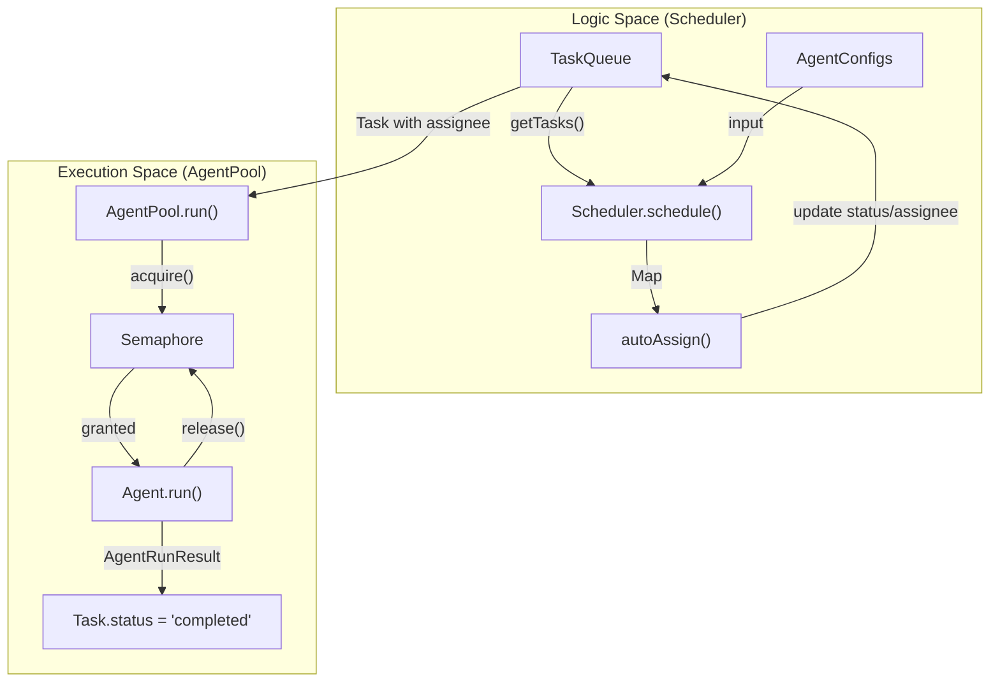

<!-- source: DeepWiki mcp.deepwiki.com · repo JackChen-me/open-multi-agent · page 2.4 Scheduler and AgentPool · fetched 2026-10-26 -->

# Scheduler and AgentPool

<details>
<summary>Relevant source files</summary>

The following files were used as context for generating this wiki page:

- [src/agent/pool.ts](src/agent/pool.ts)
- [src/orchestrator/scheduler.ts](src/orchestrator/scheduler.ts)
- [src/utils/semaphore.ts](src/utils/semaphore.ts)

</details>


The `Scheduler` and `AgentPool` components manage how work is distributed across agents and how concurrent execution is throttled. While `AgentPool` acts as a physical registry and execution gate for `Agent` instances, the `Scheduler` provides the logic for mapping abstract `Task` objects to the most appropriate agents based on configurable strategies.

## AgentPool

The `AgentPool` class is a registry and execution manager for a collection of `Agent` instances [src/agent/pool.ts:57-58](). It enforces a global concurrency limit across all managed agents using a `Semaphore` [src/agent/pool.ts:68-69]().

### Concurrency Control
The pool uses a `Semaphore` to ensure that no more than `maxConcurrency` (default: 5) async agent runs occur simultaneously [src/agent/pool.ts:65-68](). This prevents overwhelming LLM provider rate limits or local system resources when running large teams.

- **`run(agentName, prompt)`**: Acquires a semaphore slot, executes the named agent's `run` method, and releases the slot upon completion or error [src/agent/pool.ts:126-135]().
- **`runParallel(tasks)`**: Takes an array of `{ agent, prompt }` descriptors and executes them all via `Promise.allSettled`. It internally calls `run`, meaning the concurrency cap is respected even if the input array is larger than the cap [src/agent/pool.ts:147-157]().
- **`runAny(prompt)`**: Implements a basic round-robin dispatch at the pool level. It selects the next agent in insertion order and executes the prompt [src/agent/pool.ts:185-195]().

### Registry and Status
Agents are added to the pool via `add(agent)` and must have unique names [src/agent/pool.ts:80-87](). The `getStatus()` method provides a snapshot of the pool's health, aggregating the `AgentState` of every registered agent into counts of `idle`, `running`, `completed`, and `error` [src/agent/pool.ts:211-224]().

**Sources:**
- [src/agent/pool.ts:57-69]() (Class definition and Semaphore initialization)
- [src/agent/pool.ts:126-174]() (Execution methods)
- [src/agent/pool.ts:211-224]() (Status reporting)
- [src/utils/semaphore.ts:24-50]() (Semaphore implementation)

---

## Scheduler

The `Scheduler` class contains the logic for assigning `Task` objects to `AgentConfig` definitions [src/orchestrator/scheduler.ts:127-136](). It is stateless; it takes a snapshot of tasks and agents and returns a mapping of recommendations.

### Scheduling Strategies
The framework supports four `SchedulingStrategy` types [src/orchestrator/scheduler.ts:31-35]():

| Strategy | Logic | Use Case |
| :--- | :--- | :--- |
| `round-robin` | Distributes tasks sequentially across agents using an internal `roundRobinCursor` [src/orchestrator/scheduler.ts:129-166](). | General purpose, balanced load. |
| `least-busy` | Assigns tasks to the agent currently associated with the fewest `in_progress` tasks in the `TaskQueue` [src/orchestrator/scheduler.ts:167-168](). | Dynamic load balancing. |
| `capability-match` | Scores agents by matching task description keywords against the agent's `role` and `goal` [src/orchestrator/scheduler.ts:169-170](). | Specialized teams (e.g., "coder" vs "reviewer"). |
| `dependency-first` | Uses a BFS to find tasks that are blocking the highest number of other tasks (the "critical path") [src/orchestrator/scheduler.ts:41-75](). | Complex DAGs where bottlenecks must be cleared. |

### Keyword Matching Logic
For the `capability-match` strategy, the scheduler uses `extractKeywords` to strip common stop-words [src/orchestrator/scheduler.ts:94-107](). It then calculates a `keywordScore` based on the overlap between the task's requirements and the agent's metadata [src/orchestrator/scheduler.ts:83-86]().

**Sources:**
- [src/orchestrator/scheduler.ts:31-35]() (Strategy types)
- [src/orchestrator/scheduler.ts:50-75]() (Dependency BFS logic)
- [src/orchestrator/scheduler.ts:157-174]() (Primary `schedule` method)

---

## Data Flow: Task Assignment to Execution

The following diagram illustrates how a `Task` moves from the `TaskQueue` through the `Scheduler` logic and finally into the `AgentPool` for execution.

### Task Dispatch Pipeline

**Sources:**
- [src/orchestrator/scheduler.ts:176-187]() (Logic for `autoAssign`)
- [src/agent/pool.ts:126-135]() (Logic for `run` and Semaphore interaction)

---

## Implementation Details

### Semaphore-based Concurrency
The `Semaphore` class manages a FIFO `queue` of `resolve` functions [src/utils/semaphore.ts:26-49](). When `max` concurrency is reached, subsequent calls to `acquire()` return a `Promise` that remains pending until a previous task calls `release()` [src/utils/semaphore.ts:56-65]().

### Dependency Analysis
The `countBlockedDependents` function builds a reverse adjacency map (dependency ID to dependent tasks) [src/orchestrator/scheduler.ts:53-60](). It performs a Breadth-First Search (BFS) to count exactly how many tasks are transitively blocked by a specific task ID [src/orchestrator/scheduler.ts:63-75]().

### AgentPool Status Snapshot
The `PoolStatus` interface provides a read-only view of the pool [src/agent/pool.ts:33-44]().
```typescript
export interface PoolStatus {
  readonly total: number
  readonly idle: number
  readonly running: number
  readonly completed: number
  readonly error: number
}
```

**Sources:**
- [src/utils/semaphore.ts:41-65]() (Acquire/Release logic)
- [src/orchestrator/scheduler.ts:50-75]() (BFS dependency counting)
- [src/agent/pool.ts:33-44]() (Status interface)

---

