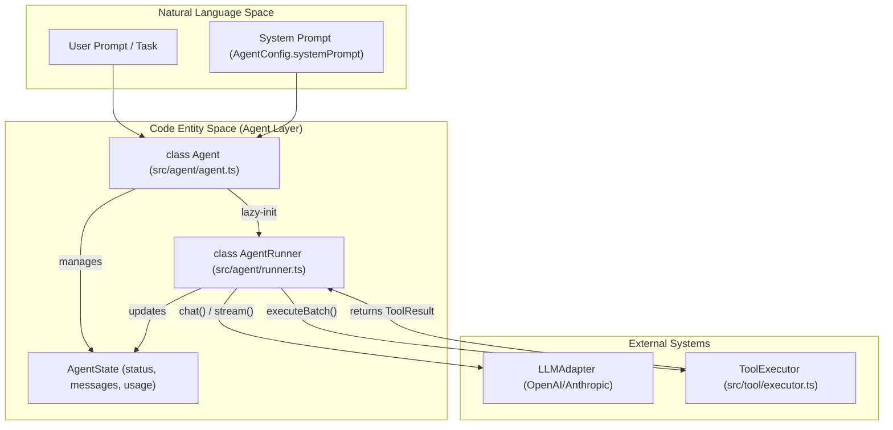
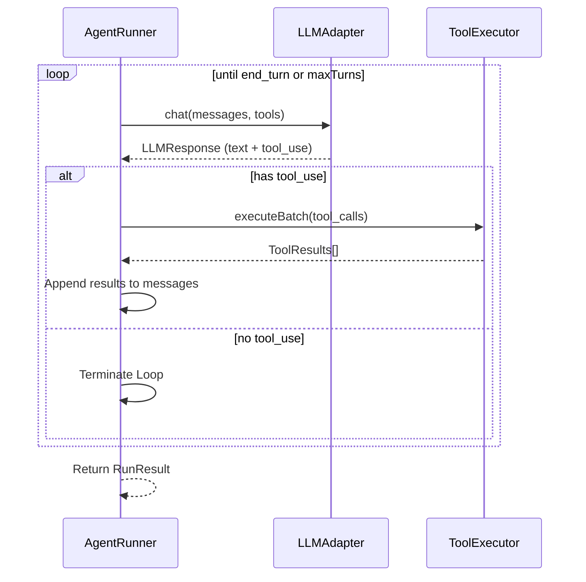

<!-- source: DeepWiki mcp.deepwiki.com · repo JackChen-me/open-multi-agent · page 3 Agent Layer · fetched 2026-10-26 -->

# Agent Layer

Relevant source files

The following files were used as context for generating this wiki page:

- [src/agent/agent.ts](src/agent/agent.ts)
- [src/agent/runner.ts](src/agent/runner.ts)

The **Agent Layer** is the primary execution engine of the `open-multi-agent` framework. It provides a high-level abstraction over LLM interactions, tool execution, and state management. While the Orchestrator (see [Orchestrator](#2.1)) manages groups of agents, the Agent Layer defines how a single entity perceives its environment, reasons through problems, and acts via tools.

### Core Components

The layer is built around two primary classes that separate state management from execution logic:

1.  **`Agent`**: The public-facing interface. It manages the agent's identity, configuration, persistent conversation history, and lifecycle state (e.g., `idle`, `running`).
2.  **`AgentRunner`**: The internal execution engine. It implements the "agentic loop," handling the low-level details of LLM requests, parallel tool execution, and token usage aggregation.

### High-Level Architecture

The following diagram illustrates how the Agent Layer bridges the gap between high-level user requests and low-level code execution.

**Diagram: Agent Layer Architecture**

Sources: [src/agent/agent.ts:61-94](), [src/agent/runner.ts:139-149](), [src/agent/agent.ts:106-133]()

---

## 3.1 Agent Class

The `Agent` class serves as the primary entry point for developers. It encapsulates an `AgentConfig` and maintains an internal `AgentState`. 

### Key Responsibilities
- **State Management**: Tracks whether the agent is `idle`, `running`, `completed`, or in an `error` state [src/agent/agent.ts:89-93]().
- **Conversation Persistence**: Provides two modes of execution:
    - `run()`: A "one-shot" execution that does not save history [src/agent/agent.ts:147-153]().
    - `prompt()`: A "stateful" execution that appends messages to a persistent `messageHistory` [src/agent/agent.ts:163-179]().
- **Lazy Initialization**: The underlying `AgentRunner` and `LLMAdapter` are only instantiated when an execution method is first called [src/agent/agent.ts:106-133]().
- **Tool Management**: Allows dynamic addition and removal of tools at runtime via `addTool()` and `removeTool()` [src/agent/agent.ts:222-233]().

For details on configuration and the full API, see **[Agent Class](#3.1)**.

Sources: [src/agent/agent.ts:1-24](), [src/agent/agent.ts:61-70]()

---

## 3.2 AgentRunner and Conversation Loop

The `AgentRunner` is the "heart" of the framework, responsible for the iterative process of reasoning and acting. It operates on a `while(true)` loop that continues until the LLM provides a final answer or a limit is reached.

### The Agentic Loop
The runner executes the following sequence:
1.  **LLM Call**: Sends the current message history to the `LLMAdapter`.
2.  **Extraction**: Parses the response for `text` blocks and `tool_use` blocks [src/agent/runner.ts:108-110]().
3.  **Parallel Execution**: If tools are requested, it uses the `ToolExecutor` to run them concurrently [src/agent/runner.ts:7-8]().
4.  **Injection**: Appends the tool results back into the conversation history as `tool_result` blocks.
5.  **Repeat**: Loops back to step 1 until the LLM signals `end_turn` without further tool calls [src/agent/runner.ts:164-165]().

**Diagram: The Runner Execution Loop**

Sources: [src/agent/runner.ts:4-13](), [src/agent/runner.ts:139-149]()

### Execution Control
- **`maxTurns`**: Prevents infinite loops by capping the number of round-trips (default: 10) [src/agent/runner.ts:49-50]().
- **`AbortSignal`**: Supports cancellation of in-flight LLM requests and tool executions [src/agent/runner.ts:54-55]().
- **Streaming**: Provides real-time updates via an `AsyncGenerator`, yielding `StreamEvent` objects for text deltas and tool lifecycle events [src/agent/runner.ts:198-204]().

For a deep dive into the loop internals and result aggregation, see **[AgentRunner and Conversation Loop](#3.2)**.

Sources: [src/agent/runner.ts:81-93](), [src/agent/runner.ts:164-195]()

---

