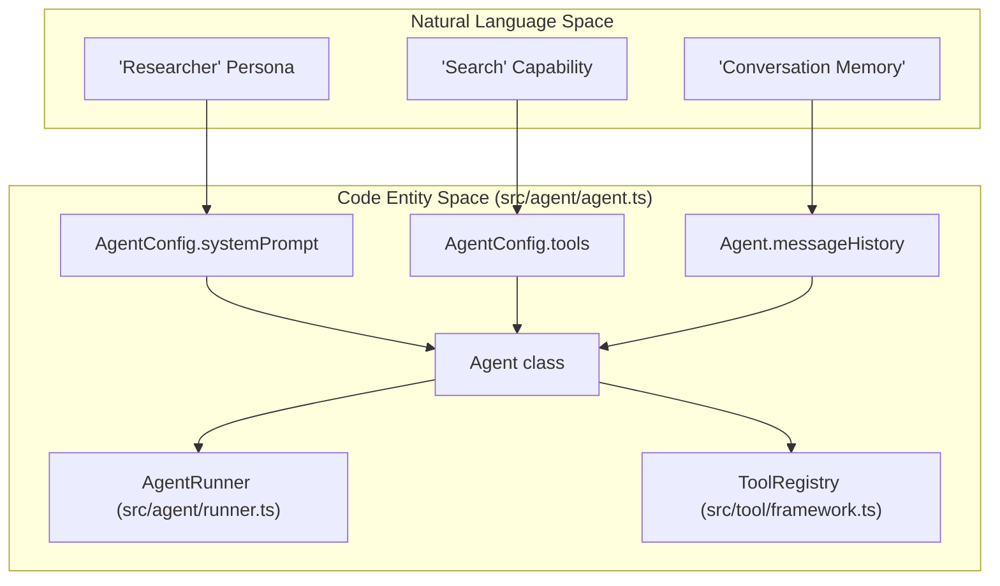
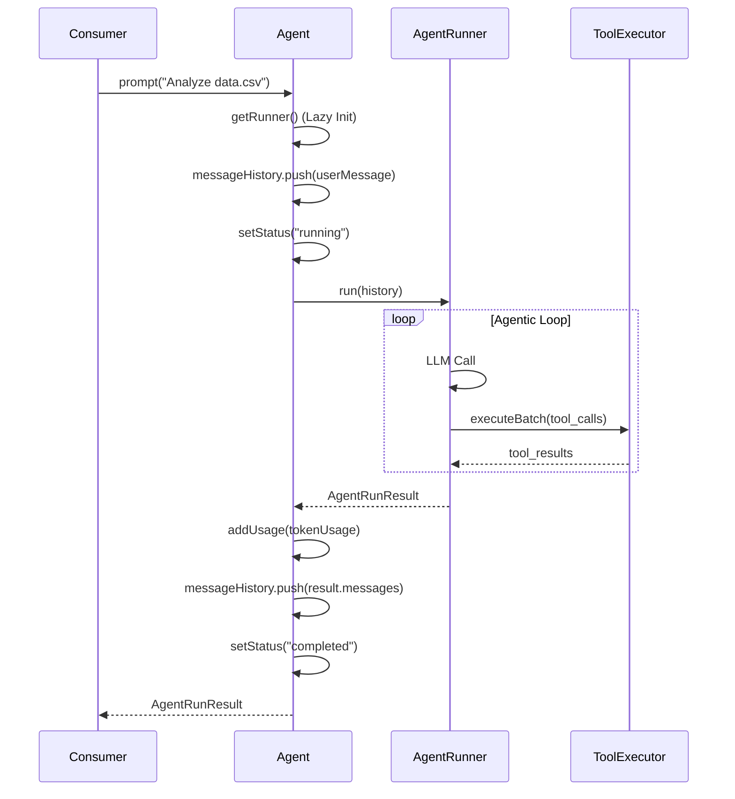

<!-- source: DeepWiki mcp.deepwiki.com · repo JackChen-me/open-multi-agent · page 3.1 Agent Class · fetched 2026-10-26 -->

# Agent Class

Relevant source files

The following files were used as context for generating this wiki page:

- [src/agent/agent.ts](src/agent/agent.ts)
- [src/types.ts](src/types.ts)

The `Agent` class is the primary high-level interface for the `open-multi-agent` framework. It serves as a stateful wrapper around the `AgentRunner`, managing conversation history, lifecycle transitions, and tool registration. While the `AgentRunner` handles the low-level "while-true" loop of LLM interaction and tool execution, the `Agent` class provides the ergonomic API used by consumers to execute one-shot queries, maintain multi-turn dialogues, and track token usage.

### Core Architecture and Data Flow

The `Agent` class bridges the gap between the static `AgentConfig` and the dynamic execution environment. It uses a lazy initialization pattern for its internal `AgentRunner` to ensure that provider SDKs are only loaded when needed.

#### Entity Relationship: Natural Language to Code
This diagram illustrates how natural language concepts (like a "Researcher" persona) map to specific code entities within the `Agent` class.

**Agent Entity Mapping**

**Sources:** [src/agent/agent.ts:61-94](), [src/types.ts:186-196]()

---

### Agent Configuration and State

An `Agent` is initialized with an `AgentConfig`, a `ToolRegistry`, and a `ToolExecutor`. The registry and executor are injected to allow multiple agents (e.g., in a `Team`) to share the same tool definitions and execution logic.

#### AgentConfig
The configuration defines the agent's identity and constraints:
*   `name`: Unique identifier.
*   `model`: The specific LLM (e.g., `claude-3-5-sonnet-20240620`).
*   `provider`: `anthropic` or `openai`.
*   `tools`: A list of tool names the agent is permitted to use.
*   `maxTurns`: Maximum iterations in the agentic loop (defaulting to 10 in the runner).

#### AgentState
The agent tracks its lifecycle through the `AgentState` interface:
*   **`idle`**: Ready for a new task.
*   **`running`**: Currently processing a prompt or executing tools.
*   **`completed`**: Successfully finished the last run.
*   **`error`**: Encountered an unrecoverable failure.

**Sources:** [src/agent/agent.ts:79-94](), [src/types.ts:186-204]()

---

### Execution API

The `Agent` provides three primary methods for interaction, each handling the `AgentState` and `messageHistory` differently.

| Method | History Usage | Persistence | Best Use Case |
| :--- | :--- | :--- | :--- |
| `run(prompt)` | Ignored | Not saved | Stateless, one-off tasks. |
| `prompt(message)` | Included in context | Appended to history | Chatbots, multi-step reasoning. |
| `stream(prompt)` | Ignored | Not saved | Real-time UI updates for one-off tasks. |

#### Internal Execution Flow
When any execution method is called, the agent performs the following steps:
1.  **Lazy Initialization**: Calls `getRunner()` to instantiate the `AgentRunner` and `LLMAdapter` if they don't exist [src/agent/agent.ts:106-133]().
2.  **State Transition**: Updates status to `running` [src/agent/agent.ts:258]().
3.  **Runner Invocation**: Delegates the actual LLM-Tool loop to `this.runner.run()` or `this.runner.stream()` [src/agent/agent.ts:264]().
4.  **Usage Tracking**: Accumulates `TokenUsage` from the `LLMResponse` into the agent's internal state [src/agent/agent.ts:269-272]().

**Sequence: Agent.prompt() Execution**

**Sources:** [src/agent/agent.ts:163-179](), [src/agent/agent.ts:253-281]()

---

### Token Usage Tracking

The agent maintains a cumulative count of tokens consumed across all turns in its lifecycle. This is handled by the internal `addUsage` helper which sums `input_tokens` and `output_tokens` from every LLM response returned by the runner.

*   **Initialization**: State starts with `ZERO_USAGE` (0/0) [src/agent/agent.ts:44-51]().
*   **Accumulation**: Every successful run adds the `usage` from the `AgentRunResult` to `this.state.tokenUsage` [src/agent/agent.ts:271]().
*   **Reset**: Calling `reset()` clears the usage back to zero [src/agent/agent.ts:212-219]().

**Sources:** [src/agent/agent.ts:44-51](), [src/agent/agent.ts:269-272]()

---

### Dynamic Tool Management

Agents can have their capabilities modified at runtime without needing to be re-instantiated.

*   **`addTool(name)`**: Adds a tool name to the agent's `allowedTools` list. The tool must exist in the `ToolRegistry` injected at construction [src/agent/agent.ts:226-231]().
*   **`removeTool(name)`**: Removes a tool from the agent's allowed list [src/agent/agent.ts:236-241]().

Note that these methods update the `RunnerOptions` within the `AgentRunner` instance if it has already been initialized, ensuring the LLM is immediately aware of the change in available tools during the next turn [src/agent/agent.ts:229]().

**Sources:** [src/agent/agent.ts:222-242]()

---

### State and History Management

The `Agent` class provides methods to inspect and clear its internal memory:

*   **`getState()`**: Returns a snapshot of the current `AgentState`, including status, all messages from the current/last run, and total token usage [src/agent/agent.ts:199-201]().
*   **`getHistory()`**: Returns only the persistent `LLMMessage` array used by the `prompt()` method [src/agent/agent.ts:204-206]().
*   **`reset()`**: Resets the status to `idle`, clears `messageHistory`, and zeros out `tokenUsage`. It **retains** the `AgentRunner` and `LLMAdapter` instances to avoid the overhead of re-initializing provider SDKs [src/agent/agent.ts:212-219]().

**Sources:** [src/agent/agent.ts:198-220]()

---

