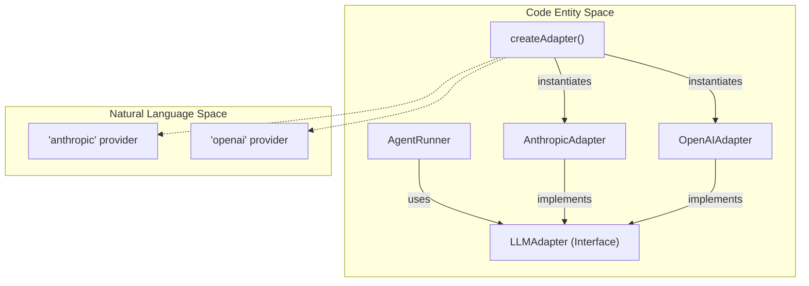
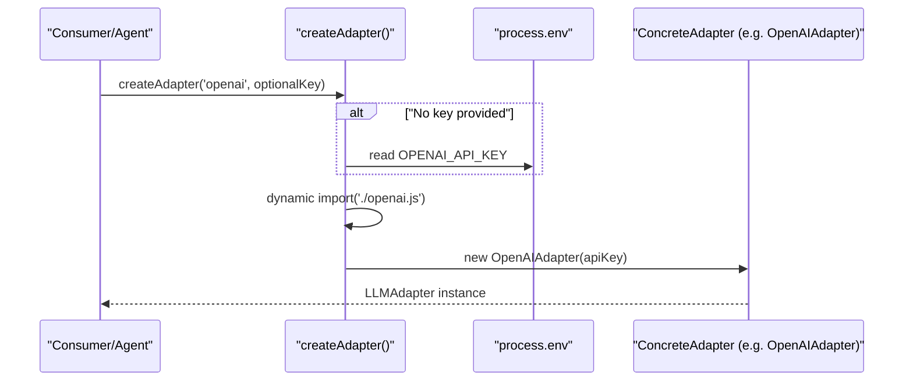

<!-- source: DeepWiki mcp.deepwiki.com · repo JackChen-me/open-multi-agent · page 4 LLM Adapters · fetched 2026-10-26 -->

# LLM Adapters

Relevant source files

The following files were used as context for generating this wiki page:

- [src/llm/adapter.ts](src/llm/adapter.ts)
- [src/types.ts](src/types.ts)

The LLM Adapter layer provides a provider-agnostic interface for interacting with Large Language Models. By abstracting the specific APIs of different providers (such as Anthropic and OpenAI), the framework allows agents to switch models or providers with minimal configuration changes. The core of this system is the `LLMAdapter` interface and a factory function that lazily loads the required implementation.

### Architecture Overview

The adapter system acts as a translation layer between the internal framework types (like `LLMMessage` and `LLMResponse`) and the proprietary formats required by external SDKs. This ensures that the `AgentRunner` and `Agent` classes can operate on a unified data structure regardless of whether they are communicating with Claude or GPT-4.

**Provider Abstraction Diagram**

Sources: [src/llm/adapter.ts:35-40](), [src/llm/adapter.ts:55-74](), [src/types.ts:186-196]()

---

### The LLMAdapter Interface

The `LLMAdapter` interface defines the standard contract for all model interactions. It supports both unary chat completions and asynchronous streaming. It uses normalized types to ensure consistency across the codebase.

| Feature | Description |
| :--- | :--- |
| **Unified Messaging** | Uses `LLMMessage` containing `ContentBlock` arrays (text, images, tool calls, or tool results). |
| **Chat Method** | `chat(messages, options)` returns a complete `LLMResponse`. |
| **Stream Method** | `stream(messages, options)` returns an `AsyncGenerator<StreamEvent>`. |
| **Token Tracking** | Every response includes `TokenUsage` for input and output accounting. |

For details on the interface definition and the factory logic, see [LLMAdapter Interface](#4.1).

**Sources:** [src/types.ts:63-81](), [src/types.ts:96-99](), [src/llm/adapter.ts:17-31]()

---

### Concrete Implementations

The framework currently provides built-in support for two major providers. These adapters handle the complexities of their respective SDKs, including mapping stop reasons and formatting tool definitions into the specific JSON Schema flavors required by each provider.

*   **Anthropic Adapter**: Interfaces with the `@anthropic-ai/sdk`, supporting models like Claude 3.5 Sonnet. It maps Anthropic's "blocks" directly to the internal `ContentBlock` format.
*   **OpenAI Adapter**: Interfaces with the `openai` SDK, supporting GPT-4o and other compatible models. It translates OpenAI's `tool_calls` and role-based message structure into the unified framework format.

For details on implementation specifics and error handling, see [Anthropic and OpenAI Adapters](#4.2).

**Sources:** [src/llm/adapter.ts:59-67](), [src/types.ts:189-189]()

---

### Adapter Factory and Lazy Loading

The `createAdapter` function is the primary entry point for obtaining an LLM client. It features lazy loading to minimize the dependency footprint; for example, the Anthropic SDK is only imported if an Anthropic adapter is explicitly requested.

**Adapter Initialization Flow**

Sources: [src/llm/adapter.ts:43-58](), [src/llm/adapter.ts:64-67]()

### Summary of Key Types

| Type | File | Purpose |
| :--- | :--- | :--- |
| `LLMAdapter` | [src/types.ts]() | The primary interface for model interaction. |
| `LLMMessage` | [src/types.ts]() | A role (`user`/`assistant`) and a list of content blocks. |
| `LLMResponse` | [src/types.ts]() | The final result of a chat completion, including metadata. |
| `StreamEvent` | [src/types.ts]() | Discrete events (text, tool_use, error, done) for streaming. |
| `LLMToolDef` | [src/types.ts]() | The serializable schema sent to providers to describe tools. |

**Sources:** [src/types.ts:63-66](), [src/types.ts:75-81](), [src/types.ts:96-99](), [src/types.ts:106-111]()

---

