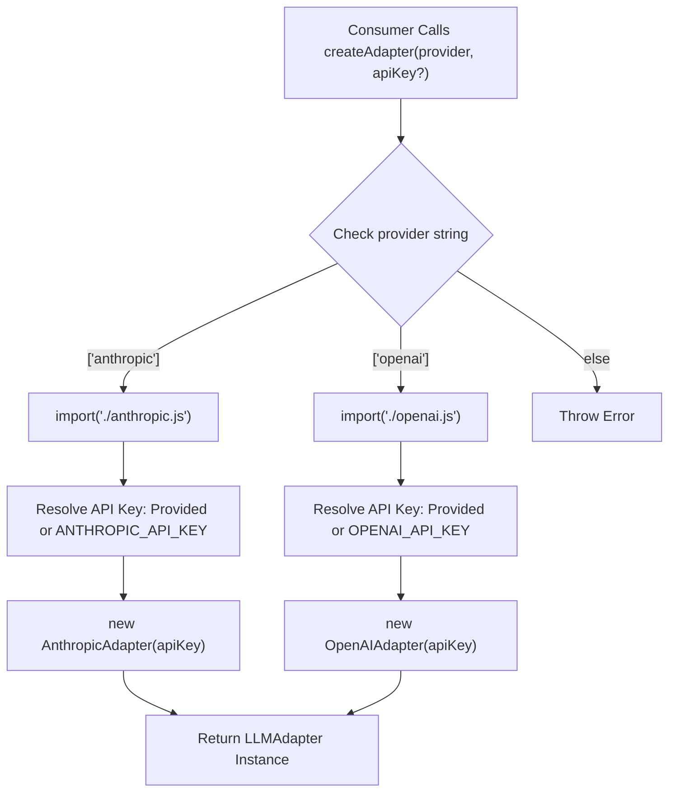
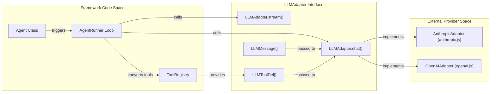

<!-- source: DeepWiki mcp.deepwiki.com · repo JackChen-me/open-multi-agent · page 4.1 LLMAdapter Interface · fetched 2026-10-26 -->

# LLMAdapter Interface

Relevant source files

The following files were used as context for generating this wiki page:

- [src/llm/adapter.ts](src/llm/adapter.ts)
- [src/types.ts](src/types.ts)

The `LLMAdapter` interface serves as the foundational abstraction layer for Large Language Model (LLM) interactions within the framework. It provides a provider-agnostic contract that allows the rest of the system—specifically agents and orchestrators—to communicate with different model providers (like Anthropic or OpenAI) using a unified data format.

## Interface Definition

The `LLMAdapter` interface enforces a standard set of methods for both blocking (unary) and streaming chat completions. This ensures that the `AgentRunner` can execute its logic without needing to handle provider-specific SDK quirks.

### LLMAdapter Interface
[src/types.ts:252-273]()

| Method | Description | Returns |
| :--- | :--- | :--- |
| `chat(messages, options)` | Performs a standard request-response cycle. | `Promise<LLMResponse>` |
| `stream(messages, options)` | Initiates a streaming response for real-time output. | `AsyncGenerator<StreamEvent>` |

### Core Data Structures

The interface relies on several key types to normalize inputs and outputs across different APIs:

*   **LLMMessage**: Represents a single turn in a conversation, containing an array of `ContentBlock` objects [src/types.ts:63-66]().
*   **ContentBlock**: A union type covering `TextBlock`, `ToolUseBlock`, `ToolResultBlock`, and `ImageBlock` [src/types.ts:53]().
*   **LLMResponse**: The final normalized output containing the generated content, stop reason, and token usage [src/types.ts:75-81]().

### Configuration Options

When invoking an adapter, two primary option objects are used to control model behavior:

1.  **LLMChatOptions**: Used for standard chat calls. It includes the `systemPrompt`, `temperature`, `maxTokens`, and an optional array of `LLMToolDef` [src/types.ts:221-231]().
2.  **LLMStreamOptions**: Extends `LLMChatOptions` and is passed to the `stream` method to handle incremental updates [src/types.ts:233-234]().

**Sources:** [src/types.ts:53-81](), [src/types.ts:221-234](), [src/types.ts:252-273]()

---

## Streaming and Events

The `stream` method returns an `AsyncGenerator` that yields `StreamEvent` objects. This allows the UI or calling process to react to incremental text generation or tool invocations as they happen.

### StreamEvent Types
[src/types.ts:96-99]()

| Event Type | Data Payload | Description |
| :--- | :--- | :--- |
| `text` | `string` | An incremental delta of generated text. |
| `tool_use` | `ToolUseBlock` | The model has initiated or finished defining a tool call. |
| `tool_result` | `ToolResultBlock` | A tool execution result has been injected into the stream. |
| `done` | `LLMResponse` | The final terminal event containing the full response and usage stats. |
| `error` | `Error` | Emitted if the connection drops or the provider returns an error. |

**Sources:** [src/types.ts:96-99]()

---

## The Adapter Factory

The `createAdapter` function is the primary entry point for instantiating LLM clients. It implements **lazy loading** and **automatic API key resolution** to minimize dependency overhead and simplify configuration.

### Implementation Details
[src/llm/adapter.ts:55-74]()

*   **Lazy Provider Loading**: Concrete implementations (e.g., `AnthropicAdapter`, `OpenAIAdapter`) are only imported when requested. This prevents the framework from requiring the OpenAI SDK if the user only intends to use Anthropic [src/llm/adapter.ts:48-49]().
*   **API Key Resolution**: If an `apiKey` is not provided to the factory, it attempts to resolve the key from environment variables (`ANTHROPIC_API_KEY` or `OPENAI_API_KEY`) [src/llm/adapter.ts:45-46]().

### Logic Flow: createAdapter

The following diagram illustrates how the factory resolves a provider request into a concrete instance.

**Adapter Resolution Flow**

**Sources:** [src/llm/adapter.ts:35-74]()

---

## Data Flow: Code Entities to LLM Space

This diagram maps the internal TypeScript entities used by the framework to the conceptual spaces they occupy during an LLM interaction.

**Entity Mapping Diagram**

**Sources:** [src/types.ts:106-111](), [src/types.ts:252-273](), [src/llm/adapter.ts:55-74]()

### Summary Table: Adapter Capabilities

| Feature | OpenAIAdapter | AnthropicAdapter |
| :--- | :--- | :--- |
| **File Location** | `src/llm/openai.ts` | `src/llm/anthropic.ts` |
| **Interface** | `LLMAdapter` | `LLMAdapter` |
| **Tool Support** | Via Function Calling | Via Tool Use |
| **Streaming** | Supported (`stream`) | Supported (`stream`) |
| **Default Env Var** | `OPENAI_API_KEY` | `ANTHROPIC_API_KEY` |

**Sources:** [src/llm/adapter.ts:1-74](), [src/types.ts:252-273]()

---

