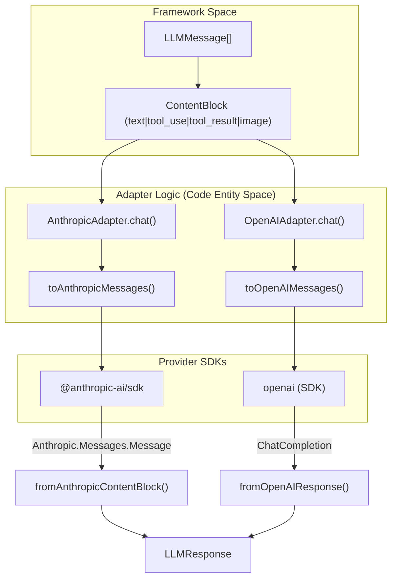
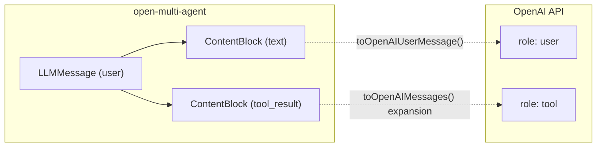

<!-- source: DeepWiki mcp.deepwiki.com · repo JackChen-me/open-multi-agent · page 4.2 Anthropic and OpenAI Adapters · fetched 2026-10-26 -->

# Anthropic and OpenAI Adapters

Relevant source files

The following files were used as context for generating this wiki page:

- [src/llm/adapter.ts](src/llm/adapter.ts)
- [src/llm/anthropic.ts](src/llm/anthropic.ts)
- [src/llm/openai.ts](src/llm/openai.ts)

The `open-multi-agent` framework provides concrete implementations of the `LLMAdapter` interface for Anthropic and OpenAI. These adapters act as a translation layer between the framework's unified message format (`LLMMessage`, `ContentBlock`) and the provider-specific SDK formats. They handle the nuances of tool calling, streaming events, and error propagation while maintaining a consistent API for the `AgentRunner`.

### Adapter Architecture and Data Flow

The `createAdapter` factory function in `src/llm/adapter.ts` provides lazy-loaded access to these implementations. This ensures that users only need to install the SDKs for the providers they actually use [src/llm/adapter.ts:48-49]().

The following diagram illustrates the data flow from the framework's internal representation to the provider-specific wire formats and back.

**LLM Adapter Translation Flow**

Sources: [src/llm/anthropic.ts:118-123](), [src/llm/openai.ts:102-135](), [src/llm/anthropic.ts:149-175](), [src/llm/openai.ts:209-245]()

---

### AnthropicAdapter

The `AnthropicAdapter` uses the `@anthropic-ai/sdk` to communicate with Claude models. It maps the framework's content blocks directly to Anthropic's `ContentBlockParam` array [src/llm/anthropic.ts:61-109]().

#### Key Implementation Details
- **Tool Mapping**: Framework `LLMToolDef` objects are converted to Anthropic's `Tool` format. The `inputSchema` is passed directly as the `input_schema` [src/llm/anthropic.ts:131-140]().
- **Role Consistency**: Anthropic requires strict user/assistant alternation. The adapter relies on the caller (usually `AgentRunner`) to provide a valid history [src/llm/anthropic.ts:114-116]().
- **Streaming**: Implements `stream()` by listening to SDK events like `content_block_delta` and `message_delta` to emit framework-standard `StreamEvent` objects [src/llm/anthropic.ts:251-330]().

**Anthropic Entity Mapping**

| Framework Entity | Anthropic SDK Entity | Mapping Function |
| :--- | :--- | :--- |
| `LLMMessage` | `MessageParam` | `toAnthropicMessages` [src/llm/anthropic.ts:118]() |
| `ContentBlock` | `ContentBlockParam` | `toAnthropicContentBlockParam` [src/llm/anthropic.ts:61]() |
| `LLMToolDef` | `Tool` | `toAnthropicTools` [src/llm/anthropic.ts:131]() |
| `LLMResponse` | `Message` | `chat()` return value [src/llm/anthropic.ts:228]() |

Sources: [src/llm/anthropic.ts:1-330]()

---

### OpenAIAdapter

The `OpenAIAdapter` handles the transition to the OpenAI Chat Completions API. Because OpenAI uses a distinct `tool` role (instead of embedding results in a `user` message), this adapter performs structural transformations on the message history [src/llm/openai.ts:12-15]().

#### Structural Expansion
When the framework sends a `user` message containing `tool_result` blocks, the `OpenAIAdapter` splits it into multiple OpenAI messages:
1. One `user` message containing any text or image content [src/llm/openai.ts:115-118]().
2. One `tool` role message for **each** `tool_result` block, identified by `tool_call_id` [src/llm/openai.ts:120-129]().

#### Key Implementation Details
- **System Prompts**: Unlike Anthropic (which has a top-level `system` parameter), OpenAI typically uses a `system` role message. The adapter prepends the `systemPrompt` from `LLMChatOptions` to the message array [src/llm/openai.ts:265-268]().
- **Tool Calls**: Framework `tool_use` blocks are converted to OpenAI's `tool_calls` array within an assistant message [src/llm/openai.ts:178-187]().
- **Streaming**: The `stream()` method iterates over the OpenAI stream, accumulating tool call arguments until they are complete, then yielding a `tool_use` event [src/llm/openai.ts:340-440]().

**OpenAI Entity Mapping**

Sources: [src/llm/openai.ts:102-135](), [src/llm/openai.ts:141-166]()

---

### Error Handling and Abort Signals

Both adapters implement standardized error handling and request cancellation:

1.  **AbortSignal**: Both `chat()` and `stream()` methods accept an `AbortSignal` in the options. This signal is passed directly to the underlying SDK (`signal` in Anthropic [src/llm/anthropic.ts:222](), `signal` in OpenAI [src/llm/openai.ts:275]()) to terminate network requests immediately.
2.  **SDK Exceptions**: Adapters do not wrap provider-specific errors (e.g., `Anthropic.APIError` or `OpenAI.APIError`). Callers are expected to handle these to manage rate limits or context window overflows [src/llm/anthropic.ts:206-207](), [src/llm/openai.ts:257-258]().
3.  **Token Usage**: Both adapters extract usage metadata (input/output tokens) from the final response and map it to the framework's `TokenUsage` type [src/llm/anthropic.ts:233-237](), [src/llm/openai.ts:235-239]().

### Configuration

Adapters resolve API keys in the following order:
1.  Explicit `apiKey` passed to the constructor [src/llm/anthropic.ts:193-195](), [src/llm/openai.ts:251-253]().
2.  Environment variables: `ANTHROPIC_API_KEY` or `OPENAI_API_KEY` [src/llm/anthropic.ts:194](), [src/llm/openai.ts:252]().

Sources: [src/llm/anthropic.ts:187-240](), [src/llm/openai.ts:245-280](), [src/llm/adapter.ts:55-74]()

---

