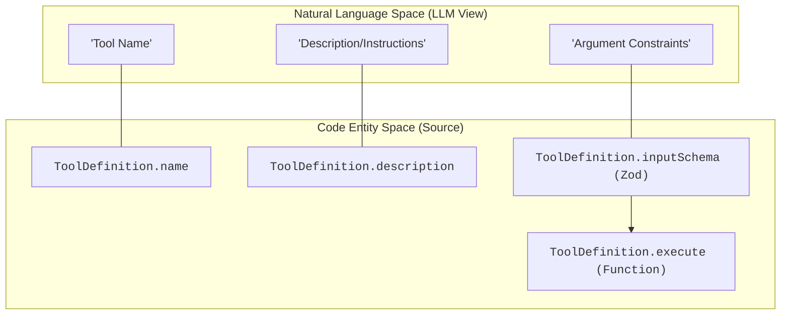
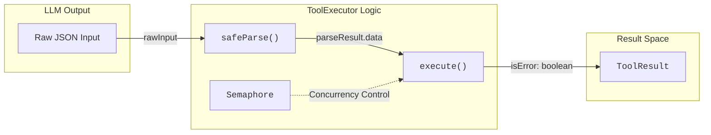

<!-- source: DeepWiki mcp.deepwiki.com · repo JackChen-me/open-multi-agent · page 5 Tool System · fetched 2026-10-26 -->

# Tool System

Relevant source files

The following files were used as context for generating this wiki page:

- [src/tool/built-in/index.ts](src/tool/built-in/index.ts)
- [src/tool/executor.ts](src/tool/executor.ts)
- [src/tool/framework.ts](src/tool/framework.ts)

The **Tool System** provides a structured way for agents to interact with the external world. It handles the definition of tool schemas using Zod, registration within a central repository, and safe, concurrent execution. By bridging the gap between high-level LLM requests and low-level code execution, the system ensures that inputs are validated and errors are handled gracefully without crashing the agentic loop.

## Overview of the Tool Lifecycle

The tool system operates in three distinct phases: definition, registration, and execution. This separation allows tools to be defined once and reused across multiple agents or teams.

### 1. Definition & Registration
Tools are defined using `defineTool`, which pairs a Zod schema with an executable function [src/tool/framework.ts:71-83](). These definitions are then stored in a `ToolRegistry` [src/tool/framework.ts:93-203](). The registry is responsible for converting these definitions into the JSON Schema format required by LLM providers like OpenAI and Anthropic [src/tool/framework.ts:162-172]().

### 2. Execution
When an agent receives a tool call from an LLM, it uses a `ToolExecutor` [src/tool/executor.ts:47-54](). The executor validates the LLM's provided arguments against the tool's Zod schema [src/tool/executor.ts:139-147](). If valid, it runs the tool, capturing any errors or timeouts as a `ToolResult` [src/tool/executor.ts:157-168]().

### 3. Built-in Capabilities
The framework includes a set of pre-configured tools for common filesystem and shell operations, accessible via `registerBuiltInTools` [src/tool/built-in/index.ts:46-50]().

---

## Natural Language to Code Entity Mapping

The following diagrams illustrate how natural language concepts used by the LLM map to specific code entities and data structures within the framework.

### Tool Definition Mapping
This diagram shows how a tool's conceptual parts (Name, Purpose, Arguments) map to the `ToolDefinition` structure.

**Sources:** [src/tool/framework.ts:71-83](), [src/types.ts:153-169]()

### Execution Flow & Data Translation
This diagram tracks how raw JSON from an LLM is processed by the `ToolExecutor` into a validated `ToolResult`.

**Sources:** [src/tool/executor.ts:132-169](), [src/utils/semaphore.ts:1-10]()

---

## Sub-System Components

### [Tool Framework: defineTool and ToolRegistry](#5.1)
The framework layer defines the `ToolDefinition` interface and the `ToolRegistry` class. It includes a robust `zodToJsonSchema` converter that translates TypeScript/Zod types into the JSON Schema dialect understood by LLMs.
*   **Key Entity:** `ToolRegistry` manages the collection of tools for an agent [src/tool/framework.ts:93]().
*   **Key Entity:** `defineTool` provides type safety for tool implementations [src/tool/framework.ts:71]().

For details, see [Tool Framework: defineTool and ToolRegistry](#5.1).

### [ToolExecutor](#5.2)
The `ToolExecutor` is the engine that runs tools. It provides error isolation, ensuring that a crash in a tool function does not crash the agent. It also supports `executeBatch` for running multiple tool calls in parallel using a `Semaphore` to limit resource usage.
*   **Key Entity:** `ToolExecutor` handles validation and execution [src/tool/executor.ts:47]().
*   **Key Entity:** `BatchToolCall` represents a single request in a parallel execution set [src/tool/executor.ts:30]().

For details, see [ToolExecutor](#5.2).

### [Built-in Tools](#5.3)
The framework provides five essential tools out-of-the-box: `bash`, `file_read`, `file_write`, `file_edit`, and `grep`. These are optimized for agentic workflows, such as using `ripgrep` for efficient searching.
*   **Key Entity:** `BUILT_IN_TOOLS` array containing all standard tools [src/tool/built-in/index.ts:26]().
*   **Key Entity:** `registerBuiltInTools` helper for quick setup [src/tool/built-in/index.ts:46]().

For details, see [Built-in Tools](#5.3).

---
**Sources:**
- [src/tool/framework.ts:1-203]()
- [src/tool/executor.ts:1-178]()
- [src/tool/built-in/index.ts:1-50]()
- [src/types.ts:153-180]()

---

