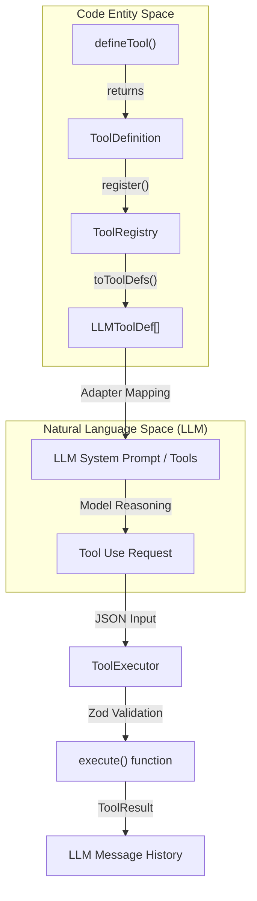
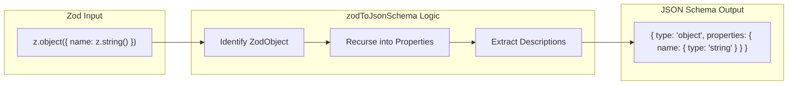

<!-- source: DeepWiki mcp.deepwiki.com · repo JackChen-me/open-multi-agent · page 5.1 Tool Framework: defineTool and ToolRegistry · fetched 2026-10-26 -->

# Tool Framework: defineTool and ToolRegistry

Relevant source files

The following files were used as context for generating this wiki page:

- [src/tool/framework.ts](src/tool/framework.ts)
- [src/types.ts](src/types.ts)

The Tool Framework provides the core primitives for declaring, registering, and converting tools into the structured formats required by Large Language Models (LLMs). It abstracts the complexity of JSON Schema generation and validation, allowing developers to focus on the tool's logic and input constraints using Zod.

## Core Primitives

The framework relies on a set of standardized types to ensure consistency between tool definition, execution, and LLM communication.

### defineTool

The `defineTool` function is the primary entry point for creating a typed tool. It enforces a contract where the input is validated against a `ZodSchema` before being passed to an asynchronous `execute` function.

| Property | Type | Description |
| :--- | :--- | :--- |
| `name` | `string` | Unique identifier for the tool used by the LLM to invoke it. |
| `description` | `string` | Natural language description helping the LLM understand when to use the tool. |
| `inputSchema` | `ZodSchema<TInput>` | A Zod schema defining the expected structure of the tool's arguments. |
| `execute` | `Function` | The implementation logic: `(input: TInput, context: ToolUseContext) => Promise<ToolResult>`. |

**Sources:**
- [src/tool/framework.ts:71-83]() (defineTool implementation)
- [src/types.ts:174-179]() (ToolDefinition interface)

### ToolResult and Context

Tools do not throw exceptions for operational failures; instead, they return a `ToolResult` object. This allows the framework to pass the error back to the LLM as a "tool result" block so the model can attempt to self-correct.

- **ToolResult**: Contains `data` (the stringified output) and an optional `isError` boolean [src/types.ts:163-166]().
- **ToolUseContext**: Provides metadata to the tool during execution, including `agent` info, `team` info, a `cwd` (current working directory) hint, and an `abortSignal` for cancellation [src/types.ts:126-146]().

**Sources:**
- [src/types.ts:126-166]()

---

## ToolRegistry

The `ToolRegistry` acts as a central repository for tools. It manages the lifecycle of tool registration and provides methods to export these tools in formats compatible with different LLM providers (e.g., Anthropic, OpenAI).

### Key Methods

- **`register(tool)`**: Adds a `ToolDefinition` to the internal `Map`. It throws an error if a tool with the same name already exists to prevent silent overwrites [src/tool/framework.ts:102-110]().
- **`unregister(name)`**: Gracefully removes a tool by name [src/tool/framework.ts:148-150]().
- **`toToolDefs()`**: The primary method used by `AgentRunner`. It iterates through registered tools and converts their Zod schemas into JSON Schema objects [src/tool/framework.ts:162-171]().
- **`toLLMTools()`**: A specialized exporter that produces the specific `input_schema` structure expected by Anthropic's API [src/tool/framework.ts:178-202]().

### Tool Registration Data Flow

The following diagram illustrates how a tool moves from a code definition into the `ToolRegistry` and eventually into the LLM's context.

**Tool Registration and Transformation**

**Sources:**
- [src/tool/framework.ts:93-203]() (ToolRegistry class)
- [src/types.ts:106-111]() (LLMToolDef type)

---

## Schema Conversion: zodToJsonSchema

To communicate tool requirements to an LLM, the framework must convert TypeScript/Zod definitions into standard JSON Schema. The `zodToJsonSchema` function handles this recursive transformation.

### Supported Zod Types
The converter supports a wide range of Zod primitives and wrappers:
- **Primitives**: `z.string()`, `z.number()`, `z.boolean()`, `z.null()`.
- **Collections**: `z.array()`, `z.object()`, `z.record()`.
- **Logic**: `z.enum()`, `z.nativeEnum()`, `z.union()`, `z.anyOf()`, `z.optional()`, `z.nullable()`.
- **Metadata**: It extracts descriptions from `.describe()` calls to populate the `description` field in JSON Schema.

### Conversion Logic
The function performs a type-check on the Zod internal `_def` and maps it to the `JSONSchemaProperty` type.

**Data Flow: Type to Schema**

**Sources:**
- [src/tool/framework.ts:29-45]() (JSONSchemaProperty definition)
- [src/tool/framework.ts:209-224]() (zodToJsonSchema entry point)
- [src/tool/framework.ts:238-348]() (Internal recursive conversion logic)

---

## Implementation Summary

| Component | Responsibility | Key File |
| :--- | :--- | :--- |
| `defineTool` | Factory for creating `ToolDefinition` objects with type safety. | [src/tool/framework.ts]() |
| `ToolRegistry` | Manages a collection of tools and exports them for LLM use. | [src/tool/framework.ts]() |
| `zodToJsonSchema` | Transforms Zod schemas into LLM-readable JSON Schema. | [src/tool/framework.ts]() |
| `ToolDefinition` | Interface defining the name, description, schema, and executor. | [src/types.ts]() |
| `ToolResult` | Standardized object for returning tool output or errors. | [src/types.ts]() |

**Sources:**
- [src/tool/framework.ts:1-350]()
- [src/types.ts:102-180]()

---

