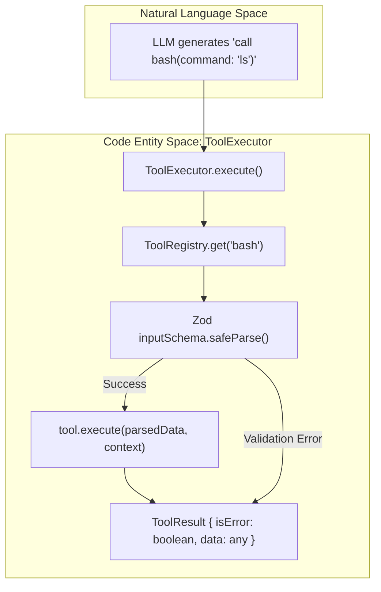
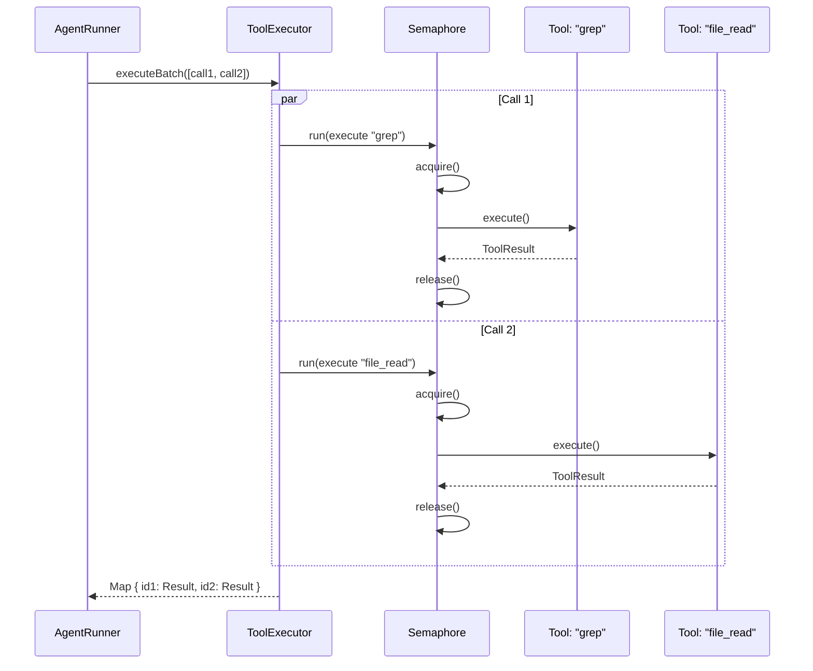

<!-- source: DeepWiki mcp.deepwiki.com · repo JackChen-me/open-multi-agent · page 5.2 ToolExecutor · fetched 2026-10-26 -->

# ToolExecutor

Relevant source files

The following files were used as context for generating this wiki page:

- [src/tool/executor.ts](src/tool/executor.ts)
- [src/utils/semaphore.ts](src/utils/semaphore.ts)

The `ToolExecutor` is the engine responsible for invoking tools defined within the framework. It acts as a bridge between the raw tool calls generated by an LLM and the typed, validated execution environment of the codebase. It provides robust error isolation, Zod-based input validation, and concurrency management via a semaphore-based scheduling system.

## Core Responsibilities

The `ToolExecutor` class `[src/tool/executor.ts:47-178]()` handles the lifecycle of a tool call through several distinct phases:

1.  **Registry Lookup**: Verifies that the requested tool exists in the provided `ToolRegistry` `[src/tool/executor.ts:75-80]()`.
2.  **Pre-execution Checks**: Validates the `AbortSignal` to ensure the request hasn't been cancelled before starting `[src/tool/executor.ts:83-87]()`.
3.  **Input Validation**: Uses the tool's Zod `inputSchema` to parse and validate the raw input from the LLM `[src/tool/executor.ts:139-147]()`.
4.  **Concurrency Control**: For batch operations, it uses a `Semaphore` to limit the number of simultaneous tool executions `[src/tool/executor.ts:53, 113-115]()`.
5.  **Error Isolation**: Wraps execution in try-catch blocks to ensure that tool failures are returned as `ToolResult` objects rather than throwing exceptions that would crash the agent loop `[src/tool/executor.ts:157-168]()`.

### From LLM Request to Code Execution

The following diagram illustrates how a natural language request processed by an LLM translates into a specific execution path within the `ToolExecutor`.

**LLM Tool Call Flow**

Sources: `[src/tool/executor.ts:70-90]()`, `[src/tool/executor.ts:132-169]()`

## Single Execution

The `execute` method `[src/tool/executor.ts:70-90]()` is the entry point for running a single tool. It is designed to be "fail-safe," meaning it will never reject its promise. Instead, any error—be it a missing tool, a validation failure, or a runtime exception—is captured and returned as a `ToolResult` with `isError: true` `[src/tool/executor.ts:172-177]()`.

- **Abort Signal**: The executor checks `context.abortSignal` twice: once before looking up the tool and again after potentially expensive Zod parsing `[src/tool/executor.ts:83, 150]()`.
- **Validation**: If Zod validation fails, the executor formats the Zod issues into a readable string for the LLM to process `[src/tool/executor.ts:141-146]()`.

## Batch Execution and Concurrency

When an agent needs to run multiple tools (e.g., searching multiple files simultaneously), it uses `executeBatch` `[src/tool/executor.ts:105-121]()`. This method accepts an array of `BatchToolCall` objects and returns a `Map<string, ToolResult>`.

### Concurrency Control via Semaphore

The `ToolExecutor` uses a `Semaphore` `[src/utils/semaphore.ts:24-89]()` to prevent resource exhaustion. By default, it allows a `maxConcurrency` of 4 `[src/tool/executor.ts:53]()`.

**Batch Execution Architecture**

Sources: `[src/tool/executor.ts:105-121]()`, `[src/utils/semaphore.ts:71-78]()`

## Error Handling and Result Formatting

The `ToolExecutor` treats errors as data. This is critical for agentic workflows where the LLM needs to know *why* a tool failed (e.g., a syntax error in a shell command) so it can attempt to correct its input in the next turn.

| Error Type | Detection Point | Result `isError` | Result `data` |
| :--- | :--- | :--- | :--- |
| **Missing Tool** | `registry.get()` | `true` | "Tool [name] is not registered..." |
| **Abort** | `abortSignal.aborted` | `true` | "Tool [name] was aborted..." |
| **Validation** | `inputSchema.safeParse()` | `true` | Formatted list of Zod issues |
| **Runtime Error** | `try/catch` block | `true` | Error message or stringified error |
| **Success** | `tool.execute()` | `false` | Tool-defined output |

Sources: `[src/tool/executor.ts:76-80]()`, `[src/tool/executor.ts:140-147]()`, `[src/tool/executor.ts:157-168]()`

## Class Reference

### ToolExecutor
- `constructor(registry: ToolRegistry, options?: ToolExecutorOptions)`: Initializes the executor with a tool registry and optional concurrency settings `[src/tool/executor.ts:51-54]()`.
- `execute(toolName, input, context)`: Executes a single tool with validation and error isolation `[src/tool/executor.ts:70-90]()`.
- `executeBatch(calls, context)`: Executes multiple tools in parallel using a semaphore `[src/tool/executor.ts:105-121]()`.

### ToolExecutorOptions
- `maxConcurrency`: (Optional) The maximum number of tools to run at once. Defaults to 4 `[src/tool/executor.ts:21-27]()`.

### BatchToolCall
- `id`: A unique identifier for the call, used to map results back to requests `[src/tool/executor.ts:31-32]()`.
- `name`: The name of the tool to execute `[src/tool/executor.ts:33-34]()`.
- `input`: The raw arguments provided for the tool `[src/tool/executor.ts:35-36]()`.

Sources: `[src/tool/executor.ts:21-47]()`

---

