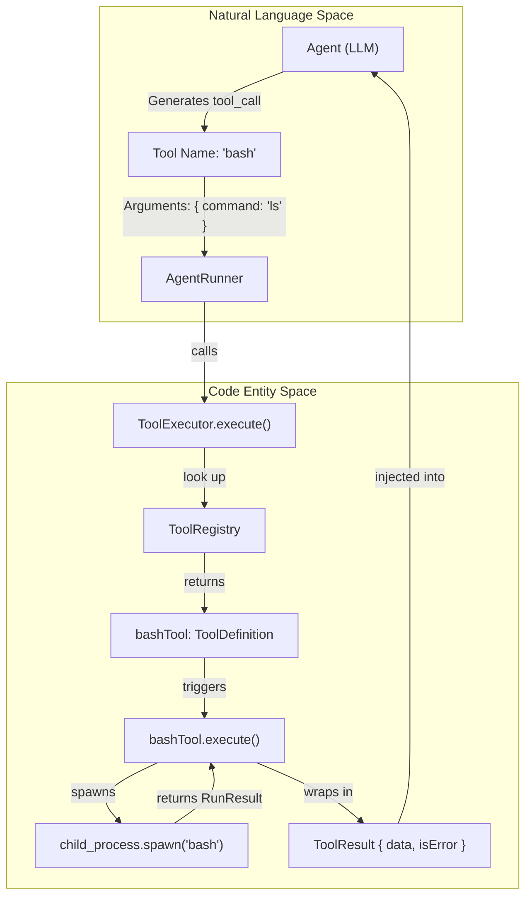
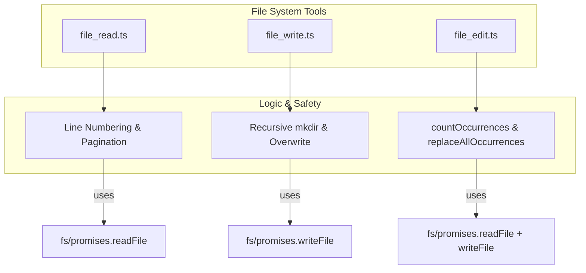

<!-- source: DeepWiki mcp.deepwiki.com · repo JackChen-me/open-multi-agent · page 5.3 Built-in Tools · fetched 2026-10-26 -->

# Built-in Tools

Relevant source files

The following files were used as context for generating this wiki page:

- [src/tool/built-in/bash.ts](src/tool/built-in/bash.ts)
- [src/tool/built-in/file-edit.ts](src/tool/built-in/file-edit.ts)
- [src/tool/built-in/file-read.ts](src/tool/built-in/file-read.ts)
- [src/tool/built-in/file-write.ts](src/tool/built-in/file-write.ts)
- [src/tool/built-in/grep.ts](src/tool/built-in/grep.ts)
- [src/tool/built-in/index.ts](src/tool/built-in/index.ts)

The `open-multi-agent` framework provides a suite of high-utility built-in tools designed to give agents the capability to interact with the local file system, execute shell commands, and perform performant text searches. These tools are implemented using the standard `defineTool` primitive and are optimized for LLM consumption through clear schemas and structured error reporting.

### Registration and Availability

The built-in tools are managed through a central registry mechanism. Developers can either use the complete set or pick individual tools to register with a `ToolRegistry` [src/tool/built-in/index.ts:9-14]().

*   `BUILT_IN_TOOLS`: A constant array containing all five tool definitions [src/tool/built-in/index.ts:26-32]().
*   `registerBuiltInTools(registry)`: A convenience function that iterates over `BUILT_IN_TOOLS` and calls `registry.register(tool)` for each [src/tool/built-in/index.ts:46-50]().

### Tool Data Flow

The following diagram illustrates how a built-in tool (e.g., `bashTool`) transitions from a natural language request to execution within the Node.js environment.

**Built-in Tool Execution Flow**

Sources: [src/tool/built-in/bash.ts:22-63](), [src/tool/built-in/index.ts:26-32](), [src/tool/built-in/index.ts:46-50]()

---

### 1. Bash Execution (`bash`)

The `bashTool` allows agents to execute arbitrary shell commands. It runs in a non-interactive shell via `bash -c` [src/tool/built-in/bash.ts:28-29]().

*   **Key Features**:
    *   **Timeout Control**: Defaults to 30,000ms to prevent hanging processes [src/tool/built-in/bash.ts:16-16]().
    *   **CWD Support**: Allows specifying the working directory for the command [src/tool/built-in/bash.ts:40-43]().
    *   **Abort Signal**: Integration with `AbortSignal` ensures that if the agent's run is cancelled, the underlying shell process is killed with `SIGKILL` [src/tool/built-in/bash.ts:126-128]().
*   **Implementation**: Uses `child_process.spawn` to capture `stdout` and `stderr` separately, merging them into a labeled output string if both are present [src/tool/built-in/bash.ts:93-100](), [src/tool/built-in/bash.ts:161-187]().

Sources: [src/tool/built-in/bash.ts:1-63]()

---

### 2. File Operations (`file_read`, `file_write`, `file_edit`)

These three tools provide a robust interface for file manipulation, moving from simple I/O to targeted string replacement.

#### `file_read`
Reads file contents with 1-based line numbers prefixed to every line [src/tool/built-in/file-read.ts:19-20]().
*   **Chunking**: Supports `offset` and `limit` parameters to read specific slices of large files, preventing context window overflow [src/tool/built-in/file-read.ts:21-22]().
*   **Metadata**: Appends a summary line (e.g., "showing lines 1–50 of 200") when a file is partially read [src/tool/built-in/file-read.ts:95-98]().

#### `file_write`
Creates or overwrites a file.
*   **Automatic Directory Creation**: Automatically performs the equivalent of `mkdir -p` for the parent directory of the target path [src/tool/built-in/file-write.ts:46-56]().
*   **Reporting**: Returns the byte count and line count of the written content [src/tool/built-in/file-write.ts:70-77]().

#### `file_edit`
Performs a targeted string replacement. This is preferred over `file_write` for modifying existing code to minimize the risk of the LLM hallucinating or deleting unrelated code [src/tool/built-in/file-edit.ts:22-24]().
*   **Uniqueness Invariant**: By default, it errors if the `old_string` appears more than once, forcing the agent to be specific [src/tool/built-in/file-edit.ts:77-85]().
*   **`replace_all`**: An optional flag to override the uniqueness check [src/tool/built-in/file-edit.ts:39-45]().

**File Tool Logic Map**

Sources: [src/tool/built-in/file-read.ts:46-104](), [src/tool/built-in/file-write.ts:35-80](), [src/tool/built-in/file-edit.ts:48-111]()

---

### 3. Search (`grep`)

The `grepTool` provides high-performance regex searching across files and directories.

*   **Hybrid Implementation**:
    1.  **Ripgrep (`rg`)**: The tool first checks if the `ripgrep` binary is available on the system [src/tool/built-in/grep.ts:93-100](). If found, it uses `rg` for maximum speed and native glob support.
    2.  **Node.js Fallback**: If `rg` is missing, it falls back to a pure Node.js recursive implementation using `fs.readdir` and `fs.readFile` [src/tool/built-in/grep.ts:103-108]().
*   **Optimization**:
    *   **SKIP_DIRS**: Both implementations ignore common non-source directories like `.git`, `node_modules`, and `dist` [src/tool/built-in/grep.ts:24-32]().
    *   **Result Capping**: Results are limited by `maxResults` (default 100) to keep LLM responses manageable [src/tool/built-in/grep.ts:22-22]().

Sources: [src/tool/built-in/grep.ts:1-109]()

### Summary Table

| Tool Name | Primary Function | Key Parameters | Implementation Detail |
| :--- | :--- | :--- | :--- |
| `bash` | Shell execution | `command`, `timeout`, `cwd` | `child_process.spawn` [src/tool/built-in/bash.ts:93]() |
| `file_read` | Read file content | `path`, `offset`, `limit` | Line numbering (1-based) [src/tool/built-in/file-read.ts:91]() |
| `file_write` | Create/Overwrite | `path`, `content` | Recursive directory creation [src/tool/built-in/file-write.ts:48]() |
| `file_edit` | String replacement | `old_string`, `new_string` | Uniqueness check by default [src/tool/built-in/file-edit.ts:77]() |
| `grep` | Regex search | `pattern`, `path`, `glob` | Ripgrep with Node.js fallback [src/tool/built-in/grep.ts:92]() |

Sources: [src/tool/built-in/index.ts:26-32]()

---

