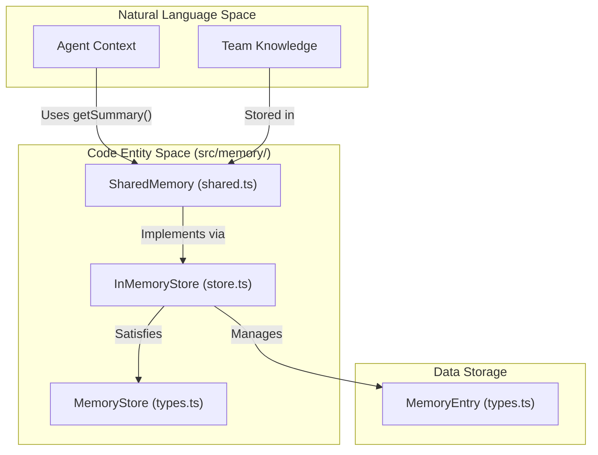
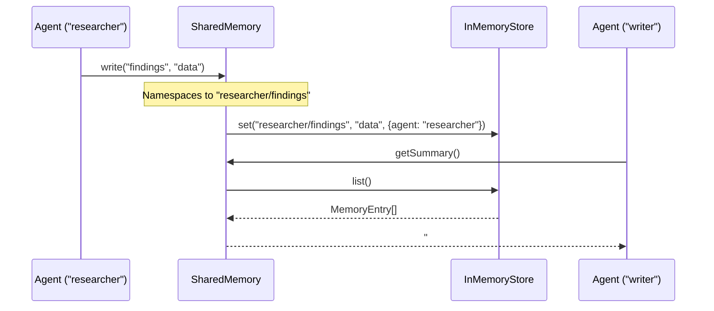

<!-- source: DeepWiki mcp.deepwiki.com · repo JackChen-me/open-multi-agent · page 6 Memory System · fetched 2026-10-26 -->

# Memory System

Relevant source files

The following files were used as context for generating this wiki page:

- [src/memory/shared.ts](src/memory/shared.ts)
- [src/memory/store.ts](src/memory/store.ts)
- [src/types.ts](src/types.ts)

The **Memory System** provides a persistent and shared state layer for agents within the `open-multi-agent` framework. It allows individual agents to store information and enables teams of agents to collaborate by sharing findings, task results, and context through a unified interface.

The system is built on a layered architecture: a low-level `MemoryStore` for raw data persistence, an `InMemoryStore` implementation for runtime storage, and a high-level `SharedMemory` manager that handles namespacing and context synthesis for agent teams.

### Memory Architecture Overview

The following diagram illustrates how the memory components relate to the core agent and team entities.

**Memory Layer Entity Map**

Sources: [src/memory/shared.ts:36-41](), [src/memory/store.ts:31-32](), [src/types.ts:245-250]()

---

## 6.1 MemoryStore and InMemoryStore

The foundation of the memory system is the `MemoryStore` interface. It defines a standard asynchronous API for key-value storage, ensuring that the framework can remain agnostic of the underlying storage backend (e.g., Local RAM, Redis, or SQLite).

### Key Features
- **Asynchronous Interface**: All methods in `MemoryStore` return promises, allowing for easy migration to network-based or disk-based backends [src/memory/store.ts:17-19]().
- **InMemoryStore**: The default implementation uses a JavaScript `Map` [src/memory/store.ts:32-32](). It supports basic CRUD operations and includes a `search` method for case-insensitive substring matching across keys and values [src/memory/store.ts:99-108]().
- **Metadata Preservation**: When updating an existing key, the `set` method preserves the original `createdAt` timestamp [src/memory/store.ts:49-62]().

For implementation details and guidance on creating custom backends, see **[MemoryStore and InMemoryStore](#6.1)**.

Sources: [src/memory/store.ts:1-124](), [src/types.ts:252-261]()

---

## 6.2 SharedMemory

`SharedMemory` is a high-level wrapper around a `MemoryStore` designed specifically for multi-agent coordination. It introduces **Namespacing**, ensuring that while all agents can read from the shared pool, every write is attributed to a specific agent.

### Core Concepts
- **Namespaced Keys**: Writes are automatically prefixed using the pattern `<agentName>/<key>` [src/memory/shared.ts:58-69]().
- **Context Synthesis**: The `getSummary()` method generates a Markdown-formatted digest of all stored information. This summary is intended to be injected into an agent's system prompt so it understands the current state of the team's collective knowledge [src/memory/shared.ts:107-159]().
- **Orchestration**: The framework's orchestrator uses `SharedMemory` to pass outputs from one task as inputs to the next agent in a pipeline.

### Data Flow: Shared Memory Interaction

For details on namespacing logic and summary generation, see **[SharedMemory](#6.2)**.

Sources: [src/memory/shared.ts:17-35](), [src/memory/shared.ts:127-159]()

---

