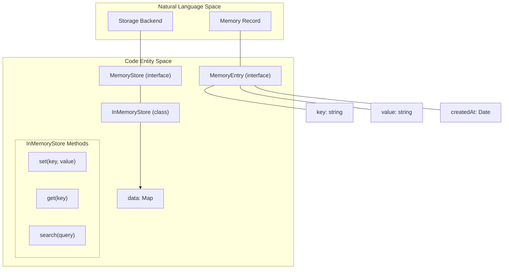
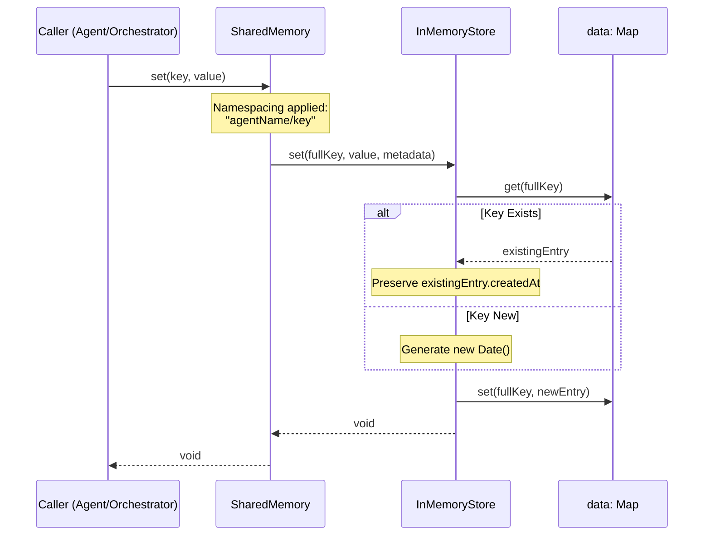

<!-- source: DeepWiki mcp.deepwiki.com · repo JackChen-me/open-multi-agent · page 6.1 MemoryStore and InMemoryStore · fetched 2026-10-26 -->

# MemoryStore and InMemoryStore

<details>
<summary>Relevant source files</summary>

The following files were used as context for generating this wiki page:

- [src/memory/store.ts](src/memory/store.ts)
- [src/types.ts](src/types.ts)

</details>


The Memory Store system provides a standardized interface for persisting and retrieving information across agent execution cycles. It serves as the foundational storage layer for the framework's shared memory capabilities, allowing agents within a team to exchange data, track task progress, and maintain long-term context.

## MemoryStore Interface

The `MemoryStore` interface defines a set of asynchronous methods for key-value storage. While the default implementation is in-memory, the interface is designed to be provider-agnostic, enabling developers to swap the underlying storage (e.g., to Redis or SQLite) without modifying the high-level agent or team logic [src/memory/store.ts:16-20]().

### Data Structures

All data in a `MemoryStore` is encapsulated in a `MemoryEntry` object:

| Property | Type | Description |
| :--- | :--- | :--- |
| `key` | `string` | The unique identifier for the memory entry. |
| `value` | `string` | The stored content. Structured data must be serialized (e.g., via `JSON.stringify`). |
| `metadata` | `Record<string, unknown>` | Optional key-value pairs for categorization or filtering. |
| `createdAt` | `Date` | The timestamp when the entry was first created. |

### Core Methods

The interface requires the following asynchronous operations [src/memory/store.ts:31-80]():

*   **`get(key: string)`**: Retrieves a `MemoryEntry` or `null` if the key does not exist.
*   **`set(key: string, value: string, metadata?: Record<string, unknown>)`**: Persists a value. Implementations must handle "upsert" logic.
*   **`list()`**: Returns an array of all `MemoryEntry` objects currently in the store.
*   **`delete(key: string)`**: Removes a specific entry by key.
*   **`clear()`**: Wipes all entries from the store.

**Sources:** [src/types.ts:213-245](), [src/memory/store.ts:1-30]()

---

## InMemoryStore Implementation

The `InMemoryStore` is the default implementation provided by the framework. It manages data using a standard JavaScript `Map` [src/memory/store.ts:32](). It is optimized for single-process use cases and testing environments where persistence across restarts is not required.

### Upsert and Lifecycle Semantics
When calling `set()`, the `InMemoryStore` performs a specific check on the `createdAt` property. If a key already exists, the original `createdAt` timestamp is **preserved**, while the `value` and `metadata` are updated [src/memory/store.ts:43-62](). This allows agents to track the "age" of a piece of information even if it has been updated multiple times.

### Search Extension
Beyond the standard interface, `InMemoryStore` includes a `search()` method. This performs a case-insensitive linear scan across both keys and values [src/memory/store.ts:86-109]().

### System Entity Mapping: Store to Implementation

The following diagram illustrates how the abstract `MemoryStore` interface relates to the concrete `InMemoryStore` and the internal data structures.

"Memory Storage Entity Mapping"

**Sources:** [src/memory/store.ts:31-124](), [src/types.ts:213-245]()

---

## Data Flow: Memory Persistence

When an agent or the orchestrator interacts with memory, the data flows through the `SharedMemory` wrapper (which provides namespacing) down into the `MemoryStore`.

"Memory Set Data Flow"

**Sources:** [src/memory/store.ts:49-62](), [src/types.ts:159-160]()

---

## Swapping Backends (Redis/SQLite)

The framework is designed to allow production-grade backends to replace the default `InMemoryStore`. To implement a custom backend, a class must satisfy the `MemoryStore` interface.

### Implementation Guidance

1.  **Async Requirements**: Even if the underlying driver is synchronous, the `MemoryStore` interface requires `Promise` returns to ensure compatibility [src/memory/store.ts:17-19]().
2.  **Serialization**: The store should expect `value` to be a string. For SQLite, this maps to a `TEXT` or `BLOB` column; for Redis, a standard `SET` command.
3.  **Metadata Handling**: The `metadata` field is a flat or nested object. In SQL backends, this is typically stored in a `JSON` column.
4.  **CreatedAt Preservation**: Ensure your `set` logic (or SQL `INSERT ... ON CONFLICT`) does not overwrite the initial creation timestamp if the record already exists [src/memory/store.ts:46-48]().

### Example Interface Alignment
To use a custom store, pass it to the `SharedMemory` constructor or the `Team` configuration:

```ts
// Example of how a custom store is integrated
const customStore = new MyRedisStore({ host: 'localhost' });
const team = createTeam({
  name: 'research-team',
  agents: [...],
  sharedMemory: new SharedMemory(customStore)
});
```

**Sources:** [src/memory/store.ts:4-8](), [src/types.ts:159-160]()

---

