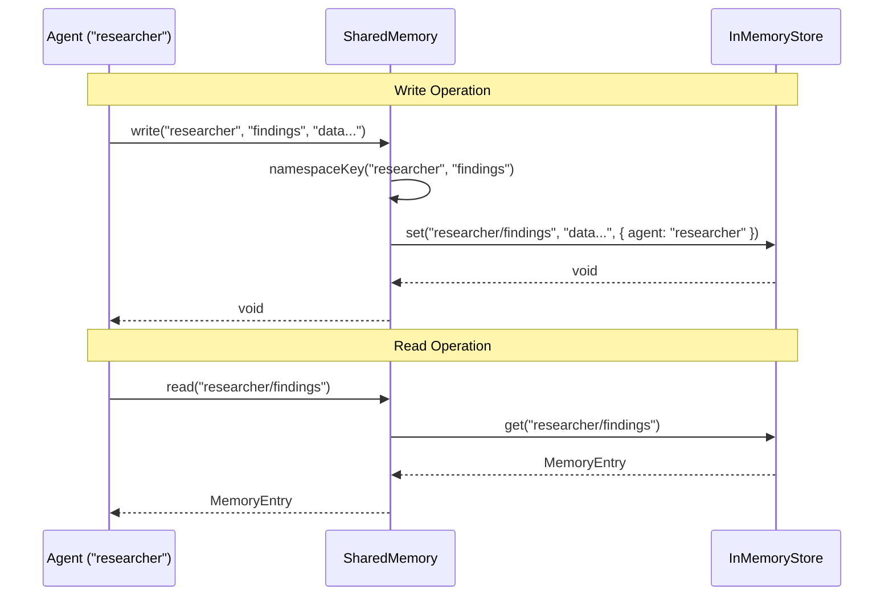
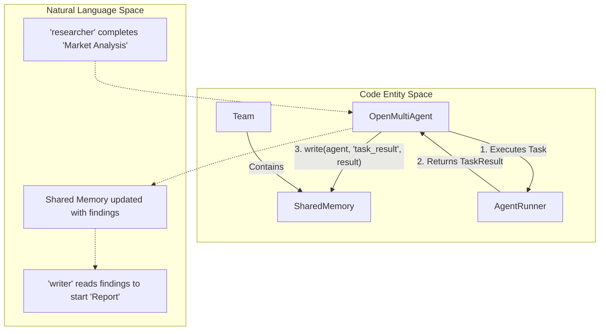

<!-- source: DeepWiki mcp.deepwiki.com · repo JackChen-me/open-multi-agent · page 6.2 SharedMemory · fetched 2026-10-26 -->

# SharedMemory

<details>
<summary>Relevant source files</summary>

The following files were used as context for generating this wiki page:

- [src/memory/shared.ts](src/memory/shared.ts)
- [src/team/team.ts](src/team/team.ts)

</details>


The `SharedMemory` class provides a namespaced key-value storage layer designed for autonomous agents operating within a `Team`. It ensures that while all agents can read from the global pool of knowledge, every piece of information remains attributable to its creator through a structured naming convention.

## Overview and Namespace Pattern

`SharedMemory` acts as a wrapper around an `InMemoryStore` [src/memory/shared.ts:37-41](). It enforces a strict namespacing pattern for all write operations to prevent key collisions between agents and to maintain provenance.

### Key Composition
Every entry in the shared memory is identified by a fully-qualified key using the format:
`<agentName>/<key>`

When an agent writes to the store, the `SharedMemory` class automatically prepends the agent's name to the provided logical key [src/memory/shared.ts:64-68]().

| Operation | Input | Resulting Internal Key |
| :--- | :--- | :--- |
| **Write** | `agent: "researcher"`, `key: "stats"` | `"researcher/stats"` |
| **Read** | `key: "researcher/stats"` | Returns value for `"researcher/stats"` |

### Implementation Details
The class utilizes a private static helper `namespaceKey` to ensure consistent formatting across the API [src/memory/shared.ts:178-180]().

**Sources:**
- [src/memory/shared.ts:4-8]()
- [src/memory/shared.ts:36-41]()
- [src/memory/shared.ts:178-180]()

---

## Data Flow: Writing and Reading

The following diagram illustrates how the `SharedMemory` class bridges the gap between the high-level `Agent` names and the underlying `InMemoryStore` entities.

### Memory Access Flow
"This diagram shows how `SharedMemory.write` and `SharedMemory.read` interact with the `InMemoryStore`."



**Sources:**
- [src/memory/shared.ts:58-69]()
- [src/memory/shared.ts:80-82]()
- [src/memory/shared.ts:178-180]()

---

## Context Injection via getSummary

One of the primary roles of `SharedMemory` is to provide context to LLMs. The `getSummary()` method generates a Markdown-formatted digest of the entire store [src/memory/shared.ts:127-159]().

### Summary Generation Logic
1.  **Grouping**: Entries are retrieved from `listAll()` and grouped by the prefix (the agent name) [src/memory/shared.ts:131-144]().
2.  **Truncation**: To protect the LLM's context window, values exceeding 200 characters are truncated [src/memory/shared.ts:151-153]().
3.  **Formatting**: The output is structured with Markdown headers for each agent [src/memory/shared.ts:146-158]().

### Example Output
```markdown
## Shared Team Memory

### researcher
- findings: TypeScript 5.5 ships const type params

### coder
- plan: Implement feature X using const type params
```

**Sources:**
- [src/memory/shared.ts:107-126]()
- [src/memory/shared.ts:127-159]()

---

## Orchestrator Integration

In a `Team` environment, `SharedMemory` is initialized if `config.sharedMemory` is true [src/team/team.ts:106](). The `OpenMultiAgent` orchestrator uses this shared space to pass results between agents, especially when tasks have dependencies.

### Orchestrator Result Propagation
"This diagram shows how `OpenMultiAgent` uses `SharedMemory` to facilitate data flow between agents in a task pipeline."



### Key Functions
*   **`listByAgent(agentName)`**: Filters the store to return only entries where the key starts with the agent's namespace prefix [src/memory/shared.ts:97-101]().
*   **`getStore()`**: Provides direct access to the underlying `MemoryStore` for low-level operations [src/memory/shared.ts:170-172]().

**Sources:**
- [src/team/team.ts:95]()
- [src/team/team.ts:106]()
- [src/memory/shared.ts:97-101]()
- [src/memory/shared.ts:170-172]()

---

