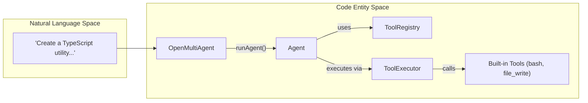
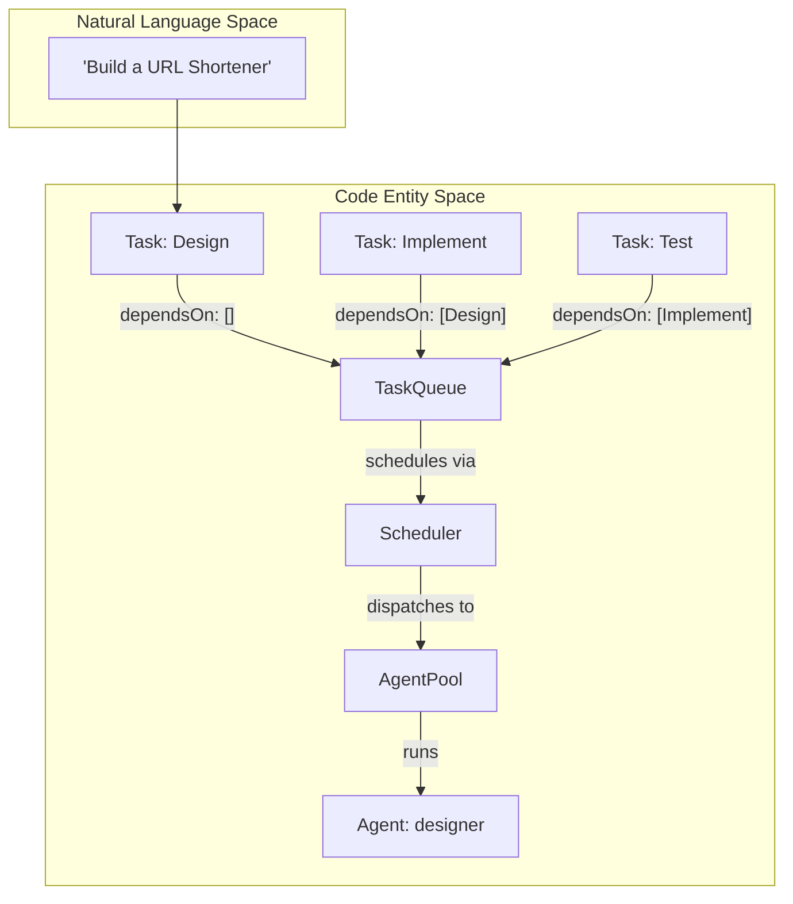

<!-- source: DeepWiki mcp.deepwiki.com · repo JackChen-me/open-multi-agent · page 7 Usage Examples · fetched 2026-10-26 -->

# Usage Examples

Relevant source files

The following files were used as context for generating this wiki page:

- [examples/01-single-agent.ts](examples/01-single-agent.ts)
- [examples/02-team-collaboration.ts](examples/02-team-collaboration.ts)
- [examples/03-task-pipeline.ts](examples/03-task-pipeline.ts)
- [examples/04-multi-model-team.ts](examples/04-multi-model-team.ts)

This page provides a high-level overview of the practical application patterns for the `open-multi-agent` framework. By examining the provided example scripts, you can understand how to transition from simple single-agent queries to complex, multi-model team pipelines with custom tool integrations.

The framework is designed to be composable: you can use the high-level `OpenMultiAgent` orchestrator for automated workflows or wire the underlying `Agent`, `ToolRegistry`, and `AgentPool` components manually for granular control.

### Core Patterns Overview

The examples demonstrate three primary ways to interact with the framework:

| Pattern | Primary Entity | Use Case |
| :--- | :--- | :--- |
| **One-Shot / Streaming** | `Agent` | Simple Q&A, real-time UI updates, or basic tool use. |
| **Coordinated Team** | `OpenMultiAgent.runTeam` | High-level goals where the framework decomposes tasks. |
| **Explicit Pipeline** | `OpenMultiAgent.runTasks` | Workflows with strict dependency graphs (DAGs). |
| **Custom Integration** | `AgentPool` + `defineTool` | Mixing LLM providers and specialized domain tools. |

---

### Single Agent and Streaming

The simplest entry point is using a single agent to perform a task. This can be done via the `OpenMultiAgent` convenience wrapper or by instantiating the `Agent` class directly for more control over the lifecycle.

*   **One-Shot Tasks**: Use `OpenMultiAgent.runAgent` to execute a prompt and receive a final result including token usage and tool call history [examples/01-single-agent.ts:34-49]().
*   **Streaming**: For interactive applications, `Agent.stream()` provides an `AsyncGenerator` that yields `text`, `tool_call`, and `done` events [examples/01-single-agent.ts:93-103]().
*   **Multi-Turn**: The `Agent.prompt()` method maintains internal conversation history, allowing for back-and-forth tutoring or debugging sessions [examples/01-single-agent.ts:122-129]().

For details, see [Single Agent and Streaming](#7.1).

**Code Entity Mapping: Single Agent Flow**

Sources: [examples/01-single-agent.ts:21-89](), [src/index.ts:1-20]()

---

### Team Collaboration and Task Pipelines

When a goal is too large for one agent, the framework supports multi-agent teams. Agents are assigned specific roles via their `systemPrompt` and toolsets.

*   **Autonomous Teams**: By using `createTeam` and `runTeam`, the `OpenMultiAgent` orchestrator acts as a coordinator. It decomposes the goal into a `TaskQueue` and assigns them to agents like `architect`, `developer`, or `reviewer` [examples/02-team-collaboration.ts:103-128]().
*   **Explicit Pipelines**: For predictable workflows, `runTasks` accepts an array of `Task` objects with `dependsOn` fields. This creates a Directed Acyclic Graph (DAG) where, for example, a `tester` agent waits for the `implementer` to finish [examples/03-task-pipeline.ts:114-165]().

For details, see [Team Collaboration and Task Pipelines](#7.2).

**Code Entity Mapping: Task Pipeline**

Sources: [examples/03-task-pipeline.ts:104-165](), [src/types.ts:1-50]()

---

### Multi-Model Teams and Custom Tools

Advanced use cases often require mixing different LLM providers (e.g., Anthropic for reasoning, OpenAI for speed) and connecting to external APIs.

*   **Custom Tools**: Defined using `defineTool` with a Zod schema for input validation. This ensures the LLM receives accurate JSON schemas and the `ToolExecutor` validates arguments before execution [examples/04-multi-model-team.ts:29-72]().
*   **Provider Mixing**: An `AgentPool` can manage agents using different `LLMAdapter` implementations simultaneously [examples/04-multi-model-team.ts:140-163]().
*   **Manual Wiring**: For maximum flexibility, you can bypass the high-level orchestrator and manually register tools into a `ToolRegistry` to be injected into specific agents [examples/04-multi-model-team.ts:121-132]().

For details, see [Multi-Model Teams and Custom Tools](#7.3).

**Sources:**
- [examples/01-single-agent.ts:1-132]()
- [examples/02-team-collaboration.ts:1-168]()
- [examples/03-task-pipeline.ts:1-194]()
- [examples/04-multi-model-team.ts:1-189]()

---

