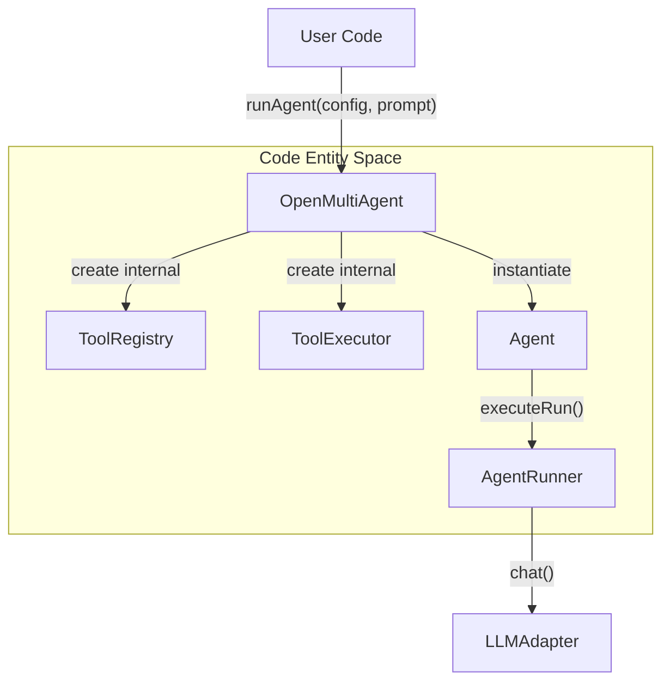
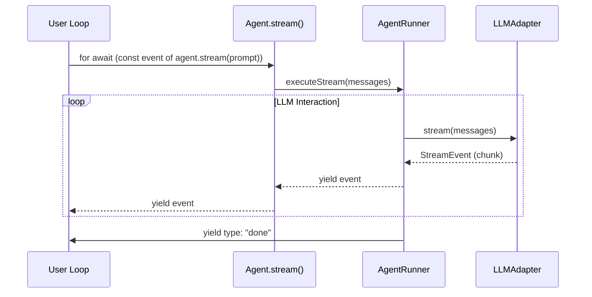
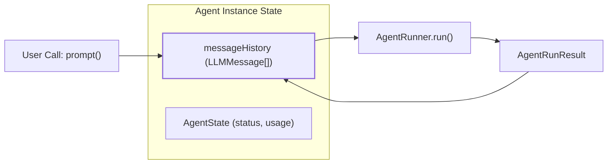

<!-- source: DeepWiki mcp.deepwiki.com · repo JackChen-me/open-multi-agent · page 7.1 Single Agent and Streaming · fetched 2026-10-26 -->

# Single Agent and Streaming

Relevant source files

The following files were used as context for generating this wiki page:

- [examples/01-single-agent.ts](examples/01-single-agent.ts)
- [src/agent/agent.ts](src/agent/agent.ts)

This page provides a technical walkthrough of the patterns demonstrated in `examples/01-single-agent.ts`. It covers three primary interaction modes: one-shot execution via the high-level `OpenMultiAgent` orchestrator, incremental output using the `Agent.stream()` method, and multi-turn stateful conversations using `Agent.prompt()`.

## Overview of Interaction Modes

The framework provides three distinct ways to interact with a single agent, depending on whether you need simple task execution, real-time UI updates, or a persistent conversation history.

| Method | Class | History Persistence | Use Case |
| :--- | :--- | :--- | :--- |
| `runAgent()` | `OpenMultiAgent` | No | Simplest entry point for one-off tasks. |
| `stream()` | `Agent` | No | Real-time streaming of text and tool events. |
| `prompt()` | `Agent` | Yes | Chatbots and multi-step interactive debugging. |

Sources: [examples/01-single-agent.ts:17-132](), [src/agent/agent.ts:139-192]()

---

## One-Shot Execution with OpenMultiAgent

The `OpenMultiAgent.runAgent` method is a convenience wrapper designed for the "simplest path" [examples/01-single-agent.ts:18-19](). It abstracts away the manual setup of a `ToolRegistry` and `ToolExecutor`.

### Data Flow: runAgent
When `runAgent` is called, the orchestrator performs the following:
1.  **Initialization**: It creates an internal `AgentPool` and registers the requested tools (e.g., `bash`, `file_read`) [examples/01-single-agent.ts:41]().
2.  **Execution**: It instantiates an `Agent` and calls its `run()` method.
3.  **Lifecycle**: The `onProgress` callback intercepts `OrchestratorEvent` types such as `agent_start` and `agent_complete` to provide telemetry [examples/01-single-agent.ts:23-29]().

### Code Entity Mapping: Orchestrator to Agent
The following diagram shows how the high-level `OpenMultiAgent` call bridges into the core `Agent` and `AgentRunner` logic.

**Orchestrator Execution Path**

Sources: [examples/01-single-agent.ts:21-49](), [src/agent/agent.ts:147-153]()

---

## Streaming and Incremental Output

For applications requiring low latency or "typewriter" effects, the `Agent` class provides a `stream()` method that returns an `AsyncGenerator<StreamEvent>` [src/agent/agent.ts:186-192]().

### Implementation Details
To use streaming, the consumer must manually wire the `ToolRegistry` and `ToolExecutor` [examples/01-single-agent.ts:75-79]().
- **Tool Injection**: The `Agent` constructor requires these dependencies so that tools can be shared across agents if needed [src/agent/agent.ts:79-83]().
- **Event Handling**: The loop iterates over events of type `text`, `tool_use`, `tool_result`, and `done` [examples/01-single-agent.ts:93-103]().

### Stream Event Flow
The `AgentRunner` generates events during its internal loop. Unlike `run()`, which buffers the entire response, `stream()` yields chunks as they arrive from the `LLMAdapter`.

**Streaming Data Flow**

Sources: [examples/01-single-agent.ts:93-103](), [src/agent/agent.ts:186-192]()

---

## Multi-Turn Conversations

The `Agent.prompt()` method enables stateful interactions where the agent remembers previous context [src/agent/agent.ts:163-180]().

### History Management
1.  **Persistence**: The `Agent` class maintains a `messageHistory: LLMMessage[]` array [src/agent/agent.ts:69]().
2.  **Appending**: Each call to `prompt()` appends the new user message to `messageHistory` [src/agent/agent.ts:169]().
3.  **Context Injection**: The entire history is passed to the `AgentRunner` for every turn [src/agent/agent.ts:171]().
4.  **Result Capture**: The assistant's response and any tool-use messages are appended back into the history to preserve the "conversation thread" [src/agent/agent.ts:174-176]().

### Comparison: run() vs prompt()
- **`run(prompt)`**: Creates a fresh message array `[{ role: 'user', content: prompt }]`. It does **not** modify `this.messageHistory` [src/agent/agent.ts:147-152]().
- **`prompt(message)`**: Mutates `this.messageHistory`. Subsequent calls "see" the previous turns [examples/01-single-agent.ts:122-129]().

**Conversation State Mapping**

Sources: [src/agent/agent.ts:61-94](), [src/agent/agent.ts:163-180](), [examples/01-single-agent.ts:109-130]()

---

## Technical Summary of Classes

| Class | Responsibility | Key Methods |
| :--- | :--- | :--- |
| `Agent` | High-level API, history management, state transitions. | `run()`, `prompt()`, `stream()`, `getHistory()` |
| `AgentRunner` | The core "agentic loop" (LLM -> Tool -> LLM). | `run()`, `stream()` |
| `ToolRegistry` | Stores and retrieves `ToolDefinition` objects. | `register()`, `get()` |
| `ToolExecutor` | Validates and executes tool logic with Zod. | `execute()`, `executeBatch()` |

Sources: [src/agent/agent.ts:61-222](), [examples/01-single-agent.ts:76-89]()

---

