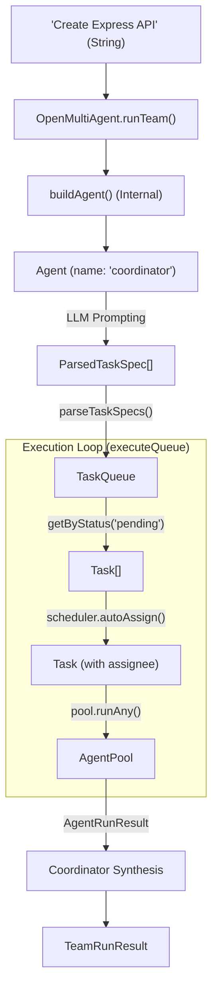
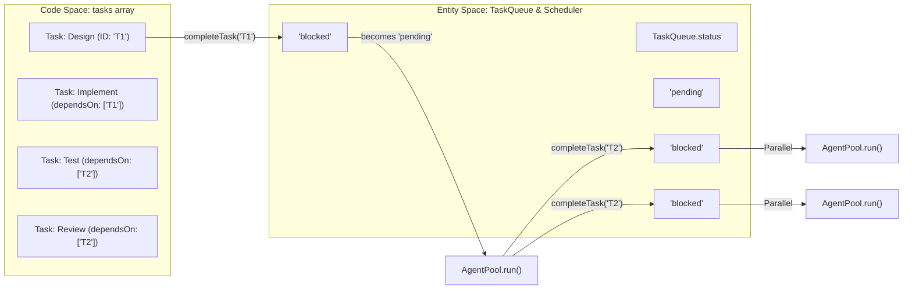

<!-- source: DeepWiki mcp.deepwiki.com · repo JackChen-me/open-multi-agent · page 7.2 Team Collaboration and Task Pipelines · fetched 2026-10-26 -->

# Team Collaboration and Task Pipelines

Relevant source files

The following files were used as context for generating this wiki page:

- [examples/02-team-collaboration.ts](examples/02-team-collaboration.ts)
- [examples/03-task-pipeline.ts](examples/03-task-pipeline.ts)
- [src/orchestrator/orchestrator.ts](src/orchestrator/orchestrator.ts)

This page explores the two primary modes of multi-agent orchestration provided by the `OpenMultiAgent` framework: the **Coordinator Pattern** (automated decomposition) and **Explicit Task Pipelines** (directed acyclic graphs). 

## Overview of Collaboration Patterns

The framework supports two distinct ways to manage multiple agents working toward a goal:

1.  **Auto-Orchestrated (Coordinator Pattern):** A specialized "coordinator" agent analyzes a high-level goal, decomposes it into a JSON-based task list, assigns them to team members, and synthesizes the final result.
2.  **Explicit Pipelines:** The developer defines a list of `Task` objects with `dependsOn` arrays. The `TaskQueue` manages the lifecycle, ensuring agents only receive tasks once their dependencies are satisfied.

| Feature | `runTeam` (Coordinator) | `runTasks` (Pipeline) |
| :--- | :--- | :--- |
| **Task Creation** | Dynamic (LLM-generated) | Static (Developer-defined) |
| **Dependency Management** | Inferred by Coordinator | Explicit `dependsOn` IDs |
| **Primary Use Case** | Exploratory/Complex goals | Repeatable/Structured workflows |
| **Entry Point** | `orchestrator.runTeam()` | `orchestrator.runTasks()` |

Sources: [src/orchestrator/orchestrator.ts:33-41](), [examples/02-team-collaboration.ts:4-6](), [examples/03-task-pipeline.ts:4-6]()

---

## The Coordinator Pattern (Example 02)

In Example 02, a team consisting of an `architect`, `developer`, and `reviewer` is created to build a REST API. Instead of manual tasking, the `OpenMultiAgent` class uses a "coordinator" loop.

### Code-to-System Mapping: Coordinator Workflow

The following diagram bridges the natural language goal to the internal code entities that execute the coordinator pattern.

**Title: Coordinator Decomposition and Execution**

Sources: [src/orchestrator/orchestrator.ts:33-41](), [src/orchestrator/orchestrator.ts:88-93](), [src/orchestrator/orchestrator.ts:106-149](), [src/orchestrator/orchestrator.ts:177-195]()

### Implementation Detail: `runTeam`
When `runTeam` is called [src/orchestrator/orchestrator.ts:246-246](), the orchestrator:
1.  **Initializes a Coordinator**: Creates a temporary `Agent` using the `defaultModel` [src/orchestrator/orchestrator.ts:257-262]().
2.  **Decomposes the Goal**: Prompts the coordinator to output a JSON array of tasks [src/orchestrator/orchestrator.ts:275-285]().
3.  **Parses Tasks**: Uses `parseTaskSpecs` to extract `title`, `description`, and `assignee` [src/orchestrator/orchestrator.ts:111-149]().
4.  **Executes**: Passes the populated `TaskQueue` to `executeQueue` for parallel execution [src/orchestrator/orchestrator.ts:303-303]().

Sources: [src/orchestrator/orchestrator.ts:246-310](), [examples/02-team-collaboration.ts:128-128]()

---

## Explicit Task Pipelines (Example 03)

Example 03 demonstrates a structured pipeline: **Design → Implement → (Test + Review)**. This utilizes `runTasks` where dependencies are explicitly declared using the `dependsOn` property.

### Code-to-System Mapping: Dependency Pipeline

This diagram shows how `Task` definitions in code translate to the internal `TaskQueue` state machine.

**Title: Task Dependency and Parallelism**

Sources: [examples/03-task-pipeline.ts:114-166](), [src/orchestrator/orchestrator.ts:177-195](), [src/task/queue.ts:104-121]()

### Key Implementation Features

#### 1. Task Dependency Resolution
The `TaskQueue` tracks the state of every task. A task remains in `'blocked'` status as long as `isTaskReady()` returns false [src/task/queue.ts:104-121](). When a parent task completes, the queue calls `unblockDependents()` [src/task/queue.ts:144-154](), transitioning child tasks to `'pending'`.

#### 2. Parallel Execution
The `executeQueue` function runs a `while(true)` loop [src/orchestrator/orchestrator.ts:183-183](). In each iteration, it identifies all `'pending'` tasks and dispatches them simultaneously using `Promise.all` [src/orchestrator/orchestrator.ts:193-215](). This allows the `Test` and `Review` tasks in Example 03 to run at the same time once the `Implement` task finishes.

#### 3. Shared Memory Integration
Both examples enable `sharedMemory: true` [examples/02-team-collaboration.ts:112-112](), [examples/03-task-pipeline.ts:107-107](). This ensures that when the `implementer` agent runs, it can access the output of the `designer` agent via the `SharedMemory` store, which the orchestrator automatically populates with task results [src/orchestrator/orchestrator.ts:211-211]().

Sources: [src/orchestrator/orchestrator.ts:177-220](), [src/task/queue.ts:104-154](), [examples/03-task-pipeline.ts:142-164]()

---

## Progress Monitoring

Both examples utilize the `onProgress` callback to provide real-time visibility into the team's operations. The orchestrator emits `OrchestratorEvent` objects [src/types.ts:236-258]().

### Common Events
| Event Type | Trigger | Data Provided |
| :--- | :--- | :--- |
| `task_start` | Task moves to execution | `task` (ID), `data` (Task object) |
| `task_complete` | Agent finishes task | `task`, `data` (Task object) |
| `agent_start` | Agent begins LLM loop | `agent` (Name) |
| `message` | Agent sends broadcast | `agent`, `data` (Message content) |

Sources: [examples/02-team-collaboration.ts:63-97](), [examples/03-task-pipeline.ts:64-92](), [src/orchestrator/orchestrator.ts:196-196]()

---

