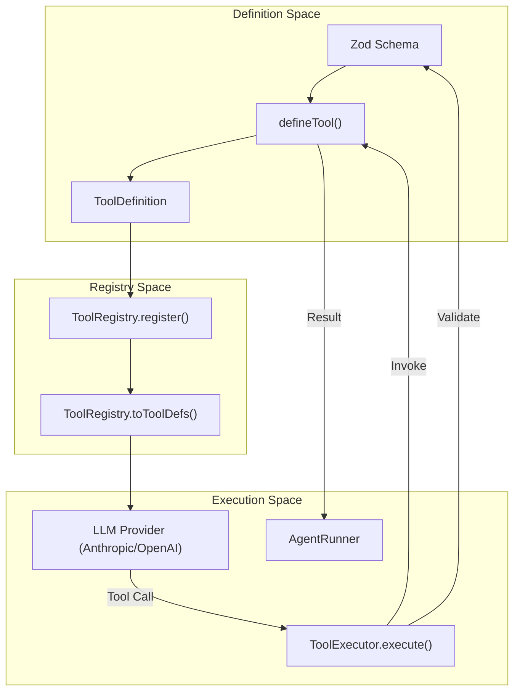
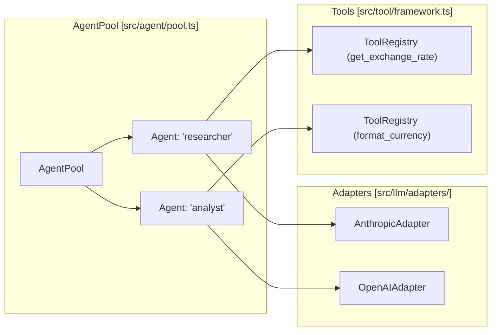

<!-- source: DeepWiki mcp.deepwiki.com · repo JackChen-me/open-multi-agent · page 7.3 Multi-Model Teams and Custom Tools · fetched 2026-10-26 -->

# Multi-Model Teams and Custom Tools

Relevant source files

The following files were used as context for generating this wiki page:

- [examples/04-multi-model-team.ts](examples/04-multi-model-team.ts)
- [src/agent/pool.ts](src/agent/pool.ts)
- [src/tool/framework.ts](src/tool/framework.ts)

This page provides a technical walkthrough of **Example 04**, demonstrating how to compose advanced agent teams that bridge different LLM providers and utilize domain-specific custom tools. While the high-level `OpenMultiAgent` API provides sensible defaults, this example showcases the "manual wiring" pattern using `AgentPool`, `ToolRegistry`, and `ToolExecutor` for maximum flexibility.

## Overview of Example 04

Example 04 illustrates three primary advanced patterns:
1.  **Provider Mixing**: Assigning an Anthropic model to one agent and an OpenAI model to another within the same workflow [examples/04-multi-model-team.ts:135-163]().
2.  **Custom Tool Definition**: Using `defineTool` and `zod` to create type-safe tools with automatic JSON Schema generation [examples/04-multi-model-team.ts:29-99]().
3.  **Manual Agent Construction**: Bypassing the orchestrator's internal `buildAgent` logic to inject custom tool registries into agents [examples/04-multi-model-team.ts:116-132]().

### Data Flow: Custom Tool Execution
The following diagram shows how a custom tool moves from definition to execution within an agent's conversation loop.

**Custom Tool Lifecycle**

Sources: [src/tool/framework.ts:71-83](), [src/tool/framework.ts:162-171](), [examples/04-multi-model-team.ts:121-132]()

## Defining Custom Tools

Tools are defined using the `defineTool` factory function. This ensures that the `inputSchema` (a Zod object) is correctly associated with the `execute` function, providing compile-time and runtime type safety [src/tool/framework.ts:71-83]().

### Example: Exchange Rate Tool
The `exchangeRateTool` fetches data from an external API. It demonstrates graceful degradation by returning a stubbed rate if the network request fails, ensuring the agent team can continue its task [examples/04-multi-model-team.ts:29-72]().

| Property | Description | Code Entity |
| :--- | :--- | :--- |
| **Name** | `get_exchange_rate` | `config.name` |
| **Input** | `from` (string), `to` (string) | `config.inputSchema` |
| **Logic** | Async fetch with 5s timeout | `config.execute` |
| **Output** | JSON string with rate/timestamp | `ToolResult` |

Sources: [examples/04-multi-model-team.ts:29-72](), [src/tool/framework.ts:22-22]()

## Multi-Model Configuration

The framework abstracts provider differences via the `LLMAdapter` interface. In Example 04, the `researcher` uses Anthropic's Claude, while the `analyst` uses OpenAI's GPT-4 (with a fallback to Claude if no OpenAI key is present) [examples/04-multi-model-team.ts:140-163]().

**Agent Entity Association**

Sources: [examples/04-multi-model-team.ts:138-163](), [src/agent/pool.ts:57-58](), [src/tool/framework.ts:93-95]()

## Manual Wiring with AgentPool

When using custom tools, agents must be constructed manually to ensure their `ToolRegistry` contains the new definitions. The helper function `buildCustomAgent` performs this wiring [examples/04-multi-model-team.ts:121-132]().

### Step-by-Step Wiring Process
1.  **Initialize Registry**: Create a new `ToolRegistry` instance [src/tool/framework.ts:93]().
2.  **Register Built-ins**: Call `registerBuiltInTools(registry)` to include standard tools like `bash` or `file_read` [examples/04-multi-model-team.ts:126]().
3.  **Register Custom Tools**: Call `registry.register(tool)` for each custom tool [src/tool/framework.ts:102]().
4.  **Initialize Executor**: Create a `ToolExecutor` passing the populated registry [examples/04-multi-model-team.ts:130]().
5.  **Instantiate Agent**: Pass the config, registry, and executor to the `Agent` constructor [examples/04-multi-model-team.ts:131]().

### Execution via AgentPool
The `AgentPool` manages these agents and enforces concurrency limits using a `Semaphore` [src/agent/pool.ts:67-69](). In this example, `maxConcurrency` is set to `1` for sequential readability [examples/04-multi-model-team.ts:181]().

The workflow follows a hand-off pattern:
1.  **Researcher Run**: `pool.run('researcher', ...)` executes. The result is captured as `researchResult.output` [examples/04-multi-model-team.ts:187-191]().
2.  **Analyst Run**: The researcher's output is passed as context to `pool.run('analyst', ...)` [examples/04-multi-model-team.ts:196-200]().

Sources: [examples/04-multi-model-team.ts:116-132](), [examples/04-multi-model-team.ts:181-200](), [src/agent/pool.ts:126-135]()

## Key Classes and Interfaces

| Class/Interface | Role | File |
| :--- | :--- | :--- |
| `ToolRegistry` | Manages tool metadata and converts Zod schemas to LLM-compatible JSON. | [src/tool/framework.ts:93]() |
| `ToolExecutor` | Handles the validation and execution of tool calls, including error isolation. | [src/index.ts:116]() |
| `AgentPool` | Acts as a registry and scheduler for agents, providing `runParallel` and `runAny`. | [src/agent/pool.ts:57]() |
| `defineTool` | Factory function that enforces the `ToolDefinition` structure. | [src/tool/framework.ts:71]() |
| `Semaphore` | Internal utility used by `AgentPool` to gate concurrent async operations. | [src/agent/pool.ts:68]() |

Sources: [src/tool/framework.ts:71-93](), [src/agent/pool.ts:57-68](), [examples/04-multi-model-team.ts:116-116]()

---

