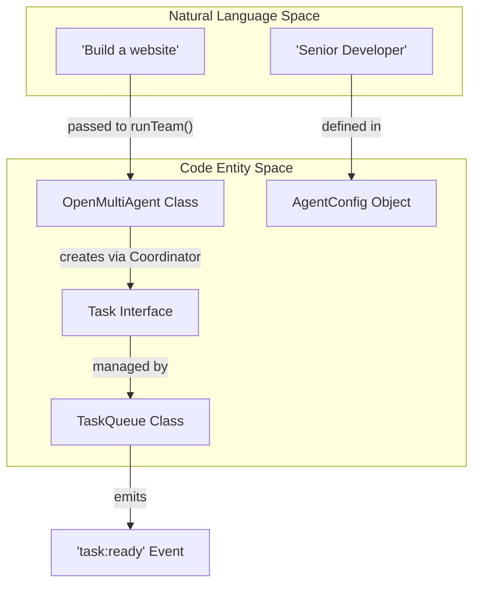
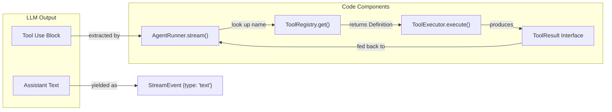
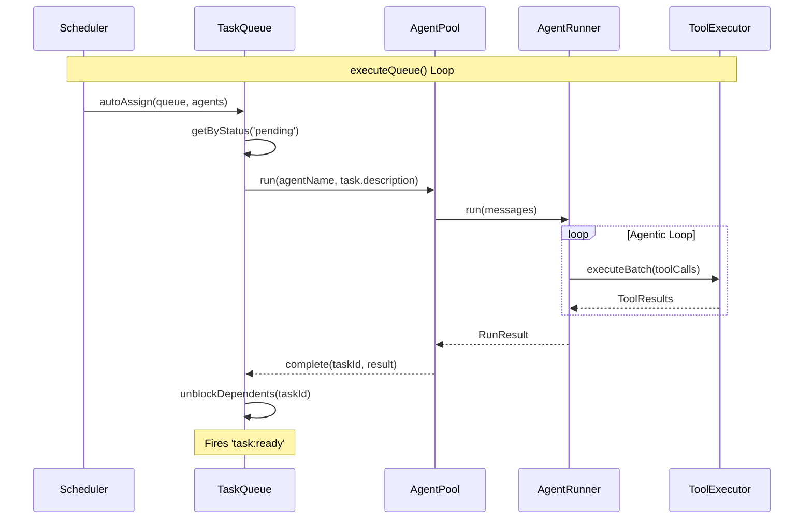

<!-- source: DeepWiki mcp.deepwiki.com · repo JackChen-me/open-multi-agent · page 8 Glossary · fetched 2026-10-26 -->

# Glossary

Relevant source files

The following files were used as context for generating this wiki page:

- [README.md](README.md)
- [src/agent/runner.ts](src/agent/runner.ts)
- [src/memory/shared.ts](src/memory/shared.ts)
- [src/orchestrator/orchestrator.ts](src/orchestrator/orchestrator.ts)
- [src/orchestrator/scheduler.ts](src/orchestrator/scheduler.ts)
- [src/task/queue.ts](src/task/queue.ts)
- [src/tool/framework.ts](src/tool/framework.ts)
- [src/types.ts](src/types.ts)
- [src/utils/semaphore.ts](src/utils/semaphore.ts)

This glossary defines the technical terms, architectural patterns, and domain-specific concepts used throughout the `open-multi-agent` framework. It serves as a reference for onboarding engineers to understand how natural language goals are transformed into executable code entities.

## Core Concepts

### Agent
An autonomous unit of execution defined by an `AgentConfig` [src/types.ts:186-196](). It encapsulates a specific role, a system prompt, and a set of available tools. Internally, an `Agent` instance [src/orchestrator/orchestrator.ts:88-93]() manages its own conversation history and state machine [src/types.ts:199-204]().

### Coordinator Pattern
A specialized orchestration strategy where a temporary "coordinator" agent is created to decompose a high-level natural language goal into a structured plan [src/orchestrator/orchestrator.ts:33-35](). The coordinator parses the user's request, generates a list of `Task` objects, and later synthesizes the final result after all tasks are completed.

### Task DAG (Directed Acyclic Graph)
The framework treats a collection of tasks as a dependency graph. Tasks use the `dependsOn` field [src/types.ts:246]() to reference the `id` or `title` of other tasks. The `TaskQueue` resolves this graph topologically, ensuring that dependent tasks remain `blocked` until their requirements are `completed` [src/task/queue.ts:37-43]().

### Tool
A stateless function that an agent can invoke to interact with the external world (e.g., file system, shell). Tools are defined using `defineTool` [src/tool/framework.ts:71-83](), which requires a Zod schema for input validation and an `execute` function.

---

## Mapping: Natural Language to Code Entities

The following diagrams illustrate how abstract concepts described in natural language (like "The Team" or "The Plan") map to specific classes and data structures in the codebase.

### Entity Mapping: Orchestration Flow
This diagram shows how a high-level goal is processed by the `OpenMultiAgent` orchestrator into concrete code objects.

**Sources:** [src/orchestrator/orchestrator.ts:4-12](), [src/types.ts:186-196](), [src/task/queue.ts:54-61]()

### Entity Mapping: Execution Loop
This diagram bridges the gap between an LLM's "thoughts" (text/tool calls) and the internal execution machinery.

**Sources:** [src/agent/runner.ts:198-212](), [src/tool/framework.ts:114-116](), [src/tool/executor.ts:21-25](), [src/types.ts:163-166]()

---

## Technical Terms & Abbreviations

| Term | Definition | Code Pointer |
| :--- | :--- | :--- |
| **AgentPool** | A concurrency-controlled registry of active agents using a `Semaphore` to limit parallel LLM calls. | [src/agent/pool.ts]() |
| **Cascade Failure** | A mechanism where a failed task automatically marks all its downstream dependents as failed. | [src/task/queue.ts:166-179]() |
| **Capability Match** | A scheduling strategy that assigns tasks to agents based on keyword overlap between task descriptions and agent roles. | [src/orchestrator/scheduler.ts:8-9]() |
| **ContentBlock** | The fundamental unit of communication; can be `text`, `tool_use`, `tool_result`, or `image`. | [src/types.ts:53]() |
| **LLMAdapter** | A provider-agnostic interface (OpenAI, Anthropic) for sending messages and receiving responses/streams. | [src/types.ts:285-298]() |
| **Semaphore** | A counting utility used to cap concurrent operations (default `maxConcurrency` is 5). | [src/utils/semaphore.ts:24-35]() |
| **SharedMemory** | A namespaced key-value store where agents can `write` findings for other agents to `read`. | [src/memory/shared.ts:36-41]() |
| **TaskQueue** | An event-driven container that manages task statuses (`pending`, `blocked`, `running`, `completed`, `failed`). | [src/task/queue.ts:54-61]() |

---

## Component Interactions

The following diagram details the data flow during a multi-agent task execution.

### Data Flow: Task Execution Loop

**Sources:** [src/orchestrator/orchestrator.ts:177-195](), [src/orchestrator/scheduler.ts:178-187](), [src/agent/runner.ts:126-138](), [src/task/queue.ts:130-138]()