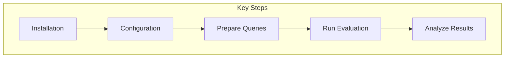
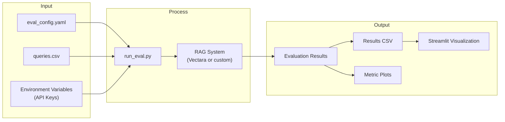
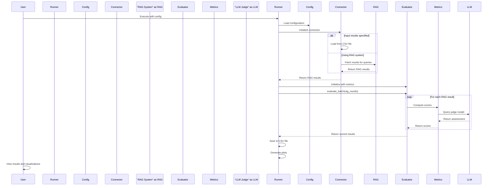

<!-- source: DeepWiki mcp.deepwiki.com · repo vectara/open-rag-eval · page 2 Getting Started · fetched 2026-10-26 -->

# Getting Started

<details>
<summary>Relevant source files</summary>

The following files were used as context for generating this wiki page:

- [README.md](README.md)
- [img/project-logo.png](img/project-logo.png)
- [requirements.txt](requirements.txt)
- [sample_prompt.txt](sample_prompt.txt)

</details>


This guide walks you through the process of setting up and using the open-rag-eval toolkit to evaluate Retrieval-Augmented Generation (RAG) systems. This page covers installation, basic configuration, and running your first evaluation. For detailed information about individual components, see [Core Components](#3).

## Overview of the Process

The open-rag-eval toolkit enables evaluation of RAG systems through the following workflow:



Sources: [README.md:28-31]()

## Prerequisites

Before installing open-rag-eval, ensure you have:

- **Python:** Version 3.9 or higher
- **OpenAI API Key:** Required for the default LLM judge model used in evaluation metrics (set as environment variable: `export OPENAI_API_KEY='your-api-key'`)
- **Vectara Account** (if using Vectara connector):
  - A Vectara account from [console.vectara.com/signup](https://console.vectara.com/signup)
  - A corpus with indexed data
  - An API key with querying permissions
  - Your Customer ID and Corpus key

Sources: [README.md:33-40]()

## Installation

There are two ways to install open-rag-eval:

### Option 1: Build from Source (Recommended for Following Examples)

```bash
git clone https://github.com/vectara/open-rag-eval.git
cd open-rag-eval
pip install -e .
```

### Option 2: Install via pip (For Using in Your Own Pipeline)

```bash
pip install open-rag-eval
```

Sources: [README.md:42-56](), [requirements.txt:1-18]()

## Basic Evaluation Workflow



Sources: [README.md:60-166]()

## Using with the Vectara Connector

### Step 1: Configure Evaluation Settings

Edit the `eval_config.yaml` file to include your Vectara credentials and evaluation parameters:

```yaml
evaluator:
  type: TRECEvaluator
  model:
    type: OpenAIModel
    name: gpt-4o-mini
    api_key: ${OPENAI_API_KEY}

connector:
  type: VectaraConnector
  options:
    api_key: ${VECTARA_API_KEY}
    corpus_key: your_corpus_id
    input_queries: queries.csv
    query_config:
      search:
        limit: 5
        context_configuration:
          sentences_before: 3
          sentences_after: 3
      generation:
        generation_preset_name: vectara-summary-ext-24-05-med-omni
        max_used_search_results: 5
        max_response_characters: 1000
        response_language: eng
        enable_factual_consistency_score: False

evaluation_results: open_eval_results.csv
```

Set required environment variables:
```bash
export VECTARA_API_KEY='your-vectara-api-key'
export OPENAI_API_KEY='your-openai-api-key'
```

Sources: [README.md:62-80]()

### Step 2: Prepare Queries

Create a CSV file named `queries.csv` containing the queries you want to evaluate:

```csv
query
What is a blackhole?
How big is the sun?
How many moons does jupiter have?
```

Sources: [README.md:88-99]()

### Step 3: Run Evaluation

Execute the evaluation script:

```bash
python open_rag_eval/run_eval.py --config eval_config.yaml
```

This will:
1. Load your configuration
2. Connect to the Vectara API
3. Run queries against your configured corpus
4. Evaluate the results using the TREC evaluator
5. Save detailed results to a CSV file

Sources: [README.md:101-109]()

### Step 4: Visualize Results

You can visualize the results in two ways:

1. **Plot metrics** (automatically done by default):
   ```bash
   python open_rag_eval/plot_results.py open_eval_results.csv
   ```

   To compare multiple results:
   ```bash
   python open_rag_eval/plot_results.py results_1.csv results_2.csv results_3.csv
   ```

2. **Interactive visualization** with Streamlit:
   ```bash
   cd open_rag_eval/viz/
   streamlit run visualize.py
   ```

   Then upload your `open_eval_results.csv` file in the web interface to explore detailed metrics.

Sources: [README.md:112-170]()

## Using with Custom RAG Outputs

If you want to evaluate RAG outputs from your own system:

### Step 1: Prepare RAG Results

Format your RAG outputs in a CSV file (see `data/test_csv_connector.csv` for an example). 

### Step 2: Configure Evaluation Settings

Modify `eval_config.yaml` to use your custom results:

```yaml
evaluator:
  type: TRECEvaluator
  model:
    type: OpenAIModel
    name: gpt-4o-mini
    api_key: ${OPENAI_API_KEY}

# Comment out the connector section
# connector:
#   ...

# Use input_results instead
input_results: path/to/your/results.csv

evaluation_results: open_eval_results.csv
```

Sources: [README.md:130-136]()

### Step 3: Run Evaluation and Visualize

Follow the same steps as in the Vectara connector approach to run the evaluation and visualize results.

```bash
python open_rag_eval/run_eval.py --config eval_config.yaml
```

Sources: [README.md:139-163]()

## Configuration Architecture

The following diagram shows how the configuration in `eval_config.yaml` maps to code components:

```mermaid
classDiagram
    class "eval_config.yaml" {
        evaluator
        connector/input_results
        evaluation_results
    }
    
    class "Evaluator" {
        <<abstract>>
        +evaluate(rag_results)
        +evaluate_batch(rag_results)
        +plot_metrics(csv_files)
    }
    
    class "TRECEvaluator" {
        -model
        -retrieval_metric
        -generation_metric
        -citation_metric
        -hallucination_metric
        -no_answer_metric
        +evaluate()
        +plot_metrics()
    }
    
    class "Connector" {
        <<abstract>>
        +fetch_data()
    }
    
    class "VectaraConnector" {
        -api_key
        -corpus_key
        +fetch_data()
        -_send_request()
    }
    
    class "CSVConnector" {
        -csv_path
        +fetch_data()
        -_parse_generated_answer()
    }
    
    class "run_eval.py" {
        +main()
        -_setup_evaluator()
        -_setup_connector()
        -_run_evaluation()
    }
    
    "eval_config.yaml" --* "Evaluator"
    "eval_config.yaml" --* "Connector"
    "Evaluator" <|-- "TRECEvaluator"
    "Connector" <|-- "VectaraConnector"
    "Connector" <|-- "CSVConnector"
    "run_eval.py" --> "Evaluator"
    "run_eval.py" --> "Connector"
```

Sources: [README.md:42-56](), [README.md:174-194]()

## Data Flow in Evaluation

This diagram illustrates the data flow during an evaluation run:



Sources: [README.md:174-182]()

For more detailed information about the specific components, see [Core Components](#3), [Evaluators](#3.2), and [Connectors](#3.3).

---

