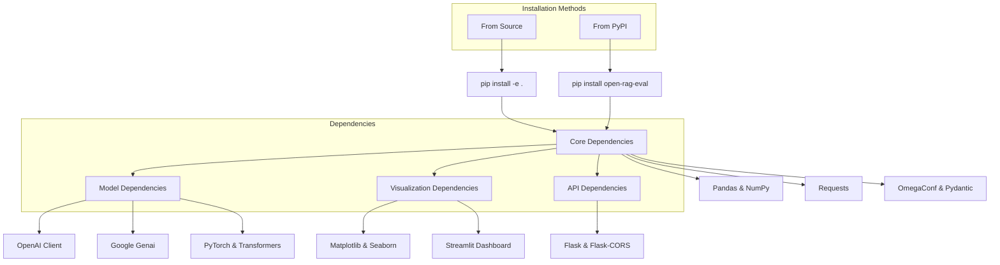
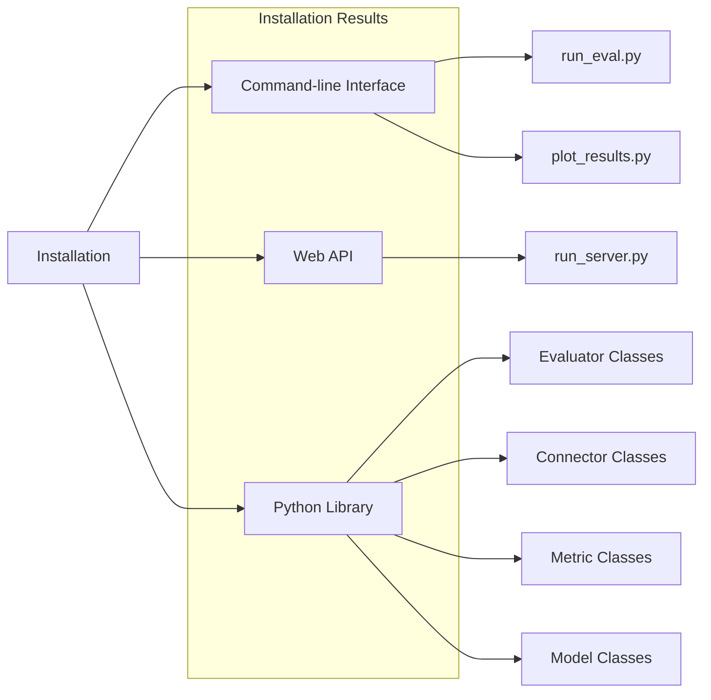

<!-- source: DeepWiki mcp.deepwiki.com · repo vectara/open-rag-eval · page 2.1 Installation · fetched 2026-10-26 -->

# Installation

<details>
<summary>Relevant source files</summary>

The following files were used as context for generating this wiki page:

- [README.md](README.md)
- [img/project-logo.png](img/project-logo.png)
- [requirements.txt](requirements.txt)
- [sample_prompt.txt](sample_prompt.txt)

</details>


This page provides detailed instructions for installing the open-rag-eval toolkit, which is used for evaluating Retrieval-Augmented Generation (RAG) systems. For information about configuring the evaluation system after installation, see [Configuration](#2.2).

## Prerequisites

Before installing open-rag-eval, ensure your system meets the following requirements:

| Requirement | Details |
|-------------|---------|
| Python | Version 3.9 or higher |
| API Keys | Required for various components (detailed below) |
| Disk Space | Approximately 500MB for the package and its dependencies |

### Required API Keys

Depending on your evaluation needs, you'll need to obtain and configure the following API keys:

- **OpenAI API Key**: Required for the default LLM judge model used in metrics like UMBRELA and AutoNugget.
- **Vectara API Key**: Required only if you're using the Vectara connector.

These API keys should be set as environment variables before running the evaluation:

```bash
export OPENAI_API_KEY='your-openai-api-key'
export VECTARA_API_KEY='your-vectara-api-key'  # Only needed for Vectara connector
```

Sources: [README.md:34-40]()

## Installation Methods

There are two methods to install open-rag-eval, depending on your use case:

### Method 1: Install from Source (Recommended for Development)

This method is ideal if you want to run the sample instructions or modify the code:

```bash
git clone https://github.com/vectara/open-rag-eval.git
cd open-rag-eval
pip install -e .
```

The `-e` flag installs the package in "editable" mode, allowing you to modify the source code and have the changes take effect without reinstalling.

### Method 2: Install from PyPI (Recommended for Integration)

This method is preferred if you want to use open-rag-eval in your own pipeline:

```bash
pip install open-rag-eval
```

Sources: [README.md:42-58]()

## Dependencies

open-rag-eval depends on several Python packages, which are automatically installed during the installation process. The key dependencies include:

| Dependency | Purpose |
|------------|---------|
| openai | Interface with OpenAI models for evaluation |
| google-genai | Interface with Google Gemini models |
| pandas | Data handling and manipulation |
| matplotlib, seaborn | Visualization of evaluation results |
| flask, flask-cors | Web API functionality |
| streamlit | Interactive visualization dashboard |
| requests | HTTP requests for API connections |
| pydantic | Data validation and settings management |
| transformers, torch | Machine learning model support |

Sources: [requirements.txt:1-18]()

### Installation Diagram



## Installation Verification

After installation, you can verify that open-rag-eval is correctly installed by running:

```bash
python -c "import open_rag_eval; print(open_rag_eval.__version__)"
```

This should print the version number of the installed package.

## System Integration

The installation process adds all the necessary components to your Python environment, allowing you to use the open-rag-eval toolkit through various interfaces:



## Common Issues and Troubleshooting

### Dependency Conflicts

If you encounter dependency conflicts during installation, consider using a virtual environment:

```bash
python -m venv venv
source venv/bin/activate  # On Windows: venv\Scripts\activate
pip install -e .  # Or: pip install open-rag-eval
```

### API Key Configuration

If you see authentication errors when running the evaluation, ensure your API keys are correctly set as environment variables. For persistent configuration, you can add these to your `.bashrc`, `.zshrc`, or equivalent shell configuration file.

Sources: [README.md:34-40](), [README.md:78-80]()

## Next Steps

After successfully installing open-rag-eval, proceed to configure the evaluation system as described in the [Configuration](#2.2) section.

---

