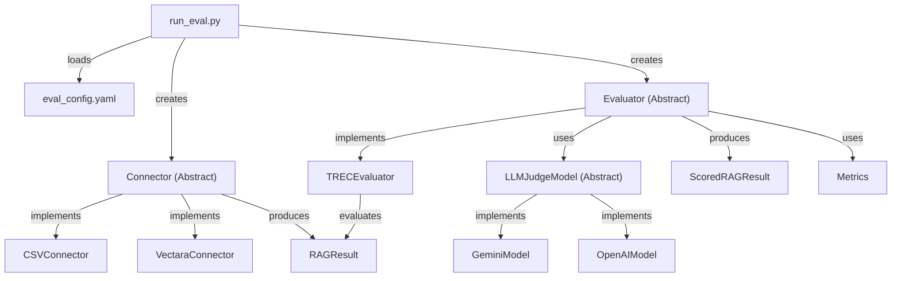
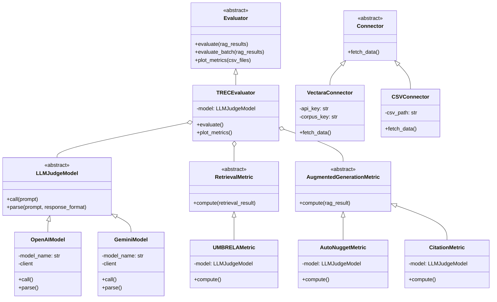
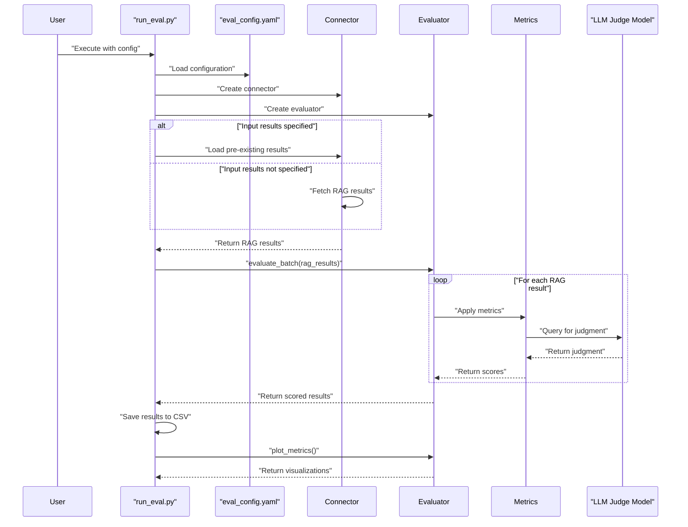
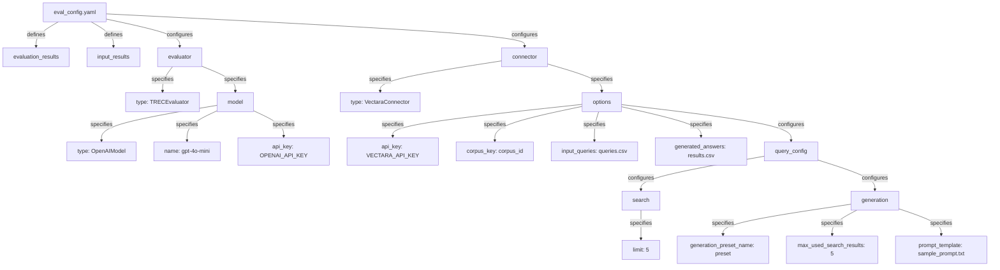

<!-- source: DeepWiki mcp.deepwiki.com · repo vectara/open-rag-eval · page 3 Core Components · fetched 2026-10-26 -->

# Core Components

Relevant source files

The following files were used as context for generating this wiki page:

- [README.md](README.md)
- [img/project-logo.png](img/project-logo.png)
- [open_rag_eval/models/__init__.py](open_rag_eval/models/__init__.py)
- [open_rag_eval/run_eval.py](open_rag_eval/run_eval.py)
- [sample_prompt.txt](sample_prompt.txt)

The Core Components section provides an overview of the fundamental building blocks that make up the open-rag-eval system. This document explains the architecture, key classes, and their interactions within the evaluation framework. For information about setting up and using the system, see [Getting Started](#2), and for detailed information about the evaluation process workflow, see [Evaluation Pipeline](#3.1).

## System Architecture Overview

The open-rag-eval system uses a modular architecture designed for flexibility and extensibility in evaluating RAG systems. The framework consists of several interconnected components that work together to assess RAG quality across multiple dimensions.

### System Architecture Diagram

Sources: [open_rag_eval/run_eval.py:1-148](). [README.md:172-188]()

## Key Components

The open-rag-eval system consists of four primary component types:

1. **Evaluators**: Classes that orchestrate evaluation by applying metrics to RAG results
2. **Connectors**: Classes that fetch data from RAG systems to be evaluated
3. **LLM Judge Models**: Models that provide judgments for evaluation metrics
4. **Metrics**: Algorithms that measure specific aspects of RAG quality

### Component Hierarchy Diagram

Sources: [open_rag_eval/models/__init__.py:1-4](), [README.md:184-186]()

## Evaluators

Evaluators serve as the backbone of the evaluation process. They take RAG results and apply various metrics to assess their quality.

### Evaluator (Abstract Base Class)

Defines the common interface for all evaluator implementations:

- `evaluate(rag_results)`: Evaluates a single RAG result
- `evaluate_batch(rag_results)`: Evaluates multiple RAG results
- `plot_metrics(csv_files)`: Visualizes the evaluation results

### TRECEvaluator

The primary evaluator implementation that follows the TREC-RAG evaluation approach:

- Uses multiple metrics to evaluate different aspects of RAG performance
- Coordinates with LLM judge models to obtain quality assessments
- Aggregates metric scores to provide comprehensive evaluation

Sources: [open_rag_eval/run_eval.py:17-50]()

## Connectors

Connectors are responsible for obtaining RAG results to be evaluated, either by retrieving them from a RAG system or loading them from a file.

### Connector (Abstract Base Class)

Defines the common interface for all connector implementations:

- `fetch_data()`: Retrieves RAG results from a specific source

### VectaraConnector

Connects to the Vectara RAG platform:

- Queries Vectara API using provided credentials
- Processes the response into the RAGResult format
- Stores results in a CSV file for evaluation

### CSVConnector

Loads pre-existing RAG results from a CSV file:

- Parses the CSV file containing queries, answers, and contexts
- Converts the data into RAGResult objects for evaluation

Sources: [open_rag_eval/run_eval.py:53-75](), [README.md:107-163]()

## LLM Judge Models

LLM Judge Models serve as the evaluation engine behind many metrics, providing judgments on the quality of RAG outputs.

### LLMJudgeModel (Abstract Base Class)

Defines the common interface for all LLM judge models:

- `call(prompt)`: Sends a prompt to the LLM and gets a response
- `parse(prompt, response_format)`: Parses the LLM response into a structured format

### OpenAIModel

Uses OpenAI's API for evaluation:

- Connects to models like GPT-4o-mini
- Formats prompts according to OpenAI's requirements
- Parses responses into structured data for metrics

### GeminiModel

Uses Google's Gemini API for evaluation:

- Connects to Gemini models
- Formats prompts according to Gemini's requirements
- Parses responses into structured data for metrics

Sources: [open_rag_eval/models/__init__.py:1-4](), [README.md:35-36]()

## Metrics

Metrics evaluate specific aspects of RAG quality, measuring dimensions like relevance, faithfulness, and citation quality.

### Retrieval Metrics

Evaluate the quality of retrieved documents:

- **UMBRELAMetric**: Assesses the relevance of retrieved documents to the query

### Generation Metrics

Evaluate the quality of generated answers:

- **AutoNuggetMetric**: Assesses the quality and completeness of the generated answer
- **CitationMetric**: Evaluates how well the answer cites the retrieved documents
- **HallucinationMetric**: Checks for factual inconsistencies in the generated answer
- **NoAnswerMetric**: Determines if a query was actually answered

Sources: [README.md:17-24]()

## Data Structures

The system uses several key data structures to represent and process evaluation data:

### RAGResult

Represents the output of a RAG system for a single query:

- `query`: The input query
- `answer`: The generated answer
- `contexts`: The retrieved contexts/documents

### ScoredRAGResult

Extends RAGResult with evaluation scores:

- `rag_result`: The original RAG result
- `scores`: The scores assigned by the evaluator and its metrics

Sources: [open_rag_eval/run_eval.py:117-119](), [open_rag_eval/run_eval.py:127-128]()

## Evaluation Workflow

The evaluation process follows a structured flow from configuration to results visualization:

### RAG Evaluation Flow Diagram

Sources: [open_rag_eval/run_eval.py:78-147]()

## Configuration System

The evaluation process is configured through a YAML file (`eval_config.yaml`), which defines:

### Configuration Structure

Sources: [open_rag_eval/run_eval.py:84-89](), [sample_prompt.txt:1-13]()

## Integration and Extension Points

The open-rag-eval system provides several interfaces for customization and extension:

1. **Custom Evaluators**: Create new evaluator classes by implementing the Evaluator interface
2. **Custom Connectors**: Create new connector classes to integrate with different RAG systems
3. **Custom Metrics**: Implement new metrics to measure additional aspects of RAG quality
4. **Custom Models**: Integrate with different LLM providers by implementing the LLMJudgeModel interface

Each component can be configured through the `eval_config.yaml` file and dynamically loaded at runtime.

Sources: [open_rag_eval/run_eval.py:17-75]()

---

