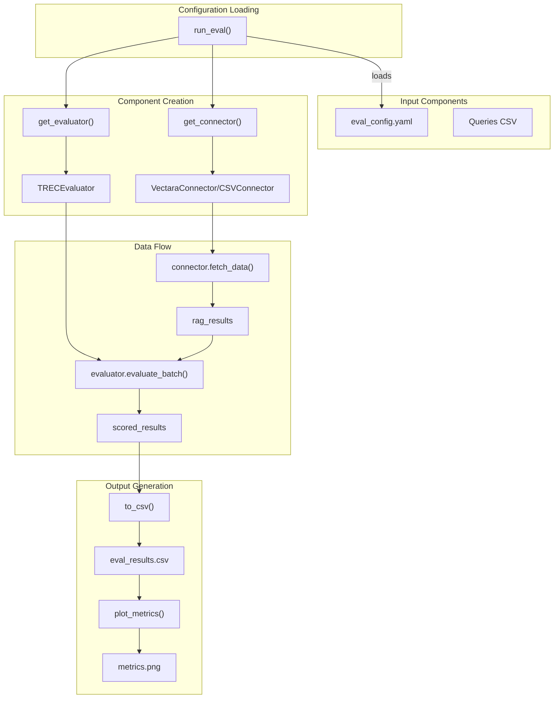
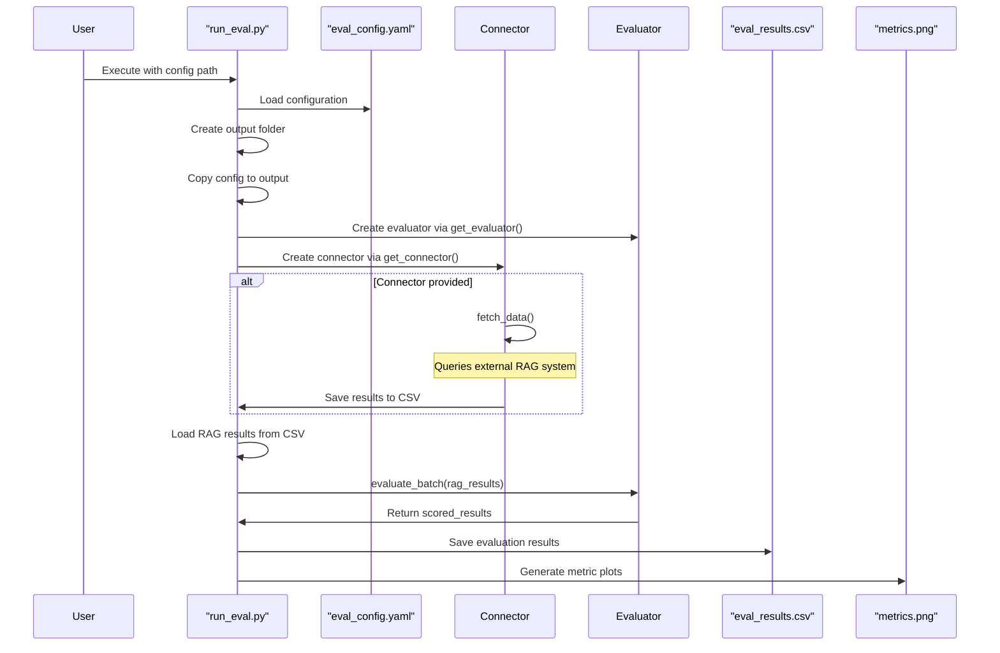
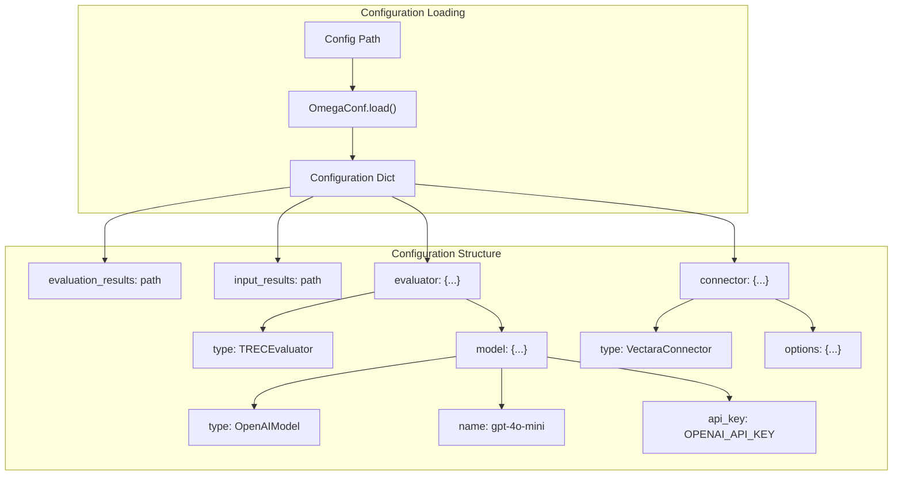
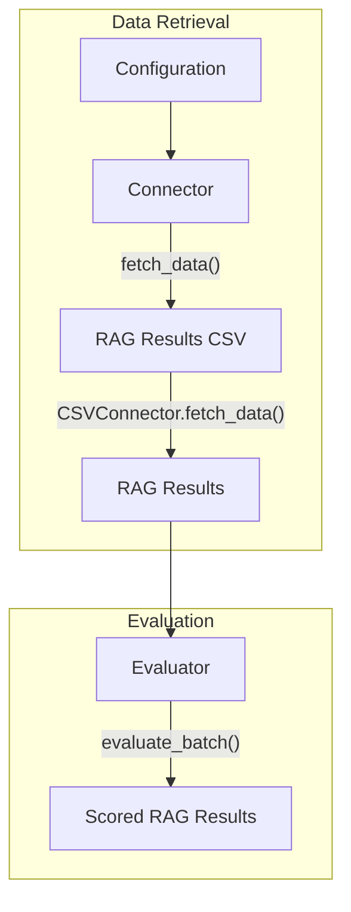
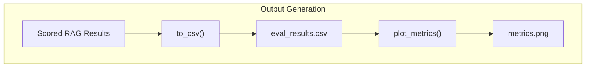
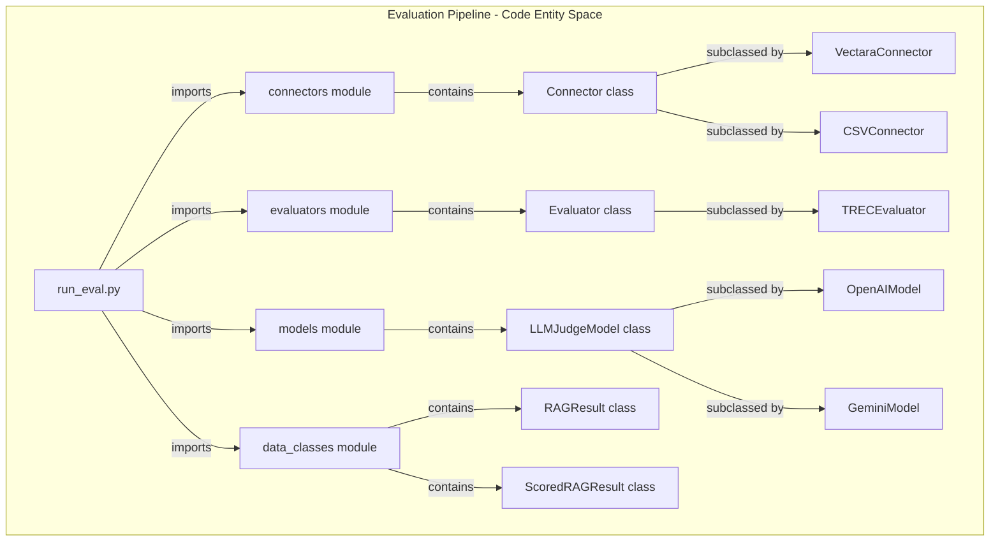

<!-- source: DeepWiki mcp.deepwiki.com · repo vectara/open-rag-eval · page 3.1 Evaluation Pipeline · fetched 2026-10-26 -->

# Evaluation Pipeline

<details>
<summary>Relevant source files</summary>

The following files were used as context for generating this wiki page:

- [README.md](README.md)
- [img/project-logo.png](img/project-logo.png)
- [open_rag_eval/models/__init__.py](open_rag_eval/models/__init__.py)
- [open_rag_eval/run_eval.py](open_rag_eval/run_eval.py)
- [sample_prompt.txt](sample_prompt.txt)

</details>


## Overview

The Evaluation Pipeline is the core workflow orchestration component of the open-rag-eval framework. It implements the end-to-end process of loading configurations, retrieving RAG outputs, applying evaluation metrics, and generating results. This page documents how the pipeline works, focusing on the implementation in `run_eval.py`.

For information about specific evaluator implementations, see [Evaluators](#3.2). For information about connectors, see [Connectors](#3.3).

## Pipeline Architecture



Sources: [open_rag_eval/run_eval.py:77-135]()

## Main Components

The evaluation pipeline consists of the following key components:

| Component | Description | Code Reference |
|-----------|-------------|---------------|
| Configuration | YAML file that defines evaluation settings | [open_rag_eval/run_eval.py:84-88]() |
| Connector | Fetches RAG results from a system | [open_rag_eval/run_eval.py:53-75]() |
| Evaluator | Applies metrics to evaluate RAG quality | [open_rag_eval/run_eval.py:17-50]() |
| Scoring | Converts evaluation results to metrics | [open_rag_eval/run_eval.py:119]() |
| Reporting | Saves results and generates visualizations | [open_rag_eval/run_eval.py:127-134]() |

Sources: [open_rag_eval/run_eval.py:1-147]()

## Execution Flow

The execution flow of the evaluation pipeline is implemented in the `run_eval()` function:



Sources: [open_rag_eval/run_eval.py:77-135]()

## Configuration Loading

The evaluation pipeline starts by loading a configuration from a YAML file:



Sources: [open_rag_eval/run_eval.py:84-88]()

## Dynamic Component Instantiation

The pipeline dynamically instantiates the evaluator and connector based on the configuration:

### Evaluator Creation

The `get_evaluator()` function loads the specified evaluator class, along with the associated LLM model:

```python
evaluator_class = getattr(evaluators, f"{evaluator_type}")
model_class = getattr(models, model_config.type)
model = model_class(model_name=model_config.name, api_key=model_config.api_key)
return evaluator_class(model=model)
```

Sources: [open_rag_eval/run_eval.py:17-50]()

### Connector Creation

The `get_connector()` function loads the specified connector class and instantiates it with the required parameters:

```python
connector_class = getattr(connectors, connector_type)
return connector_class(connector_options.api_key, connector_options.corpus_key)
```

Sources: [open_rag_eval/run_eval.py:53-75]()

## Data Retrieval and Evaluation

The pipeline has two paths for obtaining RAG results:

1. If a connector is specified, it uses the connector to fetch data from the RAG system
2. It then loads the RAG results from a CSV file

After obtaining the RAG results, it runs the evaluation using the evaluator's `evaluate_batch()` method:



Sources: [open_rag_eval/run_eval.py:107-119]()

## Output Generation

The final step of the pipeline is to save the evaluation results and generate visualizations:



Sources: [open_rag_eval/run_eval.py:127-134]()

## Command-Line Interface

The evaluation pipeline can be executed via the command line, using the `run_eval.py` script:

```
python open_rag_eval/run_eval.py --config eval_config.yaml
```

The script accepts a single argument, `--config`, which specifies the path to the configuration file.

Sources: [open_rag_eval/run_eval.py:137-147]()

## Integration with Other Components

The evaluation pipeline integrates with other components in the open-rag-eval framework:



Sources: [open_rag_eval/run_eval.py:13-14](), [open_rag_eval/models/__init__.py:1-3]()

## Summary

The Evaluation Pipeline is the central orchestration component of the open-rag-eval framework. It:

1. Loads configuration from a YAML file
2. Dynamically instantiates the appropriate evaluator and connector
3. Retrieves RAG results, either through the connector or from a pre-existing CSV file
4. Runs the evaluation using the evaluator
5. Saves the results and generates visualizations

The pipeline is designed to be flexible and extensible, allowing for different evaluators, connectors, and metrics to be used based on the configuration.

---

