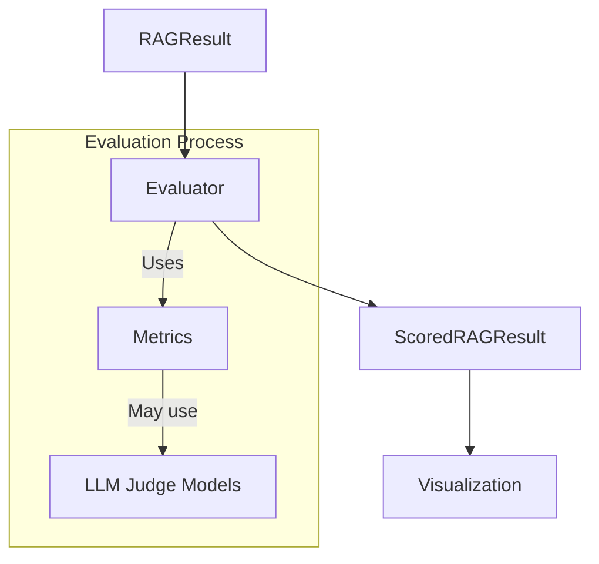
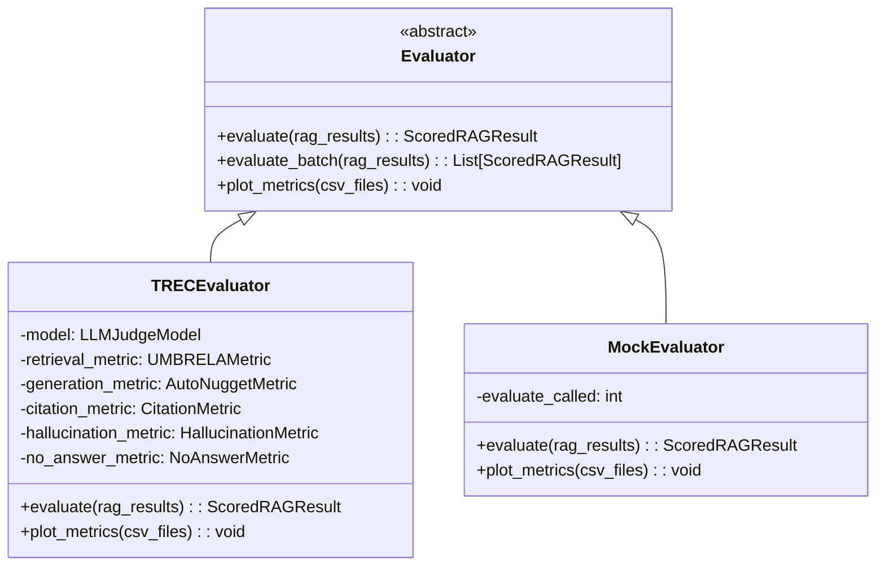
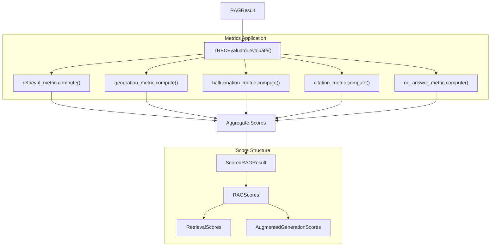
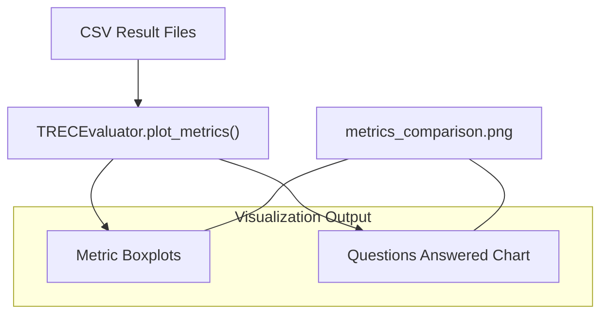

<!-- source: DeepWiki mcp.deepwiki.com · repo vectara/open-rag-eval · page 3.2 Evaluators · fetched 2026-10-26 -->

# Evaluators

Relevant source files

The following files were used as context for generating this wiki page:

- [open_rag_eval/evaluators/base_evaluator.py](open_rag_eval/evaluators/base_evaluator.py)
- [open_rag_eval/evaluators/trec_evaluator.py](open_rag_eval/evaluators/trec_evaluator.py)
- [tests/test_base_evaluator.py](tests/test_base_evaluator.py)

## Purpose and Scope

This document details the evaluator system in the open-rag-eval framework, focusing on the base `Evaluator` class and its concrete implementation, the `TRECEvaluator`. Evaluators are responsible for assessing the quality of RAG (Retrieval-Augmented Generation) results by applying various metrics and producing comprehensive scores for both the retrieval and generation components. For information about the metrics used in evaluation, see [Metrics](#3.5).

Sources: [open_rag_eval/evaluators/base_evaluator.py](), [open_rag_eval/evaluators/trec_evaluator.py]()

## Evaluator Architecture

The evaluator system follows an object-oriented design with a well-defined hierarchy:

Sources: [open_rag_eval/evaluators/base_evaluator.py:1-35](), [open_rag_eval/evaluators/trec_evaluator.py:27-35](), [tests/test_base_evaluator.py:18-39]()

### Base Evaluator Class

The `Evaluator` abstract base class defines the interface for all evaluator implementations:

- **Abstract Methods**:
  - `evaluate(rag_results)`: Evaluates a single RAG result and returns a `ScoredRAGResult`
  - `plot_metrics(csv_files)`: Visualizes metrics from evaluation results stored in CSV files

- **Concrete Methods**:
  - `evaluate_batch(rag_results, max_workers=5)`: Processes multiple RAG results in parallel using a `ThreadPoolExecutor`, with a progress bar via `tqdm`

Sources: [open_rag_eval/evaluators/base_evaluator.py:10-34]()

### TRECEvaluator Implementation

The `TRECEvaluator` is the primary concrete implementation of the `Evaluator` interface:

- **Initialization**:
  - Takes an `LLMJudgeModel` as input for metrics that require LLM-based evaluation
  - Creates instances of five different metrics:
    - `UMBRELAMetric`: Evaluates retrieval quality
    - `AutoNuggetMetric`: Evaluates generation quality
    - `CitationMetric`: Evaluates citation accuracy
    - `HallucinationMetric`: Detects hallucinations in generated answers
    - `NoAnswerMetric`: Determines if a query was properly answered

- **Evaluation Process**:
  - Applies all metrics to the RAG result
  - Calculates aggregate scores from the individual metric results
  - Returns a `ScoredRAGResult` with complete scoring information
  - Handles exceptions gracefully, returning empty scores if evaluation fails

Sources: [open_rag_eval/evaluators/trec_evaluator.py:27-85]()

## Evaluation Process

The evaluation process involves applying metrics to both the retrieval and generation components of a RAG result.

Sources: [open_rag_eval/evaluators/trec_evaluator.py:36-85]()

### Single Evaluation

The `evaluate` method in `TRECEvaluator` implements the following process:

1. Compute UMBRELA scores for retrieval quality assessment
2. Compute AutoNugget scores for generation quality assessment
3. Compute hallucination scores to detect fabricated information
4. Compute citation scores to assess citation accuracy
5. Compute no-answer scores to determine if the query was answered
6. Calculate aggregate statistics (means, etc.) from detailed metrics
7. Construct a hierarchical `RAGScores` object containing all scores
8. Return a `ScoredRAGResult` that combines the original RAG result with the scores

Sources: [open_rag_eval/evaluators/trec_evaluator.py:36-85]()

### Batch Evaluation

The base `Evaluator` class provides parallel processing of multiple RAG results:

- Uses `ThreadPoolExecutor` to evaluate multiple results concurrently
- Implements a progress bar using `tqdm` to show evaluation progress
- Returns a list of `ScoredRAGResult` objects

Sources: [open_rag_eval/evaluators/base_evaluator.py:23-34](), [tests/test_base_evaluator.py:61-82]()

## Visualization Capabilities

The `TRECEvaluator` includes a comprehensive implementation of the `plot_metrics` method to visualize evaluation results:

- **Visualization Features**:
  - Creates boxplots for key metrics:
    - Mean UMBRELA Score (retrieval)
    - Vital Nugget Score (generation)
    - Hallucination Score
    - Citation F1 Score
  - Shows percentage of questions answered
  - Supports comparison of multiple result sets

- **Plot Customization**:
  - Single CSV: Displays detailed boxplots with mean and median values
  - Multiple CSVs: Creates grouped boxplots for comparative analysis
  - Y-axis ranges optimized for each metric type

- **Implementation Details**:
  - Uses matplotlib for plotting
  - Dynamically adapts layout based on number of input CSV files
  - Exports high-resolution visualization to a specified output file

This visualization method facilitates easy comparison of different RAG systems or configurations.

Sources: [open_rag_eval/evaluators/trec_evaluator.py:87-274]()

## Score Structure

The evaluation results are structured hierarchically:

| Class | Description | Contained Scores |
|-------|-------------|------------------|
| `ScoredRAGResult` | Top-level container | Original RAG result + `RAGScores` |
| `RAGScores` | Overall scores container | `RetrievalScores` + `AugmentedGenerationScores` |
| `RetrievalScores` | Retrieval metrics | UMBRELA scores, mean UMBRELA score |
| `AugmentedGenerationScores` | Generation metrics | AutoNugget scores, nugget assignment score, vital nuggetizer score, hallucination scores, citation scores, no-answer score |

This hierarchical structure allows for comprehensive evaluation of different aspects of RAG performance while maintaining a clean organization of the various metrics.

Sources: [open_rag_eval/evaluators/trec_evaluator.py:56-76]()

---

