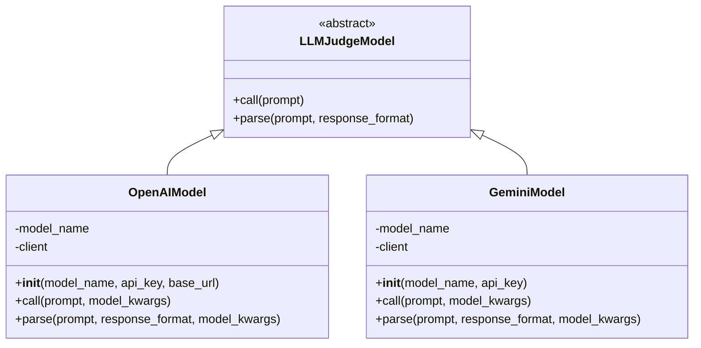
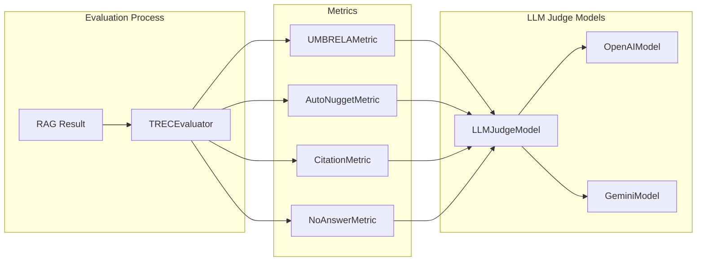

<!-- source: DeepWiki mcp.deepwiki.com · repo vectara/open-rag-eval · page 3.4 LLM Judge Models · fetched 2026-10-26 -->

# LLM Judge Models

<details>
<summary>Relevant source files</summary>

The following files were used as context for generating this wiki page:

- [open_rag_eval/models/llm_judges.py](open_rag_eval/models/llm_judges.py)
- [tests/test_llm_judges_integration.py](tests/test_llm_judges_integration.py)

</details>


## Purpose and Scope

This document describes the LLM Judge Models component of the open-rag-eval framework. These models serve as automated evaluators that assess various aspects of RAG system outputs through language model inference. LLM Judge Models provide the foundation for multiple evaluation metrics in the system by enabling automated assessment of retrieval relevance, answer quality, citation accuracy, and other important aspects of RAG system performance.

For information about the specific metrics that utilize these models, see [Metrics](#3.5).

## Model Architecture

The LLM Judge Models component implements a simple class hierarchy that provides a consistent interface for different language model providers while abstracting away the implementation details of each API.



Sources: [open_rag_eval/models/llm_judges.py:9-14](), [open_rag_eval/models/llm_judges.py:15-79](), [open_rag_eval/models/llm_judges.py:81-144]()

## Integration with Evaluation System

The LLM Judge Models are primarily used by various metrics to evaluate different aspects of RAG system responses. They serve as the inference engine that powers the evaluation process.



Sources: [open_rag_eval/models/llm_judges.py:9-14]()

## Supported Model Types

The framework currently supports two types of LLM judge models:

### OpenAI Models

The `OpenAIModel` class provides support for any model that conforms to the OpenAI API specification, including:

- Official OpenAI models (GPT-4, GPT-3.5, etc.)
- Compatible third-party APIs that implement the OpenAI interface

The class uses the OpenAI Python SDK to interact with the models and supports customization through an optional `base_url` parameter, enabling use of compatible API endpoints.

Sources: [open_rag_eval/models/llm_judges.py:15-79]()

### Gemini Models

The `GeminiModel` class supports Google's Gemini family of models through the Google GenAI Python SDK.

Sources: [open_rag_eval/models/llm_judges.py:81-144]()

## Core Functionalities

Both model implementations provide two primary methods:

### Text Generation with `call`

The `call` method sends a prompt to the LLM and returns the generated text response. This method handles the details of formatting the request for each API and provides consistent error handling.

```python
# Example usage
model = OpenAIModel(model_name="gpt-4o-mini", api_key="your-api-key")
response = model.call("What is the capital of France?")
print(response)  # "The capital of France is Paris."
```

Key features:
- Input validation
- Consistent error handling across model types
- Support for model-specific parameters via `model_kwargs`

Sources: [open_rag_eval/models/llm_judges.py:23-60](), [open_rag_eval/models/llm_judges.py:88-114]()

### Structured Parsing with `parse`

The `parse` method extends beyond simple text generation by returning structured data according to a provided Pydantic schema. This is particularly useful for evaluation metrics that need to extract specific judgments or scores from the model.

```python
# Example usage with structured output
from pydantic import BaseModel
from enum import Enum

class CitationSupportValues(str, Enum):
    FULL = "full_support"
    PARTIAL = "partial_support"
    NONE = "no_support"

class CitationSupport(BaseModel):
    support: CitationSupportValues

model = OpenAIModel(model_name="gpt-4o-mini", api_key="your-api-key")
result = model.parse(
    "Is this statement supported by the citation?...", 
    CitationSupport
)
print(result.support)  # CitationSupportValues.FULL
```

Sources: [open_rag_eval/models/llm_judges.py:62-78](), [open_rag_eval/models/llm_judges.py:116-144](), [tests/test_llm_judges_integration.py:11-19]()

## Configuration in Evaluation Pipeline

LLM Judge Models are typically configured in the `eval_config.yaml` file. The configuration specifies which model implementation to use and provides the necessary credentials.

Example configuration:

```yaml
evaluator:
  type: TRECEvaluator
  model:
    type: OpenAIModel
    name: gpt-4o-mini
    api_key: OPENAI_API_KEY  # Environment variable
```

The system loads this configuration and instantiates the appropriate model class, which is then passed to the metrics that require LLM-based evaluation.

## Error Handling

Both model implementations include comprehensive error handling:

| Error Type | Description | Handling |
|------------|-------------|----------|
| API Authentication | API key issues | Explicit error message raised |
| Rate Limiting | Exceeded API quota | Exception passed through to caller |
| Network/Connection | API unreachable | Explicit connection error |
| Invalid Input | Empty prompt | ValueError raised |
| Unexpected Errors | Any other issue | Wrapped with contextual information |

Sources: [open_rag_eval/models/llm_judges.py:34-40](), [open_rag_eval/models/llm_judges.py:52-60](), [open_rag_eval/models/llm_judges.py:99-102](), [open_rag_eval/models/llm_judges.py:113-114]()

## Implementation Details

### OpenAI Model

The `OpenAIModel` class:
- Supports configuration through model name, API key, and optional base URL
- Uses the OpenAI Python client for API communication
- Implements proper error handling for API-specific errors
- For structured output parsing, utilizes the beta parsing functionality

Sources: [open_rag_eval/models/llm_judges.py:15-79]()

### Gemini Model

The `GeminiModel` class:
- Configures through model name and API key
- Uses the Google GenAI client for API access
- Implements JSON-based structured output parsing
- Converts between Pydantic schemas and GenAI configuration

Sources: [open_rag_eval/models/llm_judges.py:81-144]()

## Usage in Metrics

The LLM Judge Models are leveraged by several metrics in the evaluation framework:

1. **UMBRELA Metric**: Uses the models to evaluate the relevance of retrieved passages to the query
2. **AutoNugget Metric**: Utilizes the models to assess the quality of generated answers
3. **Citation Metric**: Employs the models to evaluate if citations support the generated text
4. **No Answer Metric**: Uses the models to determine if a query was properly answered

Each metric constructs specialized prompts that instruct the LLM to perform specific evaluation tasks, then processes the responses to compute evaluation scores.

Sources: [tests/test_llm_judges_integration.py:21-51]()

---

