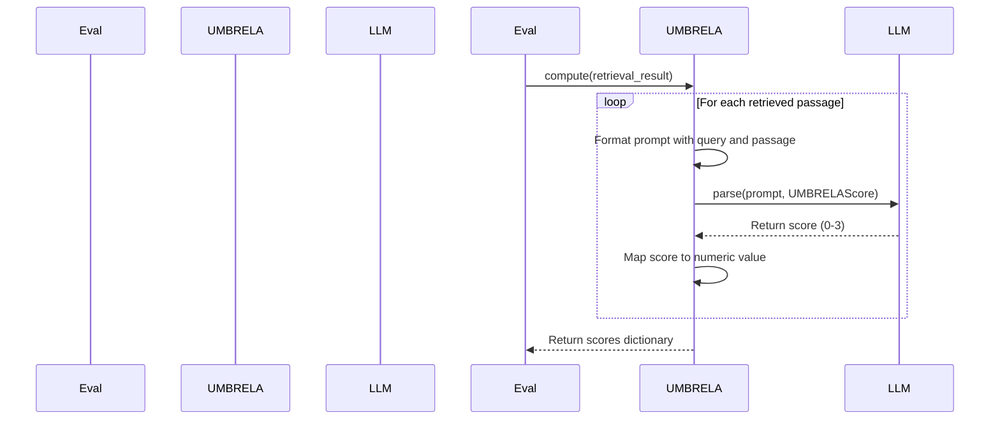
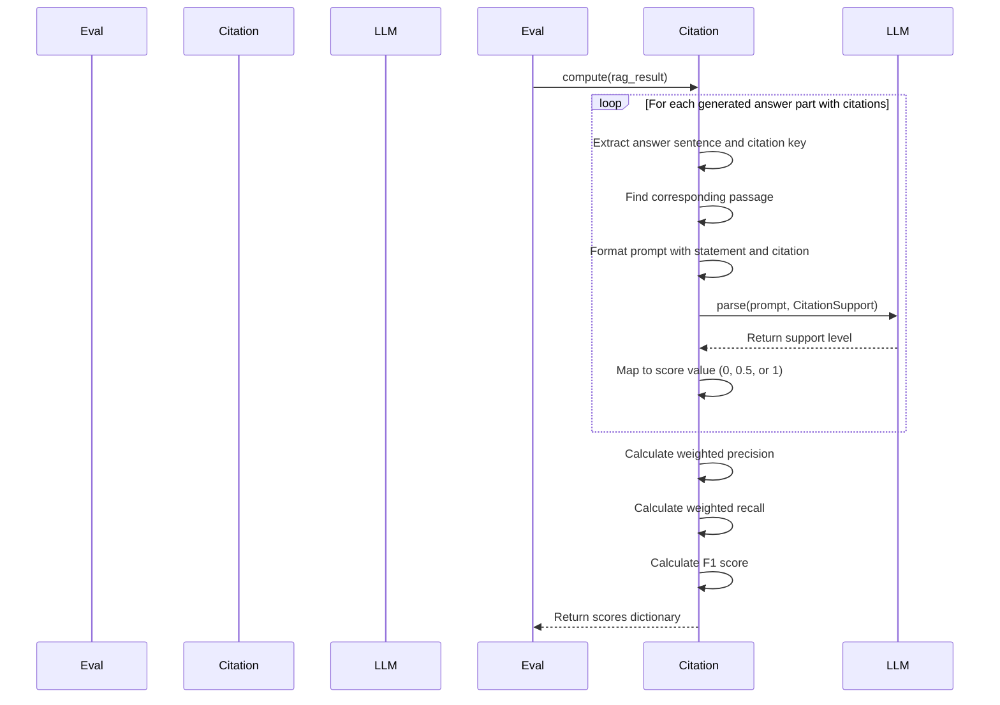
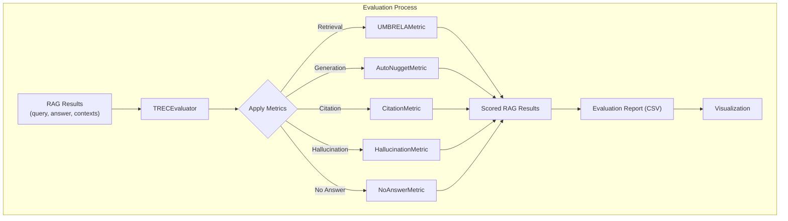
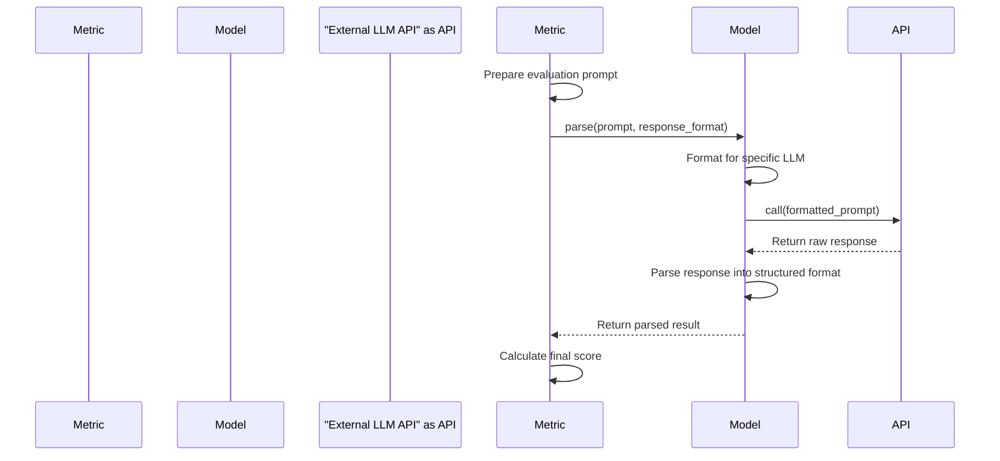

<!-- source: DeepWiki mcp.deepwiki.com · repo vectara/open-rag-eval · page 3.5 Metrics · fetched 2026-10-26 -->

# Metrics

<details>
<summary>Relevant source files</summary>

The following files were used as context for generating this wiki page:

- [README.md](README.md)
- [img/project-logo.png](img/project-logo.png)
- [open_rag_eval/_version.py](open_rag_eval/_version.py)
- [open_rag_eval/metrics/citation_metric.py](open_rag_eval/metrics/citation_metric.py)
- [open_rag_eval/metrics/umbrela_metric.py](open_rag_eval/metrics/umbrela_metric.py)
- [sample_prompt.txt](sample_prompt.txt)

</details>


## Purpose and Scope

This page provides an overview of the metrics used in the open-rag-eval toolkit to evaluate Retrieval-Augmented Generation (RAG) systems. Metrics are the core evaluation components that measure different quality aspects of RAG pipelines, including retrieval relevance, answer faithfulness, and citation accuracy.

For specific details about individual metric implementations, see:
- [UMBRELA and Citation Metrics](#3.5.1)
- [AutoNugget Metric](#3.5.2)
- [No Answer Metric](#3.5.3)

## Metric Architecture

The open-rag-eval system implements a structured hierarchy of metrics to evaluate different aspects of RAG systems. All metrics derive from base abstract classes that define the interface for computing scores.

```mermaid
classDiagram
    class "BaseMetric" {
        <<abstract>>
    }
    
    class "RetrievalMetric" {
        <<abstract>>
        +compute(retrieval_result)
    }
    
    class "AugmentedGenerationMetric" {
        <<abstract>>
        +compute(rag_result)
    }
    
    class "UMBRELAMetric" {
        -model: LLMJudgeModel
        -prompt: str
        +compute(retrieval_result): dict
    }
    
    class "CitationMetric" {
        -model: LLMJudgeModel
        +compute(rag_result): dict
    }
    
    class "AutoNuggetMetric" {
        -model: LLMJudgeModel
        +compute(rag_result): dict
    }
    
    class "HallucinationMetric" {
        +compute(rag_result): dict
    }
    
    class "NoAnswerMetric" {
        -model: LLMJudgeModel
        +compute(rag_result): dict
    }
    
    BaseMetric <|-- RetrievalMetric
    BaseMetric <|-- AugmentedGenerationMetric
    
    RetrievalMetric <|-- UMBRELAMetric
    
    AugmentedGenerationMetric <|-- CitationMetric
    AugmentedGenerationMetric <|-- AutoNuggetMetric
    AugmentedGenerationMetric <|-- HallucinationMetric
    AugmentedGenerationMetric <|-- NoAnswerMetric
```

Sources: open_rag_eval/metrics/umbrela_metric.py, open_rag_eval/metrics/citation_metric.py

### Metric Types

The metrics in open-rag-eval fall into two main categories:

1. **Retrieval Metrics**: Evaluate the quality and relevance of passages retrieved by the RAG system
   - Example: `UMBRELAMetric` assesses passage relevance to the query

2. **Augmented Generation Metrics**: Evaluate the quality of the generated answer, including its faithfulness to the retrieved passages
   - Examples: `CitationMetric`, `AutoNuggetMetric`, `HallucinationMetric`, `NoAnswerMetric`

## Core Metrics

### UMBRELA Metric

The UMBRELA (UMbrela is the Open-Source Reproduction of the Bing RELevance Assessor) metric evaluates the relevance of retrieved passages on a scale from 0 to 3:

| Score | Meaning |
|-------|---------|
| 0 | No relevance - passage has nothing to do with the query |
| 1 | Related - passage is related to the query but doesn't answer it |
| 2 | Partial answer - passage contains some answer, possibly with extraneous information |
| 3 | Exact answer - passage is dedicated to the query and contains the exact answer |

The UMBRELA metric uses a LLM judge to evaluate each retrieved passage against the query.



Sources: open_rag_eval/metrics/umbrela_metric.py

### Citation Metric

The Citation metric evaluates whether the generated answer is supported by the retrieved passages it cites. It uses an LLM judge to determine the level of support for each cited passage:

| Support Level | Meaning | Score |
|---------------|---------|-------|
| Full Support | All information in the statement is supported | 1.0 |
| Partial Support | Some parts are supported, others are missing | 0.5 |
| No Support | Citation doesn't support any part of the statement | 0.0 |

The metric calculates:
- Weighted precision: Proportion of citations that support the answer
- Weighted recall: Proportion of answer sentences that are correctly cited
- F1 score: Harmonic mean of precision and recall



Sources: open_rag_eval/metrics/citation_metric.py

### Other Metrics

#### AutoNugget Metric
Evaluates the quality of generated content by breaking it down into "nuggets" of information and assessing their accuracy and relevance.

#### Hallucination Metric
Detects when the generated answer contains information not found in the retrieved passages (hallucinations).

#### No Answer Metric
Determines if a query was answered appropriately, especially useful for queries that should receive a "no answer" response.

## Metric Usage in Evaluation

Metrics are applied through the evaluation pipeline as follows:



Sources: README.md

### Integration with LLM Judges

Many metrics rely on LLM judges to evaluate aspects that require semantic understanding:



Sources: open_rag_eval/metrics/umbrela_metric.py, open_rag_eval/metrics/citation_metric.py

## Metric Configuration

Metrics are configured through the evaluation configuration file (`eval_config.yaml`). The following sample shows how metrics are configured within the evaluator:

```yaml
evaluator:
  type: TRECEvaluator
  model:
    type: OpenAIModel
    name: gpt-4o-mini
    api_key: OPENAI_API_KEY
  metrics:
    retrieval_metric: UMBRELAMetric
    generation_metric: AutoNuggetMetric
    citation_metric: CitationMetric
    hallucination_metric: HallucinationMetric
    no_answer_metric: NoAnswerMetric
```

The configuration specifies which metrics to use and which LLM judge model will power the metrics that require AI-based evaluation.

Sources: README.md

## Interpreting Metric Scores

The evaluation toolkit produces a detailed CSV report containing scores from all configured metrics for each evaluated query. These scores can be used to:

1. Identify strengths and weaknesses in your RAG system
2. Compare different RAG configurations or providers
3. Track improvements over time
4. Diagnose specific issues (e.g., hallucination problems or citation inaccuracies)

The toolkit's visualization capabilities allow easy comparison of metric scores across different runs or configurations.

Sources: README.md

---

