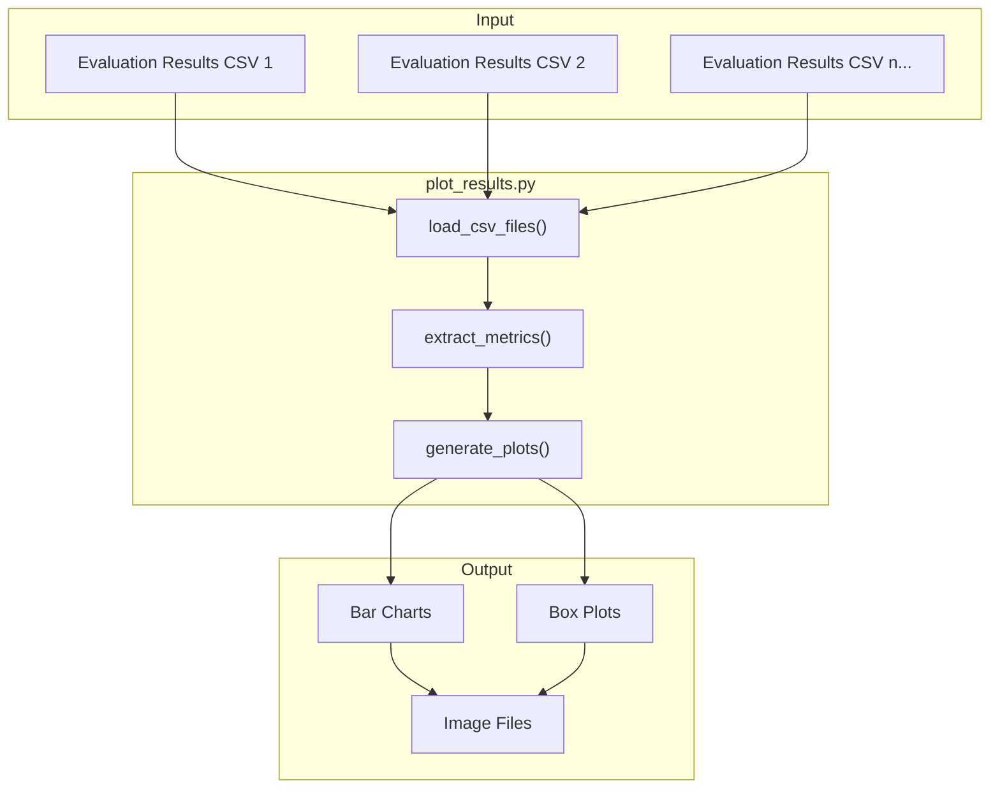
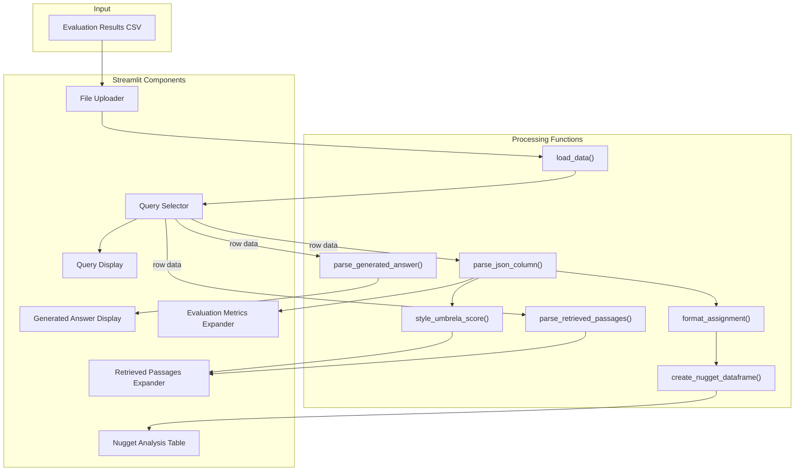
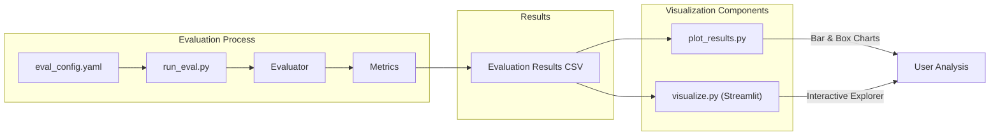

<!-- source: DeepWiki mcp.deepwiki.com · repo vectara/open-rag-eval · page 4 Visualization · fetched 2026-10-26 -->

# Visualization

<details>
<summary>Relevant source files</summary>

The following files were used as context for generating this wiki page:

- [README.md](README.md)
- [img/project-logo.png](img/project-logo.png)
- [open_rag_eval/viz/visualize.py](open_rag_eval/viz/visualize.py)
- [sample_prompt.txt](sample_prompt.txt)

</details>


This page documents the visualization capabilities of the open-rag-eval toolkit. Visualization components enable users to analyze, compare, and interpret RAG evaluation results through plots and interactive explorers. These tools transform raw evaluation data into actionable insights that help identify strengths and weaknesses in RAG systems.

## Overview of Visualization Features

The open-rag-eval toolkit provides two primary visualization methods:

1. **Results Plotting**: For high-level metric comparison across different evaluation runs
2. **Interactive Results Explorer**: For detailed per-query analysis and metric inspection

These visualization tools work with the evaluation results produced by the toolkit's evaluators and metrics.

Sources: [README.md:126-127](), [README.md:147-156]()

## Results Plotting

The `plot_results.py` script generates visualizations from evaluation results CSV files, allowing for aggregated metric comparison across different RAG system configurations or evaluation runs.

### Usage

The plotting tool can be used in two ways:

1. **Automatically**: When running `run_eval.py`, results are automatically plotted and saved to the results folder
2. **Manually**: By directly invoking the plotting script

```bash
# Plot single result file
python open_rag_eval/plot_results.py open_eval_results.csv

# Plot and compare multiple result files
python open_rag_eval/plot_results.py results_1.csv results_2.csv results_3.csv
```

This feature is particularly useful for comparing the performance of different RAG configurations, models, or providers at a glance.

Sources: [README.md:112-127](), [README.md:147-154]()

### Results Plotting Data Flow



Sources: [README.md:112-127]()

## Interactive Results Explorer

The toolkit provides a Streamlit-based interactive visualization tool for deep-diving into individual evaluation results. This explorer allows users to examine generated answers, retrieved passages, and associated metrics for each evaluated query.

### Launching the Explorer

To launch the interactive explorer:

```bash
cd open_rag_eval/viz/
streamlit run visualize.py
```

Once launched, users can upload their evaluation results CSV file through the web interface.

Sources: [README.md:156-165](), [open_rag_eval/viz/visualize.py:117-121]()

### Features of the Interactive Explorer

The explorer provides the following key features:

1. **Query Selection**: Select individual queries from the evaluation results
2. **Retrieved Passages View**: Examine retrieved passages with their relevance scores
3. **Generated Answer Inspection**: Read the generated answer with citations
4. **Detailed Metrics Analysis**: Explore all evaluation metrics for the selected query
5. **Nugget Analysis Visualization**: View nuggetized content with support assignments

Sources: [open_rag_eval/viz/visualize.py:128-201]()

### Interactive Explorer Architecture



Sources: [open_rag_eval/viz/visualize.py:1-205]()

## Visualization Data Flow in Evaluation Pipeline

The following diagram illustrates how visualization components fit into the broader evaluation pipeline:



Sources: [README.md:175-182]()

## Key Metrics Visualized

The visualization tools present several key metrics that provide insights into RAG system performance:

| Metric Type | Description | Visualization Type |
|-------------|-------------|-------------------|
| UMBRELA Scores | Relevance of retrieved passages (0-3 scale) | Colored indicators in explorer, Aggregated in plots |
| AutoNugget Scores | Quality of generated answer content | Tables in explorer, Summary in plots |
| Citation Metrics | Citation accuracy and completeness | F1 scores in explorer and plots |
| Hallucination Metrics | Detection of unsupported claims | Scores in explorer and plots |
| No Answer Metrics | Indicates if query was attempted | Colored indicators in explorer |

Sources: [open_rag_eval/viz/visualize.py:61-96](), [open_rag_eval/viz/visualize.py:164-171]()

## Understanding the Interactive Explorer

### Metric Visualization Components

The Streamlit explorer renders different metrics with specialized components:

1. **UMBRELA Scores**: Displayed with colored emoji indicators (🔴0, 🟠1, 🟡2, 🟢3)
2. **Nugget Assignments**: Formatted as colored labels (🟢Support, 🟡Partial, 🔴No Support)
3. **No Answer Detection**: Indicated as 🟢Answer Provided or 🔴Answer not attempted
4. **Nugget Analysis Table**: Structured as a DataFrame with nuggets and their assignments
5. **Expandable Metrics**: Complex metrics displayed in collapsible sections

The color-based visualization helps quickly identify strengths and weaknesses in evaluated results.

Sources: [open_rag_eval/viz/visualize.py:61-115](), [open_rag_eval/viz/visualize.py:148-200]()

### Data Parsing Components

The explorer includes several functions to parse and format the complex JSON structures found in evaluation results:

```mermaid
classDiagram
    class "Main Visualization Functions" {
        load_data(file)
        parse_retrieved_passages(passages_str)
        parse_generated_answer(answer_str)
        parse_json_column(json_str)
        style_umbrela_score(score)
        format_assignment(assignment)
        format_no_answer_score(score_data)
        create_nugget_dataframe(data)
        main()
    }
    
    class "Data Structures" {
        DataFrame
        JSON Structures
        Formatted Text
        Styled Indicators
    }
    
    "Main Visualization Functions" --> "Data Structures" : process and transform
```

Sources: [open_rag_eval/viz/visualize.py:1-115]()

## Practical Usage Tips

1. **Comparing Multiple Systems**: Use `plot_results.py` with multiple CSV files to compare different RAG configurations side-by-side.
2. **Deep-Dive Analysis**: Use the Streamlit explorer to investigate specific queries that have unusual scores or unexpected behavior.
3. **Debugging RAG Pipelines**: Examine the retrieved passages and their relevance scores to identify retrieval issues.
4. **Content Generation Analysis**: Review nugget assignments to understand where generated content lacks support from retrieved content.
5. **Report Generation**: Save visualization outputs for inclusion in reports or presentations.

Sources: [README.md:147-165]()

## Conclusion

The visualization components in open-rag-eval provide both high-level comparative analysis and detailed per-query inspection. These tools transform complex evaluation data into intuitive visual representations, making it easier to understand RAG system performance and identify areas for improvement.

---

