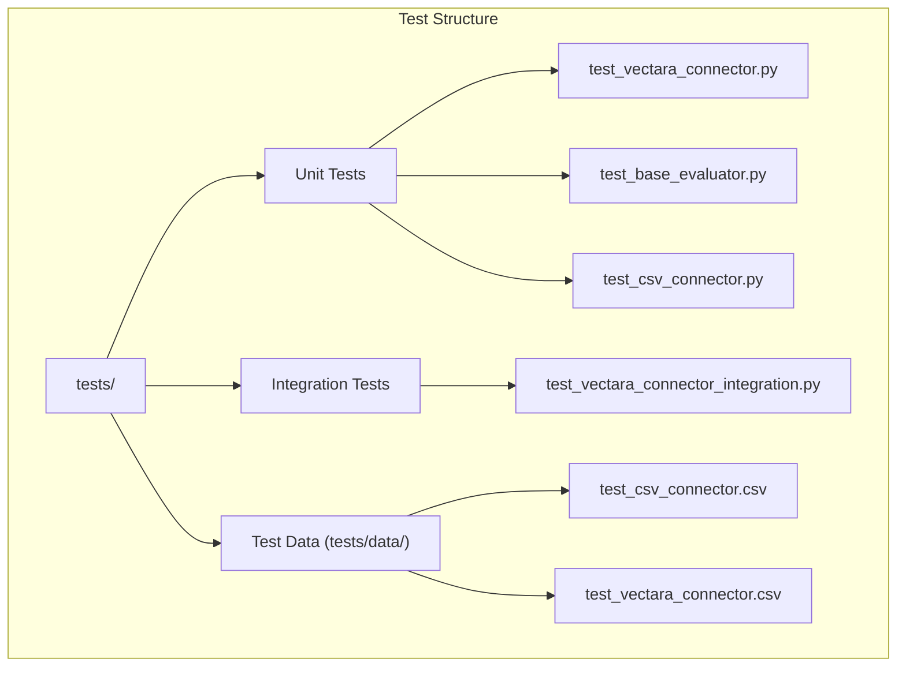
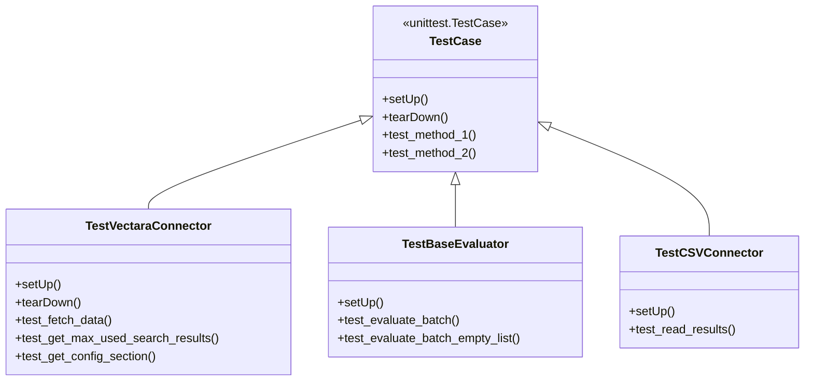
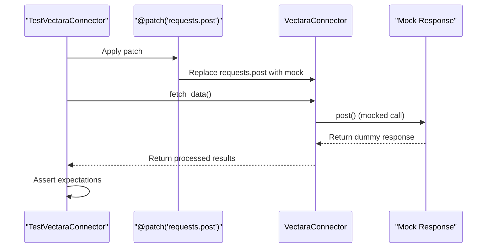
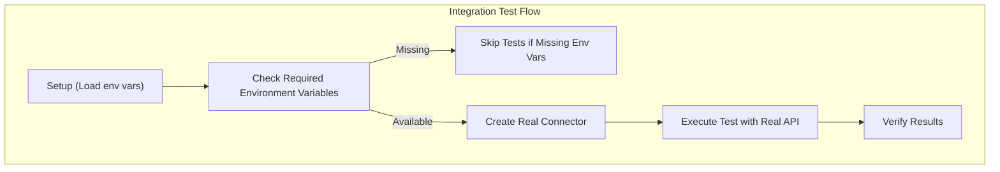
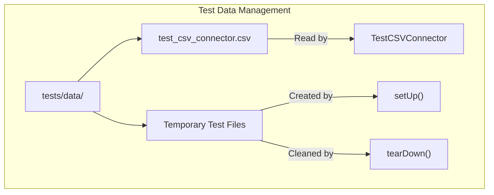
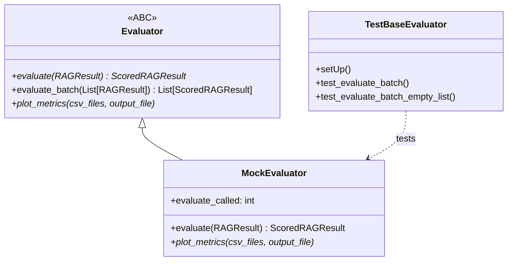
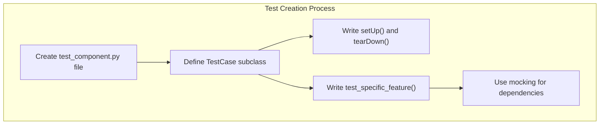

<!-- source: DeepWiki mcp.deepwiki.com · repo vectara/open-rag-eval · page 5.1 Testing · fetched 2026-10-26 -->

# Testing

<details>
<summary>Relevant source files</summary>

The following files were used as context for generating this wiki page:

- [open_rag_eval/evaluators/base_evaluator.py](open_rag_eval/evaluators/base_evaluator.py)
- [tests/data/test_csv_connector.csv](tests/data/test_csv_connector.csv)
- [tests/test_base_evaluator.py](tests/test_base_evaluator.py)
- [tests/test_csv_connector.py](tests/test_csv_connector.py)
- [tests/test_vectara_connector.py](tests/test_vectara_connector.py)
- [tests/test_vectara_connector_integration.py](tests/test_vectara_connector_integration.py)

</details>


This page provides documentation on the testing framework and practices used in the open-rag-eval repository. It covers how unit and integration tests are structured, how to write new tests, and best practices for contributing test coverage to the project.

## Overview of Testing Framework

The open-rag-eval project uses Python's built-in `unittest` framework for both unit and integration testing. Tests are organized in the `tests/` directory at the root of the project, with individual test files corresponding to specific components of the system.



Sources: [tests/test_vectara_connector.py](), [tests/test_base_evaluator.py](), [tests/test_csv_connector.py](), [tests/test_vectara_connector_integration.py](), [tests/data/test_csv_connector.csv]()

## Unit Testing Approach

Unit tests in open-rag-eval focus on testing individual components in isolation, using mocking to simulate dependencies. The project follows these general patterns:

1. Each component has a corresponding test file (e.g., `VectaraConnector` is tested in `test_vectara_connector.py`)
2. Tests use the `unittest.mock` module to patch external dependencies
3. Test cases inherit from `unittest.TestCase`
4. `setUp()` and `tearDown()` methods prepare and clean up test environments

### Example Unit Test Structure



Sources: [tests/test_vectara_connector.py](), [tests/test_base_evaluator.py](), [tests/test_csv_connector.py]()

## Mocking External Dependencies

The example below shows how `unittest.mock` is used to patch external dependencies, in this case the HTTP request to Vectara API:



Sources: [tests/test_vectara_connector.py:42-76]()

### Key Mocking Techniques

1. **Using the `@patch` decorator**: This replaces the specified object with a mock during the test execution.

```python
@patch("requests.post")
def test_fetch_data(self, mock_post):
    # Configure mock
    mock_response = MagicMock()
    mock_response.status_code = 200
    mock_response.json.return_value = DUMMY_RESPONSE
    mock_post.return_value = mock_response
    
    # Test functionality
    # ...
```

2. **Creating mock objects**: Using `MagicMock` to create objects with specific return values.

3. **Setting up test fixtures**: Using temporary files and dummy data for testing.

Sources: [tests/test_vectara_connector.py:9-12](), [tests/test_vectara_connector.py:42-48]()

## Integration Testing

Integration tests verify that components work together and with external services. They can be conditionally skipped if required external resources are unavailable.



Sources: [tests/test_vectara_connector_integration.py:9-54]()

### Integration Test Features

1. **Loading environment variables**: Using `dotenv` to load API keys and other configuration needed for real API calls.

2. **Conditional test skipping**: Tests are skipped if required environment variables are not available.

```python
required_vars = ["VECTARA_API_KEY", "VECTARA_CORPUS_KEY"]
missing = [var for var in required_vars if not os.getenv(var)]
if missing:
    raise unittest.SkipTest(
        f"Skipping integration tests, missing env vars: {', '.join(missing)}")
```

3. **Test verification**: Checking that the integration with external services produced expected results.

Sources: [tests/test_vectara_connector_integration.py:11-17](), [tests/test_vectara_connector_integration.py:33-50]()

## Test Data Management

The project uses a `tests/data/` directory to store test data files. This includes sample CSV files needed for testing connectors and other components.



Sources: [tests/data/test_csv_connector.csv](), [tests/test_vectara_connector.py:16-40]()

### Test Data Patterns

1. **Permanent test files**: Fixed data files in the repository for consistent testing (e.g., `test_csv_connector.csv`).

2. **Temporary test files**: Created during test setup and removed during teardown.

```python
def setUp(self):
    # Create a temporary CSV file with one test query.
    self.test_csv_path = Path("tests/data/test_vectara_connector.csv")
    self.test_csv_path.parent.mkdir(exist_ok=True)
    with self.test_csv_path.open("w", newline="", encoding="utf-8") as f:
        writer = csv.DictWriter(f, fieldnames=["query_id", "query"])
        writer.writeheader()
        writer.writerow(
            {"query_id": "query_1", "query": "What is the meaning of life?"}
        )
    # ...

def tearDown(self):
    # Cleanup the temporary test CSV and output CSV.
    if self.test_csv_path.exists():
        self.test_csv_path.unlink()
    # ...
```

Sources: [tests/test_vectara_connector.py:16-40]()

## Testing Abstract Base Classes

Abstract base classes like `Evaluator` require special testing approaches:



Sources: [open_rag_eval/evaluators/base_evaluator.py:1-34](), [tests/test_base_evaluator.py:1-92]()

### Testing Abstract Classes

1. **Create a concrete mock implementation**: Implement abstract methods for testing.

```python
class MockEvaluator(Evaluator):
    """Mock evaluator class for testing the abstract base class"""

    def __init__(self):
        self.evaluate_called = 0

    def evaluate(self, rag_result: RAGResult) -> ScoredRAGResult:
        self.evaluate_called += 1
        return ScoredRAGResult(
            rag_result=rag_result,
            scores=RAGScores(
                retrieval_score=RetrievalScores(scores={"mock_score": 0.5}),
                generation_score=AugmentedGenerationScores(scores={"mock_score": 0.7}),
            ),
        )
    # ...
```

2. **Test shared functionality**: Test the behavior provided by the base class.

```python
def test_evaluate_batch(self):
    """Test that evaluate_batch processes all results and uses ThreadPoolExecutor"""
    rag_results = [create_mock_rag_result(f"query_{i}") for i in range(5)]
    
    scored_results = self.evaluator.evaluate_batch(rag_results)
    
    # Check that evaluate was called for each result
    self.assertEqual(self.evaluator.evaluate_called, 5)
    # ...
```

Sources: [tests/test_base_evaluator.py:18-40](), [tests/test_base_evaluator.py:57-81]()

## Writing New Tests

When adding new components to open-rag-eval, you should create corresponding test files following these guidelines:

1. **File naming**: Name your test file `test_<component_name>.py`
2. **Class naming**: Name your test class `Test<ComponentName>`
3. **Method naming**: Prefix test methods with `test_`
4. **Use appropriate assertions**: Use the most specific assertion method for your test case

### Test Structure Pattern



## Running Tests

Tests can be run using Python's unittest module:

1. **Run all tests**: `python -m unittest discover tests`
2. **Run a specific test file**: `python -m unittest tests/test_vectara_connector.py`
3. **Run a specific test case**: `python -m unittest tests.test_vectara_connector.TestVectaraConnector`
4. **Run a specific test method**: `python -m unittest tests.test_vectara_connector.TestVectaraConnector.test_fetch_data`

## Best Practices

1. **Isolated tests**: Ensure each test is independent and doesn't rely on the state from other tests
2. **Clean up test resources**: Always clean up temporary files and resources in `tearDown()`
3. **Mock external dependencies**: Don't rely on external services for unit tests
4. **Descriptive method names**: Use clear, descriptive names for test methods
5. **Appropriate assertions**: Use specific assertion methods (e.g., `assertEqual`, `assertTrue`) rather than generic ones
6. **Test failure cases**: Test error conditions as well as success paths
7. **Document test purpose**: Include docstrings explaining what each test is verifying

Sources: [tests/test_base_evaluator.py:57-81](), [tests/test_vectara_connector.py:1-118](), [tests/test_csv_connector.py:1-121]()