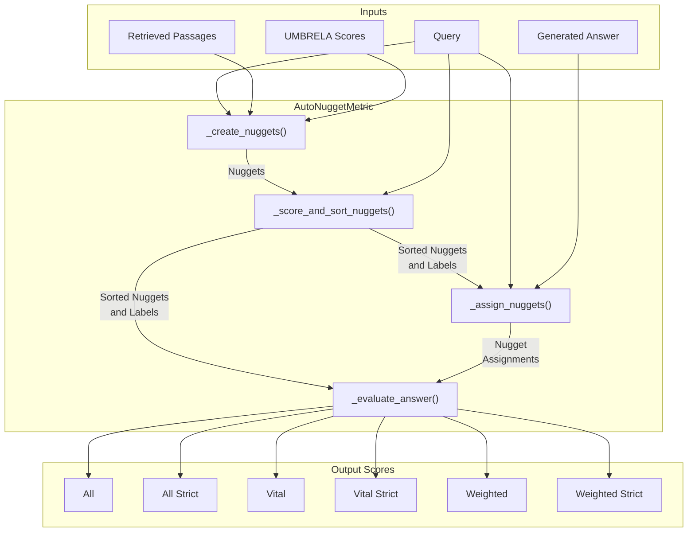
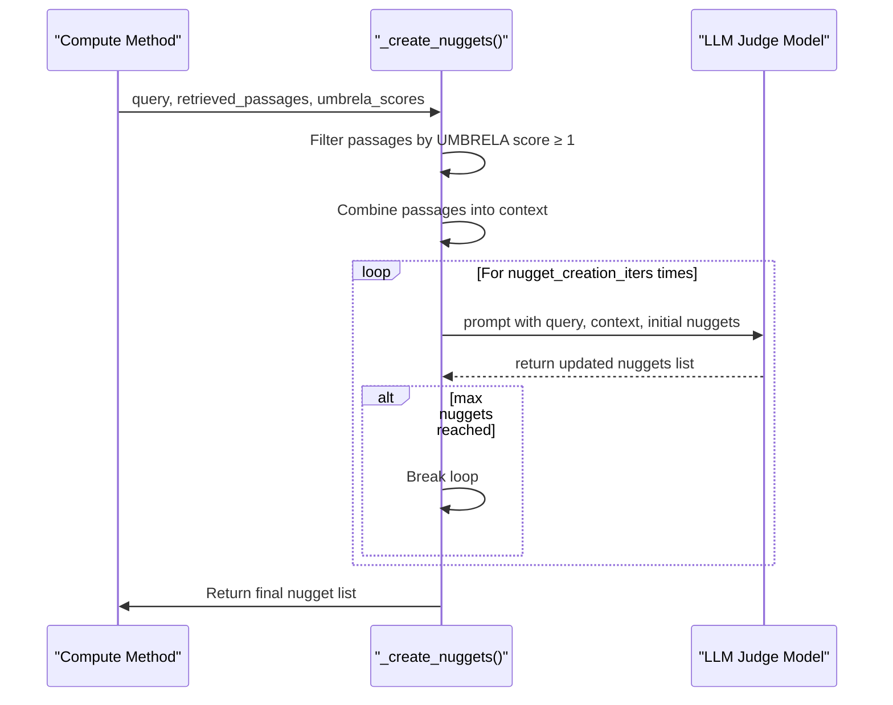
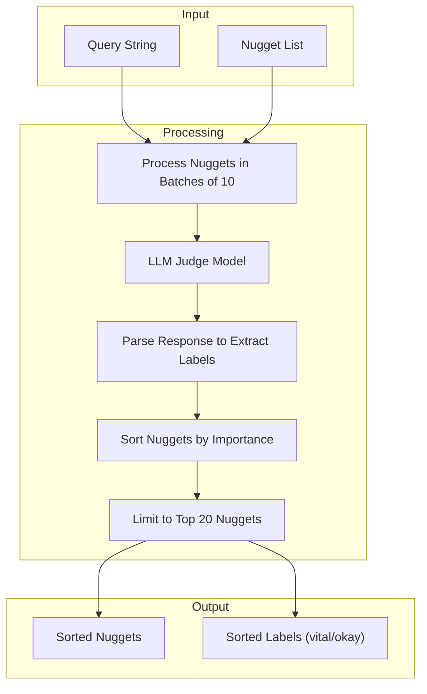
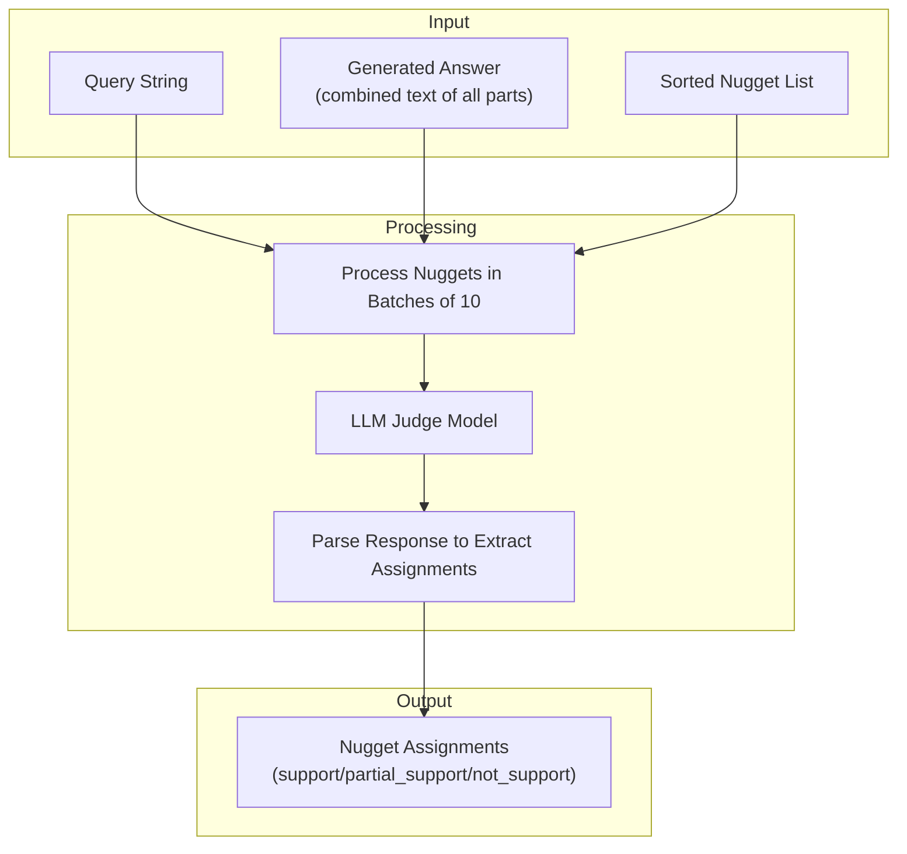
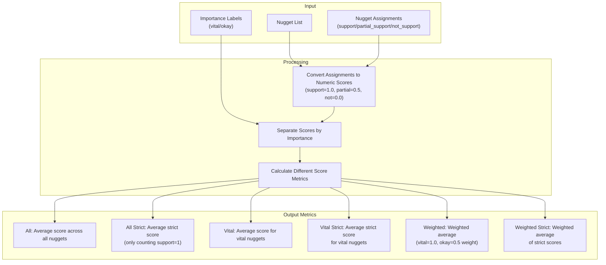

<!-- source: DeepWiki mcp.deepwiki.com · repo vectara/open-rag-eval · extra page AutoNugget Metric · fetched 2026-10-26 -->

# AutoNugget Metric

Relevant source files

The following files were used as context for generating this wiki page:

- [open_rag_eval/metrics/__init__.py](open_rag_eval/metrics/__init__.py)
- [open_rag_eval/metrics/autonugget_metric.py](open_rag_eval/metrics/autonugget_metric.py)
- [tests/test_no_answer_metric.py](tests/test_no_answer_metric.py)

The AutoNugget Metric is an evaluation metric for Retrieval-Augmented Generation (RAG) systems that assesses the quality of generated answers by breaking down information into atomic "nuggets" and measuring how well these nuggets are covered in the generated response. It implements the AutoNuggetizer evaluation approach from the TREC 2024 RAG Track and uses an LLM judge to perform its evaluations.

For information about other metrics in the open-rag-eval toolkit, see [UMBRELA and Citation Metrics](#3.5.1) and [No Answer Metric](#3.5.3).

## Core Concepts

The AutoNugget Metric operates on three fundamental concepts:

1. **Nuggets**: Small, atomic pieces of information (1-12 words) extracted from retrieved passages that address the user's query.

2. **Importance Classification**: Each nugget is classified as either:
   - **Vital**: Essential information that must be present in a good answer
   - **Okay**: Worthwhile information that contributes to the answer but is not essential

3. **Coverage Assessment**: The metric evaluates how well each nugget is covered in the generated answer:
   - **Support**: The nugget is fully captured in the answer
   - **Partial Support**: The nugget is partially captured
   - **Not Support**: The nugget is not captured at all

Sources: [open_rag_eval/metrics/autonugget_metric.py:37-40](), [open_rag_eval/metrics/autonugget_metric.py:14-35]()

## Workflow and Components

The AutoNugget Metric evaluation process consists of four main stages that transform retrieved passages into a comprehensive quality assessment.

**Diagram: AutoNugget Metric Workflow**

Sources: [open_rag_eval/metrics/autonugget_metric.py:116-150](6.31)

## Implementation Details

### 1. Nugget Creation

The first stage involves extracting information nuggets from the retrieved passages. The process uses an LLM to iteratively create concise information units based on the query and context.

**Diagram: Nugget Creation Process**

Key implementation details:
- Only passages with UMBRELA scores ≥ 1 are considered for nugget creation
- Maximum 30 nuggets are created through an iterative process
- Uses a structured prompt to guide the LLM in creating atomic information units

Sources: [open_rag_eval/metrics/autonugget_metric.py:152-201]()

### 2. Nugget Scoring and Sorting

The second stage evaluates the importance of each nugget and sorts them accordingly.

**Diagram: Nugget Scoring and Sorting Process**

Key implementation details:
- Processes nuggets in batches of 10 for efficient LLM usage
- Each nugget is classified as either "vital" or "okay"
- Nuggets are sorted with vital nuggets prioritized
- Only the top 20 nuggets are retained for further evaluation

Sources: [open_rag_eval/metrics/autonugget_metric.py:203-242]()

### 3. Nugget Assignment

The third stage evaluates how well each nugget is covered in the generated answer.

**Diagram: Nugget Assignment Process**

Key implementation details:
- Generated answer parts are combined into a single text
- Each nugget is evaluated for coverage in the generated answer
- Three possible assignment values:
  - "support" (score: 1.0): The nugget is fully covered
  - "partial_support" (score: 0.5): The nugget is partially covered
  - "not_support" (score: 0.0): The nugget is not covered

Sources: [open_rag_eval/metrics/autonugget_metric.py:244-286]()

### 4. Answer Evaluation

The final stage calculates various scores based on nugget coverage and importance.

**Diagram: Answer Evaluation Process**

Sources: [open_rag_eval/metrics/autonugget_metric.py:288-337]()

## Scoring Metrics and Interpretation

The AutoNugget Metric produces six distinct scores that provide different perspectives on answer quality:

| Metric | Description | Calculation | Use Case |
|--------|-------------|-------------|----------|
| All | Average coverage score across all nuggets | `sum(all_scores) / num_nuggets` | General quality assessment |
| All Strict | Average strict coverage (only full support counts) | `sum(all_strict_scores) / num_nuggets` | When partial coverage is insufficient |
| Vital | Average coverage score for vital nuggets only | `sum(vital_scores) / num_vital` | Focus on essential information |
| Vital Strict | Average strict coverage for vital nuggets | `sum(strict_vital_scores) / num_vital` | When essential info must be fully covered |
| Weighted | Coverage score weighted by importance | `(sum(vital_scores) + 0.5 * sum(okay_scores)) / (num_vital + 0.5 * num_okay)` | Balanced assessment prioritizing vital info |
| Weighted Strict | Strict coverage score weighted by importance | `(sum(strict_vital_scores) + 0.5 * sum(strict_okay_scores)) / (num_vital + 0.5 * num_okay)` | Strict assessment with importance weighting |

All scores range from 0 to 1, with higher values indicating better coverage of the information nuggets in the generated answer.

In addition to the numeric scores, the method returns:
- The complete list of nuggets extracted from the context
- The importance label ("vital" or "okay") for each nugget
- The coverage assignment ("support", "partial_support", or "not_support") for each nugget
- The numeric score value for each assignment

This detailed output allows for both quantitative evaluation and qualitative analysis of answer quality.

Sources: [open_rag_eval/metrics/autonugget_metric.py:288-337]()

## LLM Prompting Strategy

The AutoNugget Metric relies on three key prompts to guide the LLM judge:

1. **Nugget Creation Prompt**: Instructions for extracting atomic nuggets from context passages
   - Emphasizes conciseness (1-12 words per nugget)
   - Prioritizes more interesting information
   - Limits to information found only in the provided context

2. **Nugget Importance Prompt**: Guidelines for labeling nuggets as "vital" or "okay"
   - Vital nuggets are defined as concepts that must be present in a "good" answer
   - Okay nuggets contribute worthwhile information but are not essential

3. **Nugget Assignment Prompt**: Criteria for evaluating nugget coverage in the generated answer
   - Defines the three coverage levels (support, partial_support, not_support)
   - Special handling for "No information" cases

All prompts are designed to produce structured outputs that can be parsed into the appropriate data structures.

Sources: [open_rag_eval/metrics/autonugget_metric.py:43-104]()

## Integration with Other Metrics

The AutoNugget Metric works in conjunction with the UMBRELA metric, using UMBRELA scores to filter passages for nugget creation. This ensures that only relevant passages are considered when creating information nuggets.

In the broader evaluation pipeline, the AutoNugget Metric provides a complementary perspective to other metrics like Citation and Hallucination by focusing specifically on information coverage and completeness.

Sources: [open_rag_eval/metrics/autonugget_metric.py:116-125](), [open_rag_eval/metrics/__init__.py:1-10]()

---

