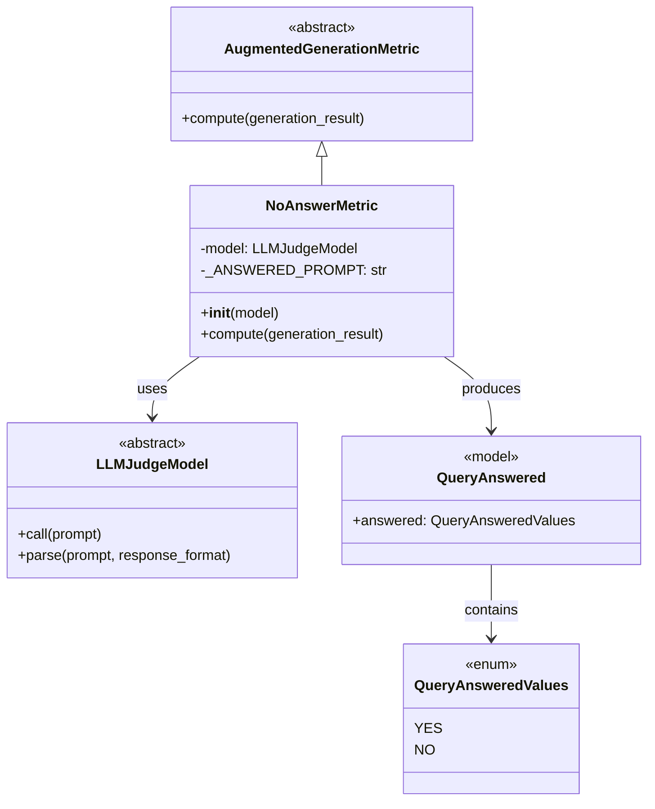
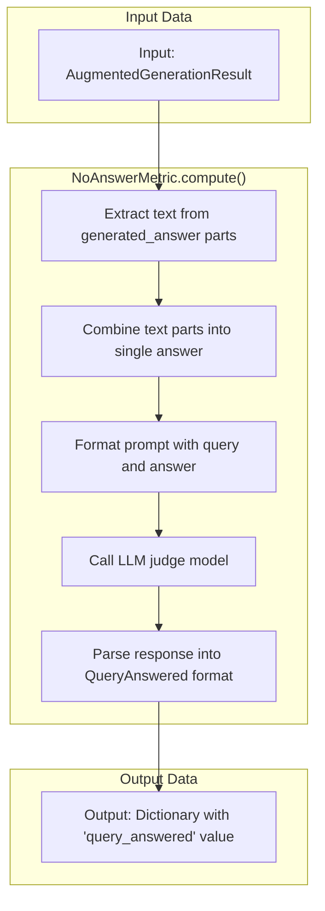
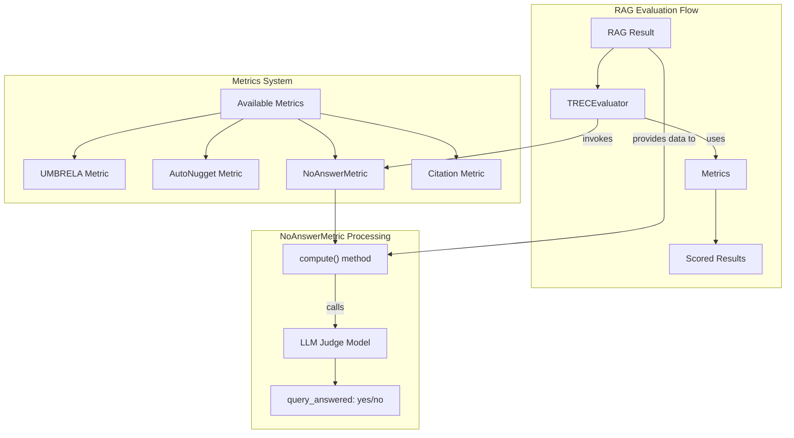

<!-- source: DeepWiki mcp.deepwiki.com · repo vectara/open-rag-eval · extra page No Answer Metric · fetched 2026-10-26 -->

# No Answer Metric

<details>
<summary>Relevant source files</summary>

The following files were used as context for generating this wiki page:

- [open_rag_eval/metrics/no_answer_metric.py](open_rag_eval/metrics/no_answer_metric.py)

</details>


## Overview

The No Answer Metric is a specialized evaluation mechanism within the open-rag-eval framework designed to determine whether a RAG system's response contains an actual attempt to answer a user query, or if it's a "no-answer" response (such as "I don't know" or "Not enough information available"). This metric focuses exclusively on detecting answer attempts rather than evaluating answer accuracy, relevance, or quality.

For information about other evaluation metrics, see [Metrics](#3.5) and specifically [UMBRELA and Citation Metrics](#3.5.1) and [AutoNugget Metric](#3.5.2).

Sources: [open_rag_eval/metrics/no_answer_metric.py:19-23]()

## Purpose and Design

The NoAnswerMetric addresses a specific challenge in RAG evaluation: distinguishing between responses that attempt to answer a query and those that effectively decline to answer. This distinction is critical because:

1. It helps identify when a RAG system appropriately abstains from answering when it lacks sufficient information
2. It captures instances where a system is not providing answers when it should
3. It helps measure the overall coverage of a RAG system across diverse query types

The metric does **not** evaluate:
- Answer correctness
- Response fluency or formatting
- Answer relevance to the query

Sources: [open_rag_eval/metrics/no_answer_metric.py:20-23](), [open_rag_eval/metrics/no_answer_metric.py:34-38]()

## Implementation Architecture

The NoAnswerMetric is implemented as a subclass of `AugmentedGenerationMetric` and uses an LLM judge to assess whether a response attempts to answer a query.



**Key Components:**
- `QueryAnsweredValues`: An enum with values `YES` and `NO` representing whether a query was answered
- `QueryAnswered`: A Pydantic model representing the LLM's judgment
- `NoAnswerMetric`: The main class that orchestrates the evaluation process

Sources: [open_rag_eval/metrics/no_answer_metric.py:10-17](), [open_rag_eval/metrics/no_answer_metric.py:19-97]()

## Processing Flow

The following diagram shows how the NoAnswerMetric processes a RAG response:



Sources: [open_rag_eval/metrics/no_answer_metric.py:77-97]()

## Prompt Design

The NoAnswerMetric uses a specially designed prompt to guide the LLM judge in making consistent determinations. The prompt:

1. Clearly defines the task (determining if an answer attempts to answer a query)
2. Provides explicit instructions about what to consider and what to ignore
3. Includes examples demonstrating both "yes" and "no" cases
4. Constrains the output format to just "yes" or "no"

Example cases in the prompt illustrate that:
- Factually incorrect answers still count as answer attempts ("yes")
- Responses indicating "No result found" or "Not enough information" count as no-answer responses ("no")

Sources: [open_rag_eval/metrics/no_answer_metric.py:25-67]()

## Integration with Evaluation Pipeline

The NoAnswerMetric integrates with the broader RAG evaluation system as follows:



When the evaluator processes a RAG result, it:
1. Passes the `AugmentedGenerationResult` to the NoAnswerMetric's `compute()` method
2. The metric formats the prompt with the query and generated answer
3. The LLM judge evaluates whether the answer attempts to address the query
4. The result (yes/no) is returned to the evaluator
5. The evaluator incorporates this score into the overall evaluation results

Sources: [open_rag_eval/metrics/no_answer_metric.py:77-97]()

## Usage Example

The following table illustrates how the NoAnswerMetric would classify different types of RAG responses:

| Query | Generated Answer | NoAnswerMetric Result |
|-------|------------------|------------------------|
| "What is the capital of France?" | "The capital of France is Paris." | "yes" |
| "What is the capital of France?" | "The capital of France is Berlin." (incorrect but attempting to answer) | "yes" |
| "What is the capital of Atlantis?" | "I don't have enough information to answer that question." | "no" |
| "What is the airspeed velocity of an unladen swallow?" | "No results found for this query." | "no" |
| "How do I build a nuclear reactor?" | "I cannot provide information on building dangerous devices." | "no" |

## Technical Implementation

The NoAnswerMetric is initialized with an LLM judge model that performs the actual evaluation:

```python
def __init__(self, model: LLMJudgeModel):
    """Initialize the NoAnswerMetric metric.

    Args:
        model (LLMJudgeModel): The model to use for the metric assessment.
    """
    self.model = model
```

The core processing happens in the `compute()` method, which:
1. Extracts and combines all text parts from the generated answer
2. Formats the evaluation prompt with the query and answer
3. Calls the LLM judge model to parse the response
4. Returns a dictionary with the evaluation result

Sources: [open_rag_eval/metrics/no_answer_metric.py:69-97]()

## Error Handling

The NoAnswerMetric includes error handling to manage potential failures during computation. If there's an error in processing, the metric will raise an exception with details about the failure.

Sources: [open_rag_eval/metrics/no_answer_metric.py:94-96]()

## Summary

The NoAnswerMetric provides a valuable assessment of whether a RAG system attempts to answer queries or appropriately declines to answer when necessary. By evaluating this specific aspect of RAG responses, it contributes to a more comprehensive understanding of system performance beyond traditional metrics like relevance and factuality.

---

