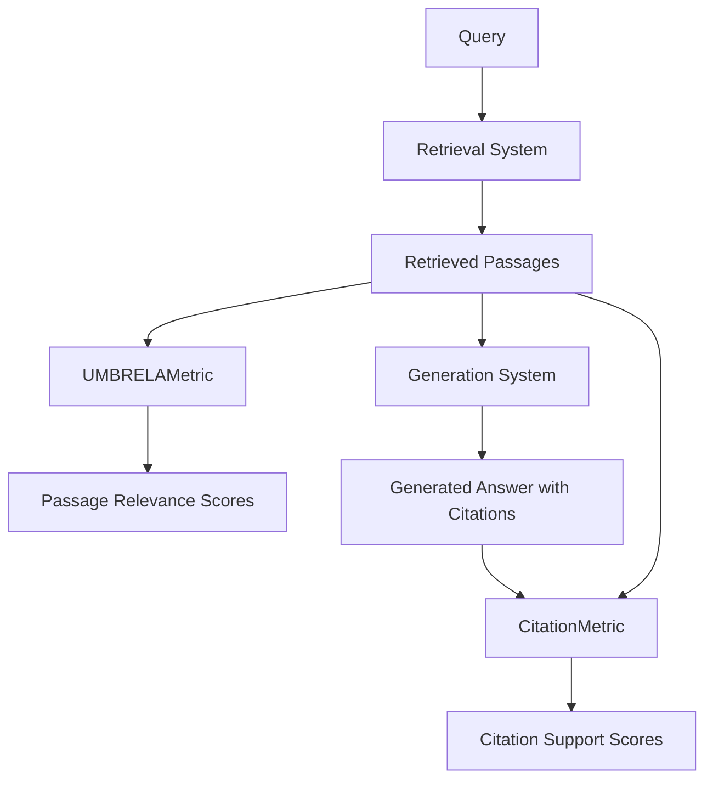
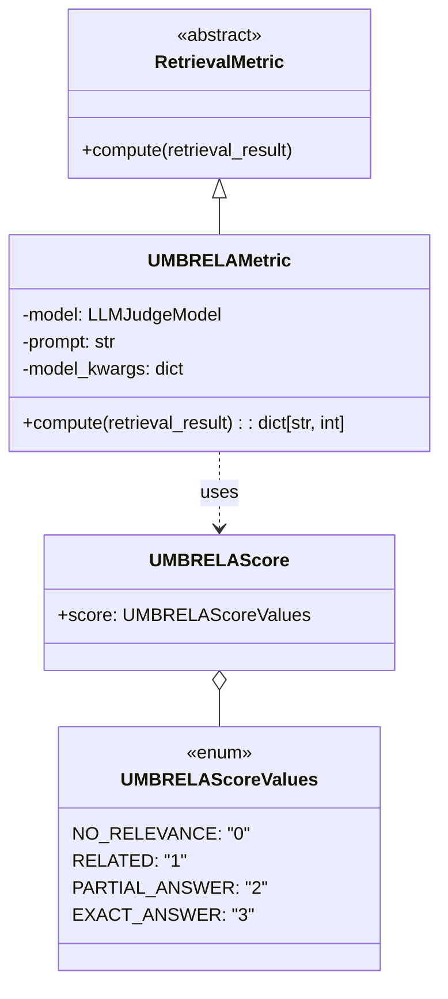
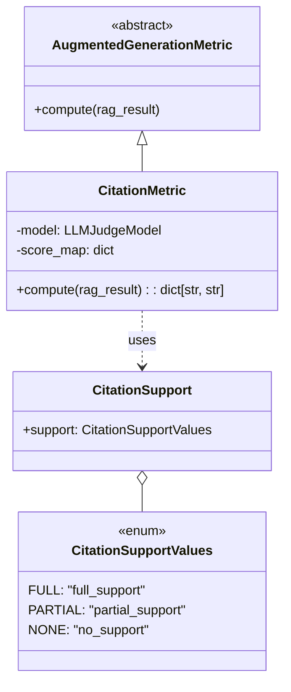
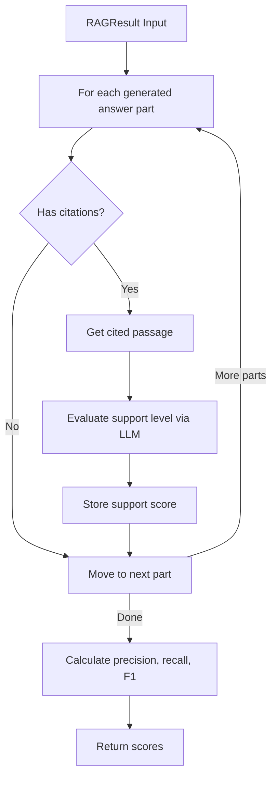
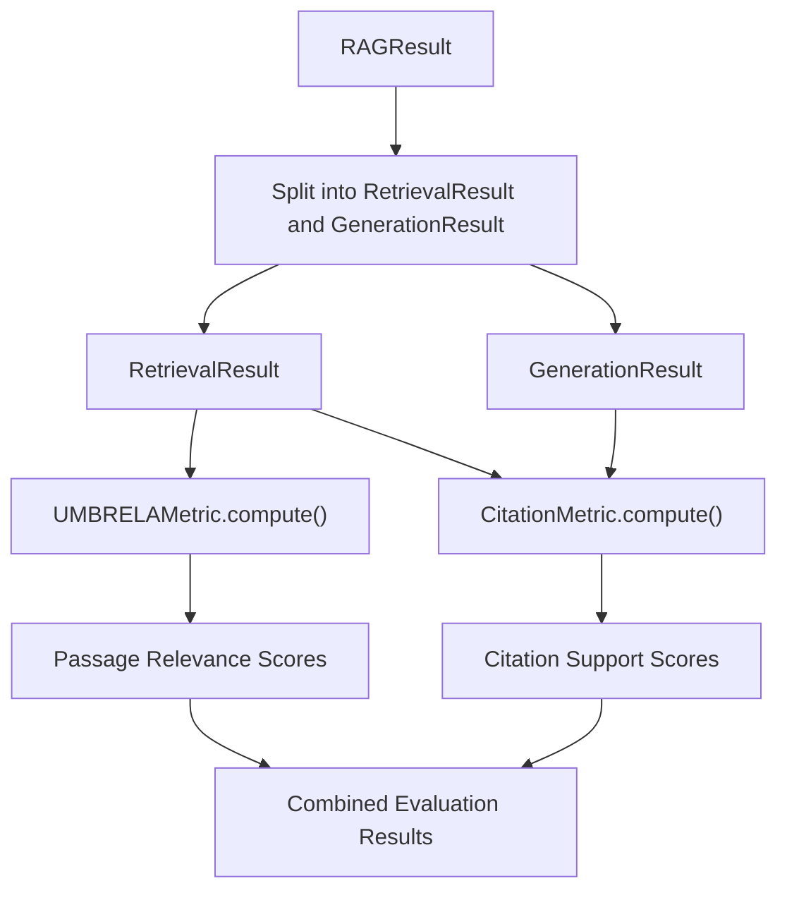

<!-- source: DeepWiki mcp.deepwiki.com · repo vectara/open-rag-eval · extra page UMBRELA and Citation Metrics · fetched 2026-10-26 -->

# UMBRELA and Citation Metrics

<details>
<summary>Relevant source files</summary>

The following files were used as context for generating this wiki page:

- [open_rag_eval/_version.py](open_rag_eval/_version.py)
- [open_rag_eval/metrics/citation_metric.py](open_rag_eval/metrics/citation_metric.py)
- [open_rag_eval/metrics/umbrela_metric.py](open_rag_eval/metrics/umbrela_metric.py)

</details>


This page documents two key evaluation metrics in the open-rag-eval framework: the UMBRELA metric for assessing retrieval relevance and the Citation metric for evaluating the factual support of generated answers. These metrics provide complementary evaluations of retrieval and generation quality in RAG systems.

## 1. Overview

Both metrics leverage LLM judges to assess different aspects of RAG performance:

- **UMBRELA (UMbrela is the (Open-Source Reproduction of the) Bing RELevance Assessor)**: Evaluates the relevance of retrieved passages to the query
- **Citation Metric**: Determines if generated answers are actually supported by the passages they cite



Sources: [open_rag_eval/metrics/umbrela_metric.py](), [open_rag_eval/metrics/citation_metric.py]()

## 2. UMBRELA Metric

The UMBRELA metric assesses how well a retrieved passage answers the original query on a scale from 0-3.

### 2.1 Scoring Scale

The UMBRELA scoring system provides a nuanced evaluation of retrieval relevance:

| Score | Label | Description |
|-------|-------|-------------|
| 0 | NO_RELEVANCE | Passage has nothing to do with the query |
| 1 | RELATED | Passage is related to the query but doesn't answer it |
| 2 | PARTIAL_ANSWER | Passage contains some answer for the query, but may be unclear or contain extraneous information |
| 3 | EXACT_ANSWER | Passage is dedicated to the query and contains the exact answer |

Sources: [open_rag_eval/metrics/umbrela_metric.py:9-13]()

### 2.2 Implementation

The UMBRELA metric is implemented in the `UMBRELAMetric` class:



Sources: [open_rag_eval/metrics/umbrela_metric.py:18-94]()

### 2.3 Evaluation Process

The UMBRELA evaluation process follows these steps:

1. For each retrieved passage in a `RetrievalResult`:
   - Construct a prompt using the query and passage
   - Send the prompt to the LLM judge model
   - Parse the response to extract a score value (0-3)
   - Map the score to the corresponding integer value
   - Store the score for the passage

The prompt instructs the LLM to:
1. Consider the underlying intent of the search
2. Measure how well the content matches a likely intent of the query
3. Measure the trustworthiness of the passage
4. Consider these aspects and determine a final score

Sources: [open_rag_eval/metrics/umbrela_metric.py:24-51](), [open_rag_eval/metrics/umbrela_metric.py:71-94]()

## 3. Citation Metric

The Citation metric evaluates whether generated answers are properly supported by the retrieved passages they claim to cite.

### 3.1 Support Levels

The Citation metric classifies the level of support for each statement-citation pair:

| Level | Value | Score | Description |
|-------|-------|-------|-------------|
| Full Support | full_support | 1.0 | All information in the statement is supported by the citation |
| Partial Support | partial_support | 0.5 | Some parts are supported, others are missing from the citation |
| No Support | no_support | 0.0 | The citation doesn't support any part of the statement |

Sources: [open_rag_eval/metrics/citation_metric.py:9-15](), [open_rag_eval/metrics/citation_metric.py:62-66]()

### 3.2 Implementation

The Citation metric is implemented in the `CitationMetric` class:



Sources: [open_rag_eval/metrics/citation_metric.py:17-109]()

### 3.3 Scoring Methodology

The Citation metric calculates three key scores:

1. **Weighted Precision**: The weighted proportion of citations that support their answer sentences.
   ```
   precision = sum(support_scores) / number_of_citations
   ```

2. **Weighted Recall**: The proportion of answer sentences that are correctly cited.
   ```
   recall = sum(support_scores) / total_answer_sentences
   ```

3. **F1 Score**: The harmonic mean of precision and recall.
   ```
   f1 = 2 * (precision * recall) / (precision + recall)
   ```

Sources: [open_rag_eval/metrics/citation_metric.py:96-107]()

### 3.4 Evaluation Process

The citation evaluation process follows these steps:



For each generated answer part with citations:
1. Get the corresponding cited passage
2. Generate a prompt asking the LLM to evaluate if the statement is supported by the citation
3. Parse the LLM response to determine the support level (full, partial, none)
4. Calculate aggregate metrics (precision, recall, F1) based on individual support scores

Sources: [open_rag_eval/metrics/citation_metric.py:68-109]()

## 4. Integration in the Evaluation Pipeline

Both metrics are used by the TRECEvaluator to provide a comprehensive assessment of RAG system performance:



The metrics work in complementary ways:
- UMBRELA focuses on the quality of retrieved information
- Citation metric focuses on how well the generated content uses the retrieved information

Together, they provide a more complete picture of RAG system performance across both retrieval and generation aspects.

Sources: [open_rag_eval/metrics/umbrela_metric.py](), [open_rag_eval/metrics/citation_metric.py]()

## 5. Usage Examples

To use these metrics in your evaluation pipeline, you need to:

1. Initialize an LLM judge model
2. Create instances of the metrics
3. Apply them to RAG results

Example for UMBRELA:
```python
# Initialize LLM judge (e.g., OpenAI model)
llm_judge = OpenAIModel(name="gpt-4o-mini", api_key="YOUR_API_KEY")

# Create UMBRELA metric instance
umbrela_metric = UMBRELAMetric(model=llm_judge)

# Apply to retrieval results
retrieval_result = RetrievalResult(query="...", retrieved_passages={...})
relevance_scores = umbrela_metric.compute(retrieval_result)
```

Example for Citation metric:
```python
# Initialize LLM judge (same as above)
llm_judge = OpenAIModel(name="gpt-4o-mini", api_key="YOUR_API_KEY")

# Create Citation metric instance
citation_metric = CitationMetric(model=llm_judge)

# Apply to RAG results
rag_result = RAGResult(retrieval_result=retrieval_result, generation_result=generation_result)
citation_scores = citation_metric.compute(rag_result)
```

Sources: [open_rag_eval/metrics/umbrela_metric.py:53-69](), [open_rag_eval/metrics/citation_metric.py:55-67]()

---

