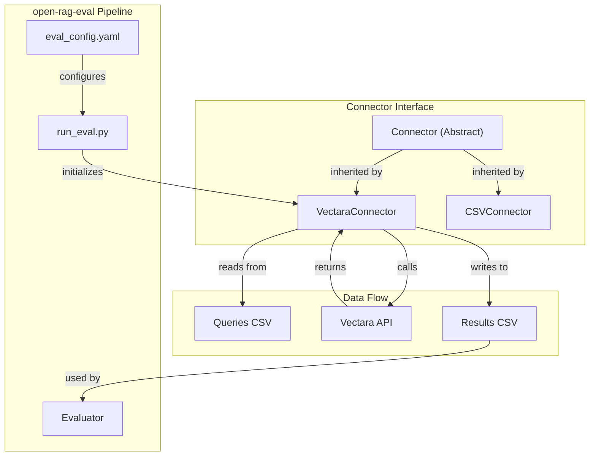
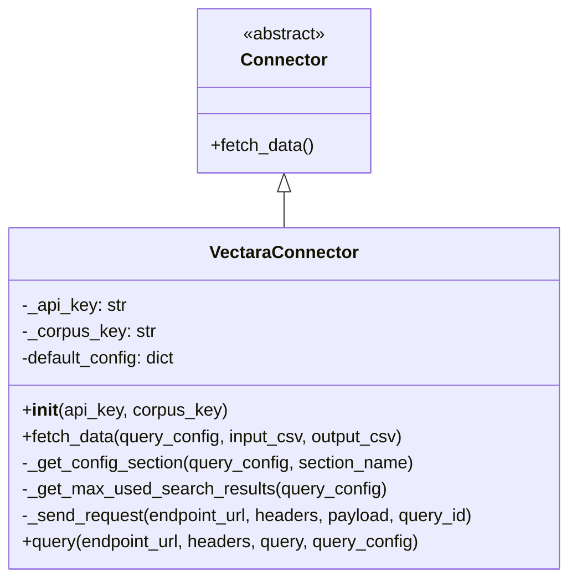
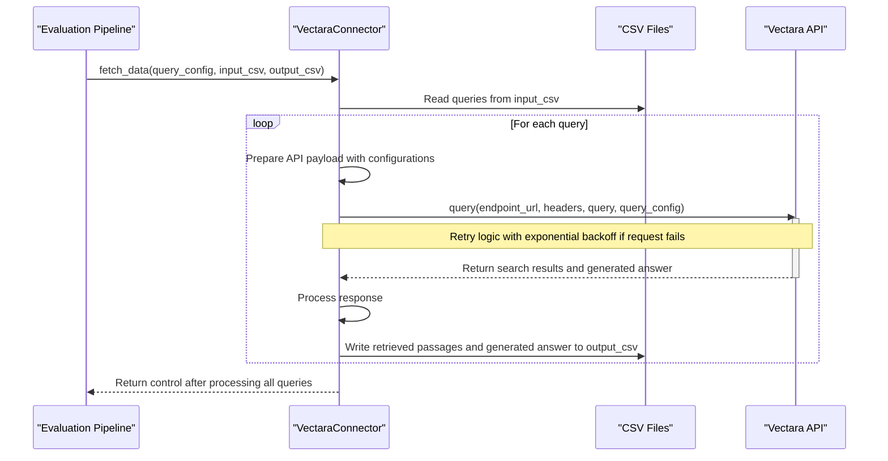

<!-- source: DeepWiki mcp.deepwiki.com · repo vectara/open-rag-eval · extra page Vectara Connector · fetched 2026-10-26 -->

# Vectara Connector

<details>
<summary>Relevant source files</summary>

The following files were used as context for generating this wiki page:

- [open_rag_eval/connectors/vectara_connector.py](open_rag_eval/connectors/vectara_connector.py)
- [tests/test_vectara_connector.py](tests/test_vectara_connector.py)
- [tests/test_vectara_connector_integration.py](tests/test_vectara_connector_integration.py)

</details>


The Vectara Connector is a specialized implementation of the abstract Connector interface designed to interact with the Vectara API for retrieving search results and generated answers. This component enables the open-rag-eval framework to evaluate RAG (Retrieval-Augmented Generation) systems powered by Vectara's search and generation capabilities.

For information about other connector types, see [Connectors](#3.3) and [CSV Connector](#3.3.2).

## 1. Architecture Overview

The VectaraConnector fits into the overall evaluation pipeline by providing a standardized interface for fetching RAG results from the Vectara platform. It handles authentication, query configuration, API communication, and result formatting.



Sources: [open_rag_eval/connectors/vectara_connector.py:40-42](), [open_rag_eval/connectors/vectara_connector.py:104-162]()

## 2. Class Structure

The VectaraConnector implements the abstract Connector interface, providing concrete implementations for fetching data from Vectara's API.



Sources: [open_rag_eval/connectors/vectara_connector.py:40-252]()

## 3. Initialization and Configuration

The VectaraConnector requires API credentials and maintains default configuration settings that can be overridden.

### 3.1 Constructor

```python
def __init__(self, api_key, corpus_key):
    self._api_key = api_key
    self._corpus_key = corpus_key
    self.default_config = { ... }
```

The constructor requires:
- `api_key`: Authentication key for the Vectara API
- `corpus_key`: The identifier for the specific corpus to query

Sources: [open_rag_eval/connectors/vectara_connector.py:41-80]()

### 3.2 Default Configuration

The connector maintains a comprehensive default configuration that covers:

| Configuration Section | Purpose | Key Settings |
|---|---|---|
| Search | Controls retrieval behavior | Limit, context configuration, reranker settings |
| Generation | Controls answer generation | Generation preset, max search results, citation style |
| Query Rewriting | Optional query preprocessing | Intelligent query rewriting flag |
| History | Session management | Save history flag |

The default maximum number of search results used for generation is defined as a constant:

```python
DEFAULT_MAX_USED_SEARCH_RESULTS = 5
```

Sources: [open_rag_eval/connectors/vectara_connector.py:17](), [open_rag_eval/connectors/vectara_connector.py:45-80]()

## 4. Core Functionality

### 4.1 Data Flow Process

The VectaraConnector's main function is to fetch data from Vectara and prepare it for evaluation. The sequence below illustrates this process:



Sources: [open_rag_eval/connectors/vectara_connector.py:104-162](), [open_rag_eval/connectors/vectara_connector.py:201-252]()

### 4.2 Main Method: fetch_data

The `fetch_data` method is the primary interface for retrieving data from Vectara:

```python
def fetch_data(self, query_config=None, input_csv="queries.csv", output_csv="results.csv")
```

Parameters:
- `query_config`: Optional configuration dictionary that overrides default settings
- `input_csv`: Path to the CSV file containing queries to process
- `output_csv`: Path where the results will be written

The method:
1. Validates API credentials
2. Reads queries from the input CSV
3. Processes each query through the Vectara API
4. Writes search results and generated answers to the output CSV

Sources: [open_rag_eval/connectors/vectara_connector.py:104-162]()

## 5. API Communication

### 5.1 Query Method

The `query` method prepares and sends requests to the Vectara API:

```python
def query(self, endpoint_url, headers, query, query_config)
```

This method:
1. Extracts search and generation configurations
2. Handles prompt template loading if specified
3. Prepares the API payload
4. Sends the request using the retry-enabled `_send_request` method

Sources: [open_rag_eval/connectors/vectara_connector.py:201-252]()

### 5.2 Request Handling with Retry Logic

The connector implements sophisticated retry logic for API communication to handle transient failures:

```python
@retry(
    stop=stop_after_attempt(5),
    wait=wait_exponential(multiplier=1, min=1, max=60),
    retry=retry_if_exception_type((requests.exceptions.RequestException, Exception)),
    before_sleep=tqdm_progress_callback,
    after=tqdm_progress_callback
)
def _send_request(self, endpoint_url, headers, payload, query_id)
```

Key features of the retry mechanism:
- Maximum of 5 retry attempts
- Exponential backoff starting at 1 second, capped at 60 seconds
- Retries on specific exception types
- Visual progress feedback via tqdm progress bars
- Detailed error logging

Sources: [open_rag_eval/connectors/vectara_connector.py:164-199](), [open_rag_eval/connectors/vectara_connector.py:20-38]()

## 6. Configuration Management

### 6.1 Helper Methods

The connector uses helper methods to manage configuration:

```python
def _get_config_section(self, query_config, section_name)
```
Extracts a specific configuration section (search, generation) from the provided query configuration or falls back to defaults.

```python
def _get_max_used_search_results(self, query_config)
```
Determines how many search results should be used for generation.

Sources: [open_rag_eval/connectors/vectara_connector.py:82-102]()

## 7. Output Format

The connector produces a CSV file with the following structure:

| Column | Description |
|---|---|
| query_id | Unique identifier for the query |
| query | The query text |
| passage_id | Numeric identifier for the passage, formatted as "[n]" |
| passage | Text of the retrieved passage |
| generated_answer | The RAG-generated answer (only in first row for each query) |

The output format follows these rules:
- The generated answer is only included in the first row for each query
- Only passages used for generation (up to max_used_search_results) are included
- Passage IDs are sequential numbers in brackets (e.g., "[1]", "[2]")

Sources: [open_rag_eval/connectors/vectara_connector.py:132-162](), [tests/test_vectara_connector.py:56-76]()

## 8. Usage Example

To use the VectaraConnector in an evaluation pipeline:

1. Configure API credentials in the eval_config.yaml file:
```yaml
connector:
  type: VectaraConnector
  options:
    api_key: YOUR_VECTARA_API_KEY
    corpus_key: YOUR_CORPUS_KEY
    input_queries: queries.csv
    generated_answers: vectara_results.csv
    query_config:
      search:
        limit: 5
      generation:
        generation_preset_name: "mockingbird-2.0"
        max_used_search_results: 5
```

2. The evaluation pipeline will initialize the connector and call its fetch_data method.

Sources: [tests/test_vectara_connector.py:41-76]()

## 9. Error Handling

The connector implements several error handling mechanisms:
- Validation of required API credentials
- Skipping malformed query rows in the input CSV
- Try/except blocks to continue processing despite failures with individual queries
- Detailed error logging
- Automatic retries with progress visualization

Sources: [open_rag_eval/connectors/vectara_connector.py:105-108](), [open_rag_eval/connectors/vectara_connector.py:141-144](), [open_rag_eval/connectors/vectara_connector.py:164-199]()

---

