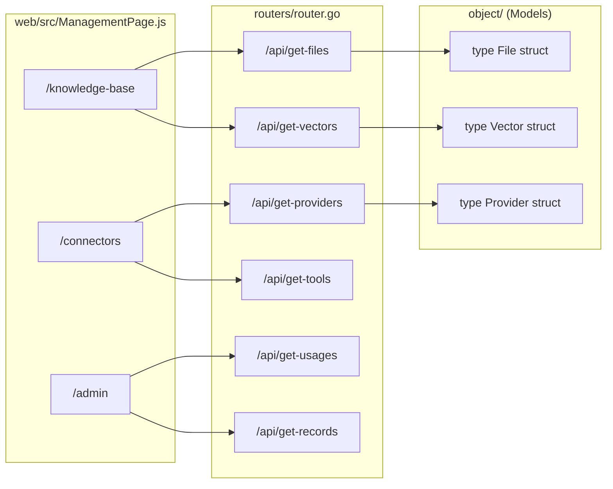

<!-- source: DeepWiki mcp.deepwiki.com · repo the-open-agent/openagent · page 1 OpenAgent Overview · fetched 2026-10-26 -->

# OpenAgent Overview

<details>
<summary>Relevant source files</summary>

The following files were used as context for generating this wiki page:

- [CONTRIBUTING.md](CONTRIBUTING.md)
- [README.md](README.md)
- [README_zh.md](README_zh.md)
- [conf/app.conf](conf/app.conf)
- [conf/conf.go](conf/conf.go)
- [docker-compose.yml](docker-compose.yml)
- [main.go](main.go)
- [object/adapter.go](object/adapter.go)
- [object/init.go](object/init.go)
- [routers/router.go](routers/router.go)
- [routers/static_filter.go](routers/static_filter.go)
- [scripts/install.ps1](scripts/install.ps1)
- [scripts/install.sh](scripts/install.sh)
- [util/browser.go](util/browser.go)
- [web/src/App.js](web/src/App.js)
- [web/src/Conf.js](web/src/Conf.js)
- [web/src/ManagementPage.js](web/src/ManagementPage.js)
- [web/src/component/nav-item-tree/NavItemTree.js](web/src/component/nav-item-tree/NavItemTree.js)

</details>


OpenAgent is an open-source, self-hostable personal AI assistant platform that integrates Large Language Models (LLMs), Retrieval-Augmented Generation (RAG), and autonomous agent loops [README.md:33-35](). It provides a full-stack solution for building and deploying AI agents capable of web browsing, code execution, and interacting with various document formats.

The system is designed to be multi-tenant and supports over 30 model providers, offering a comprehensive admin dashboard for monitoring usage, activity, and tool orchestration [README.md:91-101]().

## Core Capabilities

OpenAgent bridges the gap between raw LLM capabilities and practical utility through several key subsystems:

*   **Agent Loops:** Supports autonomous behaviors including `browser-use` for navigating websites, shell execution, and office automation [README.md:103-113]().
*   **Knowledge Base (RAG):** Automatically chunks, embeds, and indexes uploaded documents (PDF, Word, Excel, etc.) for semantic retrieval during chat [README.md:116-124]().
*   **Multi-Provider Integration:** Pluggable architecture for LLMs (OpenAI, Claude, Gemini, DeepSeek, etc.) and embedding models [README.md:91-99]().
*   **Infrastructure Management:** Built-in tools for managing machines, containers, and Kubernetes applications [web/src/ManagementPage.js:108-118]().

For deeper exploration of specific features, refer to the following child pages:
*   [Getting Started & Configuration](#1.1) — Installation, Beego `app.conf` settings, and startup sequence.
*   [System Architecture](#1.2) — MVC structure, XORM persistence, and the request filter pipeline.

## High-Level Architecture

OpenAgent follows a decoupled architecture with a Go-based backend and a React-based frontend. The backend utilizes the **Beego** framework for routing and middleware [main.go:27](), while **XORM** handles database persistence with support for MySQL, PostgreSQL, and SQLite [object/adapter.go:29-35]().

### Conceptual System Flow
The following diagram illustrates how user interactions flow through the system components, mapping high-level concepts to specific code entities.

**OpenAgent Component Interaction**
```mermaid
graph TD
    User["User Interface (React)"] -- "REST API / SSE" --> BeegoRouter["routers.initAPI()"]
    
    subgraph Backend ["Go Backend (Beego)"]
        BeegoRouter --> Filters["routers.AuthzFilter / routers.AutoSigninFilter"]
        Filters --> Controllers["controllers.ApiController"]
        Controllers --> Logic["object Package (Business Logic)"]
        Logic --> ProviderLayer["object.GetDefaultModelProvider()"]
    end

    subgraph Persistence ["Data Layer"]
        Logic --> XORM["object.Adapter (XORM)"]
        XORM --> DB[("MySQL / SQLite / Postgres")]
    end

    subgraph External ["External Services"]
        ProviderLayer --> LLM["LLM Providers (OpenAI, Claude, etc.)"]
        Logic --> Casdoor["Casdoor (Auth & SSO)"]
    end

    [web/src/App.js:58-63]() --> BeegoRouter
    [routers/router.go:35-41]() --> Filters
    [object/adapter.go:194-199]() --> XORM
```
Sources: [web/src/App.js:58-63](), [routers/router.go:35-41](), [object/adapter.go:194-199](), [main.go:66-76]()

## Major Subsystems Relation

OpenAgent organizes its capabilities into several logical groups, which are reflected in the `ManagementPage` sidebar navigation logic [web/src/ManagementPage.js:108-118]().

| Subsystem | Primary Code Responsibility | Key Components |
| :--- | :--- | :--- |
| **Identity** | Authentication and RBAC | `AuthzFilter`, `AutoSigninFilter`, Casdoor SDK [web/src/App.js:62]() |
| **Connectors** | External AI and Tool APIs | `ProviderListPage`, `ToolListPage`, `ServerListPage` (MCP) |
| **Knowledge Base** | RAG and Vector Search | `FileListPage`, `VectorListPage`, `RefreshStoreVectors` |
| **Admin** | System Monitoring | `UsagePage`, `RecordListPage`, `SystemInfo` |
| **Multimedia** | Content Processing | `TaskListPage`, `ScaleListPage`, `FormListPage` |

### Code-to-Navigation Mapping
The frontend navigation structure directly corresponds to backend API namespaces and object models defined in the router.

**Navigation to Entity Mapping**

Sources: [web/src/ManagementPage.js:108-118](), [routers/router.go:72-121](), [web/src/App.js:107-158]()

## Initialization Sequence

When the application starts via `main.go`, it performs a specific sequence of initializations to ensure the environment is ready:

1.  **Flag & Adapter Setup:** Parses CLI flags and initializes the database adapter (falling back to SQLite if MySQL is unavailable) [main.go:46-48](), [object/adapter.go:79-106]().
2.  **Database Initialization:** Seeds built-in providers, stores, and tools via `object.InitDb()` [object/init.go:29-43]().
3.  **Utility Initialization:** Prepares IP databases and document parsers [main.go:57-59]().
4.  **Background Tasks:** Starts cleanup routines for chats and transaction retry loops [main.go:60-63]().
5.  **Middleware Injection:** Sets up the Beego filter pipeline for security and monitoring [main.go:66-76]().

For detailed installation and configuration steps, see [Getting Started & Configuration](#1.1).

Sources: [main.go:40-64](), [object/adapter.go:138-152](), [object/init.go:29-43]()

---

