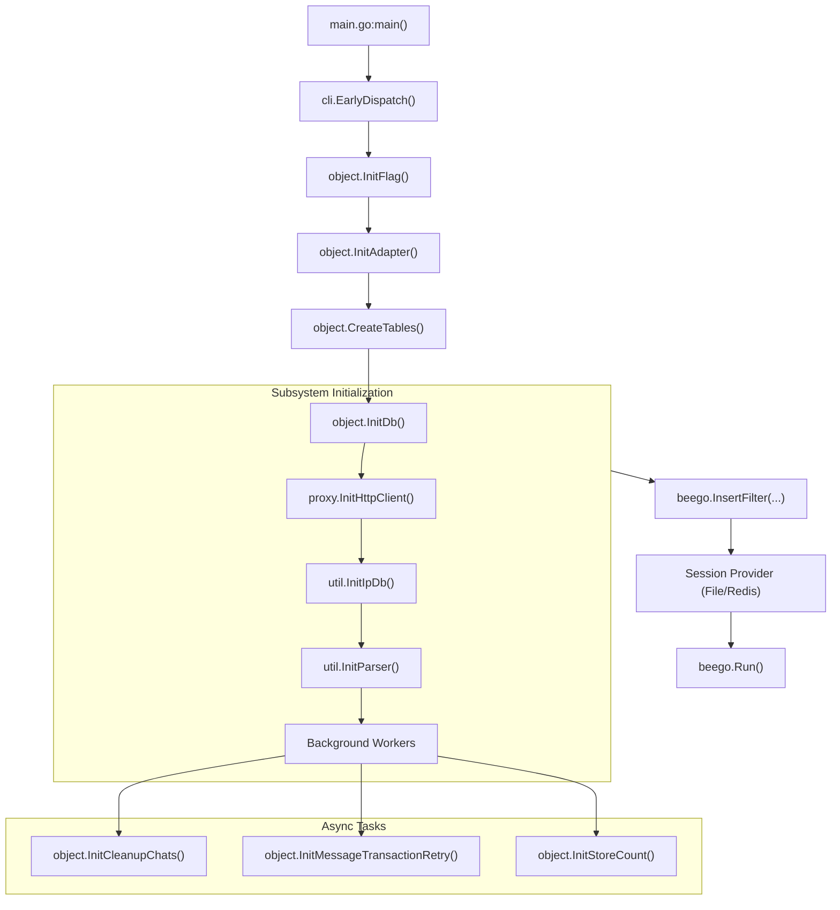
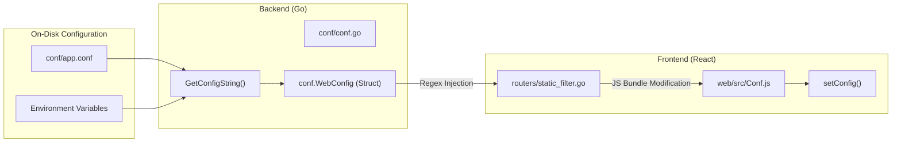

<!-- source: DeepWiki mcp.deepwiki.com · repo the-open-agent/openagent · page 1.1 Getting Started & Configuration · fetched 2026-10-26 -->

# Getting Started & Configuration

Relevant source files

The following files were used as context for generating this wiki page:

- [.github/workflows/build.yml](.github/workflows/build.yml)
- [.gitignore](.gitignore)
- [.goreleaser.yaml](.goreleaser.yaml)
- [CONTRIBUTING.md](CONTRIBUTING.md)
- [Dockerfile](Dockerfile)
- [README.md](README.md)
- [README_zh.md](README_zh.md)
- [conf/app.conf](conf/app.conf)
- [conf/conf.go](conf/conf.go)
- [docker-compose.yml](docker-compose.yml)
- [docker-entrypoint.sh](docker-entrypoint.sh)
- [embed.go](embed.go)
- [embedsupport/setup.go](embedsupport/setup.go)
- [internal/cli/cli.go](internal/cli/cli.go)
- [internal/cli/version.go](internal/cli/version.go)
- [main.go](main.go)
- [object/init.go](object/init.go)
- [routers/static_filter.go](routers/static_filter.go)
- [scripts/install.ps1](scripts/install.ps1)
- [scripts/install.sh](scripts/install.sh)
- [util/browser.go](util/browser.go)
- [util/launch_detect_unix.go](util/launch_detect_unix.go)
- [util/launch_detect_windows.go](util/launch_detect_windows.go)
- [web/src/Conf.js](web/src/Conf.js)

OpenAgent is a full-stack AI assistant platform built on the Beego framework (Go) and React. This page provides technical details on the installation process, the configuration schema across backend and frontend, and the initialization sequence that occurs when the server starts.

## Installation & Deployment

OpenAgent supports multiple deployment modes, ranging from pre-built binaries to containerized "all-in-one" environments.

### Binary Installation
Automated scripts are provided to fetch the latest release, install it to a local directory, and update the system `PATH`.
*   **macOS / Linux**: Uses `curl` to pipe `install.sh` to bash [README.md:55-58](). It installs to `$HOME/.local/share/openagent` by default [scripts/install.sh:14]().
*   **Windows**: Uses `PowerShell` to invoke `install.ps1` [README.md:60-62](). It installs to `$env:LOCALAPPDATA\openagent` by default [scripts/install.ps1:13]().

### Docker Setup
The project provides two primary Docker targets defined in the `Dockerfile`:
1.  **standard**: A lightweight Alpine-based image containing the compiled Go binary and the React build artifacts [Dockerfile:24-55]().
2.  **allinone**: A Debian-based image that includes a local MariaDB server, allowing the system to run without an external database dependency [Dockerfile:66-86]().

### Build Pipeline
GitHub Actions are used to automate tests, frontend builds via `yarn`, and backend builds using `go build` [.github/workflows/build.yml:14-70](). Final releases are handled by `GoReleaser`, which applies `UPX` compression to binaries for supported platforms [.goreleaser.yaml:42-52]().

**Sources:** [README.md:51-85](), [Dockerfile:1-86](), [scripts/install.sh:1-110](), [.github/workflows/build.yml:1-170](), [.goreleaser.yaml:1-53]()

---

## Configuration Management

Configuration is handled through a tiered system: Environment Variables > `app.conf` > Default Hardcoded Values.

### Backend: app.conf & Environment Variables
The file `conf/app.conf` contains the primary settings for the Beego application. The `conf` package provides helper functions like `GetConfigString(key)` which check `os.LookupEnv(key)` before falling back to the config file [conf/conf.go:78-119]().

| Key | Description | Default |
| :--- | :--- | :--- |
| `httpport` | The port the server listens on | `14000` [conf/app.conf:2]() |
| `driverName` | Database driver (e.g., `mysql`) | `mysql` [conf/app.conf:4]() |
| `dataSourceName` | Connection string for the database | `root:123456@tcp(localhost:3306)/` [conf/app.conf:5]() |
| `issuer` | URL for the Casdoor authentication server | - [conf/app.conf:9]() |
| `clientId` | Casdoor Application Client ID | - [conf/app.conf:10]() |
| `redisEndpoint` | Optional Redis URL for session storage | - [conf/app.conf:7]() |
| `isDemoMode` | Enables read-only mode for public demos | `false` [conf/app.conf:8]() |

**Sources:** [conf/app.conf:1-16](), [conf/conf.go:78-160]()

### Frontend: WebConfig Injection
The frontend configuration is defined in `web/src/Conf.js`. Instead of hardcoding these values into the JS bundle, the backend dynamically injects them. The `routers.StaticFilter` intercepts requests for the main JS bundle and uses regex to replace placeholder strings with values from `app.conf` (e.g., `issuer`, `clientId`) [routers/static_filter.go:168-179]().

**Sources:** [web/src/Conf.js:15-51](), [routers/static_filter.go:148-182](), [conf/conf.go:200-223]()

---

## Startup Initialization Sequence

The `main.go` file orchestrates the startup of the OpenAgent ecosystem. It initializes database connections, starts background workers, and configures the Beego middleware pipeline.

### Initialization Flow
The sequence follows a strict order to ensure dependencies (like the database) are available before background tasks start.

Title: Startup Initialization Sequence in main.go

**Sources:** [main.go:40-141](), [object/init.go:29-43]()

### Middleware Pipeline (Filters)
OpenAgent uses Beego filters to handle cross-cutting concerns for every request.

| Filter Function | Purpose | File Reference |
| :--- | :--- | :--- |
| `routers.CorsFilter` | Handles Cross-Origin Resource Sharing | [main.go:66]() |
| `routers.AutoSigninFilter` | Manages automatic authentication via cookies/tokens | [main.go:70]() |
| `routers.StaticFilter` | Serves React frontend and injects runtime config | [main.go:71]() |
| `routers.AuthzFilter` | Enforces Role-Based Access Control (RBAC) | [main.go:72]() |
| `routers.PrometheusFilter` | Collects metrics for observability | [main.go:73]() |
| `routers.RecordMessage` | Logs API interactions for the audit trail | [main.go:74]() |

**Sources:** [main.go:65-76]()

---

## Configuration Data Flow

The following diagram bridges the gap between the configuration files on disk and the runtime objects used by the system.

Title: Configuration Mapping: File to Runtime Entity

**Sources:** [conf/conf.go:200-223](), [routers/static_filter.go:168-179](), [web/src/Conf.js:29-51]()

## Built-in Resource Initialization
Upon the first run, `object.InitDb()` triggers a series of functions to populate the system with default providers, stores, and tools.

1.  **Site Sync**: Synchronizes site settings and refreshes the provider adapter [object/init.go:32-36]().
2.  **Providers**: Initializes default Model, Embedding, TTS, STT, and Image providers [object/init.go:37]().
3.  **Store**: Creates a `store-built-in` if no global stores exist, linking it to the default providers [object/init.go:38, 87-152]().
4.  **Skills & Tools**: Loads skill definitions from folders and initializes built-in tools [object/init.go:39-40]().

**Sources:** [object/init.go:29-43](), [object/init.go:87-152]()

---

