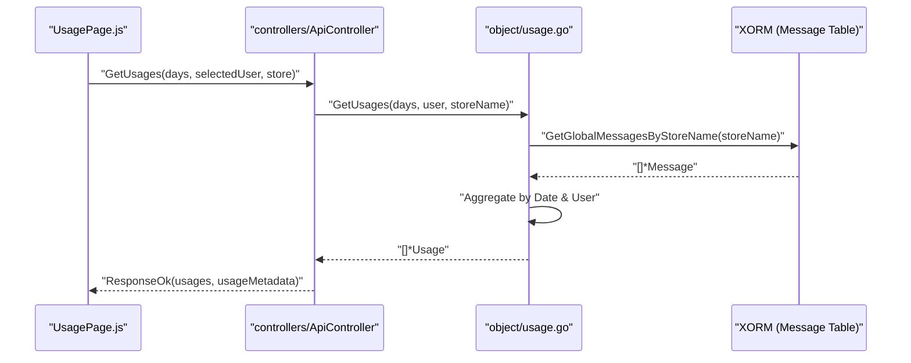
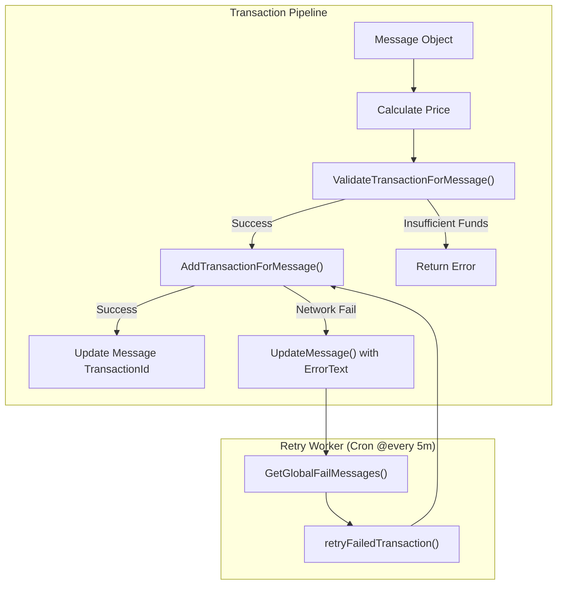

<!-- source: DeepWiki mcp.deepwiki.com · repo the-open-agent/openagent · page 10.1 Usage Analytics & Billing · fetched 2026-10-26 -->

# Usage Analytics & Billing

Relevant source files

The following files were used as context for generating this wiki page:

- [controllers/usage.go](controllers/usage.go)
- [go.mod](go.mod)
- [go.sum](go.sum)
- [model/provider.go](model/provider.go)
- [object/transaction.go](object/transaction.go)
- [object/usage.go](object/usage.go)
- [object/usage_range.go](object/usage_range.go)
- [object/usage_test.go](object/usage_test.go)
- [object/util.go](object/util.go)
- [web/src/UsagePage.js](web/src/UsagePage.js)
- [web/src/UsageTable.js](web/src/UsageTable.js)
- [web/src/backend/UsageBackend.js](web/src/backend/UsageBackend.js)

Usage Analytics and Billing in OpenAgent provides a comprehensive framework for tracking AI consumption, calculating costs, and managing financial transactions via Casdoor integration. It includes a frontend dashboard for visual analytics, a backend aggregation engine, and a resilient transaction pipeline with automated retry logic.

## Usage Data Model

The system aggregates data from `Message` objects into `Usage` and `UserUsage` structures for reporting. These models track distinct users, chats, message counts, token consumption, and calculated pricing.

| Struct | Description | Key Fields |
| :--- | :--- | :--- |
| `Usage` | Time-series aggregation of platform usage. | `Date`, `UserCount`, `ChatCount`, `MessageCount`, `TokenCount`, `Price`, `Currency` |
| `UsageMetadata` | Branding info retrieved from Casdoor. | `Organization`, `Application` |
| `UserUsage` | Per-user consumption breakdown. | `User`, `Chats`, `MessageCount`, `TokenCount`, `Price` |

**Sources:** [object/usage.go:27-40](), [object/usage.go:42-48]()

## Usage Analytics Dashboard

The `UsagePage.js` component provides a visual interface for administrators and users to monitor consumption. It leverages ECharts for data visualization and supports various time granularities.

### Visualization Components
*   **Statistic Row:** Displays high-level totals for Users, Chats, Messages, Tokens, and Total Price [web/src/UsagePage.js:254-283]().
*   **Usage Charts:** Time-series line/bar charts for messages and tokens, supporting ranges: `Hour`, `Day`, `Week`, `Month` [web/src/UsagePage.js:73-85](), [web/src/UsagePage.js:330-360]().
*   **Provider Distribution:** A pie chart showing the distribution of usage across different AI model providers, fetched via `getUsageProviders` [web/src/UsagePage.js:176-216](), [controllers/usage.go:129-145]().
*   **Activity Heatmap:** A calendar heatmap visualizing daily message activity density [web/src/UsagePage.js:218-249](), [controllers/usage.go:147-163]().
*   **Usage Table:** A detailed tabular view of consumption per user, implemented in `UsageTable.js`. Administrators can see `tokenCount` and `price`, while regular users see a simplified view [web/src/UsageTable.js:21-82](), [web/src/UsagePage.js:433-440]().

### Data Flow: Analytics Fetching
The frontend interacts with `UsageBackend.js` to retrieve aggregated data from the `ApiController`.

**Sources:** [web/src/UsagePage.js:57-71](), [controllers/usage.go:30-53](), [object/usage.go:50-131](), [web/src/backend/UsageBackend.js:17-29]()

## Billing & Transaction Pipeline

OpenAgent integrates with **Casdoor** to handle financial transactions. When a message is generated, the system calculates the price based on token usage and attempts to deduct the amount from the user's Casdoor balance.

### Transaction Logic
1.  **Validation:** Before processing, `ValidateTransactionForMessage` performs a "dry run" against the Casdoor API via `auth.AddTransactionWithDryRun` to check if the user has sufficient balance [object/transaction.go:59-84]().
2.  **Creation:** `AddTransactionForMessage` constructs a `auth.Transaction` object using `createTransactionFromMessage`. If the user is anonymous (checked via `util.IsAnonymousUserByUsername`), the transaction is tagged as "Organization" [object/transaction.go:32-55](), [object/transaction.go:88-117]().
3.  **Persistence:** Upon success, the `TransactionId` is stored in the `Message` record [object/transaction.go:114]().

### Failed Transaction Retry Logic
To ensure billing consistency despite network issues or Casdoor downtime, OpenAgent implements a background retry mechanism using a cron job.

*   **Initialization:** `InitMessageTransactionRetry` starts a cron job using `github.com/robfig/cron/v3` that runs every 5 minutes (`@every 5m`) [object/transaction.go:154-163]().
*   **Process:** The `retryFailedTransaction` function identifies messages where `ErrorText` starts with "failed to add transaction" and re-attempts the Casdoor `AddTransaction` call [object/transaction.go:119-145]().

### Transaction Pipeline Diagram

**Sources:** [object/transaction.go:32-55](), [object/transaction.go:59-84](), [object/transaction.go:88-117](), [object/transaction.go:119-145](), [object/transaction.go:154-163]()

## Key Functions & Classes Reference

| Entity | Location | Purpose |
| :--- | :--- | :--- |
| `UsagePage` | `web/src/UsagePage.js` | Main React component for the analytics dashboard. |
| `UsageTable` | `web/src/UsageTable.js` | Sub-component for rendering per-user usage stats. |
| `GetUsages` | `object/usage.go` | Aggregates message data into daily usage stats. |
| `GetRangeUsages` | `object/usage_range.go` | Aggregates stats by Hour, Day, Week, or Month. |
| `AddTransactionForMessage` | `object/transaction.go` | Communicates with Casdoor to record a financial transaction. |
| `retryFailedTransaction` | `object/transaction.go` | Background task for recovering failed billing attempts. |
| `ModelResult` | `model/provider.go` | Container for token counts and total price from AI providers. |

**Sources:** [web/src/UsagePage.js:31](), [web/src/UsageTable.js:20](), [object/usage.go:50](), [object/usage_range.go:25](), [object/transaction.go:88](), [object/transaction.go:119](), [model/provider.go:32-39]()

---

